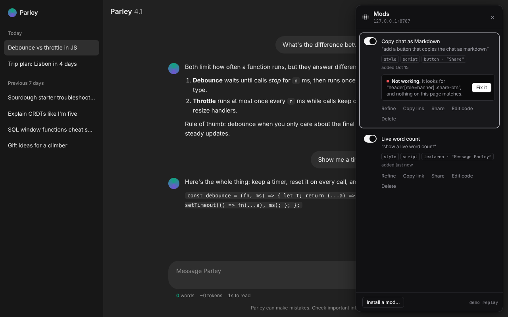
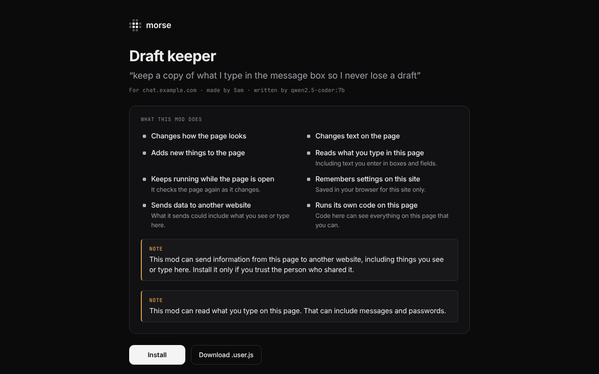
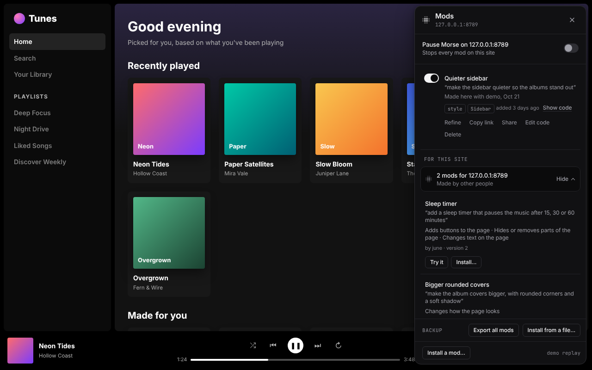
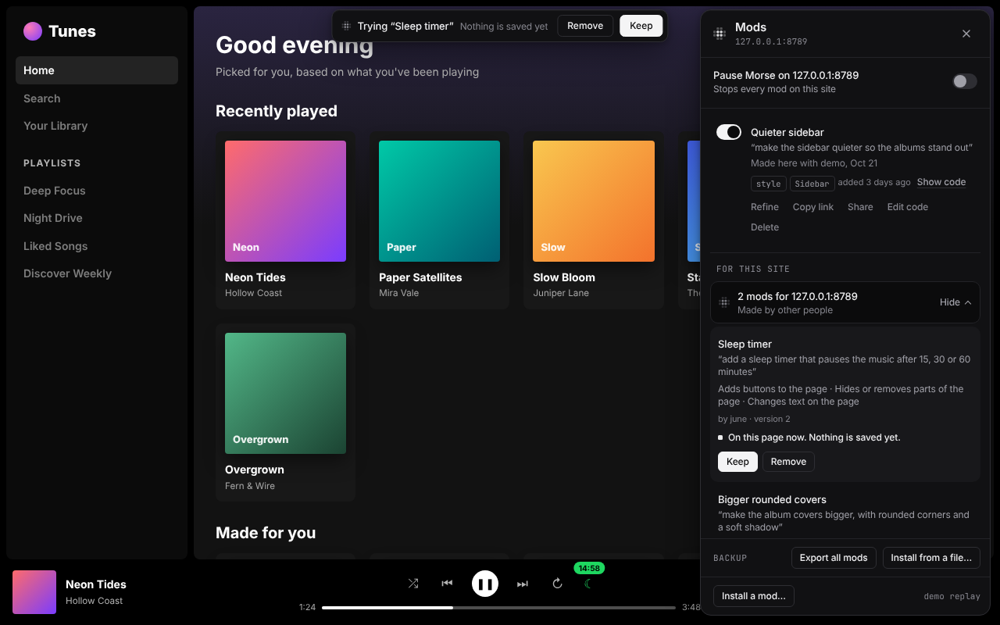
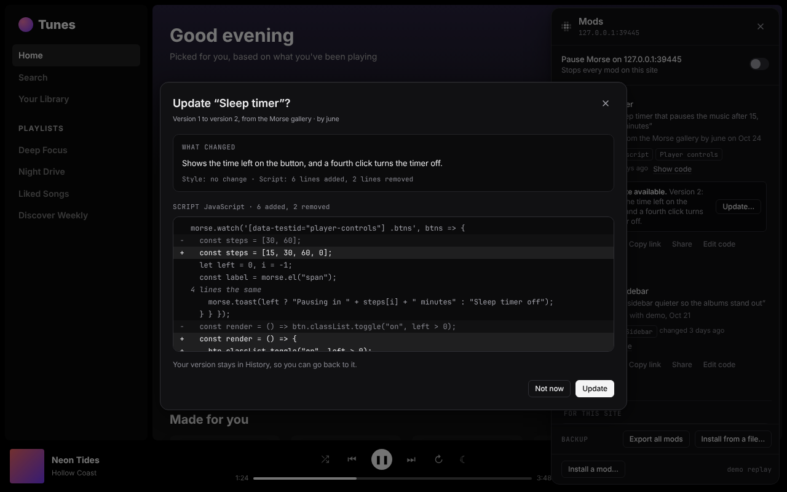
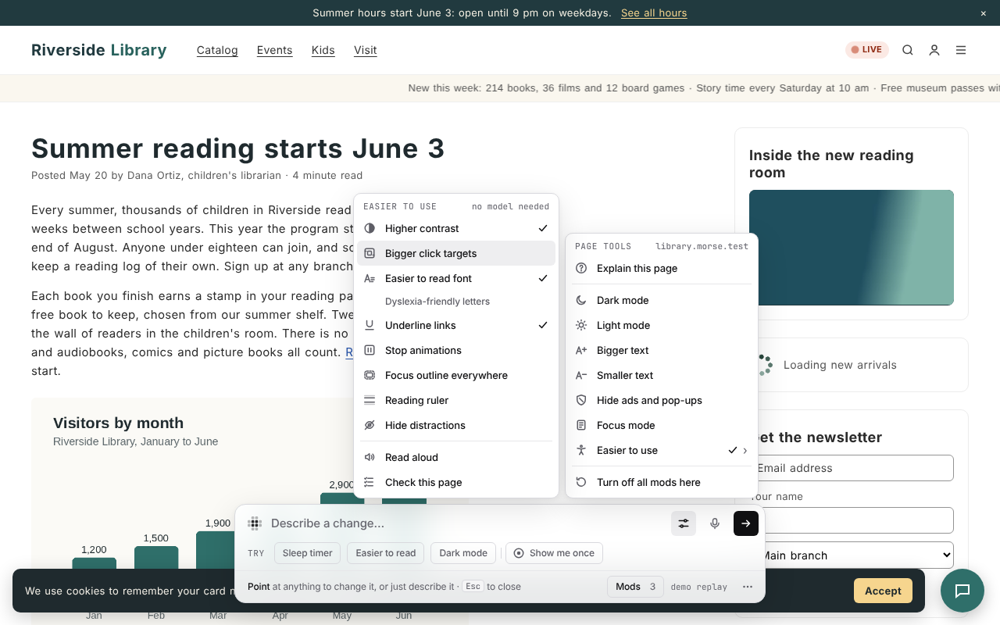
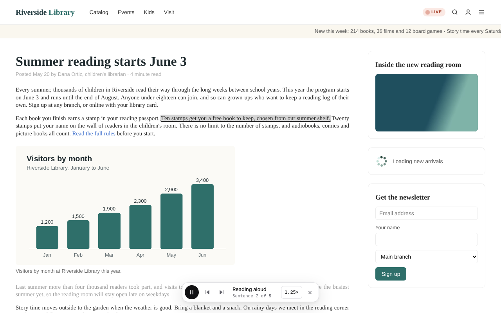
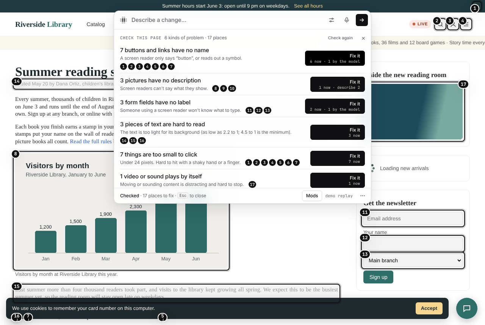
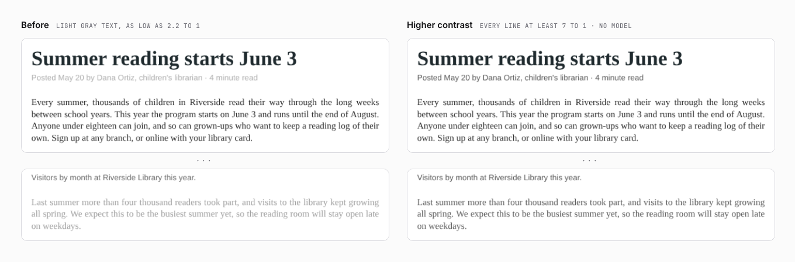

# ▦ Morse

**Morse lets you change any website or desktop app just by saying what you want, so the apps you use every day work the way you like.**

[](docs/launch/morse-demo.mp4)

*[Watch the 85-second demo](docs/launch/morse-demo.mp4). It was recorded from real runs: Claude Code wrote the sleep timer and the word count. More clips, and how they were made: [`docs/launch`](docs/launch/).*

Press a shortcut, point at something and say what you want: “add a sleep timer”, “hide the ads”, “make this text bigger”. Morse makes the change right there in the app while you watch. If you like it, save it.

A change you save is called a **mod**. Morse brings it back every time you open that site or app. You can turn a mod off at any time, or share it with a link.

Morse doesn't come with its own AI. It uses one you already have: Claude Code, Codex, or an API key. Most apps you use every day are websites, or desktop apps built from web pages (Slack, Spotify, Discord, VS Code), and Morse works in both. It's like Tampermonkey or Vencord, except you don't write the code.

```
press ⌥Space ─▶ point ─▶ "add a sleep timer" ─▶ ▦▦▦ the model writes the change ▦▦▦ ─▶ you see it ─▶ Save · Share
```


*Recorded automatically by Morse. To make this clip come out the same every time, the model's answers in it are played back from a file (see [Status](#status)). Everything else is real. The same steps with real Claude Code answers are in [`docs/screenshots/claude-code`](docs/screenshots/claude-code).*

## What works today (v0.2)

| | |
|---|---|
| **Point or describe** | Point at one thing to change it, or skip pointing and describe a change to the whole page |
| **Watch it happen** | What you pointed at turns into a grid of small squares while the model writes, then the grid sweeps away to show the change |
| **See it as it's written** | Changes to how things look show up while the model is still writing |
| **Fixes its own mistakes** | If the change doesn't work, Morse shows the model what went wrong and it tries once more |
| **Mods stay** | Saved for each site or app, and back every time you open it, even after a restart |
| **Undo and edit** | Every mod can be removed completely. If you read code, you can edit it too |
| **Keep improving it** | Ask for a follow-up (“make it smaller”) to change the same mod, step back with ⌘Z, bring back any of the last 20 versions, and fix a mod that stopped working with one click |
| **Share** | A before-and-after image, a short clip (desktop apps), a share link that carries the mod, a mod file, and a version that runs in Tampermonkey without Morse |
| **Websites** | A Chrome extension. With “Allow User Scripts” on, mods work even on sites with strict security settings |
| **Desktop apps** | `morse launch spotify` reopens the app with Morse connected. Morse never changes the app's files, so app updates don't break it |
| **Your model** | Claude Code or Codex (your own subscription, no API key), or an Anthropic or OpenAI API key. See [Models](#models) |
| **Edit tools** | Change things directly, no model needed: hide, move, resize, rename, recolor, change text size, duplicate. Page tools for dark or light mode, text size, hiding ads and focus mode. Capture something in one app and rebuild it in another |
| **Ask and find** | Ask about the app instead of changing it. You get a plain answer with numbered markers on what it means. Ask where something is and Morse tells you which menu to open. **Show me** walks you through the steps while you click. **Explain this page** sums up what the screen is for |
| **You stay in control** | One shortcut (⌥⇧0) turns off every mod on a page. Pause Morse on a site or everywhere. A mod that keeps crashing a page is held back. Before you install a shared mod, Morse says in plain words what it does. Back up all your mods to one file |
| **Show me once** | Do a task by hand once, then say “add a button that does this”, “do this when I press Ctrl+Shift+A” or “do this to every unread email”. Passwords are never recorded |
| **Easier to use** | Accessibility for any app, no model needed: higher contrast, bigger click targets, an easier to read font (and dyslexia-friendly letters), underlined links, no animations, a visible focus outline, a reading ruler, no distractions. Read aloud, Check this page with Fix it, and Describe this picture (the model writes a description for screen readers) |

## Screenshots

All captured by [`demo/shoot-extension.js`](demo/shoot-extension.js) and [`demo/shoot-desktop.js`](demo/shoot-desktop.js), using the real extension and the real desktop app connection.

### Desktop apps

| | |
|---|---|
|  **Point** at anything (⌥Space) |  **Say** what you want |
|  **Watch it happen**: a grid over what you pointed at, the code as it is written in the bar |  **Fixes its own mistakes**: the first try failed, so the error goes back to the model |
|  **Done**: save it, undo it, edit the code or share it |  **The new feature works** (sleep timer counting down) |
|  **Whole page**: the new look shows up while the model writes it |  Result |
|  **Mods panel** (⌥⇧M): turn mods on and off, share, edit, delete |  **Edit the code** |
|  **Share** |  **Quit and relaunch the app**: mods come back |


*The share image Morse makes: the same spot before and after, with the change outlined.*


### A real Electron app

[`demo/electron-app`](demo/electron-app) on a real Electron runtime, driven with real keyboard and mouse input ([`demo/shoot-electron.js`](demo/shoot-electron.js)). How to use Morse with desktop apps, and which apps can't work: [`docs/desktop.md`](docs/desktop.md).

| | |
|---|---|
|  **The bar** in Tunes, under its own menu bar (Ctrl+Shift+Space) |  **Working** on the player controls |
|  **Result**: a sleep timer (☾) |  The same request with **real Claude Code (haiku)** |
|  **VSCodium**, installed from its `.deb`: "make the status bar bigger" |  **Obsidian**'s AppImage, opened again: the ribbon it was asked to hide stays hidden |

### Finding and tracking desktop apps

| | |
|---|---|
|  **`morse apps`** lists what's installed and whether Morse can connect to it (rendered from the macOS fixture tree in [`demo/fake-installs.js`](demo/fake-installs.js); the container has no Mac) |  **`morse status`** from real sessions: windows, popups and app frames, mods on in each, and an app started with `--watch` waiting to come back |

- **`morse apps`** looks in `/Applications` and `~/Applications` (reads each `Info.plist`, checks for Electron Framework / Chromium Embedded Framework), on Windows in `%LOCALAPPDATA%\Programs`, Program Files, Roaming and Squirrel `app-<version>` folders, and on Linux on `PATH`, `/usr/share`, `/usr/lib`, `/opt`, snap and flatpak exports. Native apps (ChatGPT for Mac) are listed as "can't connect".
- **`morse launch vs code`** — names are fuzzy: `code`, `vscode`, `spot`, `discrod` all work.
- **Every place an app renders**: all windows, popups opened later, `<webview>`s, BrowserViews, and the app's own out-of-process frames (VS Code webviews). Third-party embeds, workers, DevTools and internal pages are skipped. Reloads, navigation and renderer crashes are followed; a mod saved in one window shows up in every window it matches.
- **Already open?** Morse says so in one sentence and offers `--restart` (AppleScript quit on macOS, WM_CLOSE then taskkill on Windows, SIGTERM on Linux). The choice is remembered per app in `~/.morse/apps.json`; `--no-restart` forgets it.
- **`--watch`** keeps waiting when the app quits and connects again when it's back. **`morse stop <app>`** (or Ctrl+C) disconnects: the bar and mods come off open windows and the app keeps running.

### Web (Chrome extension)

| | |
|---|---|
|  Point at a chat composer (the bar dodges your cursor) |  Working |
|  Live word count, on a site with strict security settings |  "add a button that copies the conversation as markdown" |
|  A cluttered news site |  The new look, applied while the model writes |
|  After |  Share |
|  A friend opens the share link (what it does, and its code, before install) |  …installs it, and gets the mod |
|  The Tampermonkey version running **without Morse** |  The toolbar popup: mods on this site and model settings |
|  Installed with “Allow User Scripts” on | |

### Voice, shortcuts and the bar

Captured by [`demo/shoot-bar.js`](demo/shoot-bar.js) from [`demo/bar-playground.html`](demo/bar-playground.html) (the real Morse bar, with a stand-in app and microphone).

| | |
|---|---|
|  **Hold ⌥Space to talk**: your words appear as you speak |  **Settings** (⌘, in the bar) |
|  **Change a shortcut**: Morse refuses ⌘Q, Alt+F4 and other keys that would cause trouble |  **Suggestions** for what you pointed at (Tab, ←/→) |
|  **`?`** shows the shortcuts you have |  **Esc** stops Morse. Nothing is left behind |

- **Voice.** Tap the mic, or hold the shortcut (tap opens Morse, hold talks). On websites, Chrome turns your speech into text. In desktop apps, the Morse helper does it, with your OpenAI key or with Whisper if it's installed on your computer (setup details: `OPENAI_API_KEY` or `"voice": { "openaiKey" }` in `~/.morse/config.json`, or `whisper-cli` / `whisper` on your PATH). Turn on “Send after a pause” in Settings to send when you stop talking.
- **Shortcuts** to open Morse, push to talk, open the Mods panel and show the Edit tools. Change them in Settings. Defaults: ⌥Space on macOS, Ctrl+Shift+Space on Windows and Linux (where Alt+Space opens the window menu, or KRunner on KDE). The extension's toolbar shortcut is Ctrl+Shift+Y (⌘⇧Y), so it never takes the in-page one. Settings live in `~/.morse/settings.json` (desktop) or Chrome sync (extension).
- **In the bar:** ↑/↓ for your past requests in this app, Shift+Enter for a new line, Esc or ⌘. to stop. When the bar closes, you are back where you were, and the app gets every key except your Morse shortcuts.

### Edit tools: change things directly, no model

Point at something and the Edit tools appear next to it. Press ⌘E (Ctrl+E) to use them from the keyboard: **H** hide, **M** move (drag or use the arrow keys; Shift keeps it straight or moves 10px), **R** resize, **T** edit text in place, **C** color (text, fill, border), **F** text size and weight, **D** duplicate, **⇧C** capture, **A** describe a change instead. Or just start typing to describe a change. Your edits are saved as one “Direct edits” mod with undo and redo (⌘Z / ⇧⌘Z), and it saves, shares and exports like any other mod. (For developers: [`core/edits.js`](core/edits.js) turns the edits into the same kind of code a model would write.)

| | |
|---|---|
|  The Edit tools, with the shortcut in every tooltip |  **T**: rename the headline in place |
|  **M**: move a pop-up out of the way |  **C**: recolor the masthead |
|  Page tools: hide ads, then dark mode, which leaves photos, videos and already-dark parts as they are |  **⇧C**: capture the masthead |
|  In a different app, pick it from the bar and the model rebuilds that look there | |

### Keep improving it: follow-ups, history, Fix it

A result isn't final. Type a follow-up under it ("make it bigger", "use icons instead") and Enter changes the same mod: the model gets the original request, the code as it is now and your follow-up, and writes the whole thing again. Enter with nothing typed saves it, and ⌘Z / Ctrl+Z steps back one version. Every saved mod keeps its last 20 versions; the Mods panel lists them under **History**, and clicking one brings it back. **Change** on any saved mod opens the bar on it.

When a saved mod stops working (its code fails, or what it looks for hasn't shown up after 5 seconds), its row says so in plain words, and **Fix it** sends the model what went wrong, the page as it is now and the old code. The panel also has search (once you have more than six mods), **Copy link**, and keys: ↑/↓ to move, Space to turn a mod on or off, Enter to change it.

Captured by [`demo/shoot-iterate.js`](demo/shoot-iterate.js) with the real desktop connector and the demo model.

| | |
|---|---|
|  A follow-up typed under the result: Enter changes it again, Save keeps it |  **History**: three versions; click one to bring it back |
|  The app changed under a saved mod: **Fix it** | |

### Ask and find: understand the app, not just change it

Same shortcut, same bar: ask a question instead of describing a change ("what does this button do?", "why is this greyed out?", "where do I change my password?"). The model decides which it is; a question gets a short, plain answer in the bar and numbered markers on what it's talking about (click a number to scroll there). If the thing is inside a closed menu, the answer says which menu to open. When the answer is a few clicks on this page, **Show me** walks through them one at a time, marking each step and waiting for *you* to click it. Morse never clicks or types for you. Follow-ups work ("and how do I undo that?"): the page's questions and answers are kept in memory, never saved. **Explain this page** in Page tools gives a five-line summary of what the screen is for. Captured by [`demo/shoot-ask.js`](demo/shoot-ask.js).

| | |
|---|---|
|  **Ask** what something does: an answer, and a marker on it |  **Find** a setting that lives behind a menu |
|  **Show me**: one step at a time, you do the clicking |  **Explain this page**, from Page tools |

### You stay in control

Captured by [`demo/shoot-control.js`](demo/shoot-control.js) driving the real extension.

| | |
|---|---|
|  **⌥⇧0** (Alt+Shift+0) turns every mod on the page off at once; the toast turns them back on |  **Before installing** a shared mod: what it does, in plain words, with a note when it sends data elsewhere or reads what you type. The code is folded below |
|  **Pause Morse on a site** from the Mods panel; every row says where the mod came from and has **Show code** |  The same from the toolbar popup, plus **Pause everywhere** |

- **Off switch.** A shortcut like the others (Settings → Shortcuts, default ⌥⇧0 / Alt+Shift+0). It takes every mod off the page at once. They stay off in that tab, even when you reload, until you press it again or click Turn back on. Nothing is deleted.
- **Pause.** "Pause Morse on <site>" in the Mods panel and the popup, "Pause everywhere" in the popup (the toolbar icon then says *off*), and in a terminal `morse pause [site|app]` / `morse resume`. Paused mods stay saved; every open tab and window follows at once.
- **Safe start.** If a page closes, crashes or reloads within seconds after a mod ran, three times in a row, Morse holds that mod back the next time and asks: *Keep it off* or *Turn it back on*.
- **A mod can't freeze or slow down the page.** A mod that keeps the page busy, keeps reacting to its own changes through the page, or adds too much is paused, and the Mods panel says *Paused because it was slowing this page down*, with **Turn back on** and **Fix it** (the model gets the reason). CSS that would hide the whole page is never applied. In a desktop app, a mod whose code never finishes (`while (true) {}`) is stopped within seconds, turned off, and the page reloads. Details under [How it works](#how-it-works).
- **What a mod does, before you install it.** Morse reads the mod's code ([`core/summary.js`](core/summary.js)) and lists what it changes and can do: *Changes how the page looks*, *Adds buttons to the page*, *Reads what you type in this page*, *Sends data to another website*, *Remembers settings on this site*, and so on. Things a mod adds itself, like a sleep timer's own label, don't count as changing the page. When in doubt, it mentions things rather than leaving them out. The share page, Install a mod… in the Mods panel and `morse install` all show it first, with the code below, and install only when you press Install. A web page can't install anything by itself: the share page's Install button opens Morse's own review, and only a click there installs.
- **Where it came from.** Each mod in the panel and popup says how it got there (made here with which model, your own edits, installed from a shared link and by whom, restored from a backup), with **Show code** next to it. `morse code <id>` does the same in a terminal.
- **Backups.** *Export all mods* and *Install from a file…* at the bottom of the Mods panel; `morse export --all [--out file]` and `morse install <backup file>`.

### Mods for this site: see what other people made

When you open Morse on a site that has mods in the [gallery](site/gallery.html), the empty bar says so (“2 mods for youtube.com”), and the Mods panel lists them under **For this site**: the title, the request, what it does in a few words, and who made it. **Try it** runs a mod on the page without saving anything; then **Save** keeps it and **Undo** takes it all away, the same as any change. **Install…** goes through the same review as a share link. When the gallery has a newer version of a mod you installed from it, its row says **Update available**, and **Update…** shows what changed (in words and line by line) before anything is replaced; your old version stays in History. Your own mods get **Submit to the gallery…** in the Share dialog, which opens GitHub with the mod and a short form filled in. Morse has no account or server of its own.

The list is read by the Chrome extension or the Morse helper, never by the page, and checked at most once a day. Turn it off with **Show mods others made** in Settings. Captured by [`demo/shoot-gallery.js`](demo/shoot-gallery.js).

| | |
|---|---|
|  **For this site** in the Mods panel |  **Try it**: on the page, nothing saved yet |
|  **Update…**: what changed in the newer version | |

### Easier to use: accessibility for any app

Some apps are hard to read, hard to click, or never stop moving. Page tools have an **Easier to use** group that changes that for the site or app you're on, at once and with no model. Morse makes each one itself ([`core/a11y.js`](core/a11y.js)) as a small mod: it stays on for that site, and clicking it again turns it off and puts the page back exactly as it was.

- **Higher contrast**: text darker, to at least 7 to 1 against its background; faint borders stronger; faded text back to full strength.
- **Bigger click targets**: buttons, links and fields at least 44 × 44 pixels. Links inside sentences stay as they are.
- **Easier to read font**: a plain sans-serif with a little more space between letters, words and lines, lines that stop at about 70 characters, no justified text. **Dyslexia-friendly letters** uses OpenDyslexic, Atkinson Hyperlegible or Lexend if they're on your computer, else Verdana. Nothing is downloaded.
- **Underline links**. **Stop animations**: animations jump to their end, video and sound that start by themselves pause, GIFs show their first frame. **Focus outline everywhere**: a ring you can see on any background when you use the keyboard. **Reading ruler**: a band that follows the pointer and dims the rest. **Hide distractions**: cookie bars, chat bubbles and sticky announcements, never the site's header or navigation.

**Read aloud** reads what you selected, what you pointed at, or the main text of the page, a sentence at a time, and marks the sentence it's reading. Play, pause, previous and next sentence, five speeds, <kbd>Esc</kbd> to stop. It uses your computer's own voices, so it works offline.

**Check this page** looks for common problems: pictures with no description, buttons and links with no name, form fields with no label, text too light to read (measured, not guessed), things too small to click, and video or sound that plays by itself. Every place gets a numbered marker, and each kind of problem a **Fix it** button. What Morse can work out itself is fixed at once and saved in one "Accessibility fixes" mod: a name from a tooltip, an icon or where a link goes, a darker color, a bigger size. What needs judgment becomes one precise request to the model, with the exact places in it, which you save or undo like any change.

**Describe this picture**: point at a picture and press the picture button in the Edit tools. The model says in a sentence or two what it shows, and **Save as alt text** keeps that for screen readers. This needs a model that can look at pictures: Claude Code, the Anthropic API or the OpenAI API (Codex says it can't). Checked once with real Claude Code (haiku) on the demo site's chart: "A bar chart titled “Visitors by month” for Riverside Library from January to June shows visitor counts rising each month: 1,200 in January, … 3,400 in June", in about 6 s.

Captured by [`demo/shoot-a11y.js`](demo/shoot-a11y.js) on [`demo/sites/a11y`](demo/sites/a11y/index.html), a library site with problems planted on purpose (the real Morse, a stand-in app with the demo model, speech recorded instead of spoken).

| | |
|---|---|
|  **Easier to use**, beside Page tools: three tools on |  **Read aloud**: the sentence being read is marked |
|  **Check this page**: 17 places, each with a marker, and Fix it |  **Higher contrast**, before and after |

### Show me once: do it by hand, Morse repeats it

Clicking the same things over and over? Choose **Show me once** (under the input in the empty bar, or in the ⋯ menu) and do the task by hand, once: click, type, choose, press keys. A small strip lists each step in plain words as you go: *Click “Archive”*, *Type “invoice” in “Search mail”*. **Stop** opens the bar with your steps. Then say what you want: “add a button that does this”, “do this when I press Ctrl+Shift+A” or “do this to every unread email”. Morse sends the steps to the model (in order, with what each thing is called and how to find it again) and the model writes a mod that does them for you, waiting for each thing to appear. Save, refine or undo it like any change.

- **Passwords and card numbers stay yours.** For a password field, or one marked for card details, the step says “(hidden)” and the value is never kept. The mod stops at that field and asks you to type it.
- **Only what you do, only here.** Morse records your own clicks and keys on this page while the strip shows. Not the page's own scripts, not other frames, not Morse itself. <kbd>Esc</kbd> cancels. Nothing is sent until you say what to do and press Enter.
- Steps come from [`core/showonce.js`](core/showonce.js) (plain words, names that survive a reload: ids, test ids, labels, then the words on a button) and [`runtime/src/64-show-once.js`](runtime/src/64-show-once.js). The kit gained `morse.waitFor`, `morse.type`, `morse.choose`, `morse.key` and `morse.sleep` for doing the steps.

Checked with real Claude Code (haiku) by [`evals/show-once.js`](evals/show-once.js) on the mail demo: “do this to every unread email” gave an **Archive unread** button that archived all 4 unread emails and kept the 6 read ones in 10 of 12 runs (the other 2 forgot to put the button on the page), about 10 to 25 s each; “do this when I press Ctrl+Shift+A” worked every time. Captured by [`demo/shoot-show-once.js`](demo/shoot-show-once.js).

| | |
|---|---|
|  **Show me once**, in the bar and the ⋯ menu |  **Recording**: each step as you do it |
|  **Stop**: say what to do with the steps |  **The result**, live: a button for every unread email |
|  **Done** for 3 unread emails |  A sign-in: the password is “(hidden)” |

## Status

Honest accounting of what was verified and how:

- **Verified end to end** (in a Linux container, Chromium 153): extension on three sites including a strict-CSP one; desktop connector via `morse launch` → CDP attach → inject → generate → self-repair → save → full app restart → mods re-applied; share link → install in a second browser profile; userscript export running standalone; clip recording to GIF/MP4. `npm test` covers the parser, every model backend (fake `claude` and `codex` on PATH, a fake Anthropic API), the Morse helper (pairing, auth, origins, cancel), the engine, share links, fuses, voice, the Edit tools and the helper kit (the kit and UI ones in real Chromium).
- **The main screenshots replay pre-written replies** from [`core/demo.js`](core/demo.js), a test fixture, so they come out the same every time. The same desktop flow was also run with **real Claude Code** (`claude` on the Claude subscription, model `haiku`): [`docs/screenshots/claude-code`](docs/screenshots/claude-code). It built a working sleep timer on the first try (no repair round needed) in about 15 s. Its "bigger album covers" change targeted `img` elements the demo app doesn't have, so that one did nothing visible: a small fast model guessing at markup. The extension was checked the same way: paired with `morse serve`, the popup's Test button, a full generation through the helper, and Stop killing the `claude` process mid-run.
- **Codex** isn't installed in the container, so it is only tested against a fake `codex` that prints both of its JSON output formats. **The Anthropic and OpenAI APIs** are tested against fake servers speaking their streaming protocols (the Anthropic one through the official SDK), not against the real endpoints.
- **A real Electron app** (Electron 45 on Linux): [`demo/electron-app`](demo/electron-app), a small music app with a native menu, a sandboxed preload with context isolation, an `app://` UI, a `<webview>` and a second `file://` window, packaged the way apps ship (unpacked and as `app.asar`). Verified with real X keyboard and mouse input: `morse apps` finds it, `morse launch` → hotkey → point → change (test model, and once real Claude Code haiku) → Save → quit with the app's Ctrl+Q → `morse launch` again, mod back → Mods panel → second window and webview get Morse → `morse status` → `morse stop`; `morse attach --port` to a copy running as a normal user with Chromium's sandbox fully on; and the same app with its fuses locked down. [`tests/electron.test.js`](tests/electron.test.js) runs this on every `npm test` when an Electron runtime and a display are there. Details and the apps that can't work: [`docs/desktop.md`](docs/desktop.md). The older screenshots above use a Chromium app window; multi-window edge cases (crashes, kill and restart, `--restart`) are still tested against the fake Chromium app ([`demo/fake-app.js`](demo/fake-app.js), [`tests/desktop.test.js`](tests/desktop.test.js)). Not tested: Slack, Discord, Microsoft's VS Code or Spotify, macOS and Windows (AppleScript and taskkill quitting, `.app` bundles, Squirrel installs, Windows process listing), Wayland.
- **Tested on real apps and websites** with Claude Code (haiku), using the real hotkey, mouse and keyboard ([`docs/desktop.md`](docs/desktop.md#tested-on)):
  - **Desktop, Linux:** VSCodium 1.140 (`.deb`), Obsidian 1.14.5 and Joplin 3.7.21 (AppImages). `morse apps` finds them, `morse fuses` reports them, `morse launch` opens them. "Make the status bar bigger" in VSCodium, "hide this ribbon" in Obsidian and "hide this button" (Synchronize) in Joplin each worked in 6 to 13 seconds and came back after quitting and reopening the app. Getting there needed six fixes (listed in the doc): the bar didn't start in VS Code at all, two of the apps weren't found, Obsidian's AppImage and Joplin quit on start, and AppImage changes wouldn't have come back.
  - **Websites, the built extension in Chromium 153, paired with `morse serve`:** pypi.org, nodejs.org, pkg.go.dev, rubygems.org, gitlab.com and hub.docker.com. Each change was saved, then the page reloaded. Worked and came back: a back-to-top button on PyPI (strict rules for scripts, "Allow User Scripts" on) and on GitLab, bigger code examples on pkg.go.dev, bigger download numbers on RubyGems (the first try changed nothing; the second worked), bigger dark code blocks on Docker Hub. Partly: on GitLab "hide this project information box" hid the description in the box, not the box. Failed: on the Node.js docs, "hide the left sidebar" blanked the whole page twice (the model hid a wrapper around the docs too); Undo puts it back. The changes took 8 to 13 seconds each, from Enter to seeing them.
  - **"Allow User Scripts" off:** on PyPI, whose rules block added code, Morse's code couldn't run; the model's second try was a look-only arrow that doesn't scroll (32 s). On GitLab, whose rules allow it, the button worked anyway.
  - **Not reachable from the test machine:** Wikipedia, Hacker News, MDN, YouTube, BBC and GitHub's web pages (its network refuses them), so they weren't tried.

## Install

You need Node 22 or newer. To record clips of your changes, you also need `ffmpeg`.

```bash
npm install -g morse-cli   # adds the morse command (about 700 KB)
morse setup                # choose Claude Code, Codex or an API key
morse doctor               # checks that the model answers
```

Until the first npm release, install from GitHub instead: `npm install -g github:sam-siavoshian/RRAA`.
To try it without installing, `npx morse-cli setup` works too.

From a clone, for working on Morse itself:

```bash
git clone https://github.com/sam-siavoshian/RRAA morse && cd morse
npm install && npm run build   # builds the Chrome extension into dist/extension
npm link                       # so morse runs this checkout
```

**Desktop apps:**

```bash
morse apps                       # what's installed, and whether Morse can connect
morse launch spotify --restart   # or "vs code", slack, discord, notion, obsidian, a path…
morse status                     # connected apps, their windows, ports and mods
morse stop spotify               # disconnect; the app keeps running
morse mods
morse pause                        # stop every mod everywhere (morse resume to undo)
morse export --all                 # back up every mod to one file
```

`launch` reopens the app with Morse connected. Keep the terminal open while you use it.

**Websites (Chrome):**

1. Open `chrome://extensions` and turn on **Developer mode**.
2. Click **Load unpacked** and choose the folder `morse extension` prints (`dist/extension` in a clone).
3. Open Morse's details and turn on **Allow User Scripts**. Mods that only change how a site looks work without it. Mods that add buttons or features need it on some sites.
4. The Morse settings page opens the first time. Connect a model there: run `morse serve` and type its code, or paste an Anthropic API key (see [Models](#models)).
5. Open any page and press **⌥Space** (Ctrl+Shift+Space on Windows and Linux).

## How to use

1. Press **⌥Space** (Ctrl+Shift+Space on Windows and Linux). The Morse bar opens.
2. Point at the thing you want to change and click it. To change the whole page, skip this step.
3. Describe what you want, like "add a sleep timer" or "make this easier to read", and press Enter. Or hold ⌥Space and say it.
4. Watch the change happen. Click **Save** to keep it, or **Undo** to remove it.
5. Press **⌥⇧M** to open the Mods panel. There you can turn mods on and off, share them, edit their code or delete them.

Small changes don't need the model. Point at something and use the Edit tools that appear next to it, or click the Page tools button in the bar for dark mode, bigger text and more. Press `?` in the bar to see every shortcut.

## Models

Morse doesn't come with a model. It uses one you already have.

| | What you need | How Morse uses it |
|---|---|---|
| **Claude Code** | The `claude` command, signed in with your Claude plan | Runs `claude -p` with every tool turned off, no MCP servers, no saved session, in an empty folder under `~/.morse`. It can only write text back. |
| **Codex** | The `codex` command, signed in | Runs `codex exec` in a read-only sandbox, in an empty folder |
| **Anthropic API** | An API key | Uses `claude-opus-5-5` at low effort unless you choose `claude-sonnet-5-5` or `claude-haiku-5-5`. If Claude declines a request, Morse tells you in plain words. |
| **OpenAI API** | An API key (or any OpenAI-compatible server, with `--base-url`) | Chat completions, streamed |

On a computer, Morse uses the first one it finds, in that order. To choose yourself:

```bash
morse model                                   # which model Morse will use
morse config --provider claude-code --model haiku    # opus · sonnet · haiku
morse config --provider anthropic --anthropic-key sk-ant-…
morse config --provider openai --openai-key sk-…
morse config --provider auto                  # let Morse choose again
morse doctor                                  # what's installed, plus a real test call
```

Keys are saved in `~/.morse/config.json`, which only you can read. Morse also reads `ANTHROPIC_API_KEY` and `OPENAI_API_KEY`.

**In Chrome** there are two ways to connect a model. Pick one in the toolbar popup:

- **Morse helper** (for Claude Code, Codex, or keys kept on your computer). Run `morse serve`. It shows a 6-character code. Type the code into the popup and click Pair. `morse pair` shows a new code, and `morse unpair` signs every browser out. The helper only listens on 127.0.0.1:7457, only answers Chrome extensions (and local tools like curl, which send no Origin), and needs the token it gave out at pairing. When you press Stop or close the tab, the model on your computer stops too.
- **Anthropic API key (nothing to install).** Paste a key in the popup and pick a model. The key stays in this browser's extension storage, and requests go straight from the extension to Anthropic.

The popup's **Test the model** button sends a small real request and shows the reply.

## How it works

```
                 ┌────────────── the app (Chromium renderer) ──────────────┐
                 │  runtime/runtime.js   picker · bar · effect · panel     │
                 │  core/kit.js          `morse` helpers mods run against  │
                 └──────────────▲───────────────────────────▲──────────────┘
         content script + port  │                           │  CDP binding + Runtime.evaluate
                 ┌──────────────┴─────────┐   ┌─────────────┴──────────────┐
                 │ extension/background.js │   │ daemon/connector.js        │
                 │ chrome.userScripts       │   │ morse launch / attach      │
                 └──────────────┬─────────┘   └─────────────┬──────────────┘
                                │  daemon/bridge.js          │  daemon/harness.js
                                │  (morse serve, 127.0.0.1)──┤  claude -p · codex exec
                                └────────── core/ ──────────┘
                     engine.js (stream → live CSS → run JS → repair)
                     prompt.js · parse.js · providers.js (Anthropic SDK / OpenAI / helper)
                     mod.js (format, share links, userscript export)
```

- **One runtime, two hosts.** The same `runtime.js` runs in websites (extension) and desktop apps (CDP); only the transport differs.
- **No patching.** On the web, mod JS runs through `chrome.userScripts`, so it works on strict-CSP sites. On the desktop, `morse launch` relaunches an Electron app with `--remote-debugging-port` and attaches over CDP; app files, code signatures and ASAR integrity stay intact.
- **Live and reversible.** CSS is applied while the model streams it (complete rules only). Every element, listener, timer and observer a mod creates is tracked, so turning it off removes all of it.
- **Guards, so a mod can't hurt the page.** Before anything runs, [`core/guard.js`](core/guard.js) refuses code that would obviously break the page (CSS hiding `html`, `body` or `*`, `pointer-events: none` on the page, a `while (true)` with no way out, reloading or leaving the page when you didn't ask) and gives the model one more try with what was wrong. While a mod runs, [`core/kit.js`](core/kit.js) times every callback it hands Morse, and the `setTimeout`, `setInterval`, `requestAnimationFrame` and `MutationObserver` it uses directly: over 200 ms of every second for 3 seconds, one burst over a second, more than 1,000 new matches a second for 3 seconds (a feedback loop through the page), an observer called back over 250 times in a second, or more than 20,000 new elements in a second, and the mod is paused and turned off with the reason saved (`mod.paused`). `every()` and `setInterval` run at most every 100 ms; changes a mod makes never trigger its own watches or observers; only its first few errors reach the console. This costs about 2 µs per callback and nothing measurable for watches (30 watch mods on a streaming chat: same main-thread time as without guards).
- **Frozen pages.** Code that never returns can't be stopped from inside the page. On the desktop, [`daemon/guard.js`](daemon/guard.js) pings each page that runs mod code once a second; after 4 seconds without an answer (6 once the mod's code has started), it interrupts the script over CDP (`Runtime.terminateExecution`), asks the kit whose code was running, turns that mod off and reloads the page. Pages where no mod code ran are never interrupted. In the extension only a debugger could interrupt a page, and Morse doesn't ask for that permission. There, a saved mod with a loop that has no way out never starts, a mod whose code doesn't finish within 4 seconds of starting is turned off so the next load is clean, and a freeze later on is left to Chrome's *Page unresponsive* dialog and safe start.
- **The `morse` kit keeps mods short and robust.** `morse.watch(selector, fn)` survives React re-renders; `morse.el(...)` creates elements that are tracked for undo; errors inside callbacks are captured and fed back to the model. Short, concrete API → fewer tokens, fewer mistakes.
- **Context, not the whole DOM.** The model gets the picked element's trimmed HTML, a stable selector that avoids hashed class names, its ancestors, a capped page outline (landmarks, controls, menu buttons, tabs, settings links and what sits inside closed menus), and the theme colors. Small prompts keep answers fast.
- **Mods are data.** A mod is a JSON document (prompt, match, CSS, JS). Share links carry it in the URL fragment, so no server ever sees it.

## Where REA fits

[REA (Reverse Engineer Anything)](https://github.com/morluto/rea) is a read-only investigation toolkit for coding agents: it analyzes Electron/JS bundles statically, reads Electron fuses, observes runtime execution over CDP, and drives Ghidra/Hopper/IDA/Frida for native code. It deliberately never modifies a target and is built for careful evidence, not latency, so it is the wrong tool for Morse's instant loop. Morse borrows its approach where it helps:

- **Now:** the Electron fuse check (`daemon/fuses.js`, a reimplementation of REA's `inspect_electron_fuses`) before relaunching an app.
- **Next:** a one-time "app profile" pass with REA's static JS analysis (modules, IPC channels, routes) and `inspect_web_event_listeners`, cached and fed to the model as context for requests that need the app's *logic*, not just its DOM ("make shuffle actually random").

## Security model

Mods are code running inside apps you're signed into, so:

- The model is told not to use the network, eval, or external scripts, but **that is not enforced yet** (see roadmap). Before a shared mod is installed, Morse says in plain words what its code can do (sending data elsewhere and reading what you type get a clear note) and shows the code; imported mods say where they came from. The summary is pattern matching, not a guarantee, so it errs on the side of mentioning things and flags code that builds code while it runs.
- One key (⌥⇧0) turns every mod on a page off; Morse can be paused per site or everywhere; a mod that keeps crashing a page is held back on the next load; a mod that slows down, freezes or hides the page is paused (see Guards above).
- Mods run in the renderer only. They get no Node/Electron APIs.
- Morse's own UI runs in an isolated JS world (a content script on the web, a CDP isolated world on desktop), so the app's or website's scripts can't reach Morse's host API: your prompt history, the clipboard, other sites' mods, exports or your model. Mod code runs in the page's main world, because it needs the page's own objects. Host requests are answered for the page that asked.
- `morse launch` opens a debugging port on 127.0.0.1. While it's open, **any local process can attach to that app**, which is the same trust level as anything else running as you, but worth knowing. Quit the app normally to close it. Morse picks a free port, drops any `--remote-debugging-address` you pass, checks the port can't be reached from this machine's other addresses, and won't connect if what answers isn't the app it started (process id, then user agent).
- Share links carry the mod in the URL fragment, which browsers never send to a server.
- Page text goes to the model, so a page can try to prompt-inject it. That's one reason generated code is always shown, reversible, and never silent, and why Claude Code and Codex run with no tools, no MCP servers and an empty working folder: the model can only write text.
- The Morse helper (`morse serve`) binds to 127.0.0.1 only, refuses web-page origins and non-loopback Host headers, and serves completions only to a browser that paired with a one-time code. Tokens are stored hashed.

## Roadmap

- **Days:** tune the prompt/kit with Claude Code and Codex on real Spotify, Slack, Discord, VS Code, Notion, ChatGPT; tray app with a global hotkey (Tauri) so `morse launch` isn't needed; clip recording in the extension (`tabCapture`).
- **Weeks:** REA-powered app profiles for logic-level changes; mod auto-repair when an app update breaks selectors; a static-site gallery of shared mods; enforce the no-network rule with a CSP/proxy for mod code.
- **Native apps (honest version):** macOS Accessibility / Windows UI Automation can read and drive native UIs and draw overlays *on top*, not add buttons *inside* Finder. That's "overlay + automation" mods, a v3 item.

## Site

[`site/`](site/) is the public website: static HTML, CSS and ES modules, no build step. The Pages workflow ([`.github/workflows/pages.yml`](.github/workflows/pages.yml)) publishes it laid out like the repo (`/site/` for the site, `/share/install.html` for share links, `/site/mods/index.json` for the gallery list); `npm run pages` builds the same thing into `dist/pages` and fails on a broken link.

- **`site/index.html`**: the landing page, with an in-browser demo of the pixel effect (simulated, no model runs).
- **`site/gallery.html`**: example mods from [`site/mods/`](site/mods/) (`index.json` lists them; each `*.morse.json` is a normal mod). Search, filter by app, read the code, then **Install in Morse** (a share link built exactly like `encodeShare` in `core/mod.js`), **Download for Tampermonkey** or **Copy link**. The mods were written by hand against each app in October 2026, so a selector may need a refresh.
- **`site/radar.js`**: the radar mark (OpenCode's 4×4 pixel spinner) as a tiny module.
- **`share/install.html`** uses the same styles.

Run it locally with `npm run demo:serve` and open `http://127.0.0.1:8787/site/`. Screenshots (1440×900 and 390×844, dark and light) are in [`docs/site/`](docs/site/).

To add a mod to the gallery, export it (`morse export <id>` writes a `.morse.json`), drop it in `site/mods/`, and add an entry to `site/mods/index.json`.

Morse reads the same list for **Mods for this site** ([`core/gallery.js`](core/gallery.js), fetched and cached by [`core/gallery-host.js`](core/gallery-host.js)). Each entry needs `match` (the mod's hosts and app, so Morse can tell which pages it is for) and `version`; raise `version` and add a one-line `changes` when you update a mod, and people who installed it see Update available. Entries with `"demo": true` are for the demo sites (`npm run demo:serve` serves the list at `http://127.0.0.1:8787/site/mods/index.json`, which Morse uses on those sites) and don't show on the gallery page. To read another list, set `MORSE_GALLERY_URL` or `"gallery": { "index": "…" }` in `~/.morse/config.json` (desktop), or `morse.gallery.url` in the extension's local storage.

## Repo layout

```
core/        shared brain: engine, prompt, parser, model providers, mod format, helper kit, demo replay (tests)
runtime/     the in-app UI and effect (src/ bundled into one file, injected everywhere)
extension/   Chrome MV3 host
daemon/      desktop connector + CLI (CDP, app finder/launcher, ports, status, fuses, clip recorder, mod store),
             the Morse helper for the extension, Claude Code / Codex runners
share/       static install page for share links
site/        public website: landing page, mod gallery, example mods
demo/        demo apps + the scripts that produced every screenshot
```

Regenerate the screenshots: `npm run demo:serve &` then `DISPLAY=:99 npm run screenshots` (replayed replies; add `MORSE_PROVIDER=claude-code MORSE_MODEL=haiku SHOTS=docs/screenshots/claude-code` to `demo/shoot-desktop.js` for a real model) (needs Xvfb, Chromium/Playwright, ffmpeg; set `MORSE_HOME` to a scratch dir). The Edit tools' are `DISPLAY=:99 node demo/shoot-godmode.js`; `morse apps` / `morse status` are `node demo/shoot-apps.js`.

## Contributing

```bash
npm ci
npm run check      # build, node --check on every JS file, the runtime bundle (no top-level name declared twice), every file the extension references is in dist/extension
npm test           # everything that runs headless (Playwright, installed globally, for the browser tests)
npm run test:ui    # the tests that need a display (the built extension), under xvfb-run if there's no $DISPLAY
```

CI (`.github/workflows/ci.yml`) runs all three on every push and pull request. Tests are safe to run in parallel, several checkouts at once included: each test file gets its own `MORSE_HOME` (never your `~/.morse`), every server and debugging port is picked by the OS, and tests wait on real conditions rather than sleeping. New tests should use `tests/helpers/` (`home.js` first, then `net.js`, `wait.js`, `browser.js`, `keys.js` for the platform's default hotkeys, `demo-server.js`). `MORSE_TEST_TIMEOUT_SCALE=2` doubles every timeout on a slow machine.


## Releasing

The version lives in `package.json` only; the build writes it into the extension's manifest, and `morse --version` prints it. See [CHANGELOG.md](CHANGELOG.md).

- **npm:** `npm publish` (the `prepare` script builds the extension that ships inside the package, also for installs from GitHub).
- **Chrome Web Store:** `npm run package:extension` makes `dist/morse-extension-<version>.zip`. The listing text, permission notes and screenshots are in [`docs/store/`](docs/store/).

[Privacy policy](docs/privacy.md) · [Contributing](CONTRIBUTING.md) · [Changelog](CHANGELOG.md) · MIT licensed.
