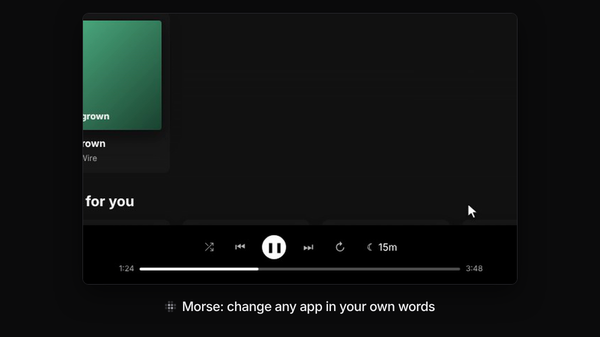

# ▦ Morse

**Morse lets you change any website or desktop app just by saying what you want, so the apps you use every day work the way you like.**

*[Watch the 85-second demo](docs/launch/morse-demo.mp4), recorded from real runs: Claude Code wrote the sleep timer and the word count.*

Press a shortcut, point at something and say what you want: “add a sleep timer”, “hide the ads”, “make this text bigger”. Morse makes the change right there while you watch. A mod is a change you saved. Morse brings it back every time you open that site or app.

<!--
  Contributors: keep this README short. It is the 30-second version.
  - Put the detail of a feature (how to use it, screenshots, limits) in a page in docs/
    and list that page in docs/README.md. Developer detail goes in docs/dev/.
  - For a new feature, add one row to "What you can do" below: a name, one plain line,
    and a link to its docs page. Nothing else.
  - Keep "Status" honest and in step with docs/desktop.md and docs/launch/README.md.
  - Words follow docs/WRITING.md. `npm test` checks every link (tests/docs.test.js).
-->

## Install

You need [Node](https://nodejs.org) 22 or newer. Full steps, and what to do when something goes wrong: [Getting started](docs/getting-started.md).

**Websites (Chrome)**

1. Get Morse: `npm install -g morse-cli` (until the first npm release: `npm install -g github:sam-siavoshian/RRAA`).
2. Open `chrome://extensions`, turn on **Developer mode**, click **Load unpacked** and choose the folder `morse extension` prints. The welcome page opens.
3. In Morse's details, turn on **“Allow User Scripts”**, so mods that add buttons or features can run.
4. Connect a model: the welcome page shows one command, `morse setup --pair <code>`. Paste it in a terminal. It finds Claude Code or Codex, checks that it answers, and the page connects by itself. Then press **⌥Space** (Ctrl+Shift+Space on Windows and Linux) on any page.

**Desktop apps (Spotify, Slack, Discord, VS Code…)**

1. Get Morse as in step 1 above, then run `morse setup` to choose your model.
2. `morse apps` shows which of your apps Morse can connect to.
3. `morse launch spotify` opens the app with Morse connected. Keep the terminal open.
4. In the app, press **Ctrl+Shift+Space** (⌥Space on a Mac), point at something and say what you want. More: [Desktop apps](docs/desktop.md).

To work on Morse itself from a clone, see the [developer guide](docs/dev/README.md#set-up-a-checkout).

## What you can do

| | | |
|---|---|---|
| **Describe a change** | Point at something, or at nothing for the whole page, and say what you want. You see it change while the model writes. | [Changing things](docs/changing-things.md) |
| **Keep improving it** | Ask for a follow-up (“make it smaller”), step back, or bring back any of the last 20 versions. | [Changing things](docs/changing-things.md#keep-improving-it) |
| **Voice** | Hold the shortcut and talk instead of typing. | [Changing things](docs/changing-things.md#voice) |
| **Edit tools** | Hide, move, resize, rename, recolor or copy something yourself. No model, no waiting. | [Edit tools and Page tools](docs/edit-and-page-tools.md) |
| **Page tools** | Dark or light mode, text size, hide ads and pop-ups, focus mode. One click each. | [Edit tools and Page tools](docs/edit-and-page-tools.md#page-tools) |
| **Ask and find** | Ask what something does or where a setting is. **Show me** walks you through the clicks. | [Ask and find](docs/ask-and-find.md) |
| **Show me once** | Do a task by hand once, then turn it into a button, a shortcut, or “do this to every one”. | [Show me once](docs/show-me-once.md) |
| **Easier to use** | Higher contrast, bigger click targets, an easier font, Read aloud, and Check this page with Fix it. | [Easier to use](docs/easier-to-use.md) |
| **Mods** | Turn mods on and off, share them with a link, try mods other people made, and fix one when a site changes. | [Mods](docs/mods.md) |
| **Your controls** | One shortcut turns every mod off. Pause Morse on a site. A mod that slows down, freezes or keeps breaking a page is stopped. Back up everything to one file. | [Your controls](docs/your-controls.md) |
| **Your style** | One look on every site and app: your font, bigger text, calmer pages, colors that are easier to tell apart. Say it once, ending with “everywhere”. | [Your style](docs/your-style.md) |
| **Desktop apps** | `morse launch spotify` opens the app with Morse connected. The app's own files never change. | [Desktop apps](docs/desktop.md) |

## Which models work

Morse has no model and no account of its own. It uses one you already have, and `morse setup` finds it.

| Model | What you need |
|---|---|
| **Claude Code** | The `claude` command, signed in with your Claude plan |
| **Codex** | The `codex` command, signed in |
| **Anthropic API key** | A key from console.anthropic.com |
| **OpenAI API key** | A key from platform.openai.com, or another server that works the same way |

How to choose one, and what each can do: [Models and setup](docs/models.md).

## Privacy

There is no Morse server. What you point at and what you ask go only to the model you chose, and only when you ask (or turn on automatic fixes). Your mods stay on your computer.
More, including what mods can do: [Privacy and safety](docs/privacy-and-safety.md) and the [privacy policy](docs/privacy.md).

## Status

Version 0.2, not released yet ([changelog](CHANGELOG.md)). What was checked for real, and what wasn't:

**Verified**

- **Websites:** the Chrome extension on three sites, one with strict security settings, in Chromium on Linux. Share links installed in a second browser profile; the Tampermonkey version runs without Morse.
- **Desktop apps:** a real Electron app built for testing (Electron 45 on Linux, with a menu bar, a locked-down preload, an embedded page and a second window, packed the way apps ship), driven with real keyboard and mouse: launch, change, save, quit, launch again, and the mod is back. Fuses locked down and Chromium's sandbox on: Morse still connects.
- **Claude Code (haiku)** as the model: the demo video, the Electron app, Describe this picture, Show me once (10 of 12 runs), and 55 everyday requests on 6 demo apps, 3 runs each: 163 of 165 worked ([evals](evals/README.md)).
- `npm test` covers every model connection against stand-ins, the Morse helper, the engine, sharing, and the UI in real Chromium.

**Not verified yet**

- Real Spotify, Slack, Discord or VS Code installs, macOS, Windows and Wayland. Apps that aren't built from web pages (Finder, most system apps) can't work. See [Desktop apps](docs/desktop.md#which-apps-cant-work-and-why).
- **Codex** is only tested against a stand-in `codex` command, and **the Anthropic and OpenAI APIs** only against stand-in servers.
- **Mods can do anything the page can.** The model is told not to send data anywhere, but nothing stops it yet. Morse says what a shared mod does before you install it.
- The extension isn't in the Chrome Web Store, and there is no tray app: on the desktop, you start apps with `morse launch`.
- Most screenshots replay pre-written answers so they come out the same every time; one set uses [real Claude Code](docs/screenshots/claude-code). How each part was checked: [Testing](docs/dev/testing.md#what-was-verified-and-how).

## More

[Docs](docs/README.md) · [Contributing](CONTRIBUTING.md) · [How Morse works](docs/dev/architecture.md) · [Privacy policy](docs/privacy.md) · [Changelog](CHANGELOG.md) · [Launch videos](docs/launch/README.md) · MIT licensed
