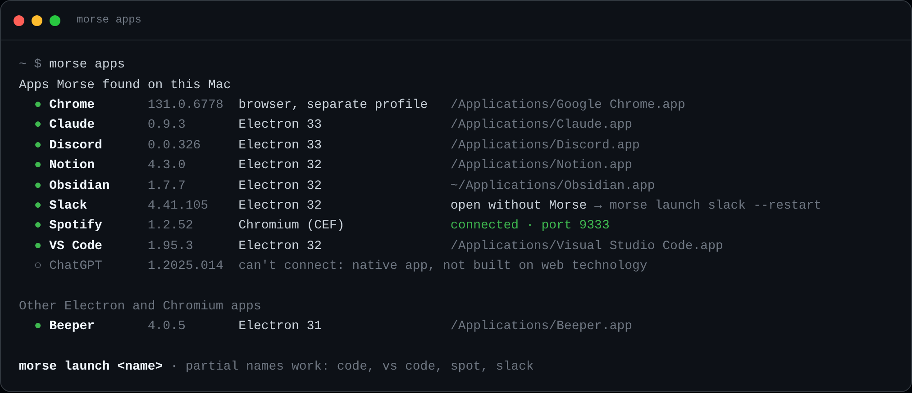
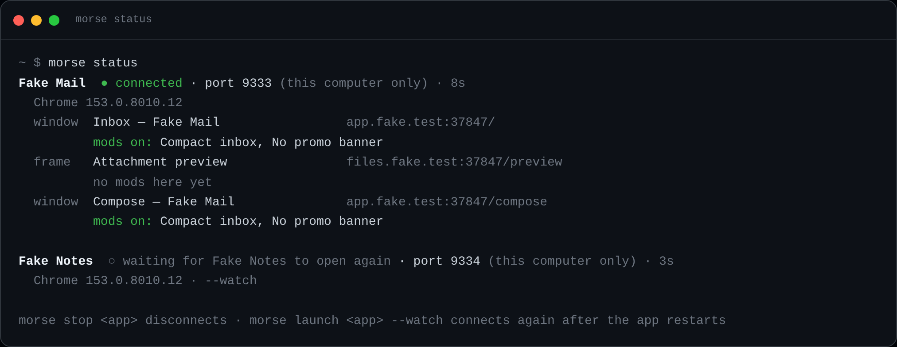
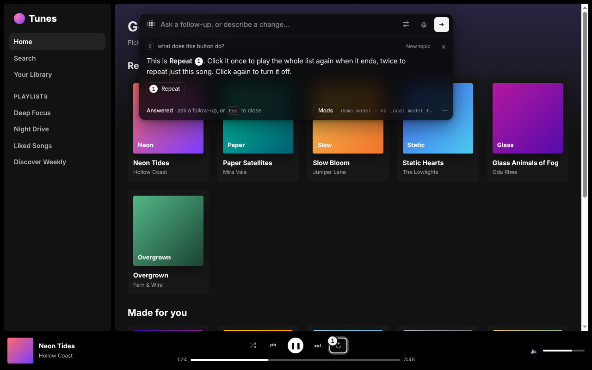
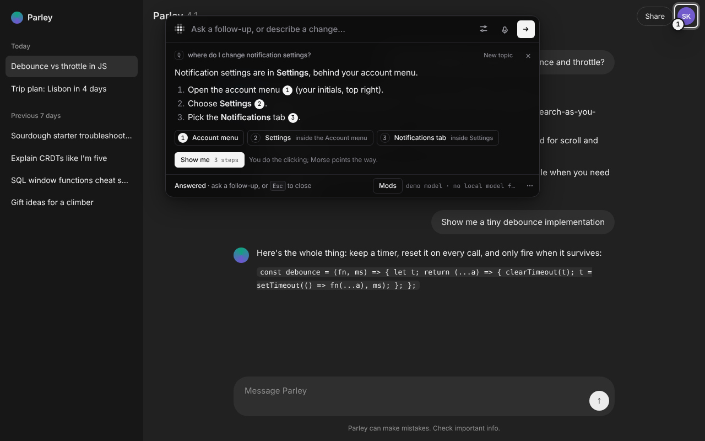
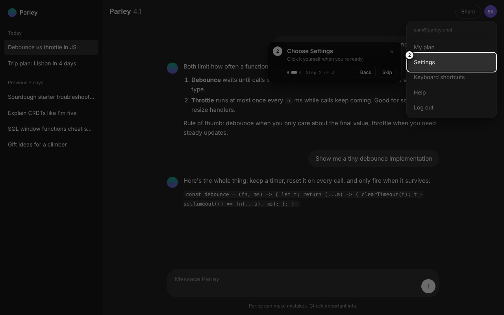
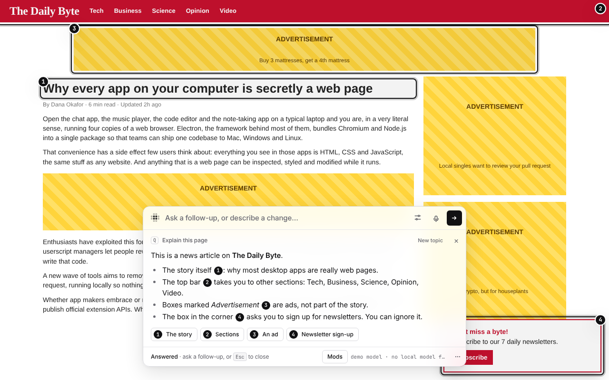

# ▦ Morse

**Customize any app in one sentence.** Press a hotkey, point at something, say what you want. Your model (Claude Code, Codex, or an API key) writes the change and Morse applies it to the running app, live, while you watch.


*Recorded automatically by Morse. The model in this clip is a replay of pre-written replies, so the clip is reproducible (see [Status](#status)); everything after generation (streaming, injection, self-repair, recording) is the real pipeline. The same flow with real Claude Code output is in [`docs/screenshots/claude-code`](docs/screenshots/claude-code).*

Most software you use every day is a web app or an Electron app: Chromium plus JavaScript. Morse injects a small runtime into those apps, sends what you pointed at and what you said to your model, and runs the CSS/JS it writes back. It's Tampermonkey/Vencord/Spicetify, except you don't write the script.

```
press ⌥Space ─▶ point ─▶ "add a sleep timer" ─▶ ▦▦▦ the model streams CSS+JS ▦▦▦ ─▶ applied live ─▶ Keep · Share
```

## What works today (v0.1)

| | |
|---|---|
| **Point or describe** | Hover-highlight picker, or skip pointing and describe a page-wide change |
| **The magic moment** | The target dissolves into a contribution-graph grid; the model's tokens rain through it as glyphs; the grid sweeps away to reveal the change |
| **Live CSS** | CSS is applied *while the model is still writing it* (complete rules only) |
| **Self-repair** | If the generated JS throws, Morse shows the model the error and retries once |
| **Persistent mods** | Saved per site (web) or per app (desktop), re-applied on reload and on app restart |
| **Undo / edit** | Every mod is fully reversible (all elements, listeners, timers, observers are tracked) and editable |
| **Share** | Before/after share card (1200×675), auto-recorded GIF + MP4 clip (desktop), share link with the mod in the URL fragment, `.morse.json`, and a `.user.js` that runs in Tampermonkey without Morse |
| **Web** | Chrome extension (MV3). Mod JS runs through `chrome.userScripts`, so it works on strict-CSP sites |
| **Desktop** | `morse launch spotify` relaunches an Electron app with a debugging port and attaches over CDP. No patching of app files: code signatures and ASAR integrity stay intact, updates don't break it |
| **Your model** | Claude Code or Codex (your own subscription, no API key), or an Anthropic or OpenAI API key. See [Models](#models) |
| **God mode** | Direct editing with no model call: hide, move, resize, rename, recolor, retype, duplicate. Page tools (dark/light mode, text size, hide ads, focus mode). Capture an element in one app and rebuild it in another |
| **Ask and find** | Ask about the app instead of changing it: plain answers with numbered markers, "where is X" names the menu to open, Show me walks the steps while you click, Explain this page, follow-ups |

## Screenshots

All captured by [`demo/shoot-extension.js`](demo/shoot-extension.js) and [`demo/shoot-desktop.js`](demo/shoot-desktop.js) driving the real extension and the real desktop connector.

### Desktop app (CDP connector)

| | |
|---|---|
|  **Point** at anything (⌥Space) |  **Say** what you want |
|  **The magic moment**: grid + token glyphs over the target, live code in the bar |  **Self-repair**: first attempt threw, the error goes back to the model |
|  **Done**, with Keep / Undo / Code / Share |  **The new feature works** (sleep timer counting down) |
|  **Page-wide**: CSS applies while the model writes it |  Result |
|  **Mods panel** (⌥⇧M): toggle, share, edit, delete |  **Edit the code** |
|  **Share** modal |  **Quit and relaunch the app**: mods come back |


*The generated share card: same crop before and after, the change outlined.*


### Finding and tracking desktop apps

| | |
|---|---|
|  **`morse apps`** lists what's installed and whether Morse can connect to it (rendered from the macOS fixture tree in [`demo/fake-installs.js`](demo/fake-installs.js); the container has no Mac) |  **`morse status`** from real sessions: windows, popups and app frames, mods on in each, and an app started with `--watch` waiting to come back |

- **`morse apps`** looks in `/Applications` and `~/Applications` (reads each `Info.plist`, checks for Electron Framework / Chromium Embedded Framework), on Windows in `%LOCALAPPDATA%\Programs`, Program Files, Roaming and Squirrel `app-<version>` folders, and on Linux on `PATH`, `/usr/share`, `/usr/lib`, `/opt`, snap and flatpak exports. Native apps (ChatGPT for Mac) are listed as "can't connect".
- **`morse launch vs code`** — names are fuzzy: `code`, `vscode`, `spot`, `discrod` all work.
- **Every place an app renders**: all windows, popups opened later, `<webview>`s, BrowserViews, and the app's own out-of-process frames (VS Code webviews). Third-party embeds, workers, DevTools and internal pages are skipped. Reloads, navigation and renderer crashes are followed; a mod saved in one window shows up in every window it matches.
- **Already open?** Morse says so in one sentence and offers `--restart` (AppleScript quit on macOS, WM_CLOSE then taskkill on Windows, SIGTERM on Linux). The choice is remembered per app in `~/.morse/apps.json`; `--no-restart` forgets it.
- **`--watch`** keeps waiting when the app quits and connects again when it's back. **`morse stop <app>`** (or Ctrl+C) disconnects: the bar and mods come off open windows and the app keeps running.

### Web (Chrome extension)

| | |
|---|---|
|  Point at a chat composer (the bar dodges your cursor) |  Working |
|  Live word count, on a site with `script-src 'self'` |  "add a button that copies the conversation as markdown" |
|  A cluttered news site |  Restyling live, mid-stream |
|  After |  Share |
|  A friend opens the share link (code shown before install) |  …installs it, and gets the mod |
|  The `.user.js` export running **without Morse** |  Toolbar popup: model settings |
|  Installed with "Allow User Scripts" on | |

### Voice, hotkeys and the command bar

Captured by [`demo/shoot-bar.js`](demo/shoot-bar.js) from [`demo/bar-playground.html`](demo/bar-playground.html) (the real runtime, a fake host, Chromium's fake microphone).

| | |
|---|---|
|  **Hold ⌥Space to talk**: live transcript, radar-pixel level meter |  **Settings** (⌘, in the bar) |
|  **Hotkey recorder** refuses ⌘Q, Alt+F4 and friends |  **Suggestions** for what you pointed at (Tab, ←/→) |
|  **`?`** shows the shortcuts you actually have |  **Esc** stops the model; nothing is left behind |

- **Voice.** Tap the mic, or hold the hotkey (tap opens, hold talks). The Web Speech API is used where it works (Chrome websites); everywhere else (Electron apps) Morse records and the host transcribes with OpenAI `gpt-4o-mini-transcribe` (your key: `OPENAI_API_KEY` or `"voice": { "openaiKey" }` in `~/.morse/config.json`) or a local `whisper-cli` / `whisper` on your PATH. "Send after a pause" is a setting.
- **Hotkeys** for open, push to talk, Mods panel and God mode, recorded from `event.code`. Defaults: ⌥Space (Ctrl+Shift+Space on Windows, where Alt+Space opens the window menu). Settings live in `~/.morse/settings.json` (desktop) or Chrome sync (extension).
- **Command-bar basics:** ↑/↓ prompt history per app, Shift+Enter for a new line, Esc or ⌘. to stop, Tab stays in the bar, focus returns to where you were, and closed means closed: only your hotkeys are ever taken from the page.

### God mode: edit directly, no model

Point at something and an edit toolbar anchors to it. Every key is a tool while it has focus: **H** hide, **M** move (drag or arrow keys, Shift locks the axis / nudges 10px), **R** resize, **T** edit text in place, **C** color (text, fill, border), **F** size and weight, **D** duplicate, **⇧C** capture, **A** ask, or just start typing to describe a change instead. A session's edits become one "Manual edits" mod with undo/redo (⌘Z / ⇧⌘Z), compiled by [`core/edits.js`](core/edits.js) into the same plain CSS/JS a model would write, so it persists, shares and exports like any mod.

| | |
|---|---|
|  The toolbar, with shortcuts in every tooltip |  **T**: rename the headline in place |
|  **M**: move a fixed popup out of the way (Shift locks the axis) |  **C**: recolor the masthead |
|  Page tools: hide ads, then a smart-invert dark mode that keeps media and already-dark parts as they are |  **⇧C**: capture the masthead to the Morse clipboard |
|  In a different app, pick it from the bar: the model rebuilds that look natively | |

### Ask and find: understand the app, not just change it

Same hotkey, same bar: ask a question instead of describing a change ("what does this button do?", "why is this greyed out?", "where do I change my password?"). The model decides which it is; a question gets a short, plain answer in the bar and numbered markers on what it's talking about (click a number to scroll there). If the thing is inside a closed menu, the answer says which menu to open: the page outline the model sees now includes menu buttons, tabs, settings links and what's inside closed menus. When the answer is a few clicks on this page, **Show me** walks through them one at a time, marking each step and waiting for *you* to click it. Morse never clicks or types for you. Follow-ups work ("and how do I undo that?"): the page's questions and answers are kept in memory, never saved. **Explain this page** in the page tools gives a five-line summary of what the screen is for. Captured by [`demo/shoot-ask.js`](demo/shoot-ask.js).

| | |
|---|---|
|  **Ask** what something does: an answer, and a marker on it |  **Find** a setting that lives behind a menu |
|  **Show me**: one step at a time, you do the clicking |  **Explain this page**, from the page tools |

## Status

Honest accounting of what was verified and how:

- **Verified end to end** (in a Linux container, Chromium 153): extension on three sites including a strict-CSP one; desktop connector via `morse launch` → CDP attach → inject → generate → self-repair → save → full app restart → mods re-applied; share link → install in a second browser profile; userscript export running standalone; clip recording to GIF/MP4. `npm test` covers the parser, every model backend (fake `claude` and `codex` on PATH, a fake Anthropic API), the Morse helper (pairing, auth, origins, cancel), the engine, share links, fuses, voice, God mode and the helper kit (the kit and UI ones in real Chromium).
- **The main screenshots replay pre-written replies** from [`core/demo.js`](core/demo.js), a test fixture, so they come out the same every time. The same desktop flow was also run with **real Claude Code** (`claude` on the Claude subscription, model `haiku`): [`docs/screenshots/claude-code`](docs/screenshots/claude-code). It built a working sleep timer on the first try (no repair round needed) in about 15 s. Its "bigger album covers" change targeted `img` elements the demo app doesn't have, so that one did nothing visible: a small fast model guessing at markup. The extension was checked the same way: paired with `morse serve`, the popup's Test button, a full generation through the helper, and Stop killing the `claude` process mid-run.
- **Codex** isn't installed in the container, so it is only tested against a fake `codex` that prints both of its JSON output formats. **The Anthropic and OpenAI APIs** are tested against fake servers speaking their streaming protocols (the Anthropic one through the official SDK), not against the real endpoints.
- **No real Electron app was available** in the container. The "desktop app" in the screenshots is a Chromium app window (`--app=`), which speaks exactly the protocol Electron apps expose with `--remote-debugging-port`. Multi-window behavior (popups, an isolated app frame, a third-party embed, reloads, crashes, kill and restart, `--restart`, `status`, `stop`) is tested against a fake app built from that Chromium ([`demo/fake-app.js`](demo/fake-app.js), [`tests/desktop.test.js`](tests/desktop.test.js)). App discovery is tested against fixture directory trees for macOS, Windows and Linux, not real installs; AppleScript and taskkill quitting, Windows process listing, and the real Spotify/Slack/Discord/VS Code layouts are untested. `webview` targets only exist in Electron, so they are covered by unit tests only. Some apps strip or block the debugging switch; `morse fuses <app>` reads the Electron fuse wire (REA's `inspect_electron_fuses` check) to tell you what to expect.

## Install

```bash
git clone https://github.com/sam-siavoshian/RRAA morse && cd morse
npm install                         # the Anthropic SDK and esbuild
npm run build                       # builds dist/extension
node daemon/cli.js doctor           # finds your model and makes a test call
```

Requires Node 22+. For clips, `ffmpeg` on your PATH. `morse` below means `node daemon/cli.js` (or run `npm link` once).

**Desktop apps:**

```bash
node daemon/cli.js apps                       # what's installed, and whether Morse can connect
node daemon/cli.js launch spotify --restart   # or "vs code", slack, discord, notion, obsidian, a path…
node daemon/cli.js status                     # connected apps, their windows, ports and mods
node daemon/cli.js stop spotify               # disconnect; the app keeps running
node daemon/cli.js mods
```

**Websites:** `chrome://extensions` → Developer mode → Load unpacked → `dist/extension`. Then in Morse's details, turn on **Allow User Scripts** (needed for JS mods on sites with a strict CSP; CSS mods work without it). The settings page opens by itself the first time; connect a model there (below). Press **⌥Space** (Alt+Space) on any page.

## Models

Morse doesn't ship a model. It uses one you already have.

| | What you need | How Morse runs it |
|---|---|---|
| **Claude Code** | The `claude` command, signed in with your Claude plan | `claude -p` with every tool turned off, no MCP servers, no saved session, in an empty folder under `~/.morse`. It only writes text back. |
| **Codex** | The `codex` command, signed in | `codex exec` in a read-only sandbox, in an empty folder |
| **Anthropic API** | An API key | `claude-opus-5-5` at low effort by default; `claude-sonnet-5-5` and `claude-haiku-5-5` to choose from. If Claude declines a request, you get a clear message. |
| **OpenAI API** | An API key (or any OpenAI-compatible server via `--base-url`) | Chat completions, streamed |

On a computer, Morse picks the first one it finds in that order. To choose yourself:

```bash
node daemon/cli.js model                                   # what Morse will use
node daemon/cli.js config --provider claude-code --model haiku    # opus · sonnet · haiku
node daemon/cli.js config --provider anthropic --anthropic-key sk-ant-…
node daemon/cli.js config --provider openai --openai-key sk-…
node daemon/cli.js config --provider auto                  # back to auto-detect
node daemon/cli.js doctor                                  # what's installed + a real test call
```

Keys live in `~/.morse/config.json` (readable only by you), or come from `ANTHROPIC_API_KEY` / `OPENAI_API_KEY`.

**In Chrome** there are two ways, picked in the toolbar popup:

- **Morse helper** (Claude Code, Codex, or keys kept on your computer). Run `node daemon/cli.js serve`. It prints a 6-character code; type it into the popup and press Pair. `morse pair` prints a new code, `morse unpair` signs every browser out. The helper listens only on 127.0.0.1:7457, only answers Chrome extensions (and local tools like curl, which send no Origin), and needs the token it handed out at pairing. Pressing Stop, or closing the tab, stops the model on your computer too.
- **Anthropic API key (no install).** Paste a key in the popup and pick a model. The key stays in this browser's extension storage and requests go straight from the extension to Anthropic.

The popup's **Test** button makes a small real call and shows the reply.

## How it works

```
                 ┌────────────── the app (Chromium renderer) ──────────────┐
                 │  runtime/runtime.js   picker · bar · effect · panel     │
                 │  core/kit.js          `morse` helpers mods run against  │
                 └──────────────▲───────────────────────────▲──────────────┘
         content script + port  │                           │  CDP binding + Runtime.evaluate
                 ┌──────────────┴─────────┐   ┌─────────────┴──────────────┐
                 │ extension/background.js │   │ daemon/connector.js        │
                 │ chrome.userScripts       │   │ morse launch / attach      │
                 └──────────────┬─────────┘   └─────────────┬──────────────┘
                                │  daemon/bridge.js          │  daemon/harness.js
                                │  (morse serve, 127.0.0.1)──┤  claude -p · codex exec
                                └────────── core/ ──────────┘
                     engine.js (stream → live CSS → run JS → repair)
                     prompt.js · parse.js · providers.js (Anthropic SDK / OpenAI / helper)
                     mod.js (format, share links, userscript export)
```

- **One runtime, two hosts.** The same `runtime.js` runs in websites (extension) and desktop apps (CDP); only the transport differs.
- **The `morse` kit keeps mods short and robust.** `morse.watch(selector, fn)` survives React re-renders; `morse.el(...)` creates elements that are tracked for undo; errors inside callbacks are captured and fed back to the model. Short, concrete API → fewer tokens, fewer mistakes.
- **Context, not the whole DOM.** The model gets the picked element's trimmed HTML, a stable selector that avoids hashed class names, its ancestors, a capped page outline (landmarks, controls, menu buttons, tabs, settings links and what sits inside closed menus), and the theme colors. Small prompts keep local models fast.
- **Mods are data.** A mod is a JSON document (prompt, match, CSS, JS). Share links carry it in the URL fragment, so no server ever sees it.

## Where REA fits

[REA (Reverse Engineer Anything)](https://github.com/morluto/rea) is a read-only investigation toolkit for coding agents: it analyzes Electron/JS bundles statically, reads Electron fuses, observes runtime execution over CDP, and drives Ghidra/Hopper/IDA/Frida for native code. It deliberately never modifies a target and is built for careful evidence, not latency, so it is the wrong tool for Morse's instant loop. Morse borrows its approach where it helps:

- **Now:** the Electron fuse check (`daemon/fuses.js`, a reimplementation of REA's `inspect_electron_fuses`) before relaunching an app.
- **Next:** a one-time "app profile" pass with REA's static JS analysis (modules, IPC channels, routes) and `inspect_web_event_listeners`, cached and fed to the model as context for requests that need the app's *logic*, not just its DOM ("make shuffle actually random").

## Security model

Mods are code running inside apps you're signed into, so:

- The model is told not to use the network, eval, or external scripts, but **that is not enforced yet** (see roadmap). Read shared mods before installing; the share page shows the full code first, and imported mods are marked.
- Mods run in the renderer only. They get no Node/Electron APIs.
- `morse launch` opens a debugging port on 127.0.0.1. While it's open, **any local process can attach to that app**, which is the same trust level as anything else running as you, but worth knowing. Quit the app normally to close it. Morse picks a free port, drops any `--remote-debugging-address` you pass, checks the port can't be reached from this machine's other addresses, and won't connect if what answers isn't the app it started (process id, then user agent).
- Share links carry the mod in the URL fragment, which browsers never send to a server.
- Page text goes to the model, so a page can try to prompt-inject it. That's one reason generated code is always shown, reversible, and never silent, and why Claude Code and Codex run with no tools, no MCP servers and an empty working folder: the model can only write text.
- The Morse helper (`morse serve`) binds to 127.0.0.1 only, refuses web-page origins and non-loopback Host headers, and serves completions only to a browser that paired with a one-time code. Tokens are stored hashed.

## Roadmap

- **Days:** tune the prompt/kit with Claude Code and Codex on real Spotify, Slack, Discord, VS Code, Notion, ChatGPT; tray app with a global hotkey (Tauri) so `morse launch` isn't needed; clip recording in the extension (`tabCapture`).
- **Weeks:** REA-powered app profiles for logic-level changes; mod auto-repair when an app update breaks selectors; a static-site gallery of shared mods; enforce the no-network rule with a CSP/proxy for mod code.
- **Native apps (honest version):** macOS Accessibility / Windows UI Automation can read and drive native UIs and draw overlays *on top*, not add buttons *inside* Finder. That's "overlay + automation" mods, a v3 item.

## Site

[`site/`](site/) is the public website: static HTML, CSS and ES modules, no build step, so GitHub Pages can serve the repo root as is (`/site/` for the site, `/share/install.html` for share links).

- **`site/index.html`**: the landing page, with an in-browser demo of the pixel effect (simulated, no model runs).
- **`site/gallery.html`**: example mods from [`site/mods/`](site/mods/) (`index.json` lists them; each `*.morse.json` is a normal mod). Search, filter by app, read the code, then **Install in Morse** (a share link built exactly like `encodeShare` in `core/mod.js`), **Download .user.js** or **Copy link**. The mods were written by hand against each app in October 2026, so a selector may need a refresh.
- **`site/radar.js`**: the radar mark (OpenCode's 4×4 pixel spinner) as a tiny module.
- **`share/install.html`** uses the same styles.

Run it locally with `npm run demo:serve` and open `http://127.0.0.1:8787/site/`. Screenshots (1440×900 and 390×844, dark and light) are in [`docs/site/`](docs/site/).

To add a mod to the gallery, export it (`morse export <id>` writes a `.morse.json`), drop it in `site/mods/`, and add an entry to `site/mods/index.json`.

## Repo layout

```
core/        shared brain: engine, prompt, parser, model providers, mod format, helper kit, demo replay (tests)
runtime/     the in-app UI and effect (src/ bundled into one file, injected everywhere)
extension/   Chrome MV3 host
daemon/      desktop connector + CLI (CDP, app finder/launcher, ports, status, fuses, clip recorder, mod store),
             the Morse helper for the extension, Claude Code / Codex runners
share/       static install page for share links
site/        public website: landing page, mod gallery, example mods
demo/        demo apps + the scripts that produced every screenshot
```

Regenerate the screenshots: `npm run demo:serve &` then `DISPLAY=:99 npm run screenshots` (replayed replies; add `MORSE_PROVIDER=claude-code MORSE_MODEL=haiku SHOTS=docs/screenshots/claude-code` to `demo/shoot-desktop.js` for a real model) (needs Xvfb, Chromium/Playwright, ffmpeg; set `MORSE_HOME` to a scratch dir). God mode's are `DISPLAY=:99 node demo/shoot-godmode.js`; `morse apps` / `morse status` are `node demo/shoot-apps.js`.

MIT licensed.
