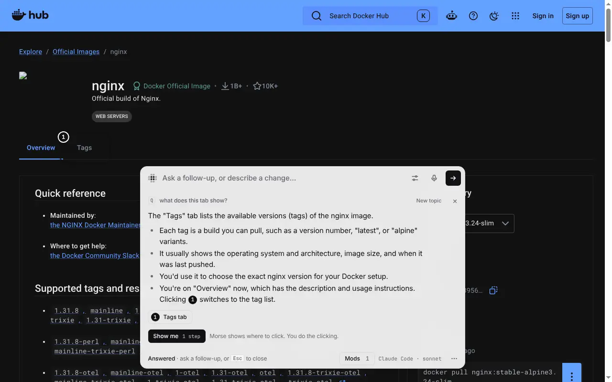
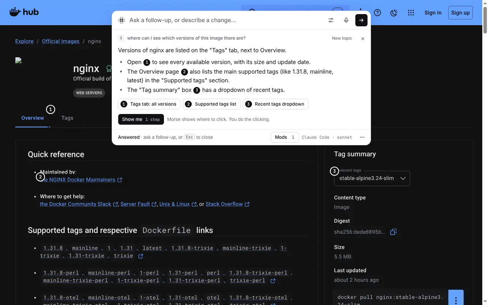
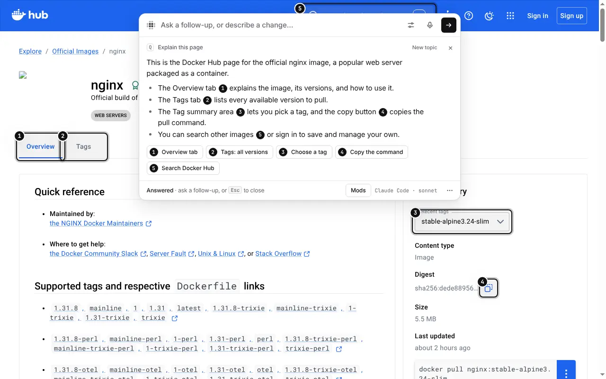

# Ask and find

Morse can also answer questions about an app. Use the same shortcut and the
same bar. Ask a question instead of describing a change:

- “what does this button do?”
- “why is this greyed out?”
- “where do I change my password?”

The model can tell a question from a request for a change.

## Ask

You get a short answer in the bar. Numbered markers show the parts of the
page it talks about. Click a number to scroll there.

You can ask more: “and how do I undo that?” Morse remembers the questions and
answers for this page while it's open. They are never saved.

## Find

Ask where something is. If it's inside a closed menu, the answer says which
menu to open.

## Show me

When the answer is a few clicks on this page, click **Show me**. Morse shows
where to click. You do the clicking. It marks one step at a time and waits
for you. Morse never clicks or types for you.

## Explain this page

**Explain this page**, in Page tools, says in about five lines what the
screen is for.

To have Morse repeat a task for you instead of showing you, see
[Show me once](show-me-once.md).
