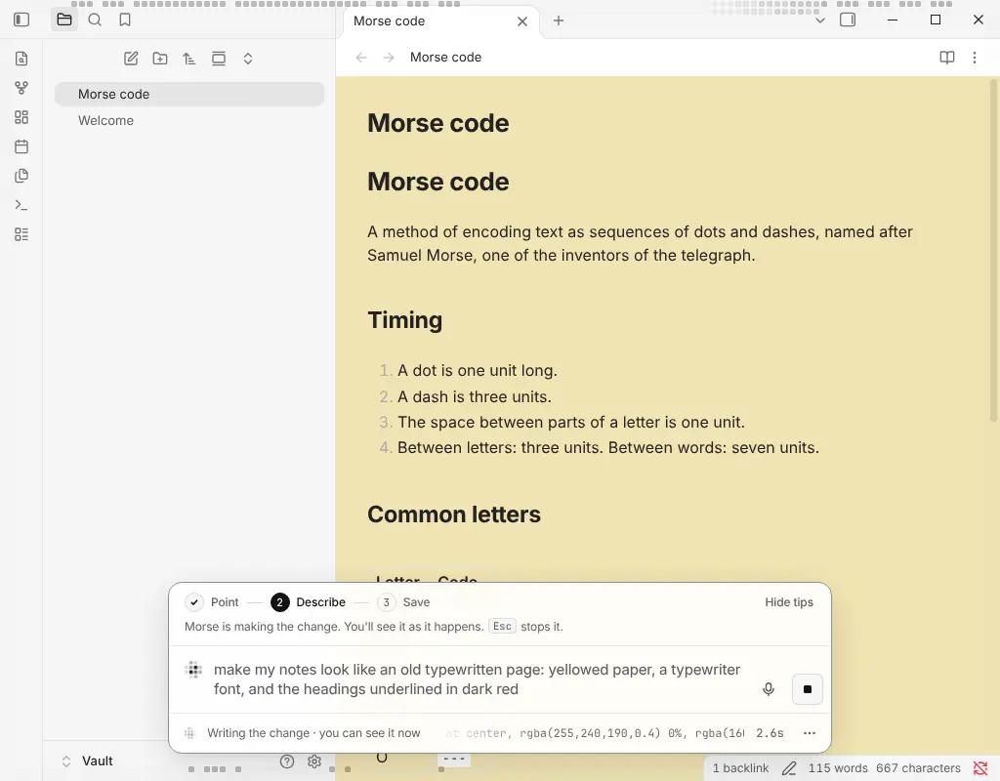
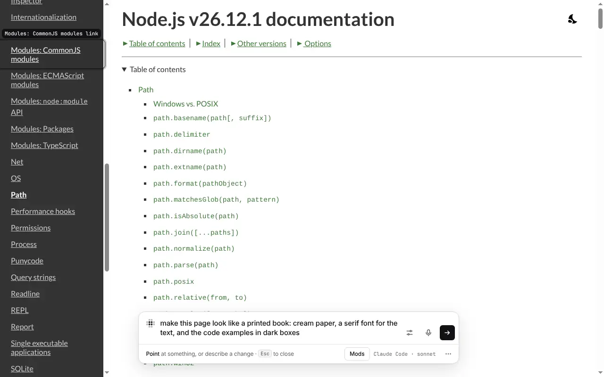
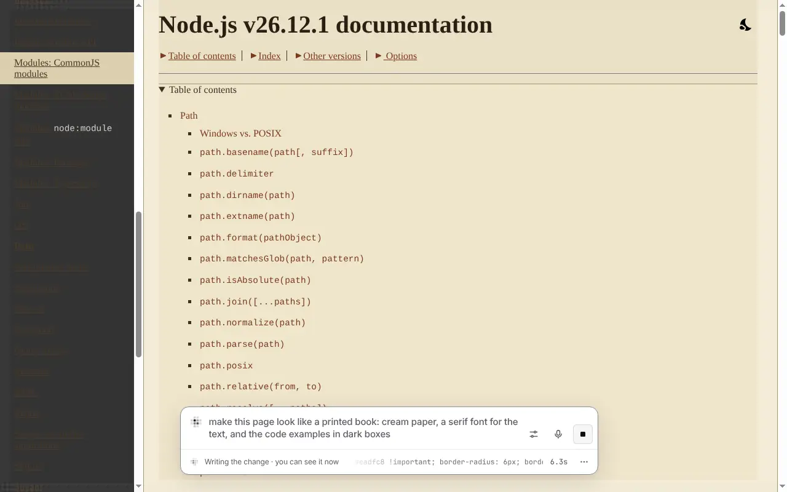
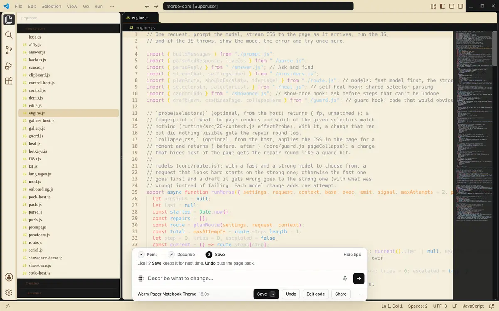
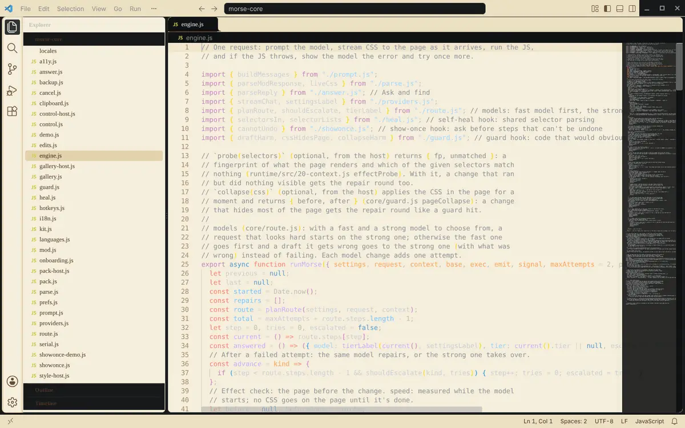
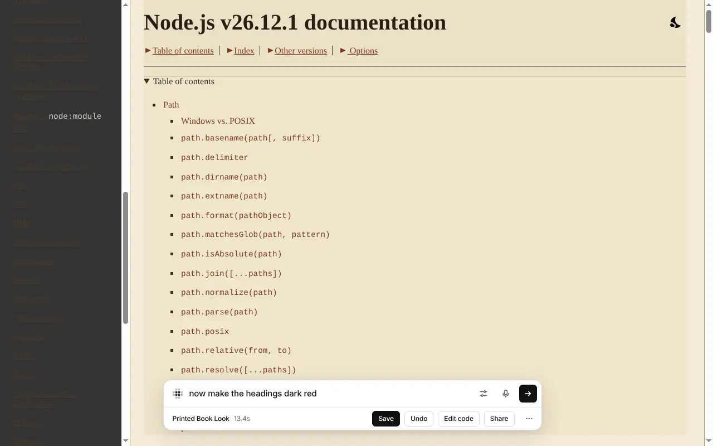
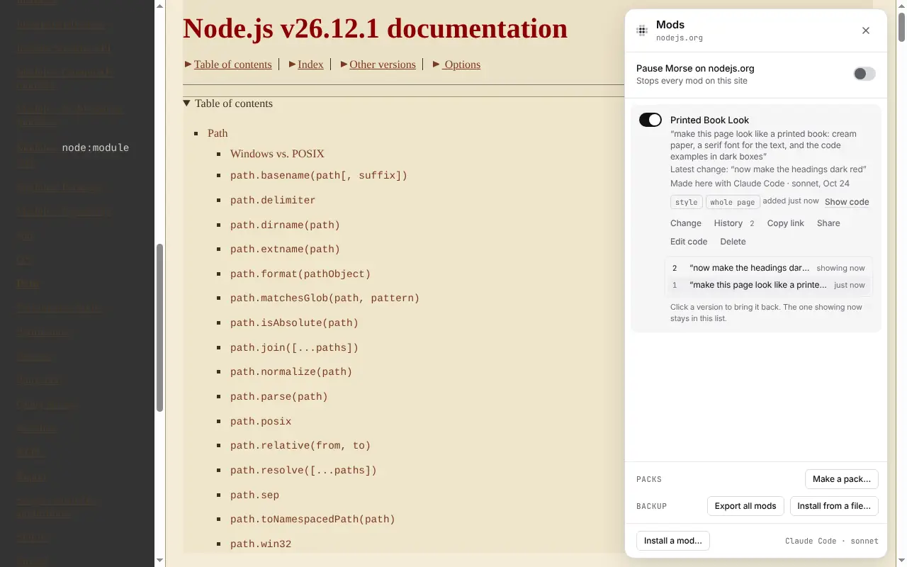

# Changing things

The bar is where you rewrite the app. Press the shortcut and say what to
remove or build. Morse writes the mod while you watch. Save your version
or undo the change.

```
press ⌥Space ─▶ point ─▶ "add a sleep timer" ─▶ ▦▦▦ the model writes the change ▦▦▦ ─▶ you see it ─▶ Save · Share
```



*Obsidian 1.14.5 on Linux: “make my notes look like an old typewritten page”. Claude Code (sonnet) wrote it in 7.8 seconds.*

## Point

Press **⌥Space** (Ctrl+Shift+Space on Windows and Linux). The bar opens.
Move the mouse over the part you want to change and click it. The bar names
what you pointed at, the way a person would say it: “Player controls”, “Send
button”.

The mouse chooses the smallest thing under it, like one link in a list. To
choose the bigger part around it (the whole list), press **⌥↑** (Alt+↑).
Press it again to go bigger still.

To change the whole page, don't point. Describe the change.

## Describe

Type what you want and press **Enter**: “add a sleep timer”, “hide the ads”,
“make this text bigger”, “show a word count under this box”. One sentence is
enough. Or hold the shortcut and say it (see [Voice](#voice)).

For ideas, press **F1** in the bar. When you point at something, the bar
also suggests a few changes for it. **Tab** picks one. **←** and **→** move
between them.

| | |
|---|---|
|  The bar in Visual Studio Code, with the request typed |  The bar on nodejs.org: point at a part, or describe the whole page |

## Watch it happen

While the model writes, what you pointed at turns into a grid of small
squares. The bar shows the change as it is written. Changes to how things
look show up before the model finishes. When it's done, the grid sweeps away
and you see the result.

If the change doesn't work the first time, Morse shows the model what went
wrong, and the model tries once more. The bar then says “needed a second
try”.

New buttons, panels and restyles should look like they came with the app.
The model sees the app's own colors, fonts, icons and a few of its buttons
and lists, and is asked to reuse them, in light and dark mode. Then, with
**Polish changes** on, Morse looks at what it added or restyled once more:
the bar says “Checking that it fits the app”, and anything that looks out of
place is fixed before you see the result. This takes a few seconds more. Turn
it off in Settings, under Changes. Small changes, like hiding something or
making text bigger, skip it.

Press **Esc** at any time to stop. Nothing is left behind.

| | |
|---|---|
|  nodejs.org turning into a printed book while the model writes it |  The same in Obsidian: the note turns yellow before the bar is done |

## Save or Undo

When the change is done, the bar shows what it made and how long it took.

- **Save** keeps it. It becomes a mod. Morse brings it back every time you
  open that site or app, even after a restart. **Enter** with nothing typed
  also saves.
- **Undo** takes it off the page. Nothing is saved.
- **Esc**, or a click outside the bar, closes the bar and keeps the change,
  like Save. Morse tells you, and shows **Undo** in case you didn't want it.
- **Edit code** shows the code the model wrote, so you can read or change it.
- **Share** makes a link, an image or a file to send to someone. See
  [Mods](mods.md#share-a-mod).

| | |
|---|---|
|  The result in Visual Studio Code, with Save, Undo, Edit code and Share |  Quit the app and open it again: the change is back |
|  nodejs.org as a printed book (Claude Code, sonnet, 13.4 seconds) | |

## Keep improving it

You can keep changing a result.

- **Ask for more.** Type under the result, like “make it bigger” or “use
  icons instead”, and press **Enter**. The model reads your first request,
  the code as it is now and what you added. Then it changes the same mod.
- **Step back.** **⌘Z** (Ctrl+Z) goes back one version. **⌘⇧Z**
  (Ctrl+Shift+Z or Ctrl+Y) goes forward again, until you ask for something
  new.
- **History.** Every saved mod keeps its last 20 versions. Open the Mods panel
  (**⌥⇧M**) and choose **History** on a mod. Click a version to bring it back.
- **Change.** On a saved mod in the Mods panel, click **Change** to open the
  bar on it. Then describe what to change.
- **Fix it.** When a saved mod stops working, its row in the Mods panel says
  so. Click **Fix it** and the model repairs it. See
  [Mods](mods.md#when-a-site-changes).

| | |
|---|---|
|  More typed under the result |  **History**: both versions. Click one to bring it back |

## Voice

Tap the microphone in the bar, or hold the shortcut. A tap opens Morse.
Holding it lets you talk. Your words appear as you speak. Let go, and Morse
starts on the change. To send as soon as you stop talking, turn on **Send
after a pause** in Settings.

- **In a browser** opened with Morse, the browser turns your speech into text.
- **In desktop apps**, Morse does it. It uses your OpenAI key, or Whisper if
  it's on your computer. To set it up, see [Models and setup](models.md#voice).

## Shortcuts and Settings

Open Settings with the **⋯** button in the bar, or press **⌘,** (Ctrl+,).
It shows the few things people change: Your style, the shortcut that opens
Morse, the theme, the language and fixing mods by themselves. **More
settings** has the rest: the other shortcuts (talk, the Mods panel, the Edit
tools, the off switch), voice, effects, where the bar sits, the model and
the small notices. Morse won't take keys that would cause trouble, like ⌘Q
or Alt+F4.

The default is ⌥Space on macOS. On Windows and Linux it is Ctrl+Shift+Space,
because Alt+Space opens the window menu there (or KRunner on KDE). See the
full list in
[Getting started](getting-started.md#shortcuts).

In the bar:

- **↑** and **↓** go through your past requests in this app.
- **Shift+Enter** starts a new line.
- **Esc** or **⌘.** stops Morse.
- **?** shows every shortcut you have.

When the bar closes, you're back where you were. The app gets every key
except your Morse shortcuts.

| | |
|---|---|
|  **Settings** |  **?** shows the shortcuts you have |

Morse keeps your settings in `~/.morse/settings.json`.
