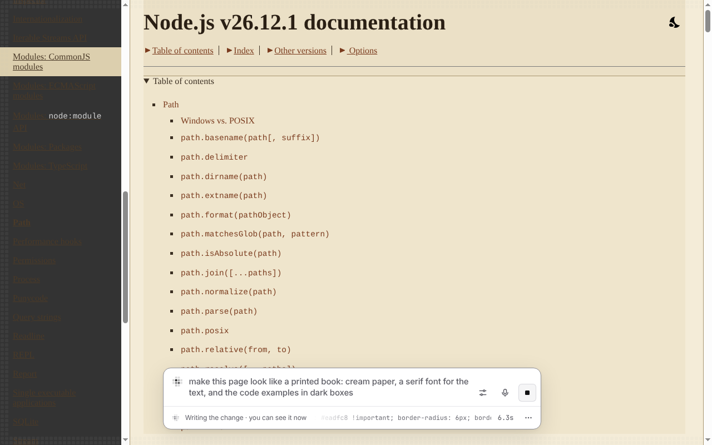
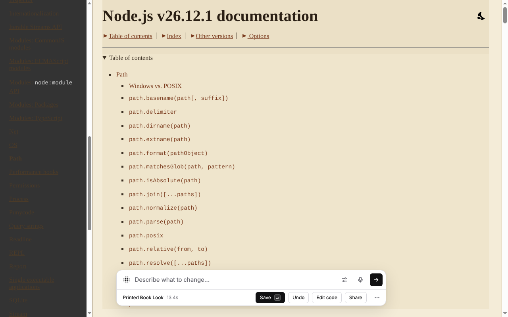
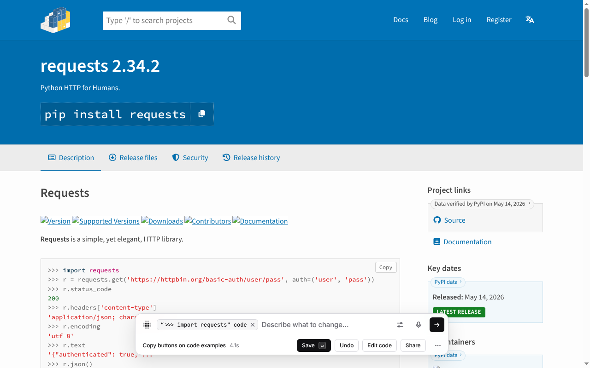
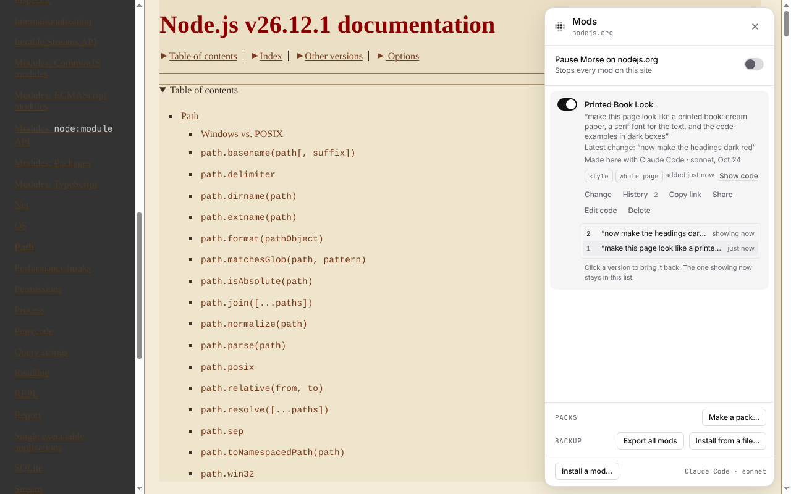
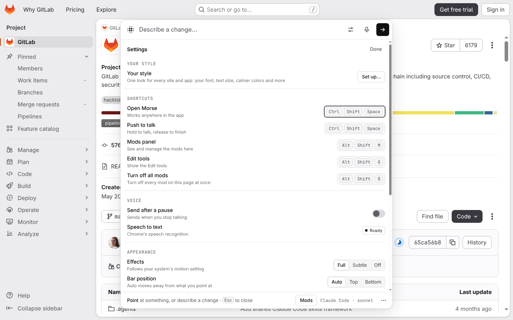
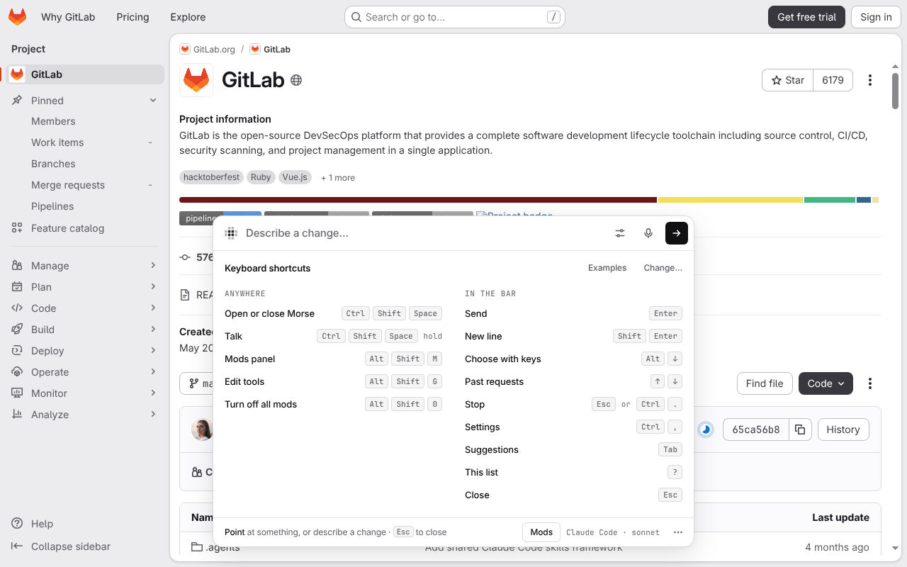

# Changing things

Everything starts in the bar. Press the shortcut, point at something, say
what you want, and watch it change.

```
press ⌥Space ─▶ point ─▶ "add a sleep timer" ─▶ ▦▦▦ the model writes the change ▦▦▦ ─▶ you see it ─▶ Save · Share
```


*Obsidian 1.14.5 on Linux, “make my notes look like an old typewritten page”, written by Claude Code (sonnet) in 7.8 seconds.*

## Point

Press **⌥Space** (Ctrl+Shift+Space on Windows and Linux). The bar opens and
Morse waits for you to point. Move the mouse over the part you want to change
and click it. The bar names what you pointed at, the way a person would say
it: “Player controls”, “Send button”.

The mouse chooses the smallest thing under it, like one link in a list. To
choose the bigger part around it (the whole list), press **⌥↑** (Alt+↑);
press it again for a bigger part still.

To change the whole page, don't point. Describe the change.

## Describe

Type what you want and press **Enter**: “add a sleep timer”, “hide the ads”,
“make this text bigger”, “show a word count under this box”. One sentence is
enough. Or hold the shortcut and say it (see [Voice](#voice)).

For ideas, press **F1** in the bar. When you point at something, the bar
also suggests a few changes for it: **Tab** picks one, **←** and **→** move
between them.

| | |
|---|---|
|  The bar in Visual Studio Code, with the request typed |  The bar on nodejs.org: point at a part, or describe the whole page |

## Watch it happen

While the model writes, what you pointed at turns into a grid of small
squares, and the bar shows the change as it is written. Changes to how things
look show up while the model is still writing. When it's done, the grid
sweeps away and you see the result.

If the change doesn't work the first time, Morse shows the model what went
wrong and it tries once more. The bar then says “needed a second try”.

Press **Esc** at any time to stop. Nothing is left behind.

| | |
|---|---|
|  nodejs.org turning into a printed book while the model writes it |  The same in Obsidian: the note turns yellow before the bar is done |

## Save or Undo

When the change is done, the bar shows what it made and how long it took.

- **Save** keeps it. It becomes a mod, and Morse brings it back every time you
  open that site or app, even after a restart. **Enter** with nothing typed
  also saves.
- **Undo** takes it off the page. Nothing is saved.
- **Esc** (or clicking away) closes the bar and keeps the change, like Save.
  Morse says so (“Kept … Closing the bar keeps a change.”), with **Undo**
  right there if you meant to drop it.
- **Edit code** shows the code the model wrote, if you want to read or change
  it.
- **Share** makes a link, an image or a file to send to someone. See
  [Mods](mods.md#share-a-mod).

| | |
|---|---|
|  The result in Visual Studio Code, with Save, Undo, Edit code and Share |  Quit the app and open it again: the change is back |
|  nodejs.org as a printed book (Claude Code, sonnet, 13.4 seconds) |  A new copy button on pypi.org’s code examples |

## Keep improving it

A result isn't final.

- **Follow-ups.** Type under the result, like “make it bigger” or “use icons
  instead”, and press **Enter**. The model gets your first request, the code
  as it is now and your follow-up, and changes the same mod.
- **Step back.** **⌘Z** (Ctrl+Z) goes back one version, and **⌘⇧Z**
  (Ctrl+Shift+Z or Ctrl+Y) goes forward again, until you ask for something new.
- **History.** Every saved mod keeps its last 20 versions. Open the Mods panel
  (**⌥⇧M**) and choose **History** on a mod. Click a version to bring it back.
- **Change.** On a saved mod in the Mods panel, **Change** opens the bar on it,
  so you can describe what to change.
- **Fix it.** When a saved mod stops working, its row in the Mods panel says
  so, and **Fix it** asks the model to repair it. See
  [Mods](mods.md#when-a-site-changes).

| | |
|---|---|
|  A follow-up typed under the result |  **History**: both versions; click one to bring it back |

## Voice

Tap the microphone in the bar, or hold the shortcut: a tap opens Morse, and
holding it talks. Your words appear as you speak. Let go and Morse starts on
the change. Turn on **Send after a pause** in Settings to send as soon as you
stop talking.

- **In Chrome**, Chrome turns your speech into text.
- **In desktop apps**, the Morse helper does it, with your OpenAI key or with
  Whisper if it's installed on your computer. Setup:
  [Models and setup](models.md#voice-in-desktop-apps).

## Shortcuts and Settings

Open Settings from the slider button in the bar, or with **⌘,** (Ctrl+,).
There you can change every shortcut: open Morse, talk, the Mods panel, the
Edit tools, and the off switch. Morse refuses keys that would cause trouble,
like ⌘Q or Alt+F4.

The defaults are ⌥Space on macOS and Ctrl+Shift+Space on Windows and Linux,
where Alt+Space opens the window menu (or KRunner on KDE). Morse's own
button in Chrome's toolbar uses Ctrl+Shift+Y (⌘⇧Y), so it never takes the
keys Morse uses in the page. The full list is in
[Getting started](getting-started.md#shortcuts).

In the bar:

- **↑** and **↓** go through your past requests in this app.
- **Shift+Enter** starts a new line.
- **Esc** or **⌘.** stops Morse.
- **?** shows every shortcut you have.

When the bar closes, you're back where you were, and the app gets every key
except your Morse shortcuts.

| | |
|---|---|
|  **Settings** |  **?** shows the shortcuts you have |

Settings are kept in Chrome's sync storage for the extension, and in
`~/.morse/settings.json` for desktop apps.
