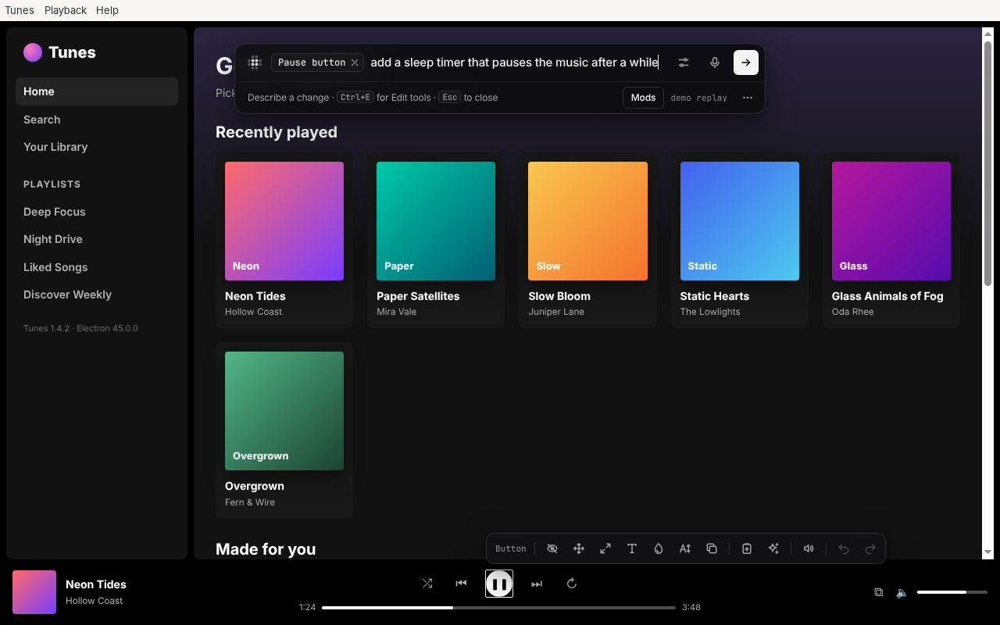
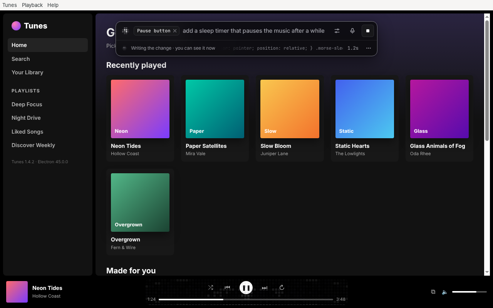
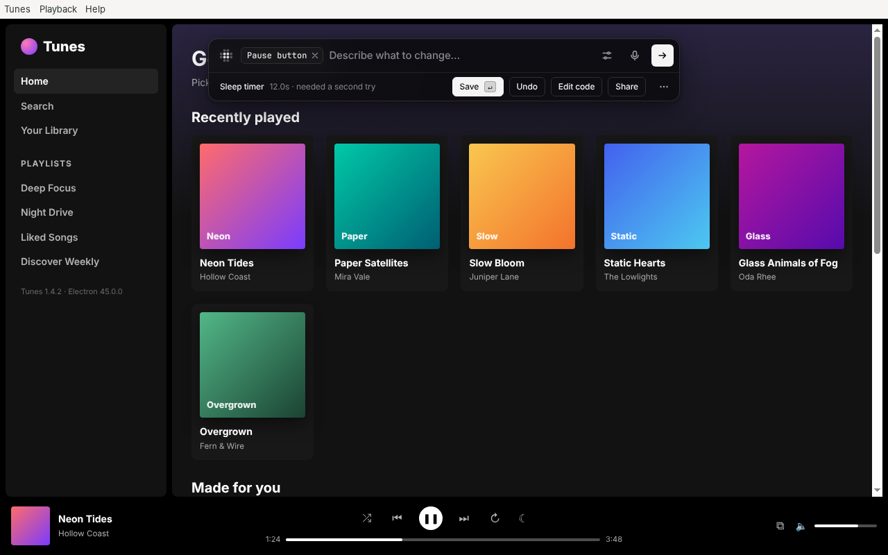
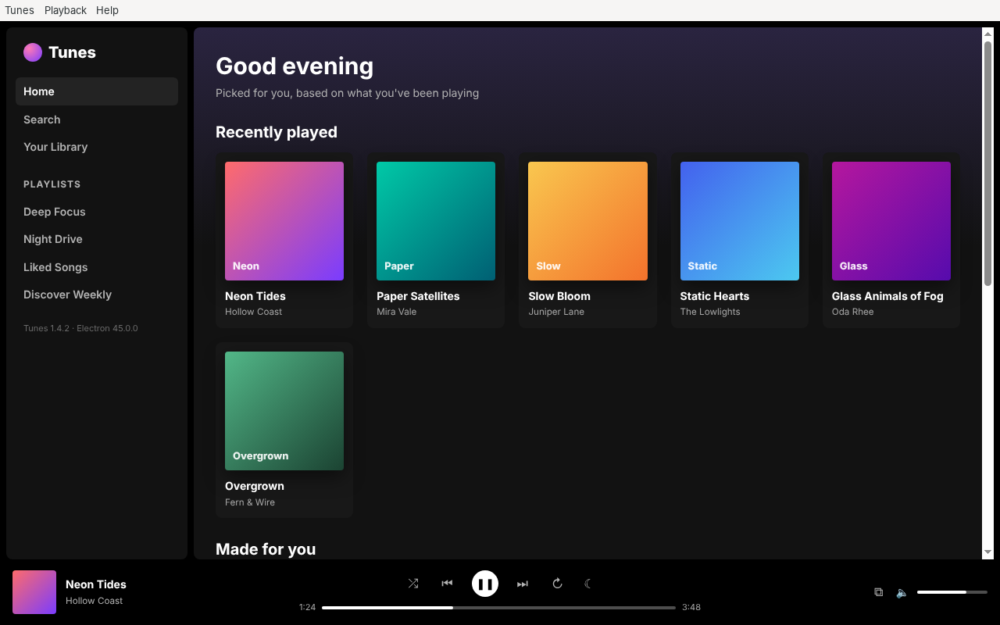
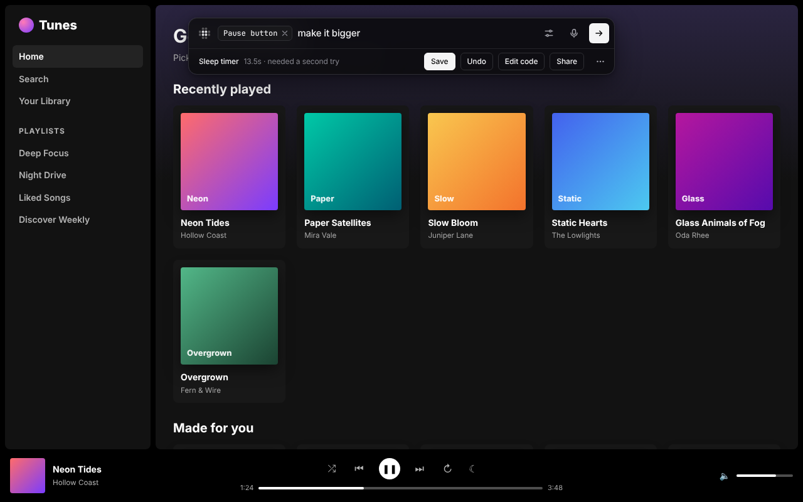
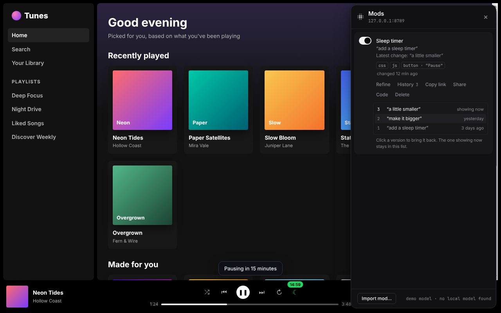

# Changing things

Everything starts in the bar. Press the shortcut, point at something and say
what you want. Then watch it change.

```
press ⌥Space ─▶ point ─▶ "add a sleep timer" ─▶ ▦▦▦ the model writes the change ▦▦▦ ─▶ you see it ─▶ Save · Share
```


*Recorded by Morse. This clip plays back saved answers, so it looks the same
every time. The same steps with real Claude Code answers are in
[screenshots/claude-code](screenshots/claude-code).*

## Point

Press **⌥Space** (Ctrl+Shift+Space on Windows and Linux). The bar opens.
Move the mouse over the part you want to change and click it. The bar names
what you pointed at, the way a person would say it: “Player controls”, “Send
button”.

The mouse chooses the smallest thing under it, like one link in a list. To
choose the bigger part around it (the whole list), press **⌥↑** (Alt+↑).
Press it again to go bigger still.

To change the whole page, don't point. Describe the change.

## Describe

Type what you want and press **Enter**: “add a sleep timer”, “hide the ads”,
“make this text bigger”, “show a word count under this box”. One sentence is
enough. Or hold the shortcut and say it (see [Voice](#voice)).

For ideas, press **F1** in the bar. When you point at something, the bar
also suggests a few changes for it. **Tab** picks one. **←** and **→** move
between them.

| | |
|---|---|
|  The bar, under the app's own menu bar |  Suggestions for what you pointed at |

## Watch it happen

While the model writes, what you pointed at turns into a grid of small
squares. The bar shows the change as it is written. Changes to how things
look show up before the model finishes. When it's done, the grid sweeps away
and you see the result.

If the change doesn't work the first time, Morse shows the model what went
wrong, and the model tries once more. The bar then says “needed a second
try”.

Press **Esc** at any time to stop. Nothing is left behind.

| | |
|---|---|
|  Working on the player controls |  The grid over what you pointed at, and the change as it is written in the bar |
|  The first try failed, so the model gets the error and tries again |  The new sleep timer counting down |
|  A new look for the whole page, shown while it is written |  **Esc** stops Morse. Nothing was changed |

## Save or Undo

When the change is done, the bar shows what it made and how long it took.

- **Save** keeps it. It becomes a mod. Morse brings it back every time you
  open that site or app, even after a restart. **Enter** with nothing typed
  also saves.
- **Undo** takes it off the page. Nothing is saved.
- **Esc**, or a click outside the bar, closes the bar and keeps the change,
  like Save. Morse tells you, and shows **Undo** in case you didn't want it.
- **Edit code** shows the code the model wrote, so you can read or change it.
- **Share** makes a link, an image or a file to send to someone. See
  [Mods](mods.md#share-a-mod).

| | |
|---|---|
|  The result: a sleep timer button (☾) next to the player |  Quit the app and open it again: the change is back |
|  A cluttered news site, restyled while the model writes |  After |
|  A live word count, on a site with strict security settings |  “add a button that copies the conversation as markdown” |

## Keep improving it

You can keep changing a result.

- **Ask for more.** Type under the result, like “make it bigger” or “use
  icons instead”, and press **Enter**. The model reads your first request,
  the code as it is now and what you added. Then it changes the same mod.
- **Step back.** **⌘Z** (Ctrl+Z) goes back one version. **⌘⇧Z**
  (Ctrl+Shift+Z or Ctrl+Y) goes forward again, until you ask for something
  new.
- **History.** Every saved mod keeps its last 20 versions. Open the Mods panel
  (**⌥⇧M**) and choose **History** on a mod. Click a version to bring it back.
- **Change.** On a saved mod in the Mods panel, click **Change** to open the
  bar on it. Then describe what to change.
- **Fix it.** When a saved mod stops working, its row in the Mods panel says
  so. Click **Fix it** and the model repairs it. See
  [Mods](mods.md#when-a-site-changes).

| | |
|---|---|
|  More typed under the result |  **History**: three versions; click one to bring it back |

## Voice

Tap the microphone in the bar, or hold the shortcut. A tap opens Morse.
Holding it lets you talk. Your words appear as you speak. Let go, and Morse
starts on the change. To send as soon as you stop talking, turn on **Send
after a pause** in Settings.

- **In Chrome**, Chrome turns your speech into text.
- **In desktop apps**, the Morse helper does it. It uses your OpenAI key, or
  Whisper if it's on your computer. To set it up, see
  [Models and setup](models.md#voice-in-desktop-apps).


## Shortcuts and Settings

Open Settings with the slider button in the bar, or press **⌘,** (Ctrl+,).
You can change every shortcut there: open Morse, talk, the Mods panel, the
Edit tools and the off switch. Morse won't take keys that would cause
trouble, like ⌘Q or Alt+F4.

The default is ⌥Space on macOS. On Windows and Linux it is Ctrl+Shift+Space,
because Alt+Space opens the window menu there (or KRunner on KDE). Morse's
button in Chrome's toolbar uses Ctrl+Shift+Y (⌘⇧Y), so it never takes keys
Morse uses in the page. See the full list in
[Getting started](getting-started.md#shortcuts).

In the bar:

- **↑** and **↓** go through your past requests in this app.
- **Shift+Enter** starts a new line.
- **Esc** or **⌘.** stops Morse.
- **?** shows every shortcut you have.

When the bar closes, you're back where you were. The app gets every key
except your Morse shortcuts.

| | |
|---|---|
|  **Settings** |  **Change a shortcut**: Morse won't take keys that would quit the app |
|  **?** shows the shortcuts you have |  Pointing at a chat box: the bar moves out of your way |

In Chrome, Morse keeps your settings in Chrome's sync storage. For desktop
apps, it keeps them in `~/.morse/settings.json`.
