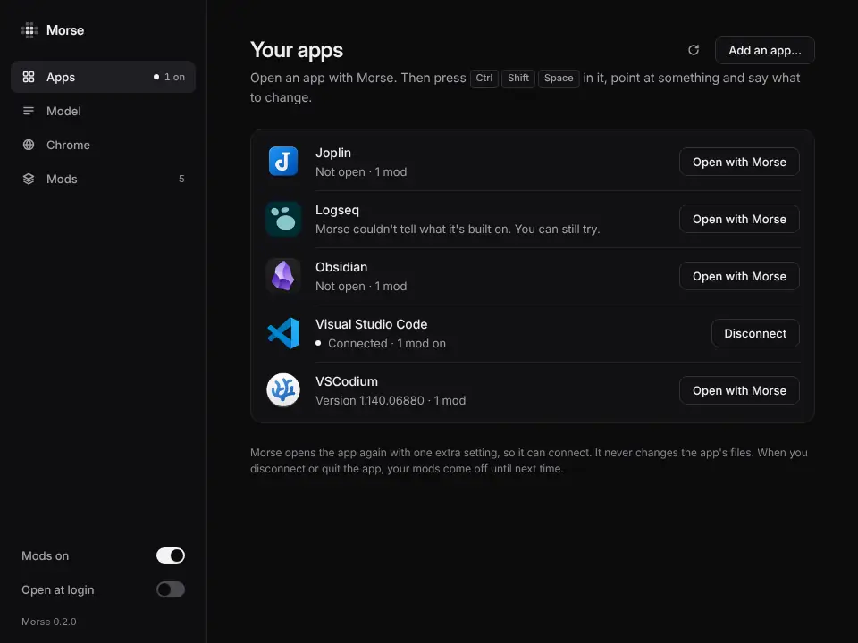
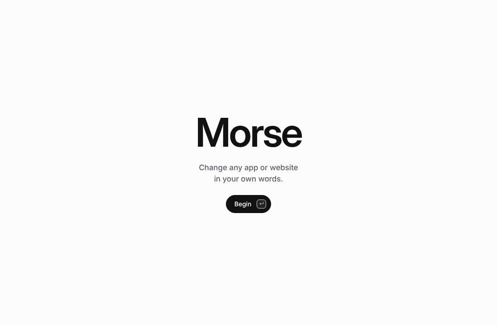
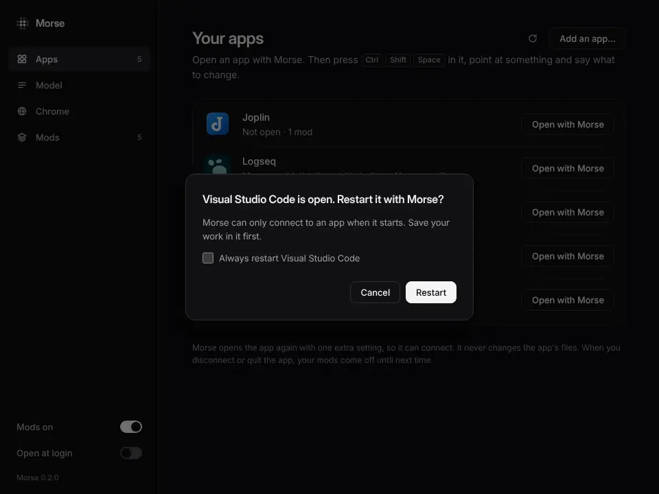
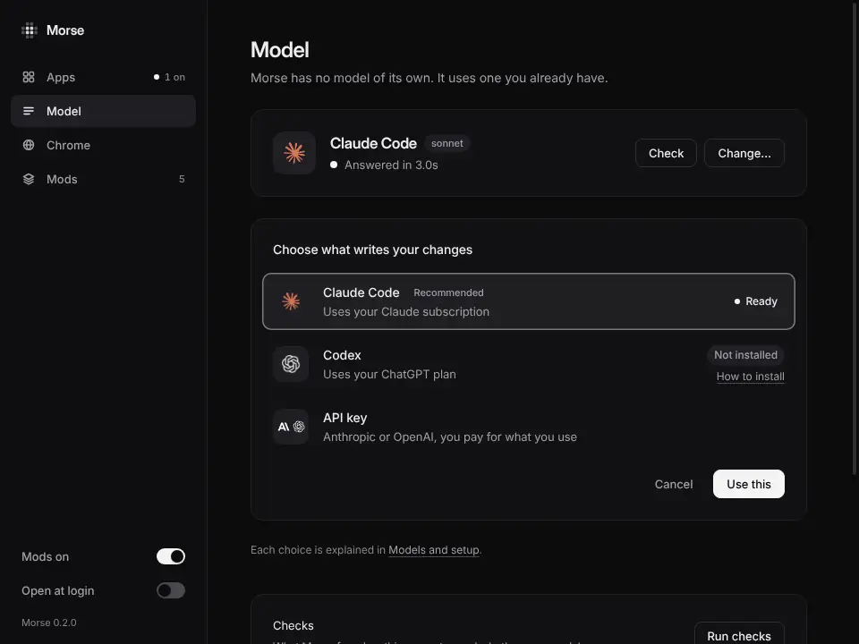
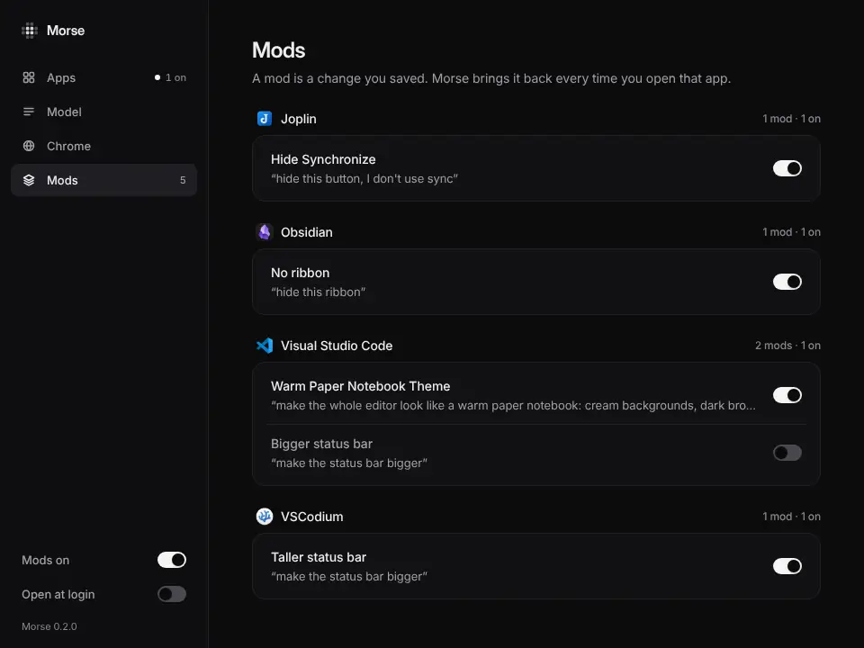
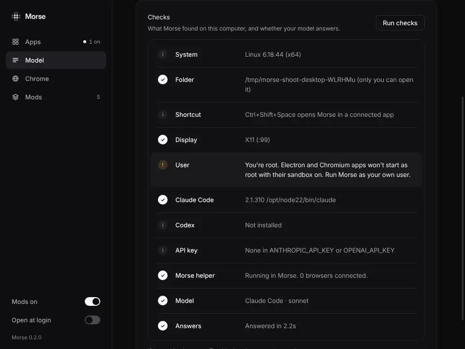
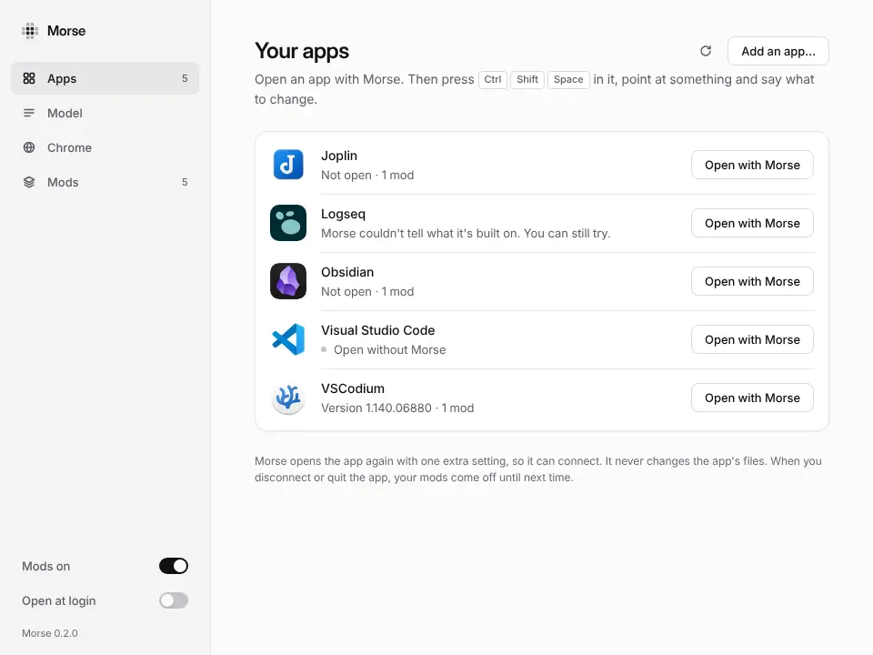

# The Morse app

The Morse app is Morse. It is the one thing to install, and the only place
you set anything up. You don't need a terminal, Node or anything else. It
finds your model, lists your apps and browsers and opens them with Morse,
and shows your mods.

A mod is a change you saved. Morse brings it back every time you open that
site or app.



## Get it

One download for each kind of computer. They are preview builds of the
newest Morse, made again every time `main` changes (the
[preview release](https://github.com/sam-siavoshian/RRAA/releases/tag/preview)
has every file and its SHA-256):

| Computer | Download | The first time |
|---|---|---|
| **Mac** with Apple silicon (M1 and later) | [Morse-mac-arm64.dmg](https://github.com/sam-siavoshian/RRAA/releases/download/preview/Morse-mac-arm64.dmg) | Open the dmg and drag Morse to Applications. |
| **Mac** with Intel | [Morse-mac-x64.dmg](https://github.com/sam-siavoshian/RRAA/releases/download/preview/Morse-mac-x64.dmg) | The same. |
| **Windows** | [Morse-Setup.exe](https://github.com/sam-siavoshian/RRAA/releases/download/preview/Morse-Setup.exe) | Open it. It installs Morse for you only, with no admin question. |
| **Linux** | [Morse-linux-x86_64.AppImage](https://github.com/sam-siavoshian/RRAA/releases/download/preview/Morse-linux-x86_64.AppImage) | Make it runnable: right-click it, Properties, Permissions, turn on “Allow executing file as program”. Then open it. |

**Mac, with no security prompts:** paste this in Terminal instead. It
downloads Morse for your Mac, checks it against the release's SHA-256 sums,
puts it in Applications and opens it:

```sh
curl -fsSL https://raw.githubusercontent.com/sam-siavoshian/RRAA/main/install-app.sh | sh
```

macOS only asks about apps a browser downloaded; Morse isn't notarized by
Apple yet (that takes a paid Apple Developer ID). The same line works on
Linux (it puts the AppImage in `~/.local/share/morse`).

Downloaded in a browser, Morse isn't signed yet, so your computer warns you once:

- **Mac:** open Morse. When macOS says it can't check it, open System
  Settings, Privacy & Security, scroll down and click **Open Anyway**. (On
  macOS 14 and older: right-click Morse in Applications and choose Open.)
- **Windows:** when SmartScreen says “Windows protected your PC”, click
  **More info**, then **Run anyway**.

Working on Morse itself? `npm run desktop` opens it from the Morse folder.

## The first time

Morse's name forms out of dots, with a short sound, then **Begin**. Four
steps follow, each with one thing on it; **Enter** goes on, and **Skip** is
always at the top:

1. **Your AI writes the changes.** Morse uses Claude Code (or Codex): it finds
   the one on this computer by itself and checks that it answers. If it finds
   neither, paste an API key there instead.
2. **Apps open with Morse.** Open an app as you usually do and Morse opens it,
   including one it finds later. The switch is **Always open with Morse**, the
   same one at the bottom of the sidebar. Turn it off to open apps yourself.
   On a Mac, allow Morse when macOS asks.
3. **Three moves, in any app:** press the shortcut, point at something, say
   what you want.
4. **Pick an app to change**, each with **Open with Morse**. Click one, and
   you're done. Browsers are in the list too, for websites.




The first run follows [Zephium](https://github.com/zephium-browser/zephium)'s:
the dots that form the name (`desktop-app/ui/formation.js`) and the sound
(`desktop-app/ui/sounds/intro.m4a`) are Zephium's, under the Mozilla Public
License 2.0, which those two files keep.

## Your apps

The Morse app shows the apps Morse can connect to. Each one says whether it's open, and whether Morse is connected
to it.

- **Open with Morse** opens the app with Morse connected. Then, in the app,
  press **Ctrl+Shift+Space** (**⌥Space** on a Mac), point at something and
  say what to change.
- **Disconnect** takes Morse off the app. The app keeps running, and your mods
  come off until next time.
- **Always open with Morse** (at the bottom of the sidebar, on unless you turn
  it off): an app you open the usual way, from the Dock, Finder or the Start
  menu, is quit and opened again with Morse a moment later. An app Morse finds
  later is treated the same way. You don't press **Open with Morse** once per
  app. An app that was already open when Morse started is left alone. The
  first-run screen has this same switch. For this, Morse opens at login, in
  the menu bar or tray.
- **Connect** shows up for an app that is open and ready for Morse, like
  after you disconnected. Morse connects without a restart.
- **Add an app…** lets you choose the file of an app Morse didn't find.

Morse can only connect to an app when the app starts. If the app is already
open, Morse asks first. Choose **Always restart**, and it won't ask again for
that app.



Morse never changes an app's files. It opens the app again with one extra
setting, so it can connect.

## Model

Morse has no model of its own. It uses one you already have: Claude Code,
Codex or an API key. **Change…** shows what's on this computer and suggests
one. Each choice says **Ready** or **Not
installed**. **How to install** shows the one command to run. **Look again**
finds it once it's there. **Check** asks the model a short question to
make sure it answers.



The marks of Claude, OpenAI and Anthropic only name the service you choose.
Where they come from: `desktop-app/ui/icons/NOTICE`.

## Websites

Chrome, Edge, Brave, Arc and Vivaldi are in your apps, with **Open with
Morse** like any app. Each opens in a window of its own with a Morse
profile: since Chrome 136, browsers don't let any program control your
everyday profile. Sign in to your sites in that window once; after that,
every site there works with Morse, and your mods for a site come back each
time you open it. Your everyday browser window is left alone.

Safari and Firefox give Morse no way in.

## Mods

This lists your mods, app by app. Each has a switch to turn it on or off. A
mod you turn off stays saved.

The **Mods on** switch at the bottom left turns every mod off at once, in
every app. Click it again to turn them back on.



## Checks

Under **Model**, **Run checks** shows what Morse found on this computer and
asks your model a short question. A row marked **!**
says what to do.



## In the tray or menu bar

Closing the window keeps Morse running, with its mark in the tray (Windows and
Linux) or the menu bar (Mac). Click it for:

- **Open Morse**: the window again.
- **Open an app with Morse**: your apps. Click a connected one to disconnect it.
- **Turn all mods off**: the off switch.
- **Quit Morse**: Morse leaves every app it connected (they keep running).

On Linux, some desktops don't show tray icons. Open the Morse app again, and
its window comes back.

With **Always open with Morse** on (at the bottom left, on unless you turn it
off), the Morse app opens when you log in, in the tray, without the window.



## Updates

Morse updates itself. It checks for a newer version when it starts and every
4 hours, and downloads it in the background. It checks the download against
the release's list of checksums before it uses it. The new version goes in
when no app is connected to Morse and you aren't using its window, or when
you quit Morse. You don't need to download anything again.

**Check for updates** in Settings looks now. It says whether you're up to date,
or that an update is available. When Morse can install it, the update window
opens. When it can't, **Get the update** opens the download.

## For developers: the morse command

The `morse` command is Morse for a terminal, for developers. It and the
Morse app are the same Morse, with the same folder (`~/.morse`), the same
model and the same mods. `morse status` lists the apps the Morse app connected.
`morse stop <app>` disconnects them. Apps you opened with `morse launch` show
as connected in the Morse app too.

## Safety

- The window only shows Morse's own page. It never loads anything from the
  internet, and web pages can't control it.
- Morse never changes an app's files, and asks before it restarts an app.
- To see what Morse sends to your model, and when, read [Privacy and safety](privacy-and-safety.md).
