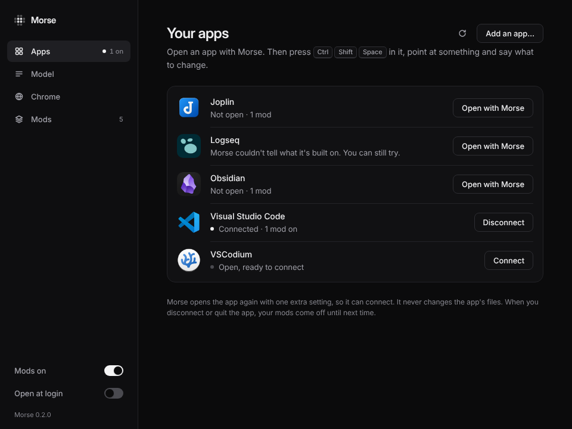
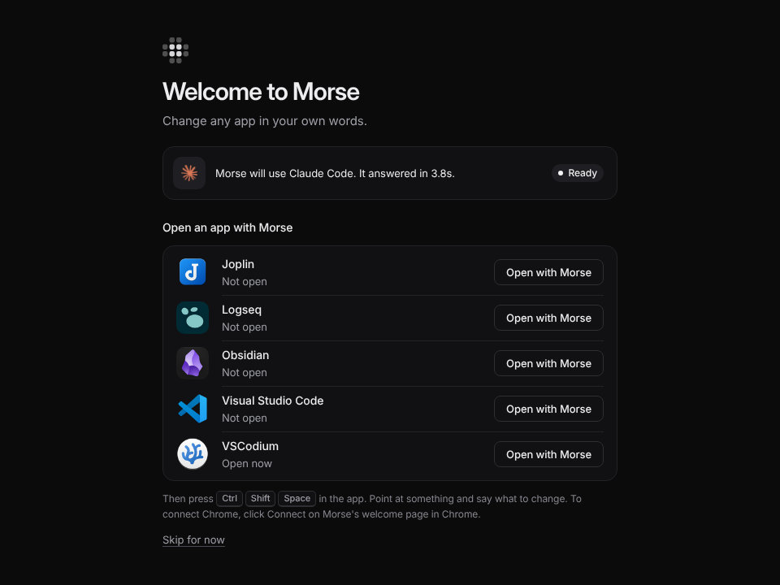
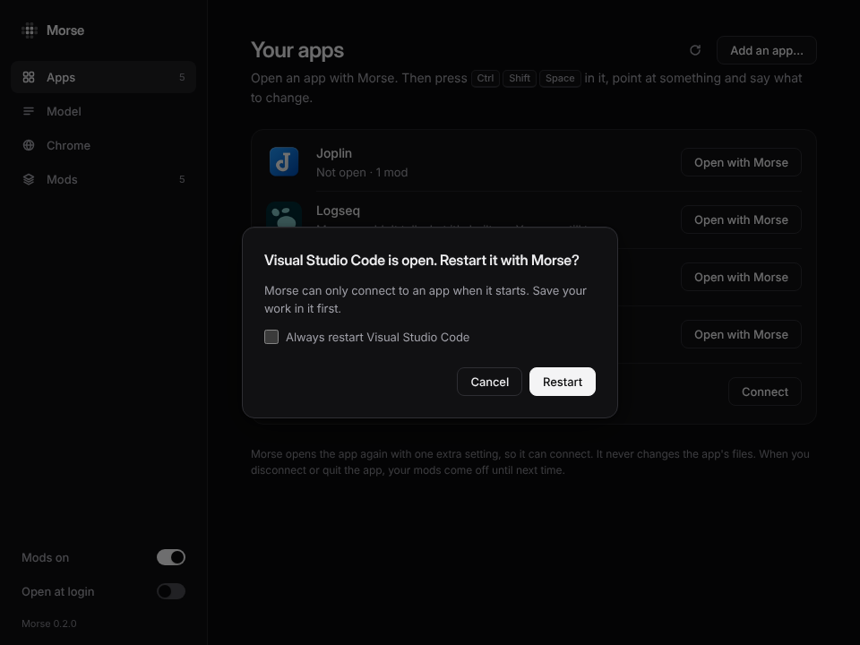
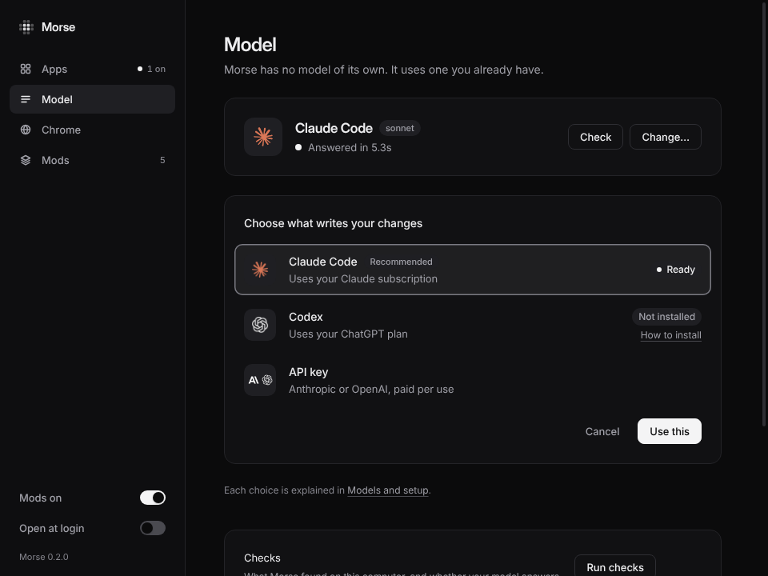
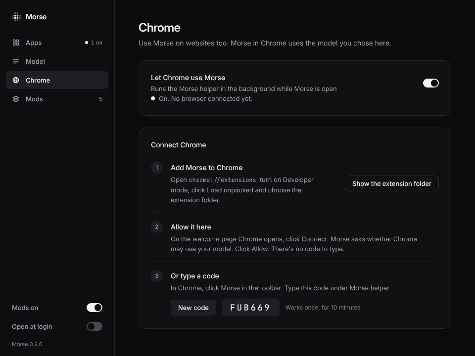
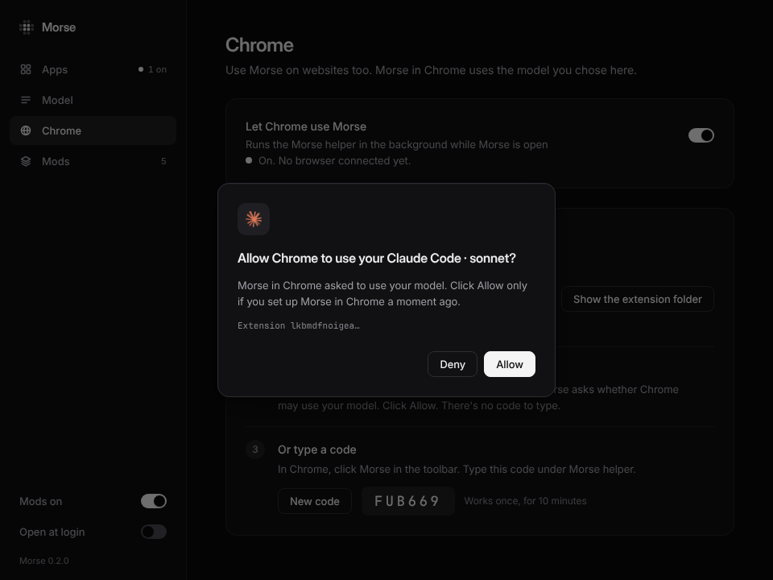
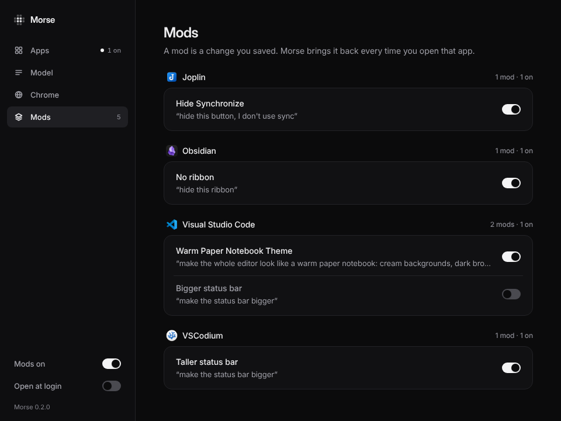
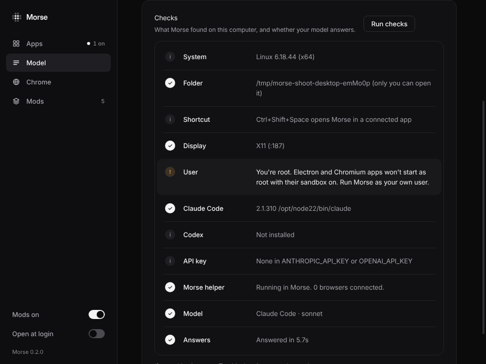
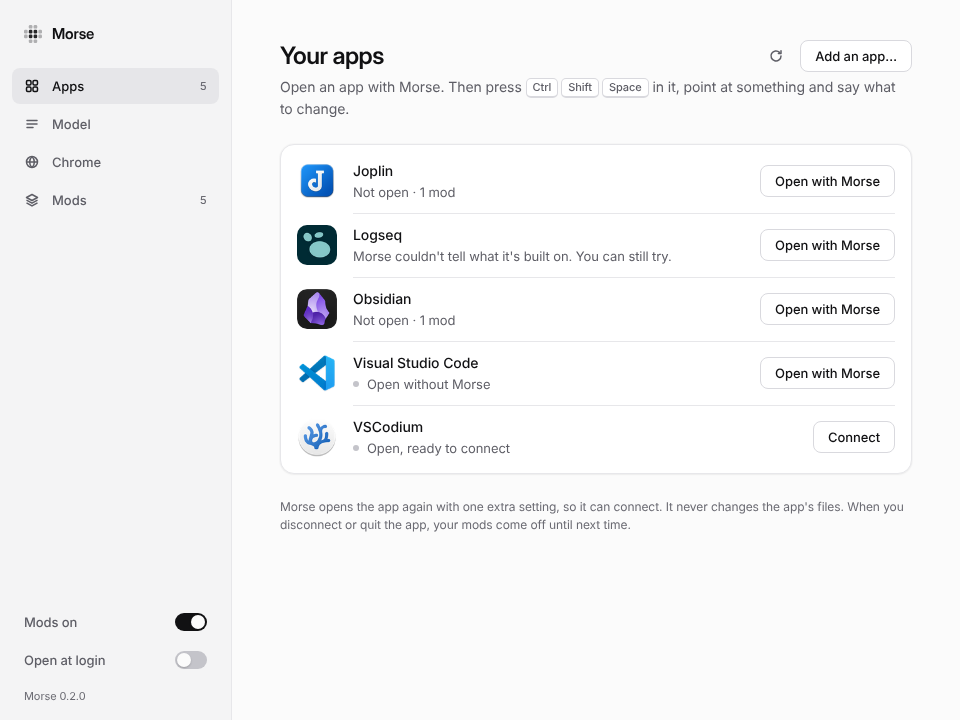

# Morse Desktop

Morse Desktop is Morse as an app on your computer. You don't need a terminal
or anything else. It lists your apps and opens them with Morse. It also helps
you choose your model, connects Chrome and shows your mods.

A mod is a change you saved. Morse brings it back every time you open that
site or app.

## Get it

One download for each kind of computer. They are preview builds of the
newest Morse, made again every time `main` changes (the
[preview release](https://github.com/sam-siavoshian/RRAA/releases/tag/preview)
has every file and its SHA-256):

| Computer | Download | The first time |
|---|---|---|
| **Mac** with Apple silicon (M1 and later) | [Morse-mac-arm64.dmg](https://github.com/sam-siavoshian/RRAA/releases/download/preview/Morse-mac-arm64.dmg) | Open the dmg and drag Morse to Applications. |
| **Mac** with Intel | [Morse-mac-x64.dmg](https://github.com/sam-siavoshian/RRAA/releases/download/preview/Morse-mac-x64.dmg) | The same. |
| **Windows** | [Morse-Setup.exe](https://github.com/sam-siavoshian/RRAA/releases/download/preview/Morse-Setup.exe) | Open it. It installs Morse for you only, with no admin question. |
| **Linux** | [Morse-linux-x86_64.AppImage](https://github.com/sam-siavoshian/RRAA/releases/download/preview/Morse-linux-x86_64.AppImage) | Make it runnable: right-click it, Properties, Permissions, turn on “Allow executing file as program”. Then open it. |

Morse isn't signed yet, so your computer warns you once:

- **Mac:** open Morse. When macOS says it can't check it, open System
  Settings, Privacy & Security, scroll down and click **Open Anyway**. (On
  macOS 14 and older: right-click Morse in Applications and choose Open.)
- **Windows:** when SmartScreen says “Windows protected your PC”, click
  **More info**, then **Run anyway**.

Working from the Morse folder? `npm run desktop` opens it from there.

## The first time

Morse Desktop opens on one screen. It finds Claude Code or Codex and checks
that it answers. Then it shows your apps. Click **Open with Morse** next to
one, and you're done. If Morse finds neither, paste an API key there instead.

## Your apps

Morse Desktop shows the apps Morse can connect to. It's the same list as
`morse apps`. Each one says whether it's open, and whether Morse is connected
to it.

- **Open with Morse** opens the app with Morse connected. Then, in the app,
  press **Ctrl+Shift+Space** (**⌥Space** on a Mac), point at something and
  say what to change.
- **Disconnect** takes Morse off the app. The app keeps running, and your mods
  come off until next time.
- **Connect** shows up for an app that is open and ready for Morse, like
  after you disconnected. Morse connects without a restart.
- **Add an app…** lets you choose the file of an app Morse didn't find.

Morse can only connect to an app when the app starts. If the app is already
open, Morse asks first. Choose **Always restart**, and it won't ask again for
that app.

Morse never changes an app's files. It opens the app again with one extra
setting, so it can connect.

## Model

Morse has no model of its own. It uses one you already have: Claude Code,
Codex or an API key. **Change…** shows what's on this computer and suggests
one, the same as `morse setup`. Each choice says **Ready** or **Not
installed**. **How to install** shows the one command to run. **Look again**
finds it once it's there. **Check** asks the model a short question to
make sure it answers.

The marks of Claude, OpenAI and Anthropic only name the service you choose.
Where they come from: `desktop-app/ui/icons/NOTICE`.

## Chrome

While Morse Desktop is open, it runs the Morse helper in the background. That
lets the Morse extension in Chrome use your model too. If you don't want
that, turn off **Let Chrome use Morse**.

To connect Chrome:

1. Click **Add to Chrome**. Morse puts the extension in a folder that stays
   put (`~/.morse/chrome-extension`), shows that folder, copies where it is,
   and opens Chrome on `chrome://extensions`. There, turn on **Developer
   mode** (top right) and drag the folder onto the page. Or click **Load
   unpacked** and choose it: on a Mac, press ⌘⇧G in that window and paste.
   Until Morse is in the Chrome Web Store, this is the way in.
2. On the welcome page Chrome opens, click **Connect**. Morse Desktop asks
   “Allow Chrome to use your Claude Code?”. Click **Allow**. There's no code
   to type.
3. Or click **Show a code**. Type that code in Morse's menu in Chrome, under
   Morse helper.

Only the Morse extension on this computer can ask. Nothing connects until you
click **Allow**. Click Allow only if you clicked Connect in Chrome a moment
ago. **Sign out browsers** disconnects every browser.

## Mods

This lists your mods, app by app. Each has a switch to turn it on or off. A
mod you turn off stays saved.

The **Mods on** switch at the bottom left turns every mod off at once, in
every app. Click it again to turn them back on. It is the same off switch as
`morse pause`.

## Checks

Under **Model**, **Run checks** shows what Morse found on this computer and
asks your model a short question, like `morse doctor`. A row marked **!**
says what to do.

## In the tray or menu bar

Closing the window keeps Morse running, with its mark in the tray (Windows and
Linux) or the menu bar (Mac). Click it for:

- **Open Morse**: the window again.
- **Open an app with Morse**: your apps. Click a connected one to disconnect it.
- **Turn all mods off**: the off switch.
- **Quit Morse**: Morse leaves every app it connected (they keep running) and
  stops the Morse helper.

On Linux, some desktops don't show tray icons. Open Morse Desktop again, and
its window comes back.

Morse Desktop only opens when you log in if you turn on **Open at login** at
the bottom left. Then it starts in the tray, without the window.

## Morse Desktop and the morse command

They are the same Morse, with the same folder (`~/.morse`), the same model and
the same mods. `morse status` lists the apps Morse Desktop connected.
`morse stop <app>` disconnects them. Apps you opened with `morse launch` show
as connected in Morse Desktop too.

## Safety

- The window only shows Morse's own page. It never loads anything from the
  internet, and web pages can't control it.
- Morse never changes an app's files, and asks before it restarts an app.
- Chrome connects only after you click **Allow** in Morse Desktop (or type a code).
- To see what Morse sends to your model, and when, read [Privacy and safety](privacy-and-safety.md).
