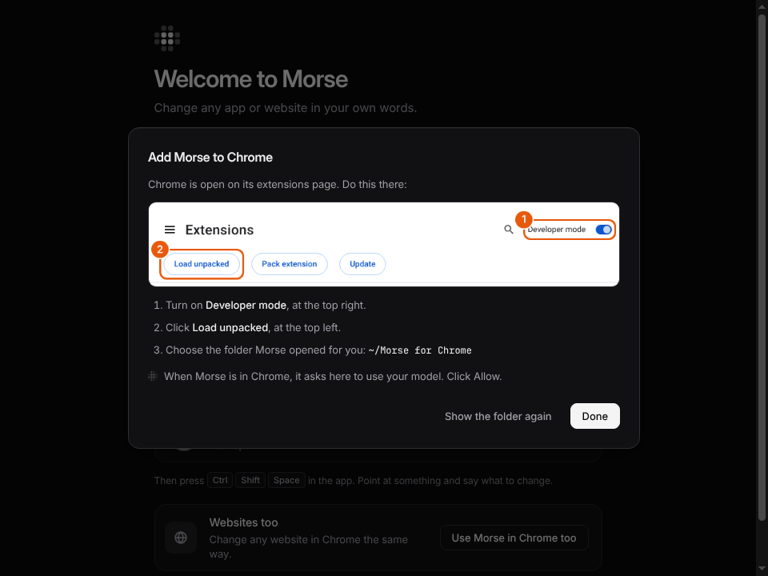

# The Morse app

The Morse app is Morse. It is the one thing to install, and the only place
you set anything up. You don't need a terminal, Node or anything else. It
finds your model, lists your apps and opens them with Morse, and adds Morse
to Chrome. It also shows your mods.

A mod is a change you saved. Morse brings it back every time you open that
site or app.

## Get it

One download for each kind of computer. They are preview builds of the
newest Morse, made again every time `main` changes (the
[preview release](https://github.com/sam-siavoshian/RRAA/releases/tag/preview)
has every file and its SHA-256):

| Computer | Download | The first time |
|---|---|---|
| **Mac** with Apple silicon (M1 and later) | [Morse-mac-arm64.dmg](https://github.com/sam-siavoshian/RRAA/releases/download/preview/Morse-mac-arm64.dmg) | Open the dmg and drag Morse to Applications. |
| **Mac** with Intel | [Morse-mac-x64.dmg](https://github.com/sam-siavoshian/RRAA/releases/download/preview/Morse-mac-x64.dmg) | The same. |
| **Windows** | [Morse-Setup.exe](https://github.com/sam-siavoshian/RRAA/releases/download/preview/Morse-Setup.exe) | Open it. It installs Morse for you only, with no admin question. |
| **Linux** | [Morse-linux-x86_64.AppImage](https://github.com/sam-siavoshian/RRAA/releases/download/preview/Morse-linux-x86_64.AppImage) | Make it runnable: right-click it, Properties, Permissions, turn on “Allow executing file as program”. Then open it. |

Morse isn't signed yet, so your computer warns you once:

- **Mac:** open Morse. When macOS says it can't check it, open System
  Settings, Privacy & Security, scroll down and click **Open Anyway**. (On
  macOS 14 and older: right-click Morse in Applications and choose Open.)
- **Windows:** when SmartScreen says “Windows protected your PC”, click
  **More info**, then **Run anyway**.

Working on Morse itself? `npm run desktop` opens it from the Morse folder.

## The first time

Morse opens on one screen, with nothing to decide:

- **Morse will use Claude Code** (or Codex). It finds the one on this
  computer by itself and checks that it answers. If it finds neither, paste
  an API key there instead.
- **Your apps**, each with **Open with Morse**. Click one, and you're done.
- **Use Morse in Chrome too**, for websites. See [Chrome](#chrome).

## Your apps

The Morse app shows the apps Morse can connect to. Each one says whether it's open, and whether Morse is connected
to it.

- **Open with Morse** opens the app with Morse connected. Then, in the app,
  press **Ctrl+Shift+Space** (**⌥Space** on a Mac), point at something and
  say what to change.
- **Disconnect** takes Morse off the app. The app keeps running, and your mods
  come off until next time.
- **Connect** shows up for an app that is open and ready for Morse, like
  after you disconnected. Morse connects without a restart.
- **Add an app…** lets you choose the file of an app Morse didn't find.

Morse can only connect to an app when the app starts. If the app is already
open, Morse asks first. Choose **Always restart**, and it won't ask again for
that app.

Morse never changes an app's files. It opens the app again with one extra
setting, so it can connect.

## Model

Morse has no model of its own. It uses one you already have: Claude Code,
Codex or an API key. **Change…** shows what's on this computer and suggests
one. Each choice says **Ready** or **Not
installed**. **How to install** shows the one command to run. **Look again**
finds it once it's there. **Check** asks the model a short question to
make sure it answers.

The marks of Claude, OpenAI and Anthropic only name the service you choose.
Where they come from: `desktop-app/ui/icons/NOTICE`.

## Chrome

Click **Use Morse in Chrome** (on the first screen, **Use Morse in Chrome
too**). Morse in Chrome uses the model you chose here, so there is nothing
to set up in Chrome.

Morse isn't in the Chrome Web Store yet, so the button adds it from a folder:

1. Morse puts the extension in a folder that stays put, **Morse for Chrome**
   in your home folder, shows that folder, and opens Chrome on its
   extensions page.
2. A picture shows where to click there: turn on **Developer mode** (top
   right), then click **Load unpacked** (top left) and choose that folder.
   Or drag the folder onto the page.
3. Morse's welcome page opens in Chrome, and the Morse app asks
   **“Allow Chrome to use your Claude Code?”**. Click **Allow**. There's no
   code to type.

Once Morse is in the Chrome Web Store, the same button opens its page there.

Only the Morse extension on this computer can ask. Nothing connects until you
click **Allow**. Click Allow only if you added Morse to Chrome a moment ago.
**Sign out browsers** disconnects every browser.

While the Morse app is open, Chrome can use your model through it. If you
don't want that, turn off **Let Chrome use Morse**. **Advanced** has the
extension's folder and a code to type, for developers.

## Mods

This lists your mods, app by app. Each has a switch to turn it on or off. A
mod you turn off stays saved.

The **Mods on** switch at the bottom left turns every mod off at once, in
every app. Click it again to turn them back on.

## Checks

Under **Model**, **Run checks** shows what Morse found on this computer and
asks your model a short question. A row marked **!**
says what to do.

## In the tray or menu bar

Closing the window keeps Morse running, with its mark in the tray (Windows and
Linux) or the menu bar (Mac). Click it for:

- **Open Morse**: the window again.
- **Open an app with Morse**: your apps. Click a connected one to disconnect it.
- **Turn all mods off**: the off switch.
- **Quit Morse**: Morse leaves every app it connected (they keep running) and
  stops the Morse helper.

On Linux, some desktops don't show tray icons. Open the Morse app again, and
its window comes back.

The Morse app only opens when you log in if you turn on **Open at login** at
the bottom left. Then it starts in the tray, without the window.

## Updates

Morse updates itself. It checks for a newer version when it starts and every
4 hours, and downloads it in the background. It checks the download against
the release's list of checksums before it uses it. The new version goes in
when no app is connected to Morse and you aren't using its window, or when
you quit Morse. You don't need to download anything again.

## For developers: the morse command

The `morse` command is Morse for a terminal, for developers. It and the
Morse app are the same Morse, with the same folder (`~/.morse`), the same
model and the same mods. `morse status` lists the apps the Morse app connected.
`morse stop <app>` disconnects them. Apps you opened with `morse launch` show
as connected in the Morse app too.

## Safety

- The window only shows Morse's own page. It never loads anything from the
  internet, and web pages can't control it.
- Morse never changes an app's files, and asks before it restarts an app.
- Chrome connects only after you click **Allow** in the Morse app (or type a code).
- To see what Morse sends to your model, and when, read [Privacy and safety](privacy-and-safety.md).
