# Morse in desktop apps

Many desktop apps are web pages inside a window. Slack, Discord, VS Code,
Obsidian, Notion, Figma, Signal and Spotify are all built this way, on
**Electron** or on Chromium. Morse can change those apps the same way it
changes websites: you point at something, say what you want, and keep it.

This page explains how to do that, what Morse does to the app (and what it
doesn't), and which apps can't work.

Rather not use a terminal? [Morse Desktop](desktop-app.md) does the same in a
window: it lists your apps, opens them with Morse and disconnects them.


## The short version

```bash
morse apps                 # what Morse found, and whether it can connect
morse launch spotify       # opens Spotify with Morse connected
```

Then, in the app, press **Ctrl+Shift+Space** (**⌥Space** on a Mac). The Morse
bar opens. Point at the part you want to change, type what you want, and press
**Enter**. When you like the result, press **Enter** again to save it.

Next time you open the app with `morse launch`, your changes come back by
themselves.

## Step by step

### 1. Find your app

```bash
morse apps
```

Morse looks where apps are usually installed: `/Applications` and
`~/Applications` on a Mac, your user's app folders, Program Files and the
Start menu on Windows, and `PATH`, `/opt`, snap, flatpak and the app menu on
Linux. There's more for [macOS](#macos) and [Windows](#windows) below. On Linux it also finds AppImages in
`~/Applications`, `~/Downloads` and `~/.local/bin`, and ones an installer added
to the app menu. Each app gets one line:

- **●** Morse can connect to it.
- **○ can't connect** and why, for example "native app, not built on web technology".
- **◌** Morse couldn't tell what it's built on. You can still try.

If your app is somewhere else, give its path instead of its name:
`morse launch "/path/to/My App"`.

### 2. Open it with Morse

```bash
morse launch slack
```

Names don't have to be exact: `code`, `vs code` and `vscode` all find VS Code.

Morse can only connect to an app when the app starts, so if it is already
open, Morse asks whether to quit it and open it again. Say **a** (always) and
it won't ask again for that app. Or pass `--restart`.

While `morse launch` runs, Morse is connected. It prints a line for each
window it connects to, including windows that open later, side panels and
embedded views.

### 3. Change something

In the app:

1. Press **Ctrl+Shift+Space** (**⌥Space** on a Mac). The bar opens.
2. Move the mouse over the part you want to change. Click it.
3. Type what you want, like "add a sleep timer" or "make this list more compact".
4. Press **Enter**. You see the change happen while the model writes it.
5. Press **Enter** to save it, or **Undo** to put the app back.

**Alt+Shift+M** opens the Mods panel, where you can turn your changes on and
off, see their code, share them or delete them.

| | |
|---|---|
| 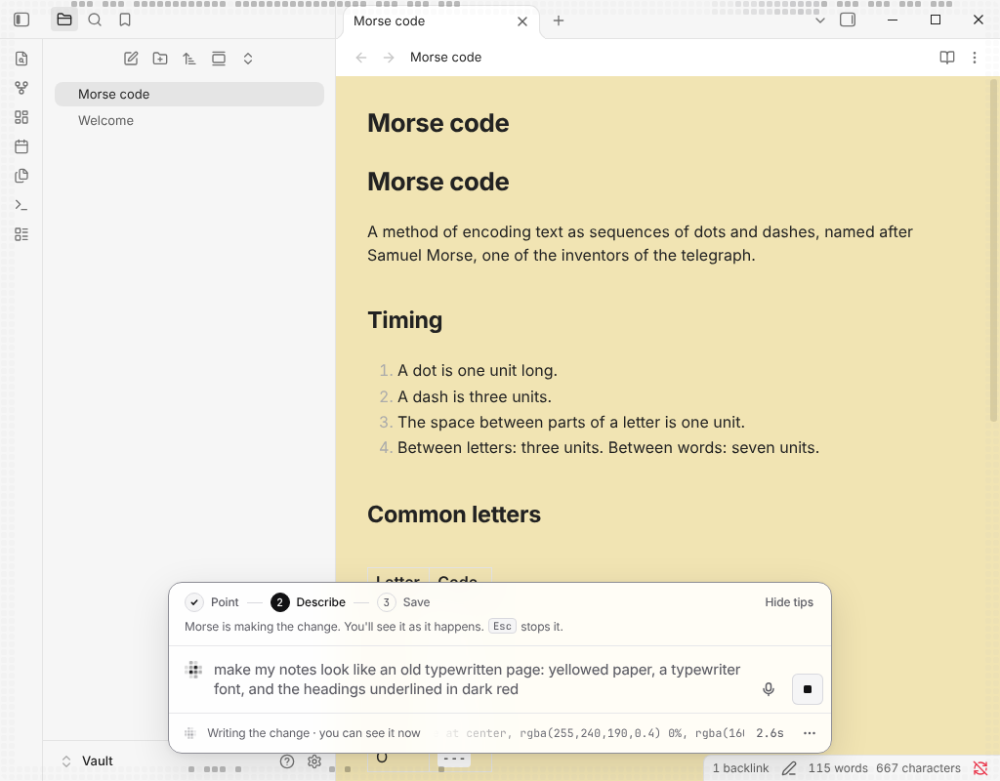 Obsidian: the change shows while the model writes it | 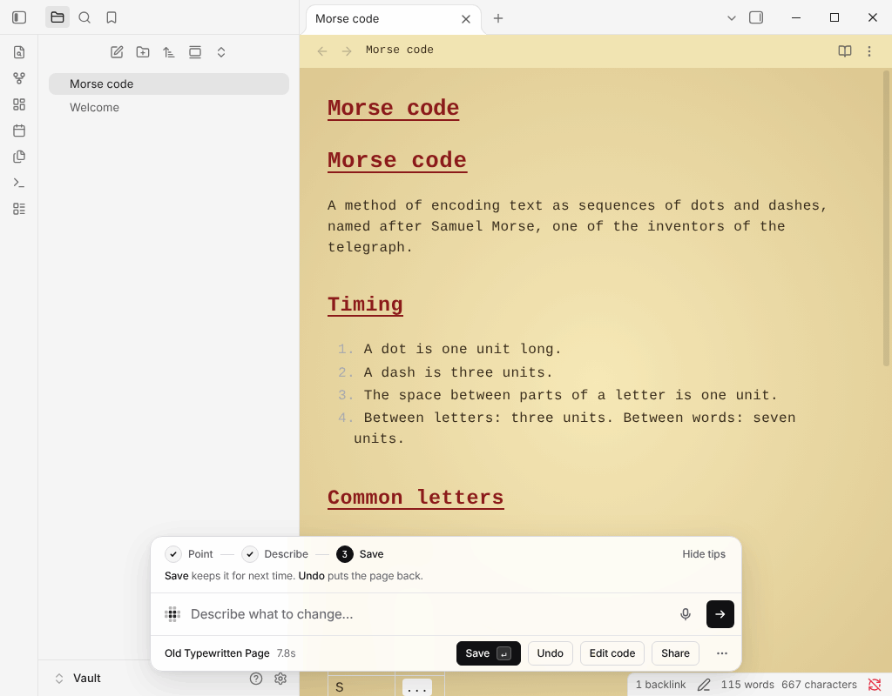 The result, with Save, Undo, Edit code and Share |
| 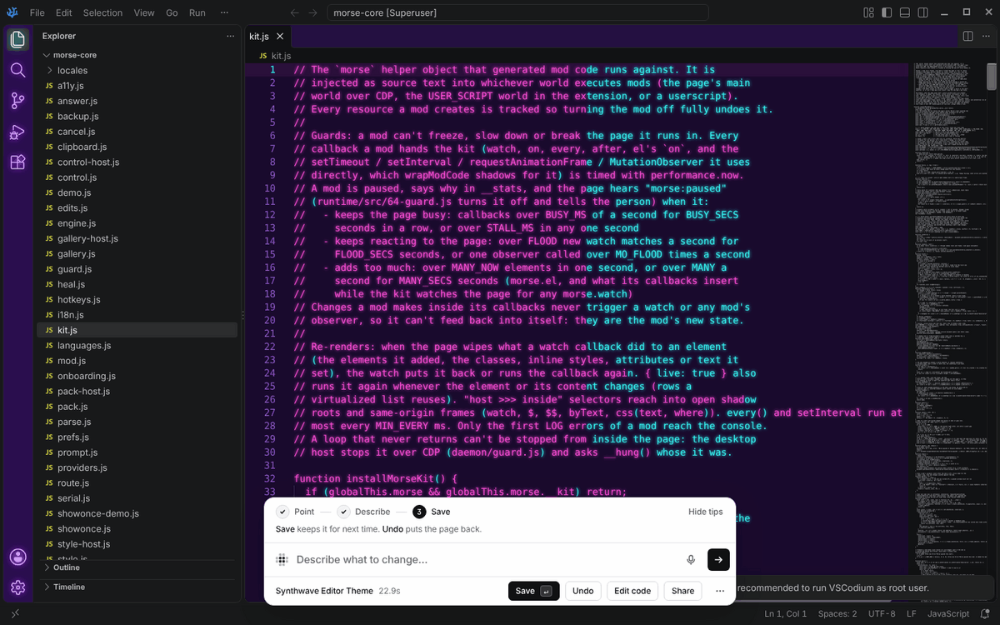 VSCodium after “give the editor a synthwave look” | 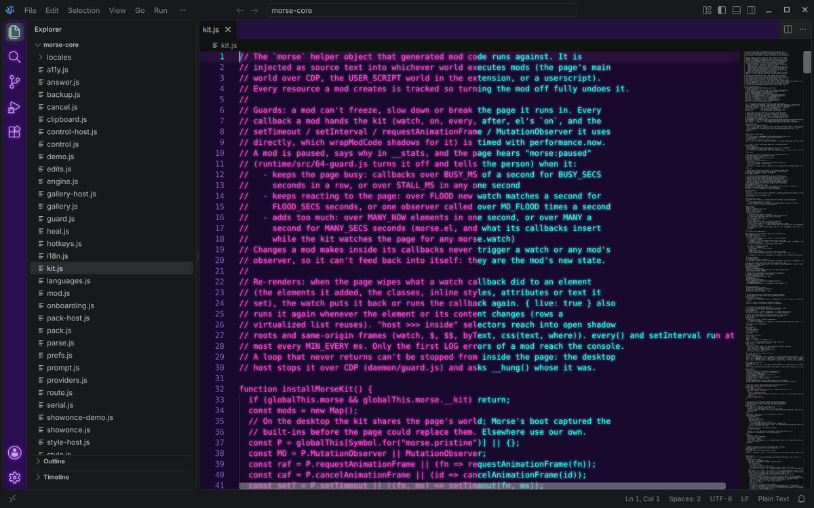 Quit the app and open it again: the change is back |

### 4. Check and stop

```bash
morse status        # which apps Morse is connected to, their windows, and the changes on in each
morse stop slack    # disconnect; the app keeps running, your changes come off until next time
```

Pressing Ctrl+C in the terminal where `morse launch` runs does the same as
`morse stop`. Quitting the app also ends `morse launch`. Add `--watch` to keep
waiting: run `morse launch <app>` again and the waiting Morse opens the app and
connects.

Morse opens most apps on a private connection that only it can use (see
[What Morse does to the app](#what-morse-does-to-the-app)). That connection
ends when Morse disconnects, so connecting to the same app again later means
opening it again: `morse launch` asks first, as for any app that is already
open. In Morse Desktop, **Connect** after **Disconnect** works without a
restart, for as long as Morse Desktop stays open.

| | |
|---|---|
|  **`morse apps`**: what's installed, and whether Morse can connect to it |  **`morse status`**: windows, pop-ups and the mods on in each, and an app started with `--watch` waiting to come back |

### What Morse follows in an app

Morse connects to every place the app shows a page: all its windows, pop-ups
that open later, side panels and embedded views (like VS Code's panels). It
keeps up when a window reloads, goes to another page or crashes. A mod saved
in one window shows up in every window it fits.

It leaves alone what isn't the app's own: embedded pages from other sites,
the developer tools, and the app's internal pages.

When the app is already open, Morse says so in one sentence and offers
`--restart`. Your answer is remembered for that app (in `~/.morse/apps.json`);
`--no-restart` forgets it.

### An app that is already running with a debugging port

If you (or a script) started the app yourself with
`--remote-debugging-port=9222`, connect to it without restarting it:

```bash
morse attach --port 9222 --app Slack
```

`--app` names the app, so your changes are saved for it.

## What Morse does to the app

- **It restarts the app with one extra switch.** For Electron apps that is
  `--remote-debugging-pipe`: the app talks to Morse over a private connection
  that Morse hands it when it starts, with no port that other programs could
  use. Tried on VSCodium, Obsidian, Joplin and every Electron release from 10
  on, on Linux; on a Mac it works the same way but hasn't been tried yet.
- **A debugging port only where the private connection can't be used:**
  Windows (not tried yet), browsers and other Chromium-based apps, apps that
  start through a launcher (Squirrel's `Update.exe`, flatpak, snap), Electron 9
  and older, `--port`, `MORSE_PIPE=0`, and `morse attach`. The switch is then
  `--remote-debugging-port`, which every Chromium-based app understands. The
  port only listens on this computer. Morse checks that, and checks that what
  answers is the app it started. While the port is open, other programs on
  this computer can connect to the app too.
- **It never changes the app's files.** Signed apps stay signed, apps that
  check their own files keep passing that check, and app updates don't undo
  anything.
- **Your changes live in your Morse folder** (`~/.morse/mods`), filed under
  the app. A change made in Slack is only ever loaded in Slack.
- **The app's own code can't see Morse.** Morse runs in a separate space in
  each window. Your changes run in the page so they can work with it, but the
  page can't reach Morse or your model.
- When you stop Morse, it takes its bar and your changes off every open
  window. The app keeps running, also when Morse quits or crashes. A debugging
  port, where one was used, closes when you quit the app.

## Changes to what an app does

Most changes are about how an app looks. Some are about what it does: "add a
button that formats my document", "when I open a note, copy its name", "make
Ctrl+Shift+K copy the line instead of deleting it". For these, Morse needs to
know how the app works inside, not only what is on the screen.

So the first time you open a desktop app with Morse, it reads how the app is
put together, in the background:

- the app's own commands, with their names (VSCodium, like VS Code, has over two thousand:
  Format Document, Save, Duplicate Selection…; Obsidian and Joplin have their
  own), and how to run them;
- how its windows talk to the rest of the app;
- what its main buttons do.

This takes a few seconds, and you can use Morse while it happens. Morse keeps
what it learned in your Morse folder (`~/.morse/profiles`), so the next time
it is ready at once. When the app updates, Morse reads it again.

When you ask for a change to what the app does, Morse gives your model the
few commands and parts of the app that fit your request. Your change can then
run the app's own commands, the same ones its menus and shortcuts run,
instead of guessing at buttons and keys.

- **Morse only reads.** It never changes the app's files (the tests check
  every file before and after), and it never replaces the app's own code. A
  change adds to what the app does; turning it off takes that away again.
- **Your request decides.** A change to how something looks doesn't need any
  of this, so Morse leaves it out.
- To see what Morse found in an app, run `morse profile code` (or any app's
  name). To try Morse without it, start it with `MORSE_PROFILE=off`.

### What it made possible

Tried on real apps with Claude Code (haiku), each request once with this and
once without, and then used the way a person would (details in
[App profiles](dev/rea.md#measurements)). With it, 10 of 11 changes worked;
without it, 4. The ones only this made possible:

| | |
|---|---|
| 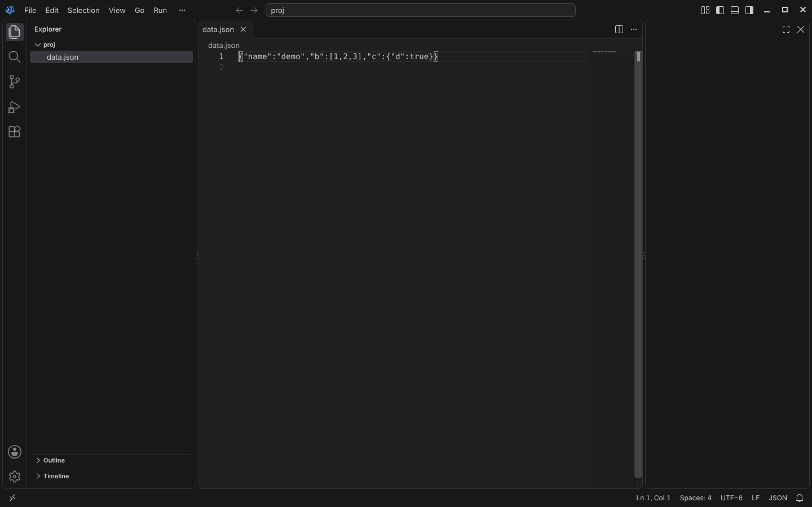 VSCodium: "add a button here that formats the document" | 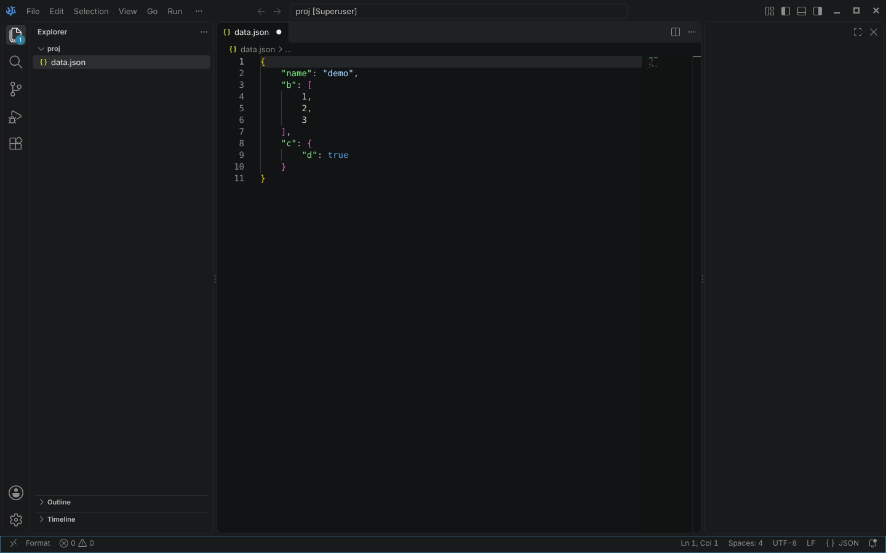 The Format button in the status bar runs VS Code's own Format Document |
| 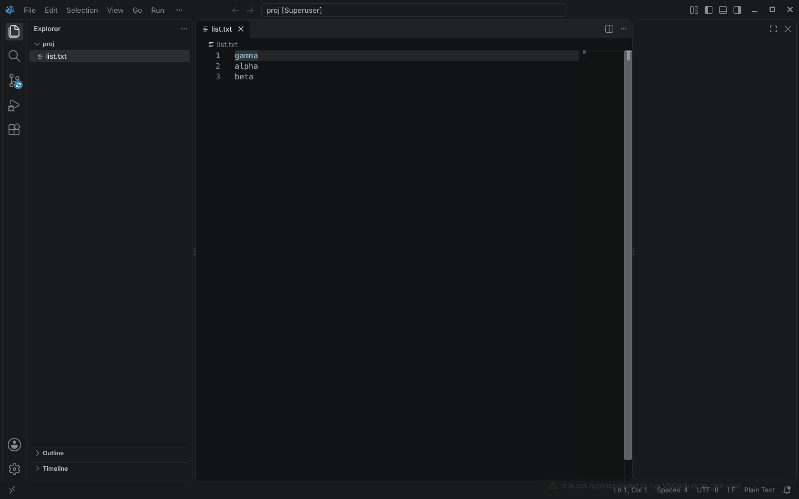 "add a button here that sorts the lines of the file alphabetically" | 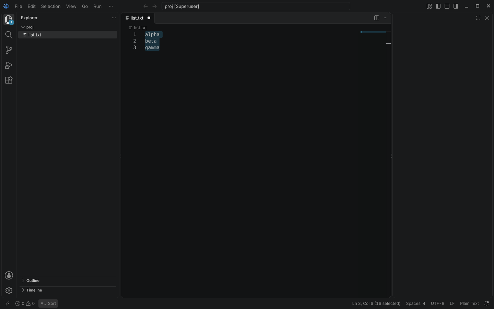 Sorted by VS Code's own Sort Lines |
| 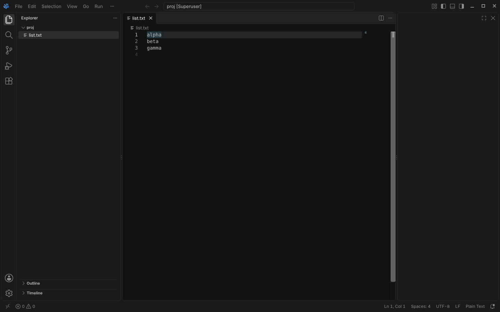 "make Ctrl+Shift+K duplicate the current line instead of deleting it", without: the line is deleted | 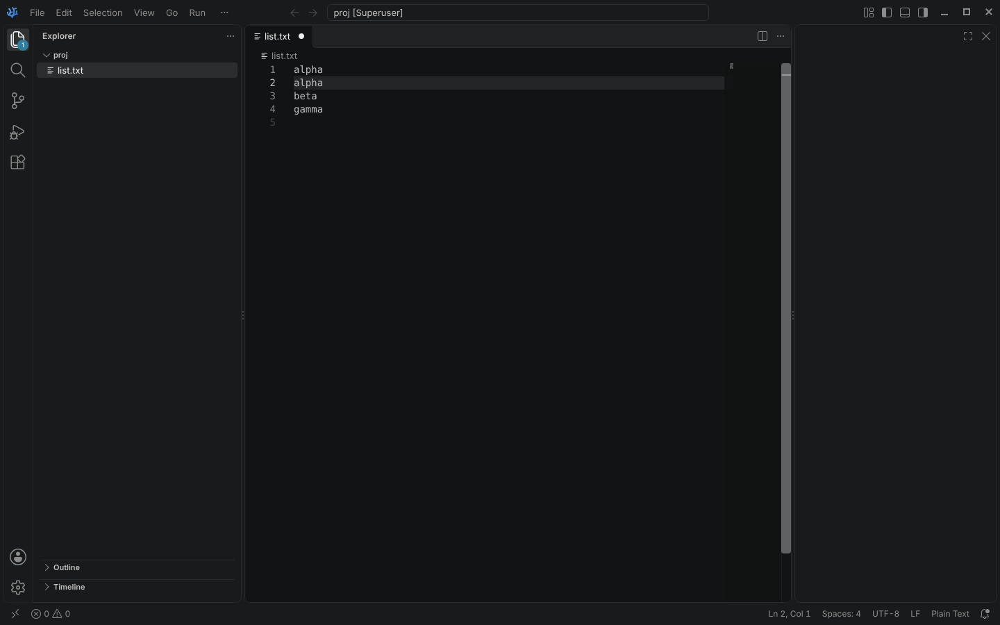 With: the line is copied |
| 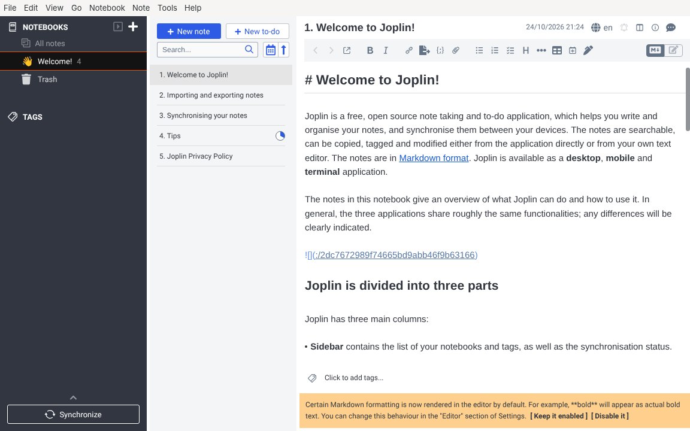 Joplin: "add a button that makes a copy of the note I'm looking at" | 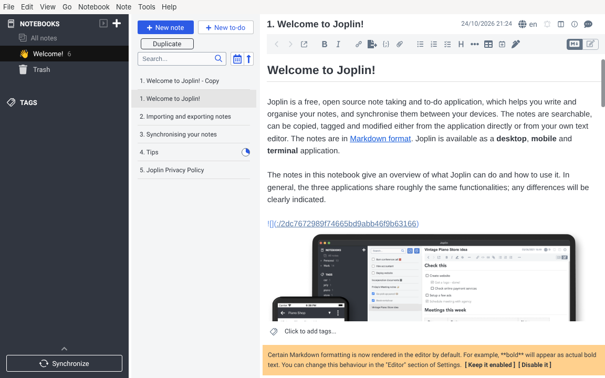 Joplin's own Duplicate made a copy of the welcome note |
| 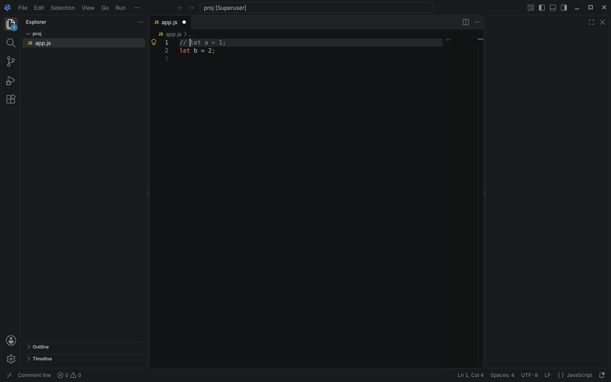 VSCodium: "add a button here that comments out the line the cursor is on" | 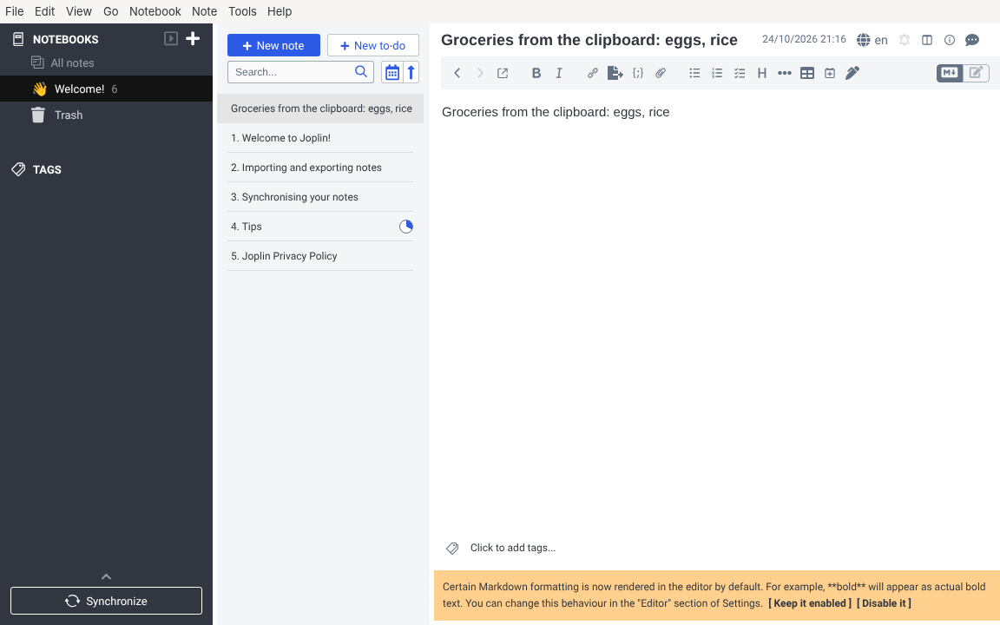 Joplin: "add a keyboard shortcut Ctrl+Alt+N that creates a new note from what is in the clipboard" |

In Obsidian the same kind of change worked with or without it (here "add a
button that inserts today's date into the note where my cursor is"), and with
it the change used Obsidian's own Insert current date:
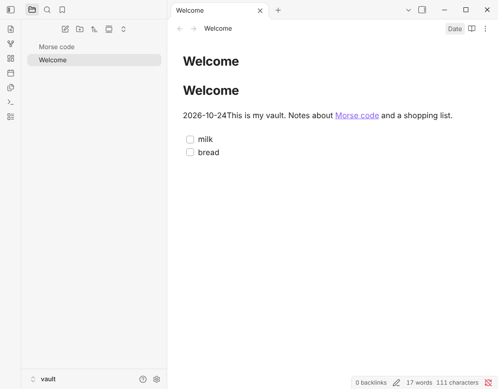

Not yet: "save the file automatically a second after I stop typing" in
VS Code. The change waited for typing in a way VS Code's editor doesn't
report, with or without this.

## Which apps can't work, and why

**Native apps.** Morse changes web pages. Apps that aren't drawn with web
technology have no page to change: Finder, System Settings, most built-in
macOS and Windows apps, Microsoft Office, and native apps like ChatGPT for Mac.
`morse apps` marks them "can't connect".

**Apps that turn off or block the debugging switch.** Morse needs the app to
open its debugging port when it starts. A few apps remove that switch, quit
when they see it, or start through a launcher that drops it (some Microsoft
Store apps on Windows). Then `morse launch` says the app "never opened its
debugging port". There is nothing Morse can safely do about that, because the
only other way in would be changing the app's files.

**AppImages on Linux.** An AppImage is the whole app packed into one file.
Morse opens it the same way as any other app. If your computer can't mount
AppImages (it has no FUSE, as on a fresh Ubuntu 24.04), Morse has the AppImage
unpack itself first. It then takes longer to open. `morse fuses` can't look
inside an AppImage, and says so.

**Electron fuses.** Electron apps can switch off some features when they are
built, using "fuses". Run this to see an app's fuses:

```bash
morse fuses slack
```

None of the fuses turn off the debugging port, so fuses alone never stop
Morse. This was checked on a real Electron app with every fuse that could
matter turned off: no running as plain Node.js, no `--inspect`, no
`NODE_OPTIONS`, only loading the app from its archive, cookie encryption on.
Morse still connected and worked. What fuses do change:

- **`--inspect` fused off**: the app's background Node.js process can't be
  debugged. Morse doesn't use it. Your changes run in the app's windows.
- **The app checks its own files** (ASAR integrity): fine, Morse never
  changes them.

**Running as root on Linux.** Electron and Chromium apps refuse to start as
the root user while their sandbox is on. `morse launch` tells you when that
happens. Run Morse as your own user. If you really must use root, add
`-- --no-sandbox`, which turns the app's sandbox off.

**Apps you can't restart.** Morse can only connect when the app starts. If an
app is in the middle of something you can't lose, wait, or use
`morse launch --restart` when it's a good moment.

**Things the app does in its background process.** Morse changes what you see
in the app's windows: layout, buttons, text, new controls, keyboard shortcuts
in the page. It can't change the app's menus, tray icon, notifications or
files on disk, because those live outside the windows.

## Tips

- If the app has a shortcut that clashes with **Ctrl+Shift+Space**, change
  Morse's in the bar's settings (the slider icon).
- `morse launch <app> -- <switches>` passes extra switches to the app, for
  example `-- --user-data-dir=/tmp/test-profile` for a separate profile.
  Morse ignores switches that would let other computers reach the debugging
  port.
- `morse pause slack` turns off every change in Slack without deleting them.
  `morse resume slack` turns them back on.

## macOS

> **Not yet tested on real hardware.** Everything in this section is built
> and checked against copies of real app folders on Linux, not on a Mac. If
> you have a Mac, the [15-minute check](dev/platform-testing.md) says what to
> try, and an issue with what you saw helps everyone.

### What to do

1. Install Node.js 22 or newer, then Morse: `npm install -g morse-cli`.
2. Open each app you want to change once the usual way, from Finder or
   Launchpad, then quit it. A Mac checks an app you downloaded the first time
   you open it. Morse starts apps from the terminal, where that first check
   can stop the app instead of asking you.
3. Run `morse apps`. It lists the apps in `/Applications`,
   `/Applications/Utilities` and `~/Applications`.
4. Run `morse launch slack --restart`. If Slack is open, Morse asks it to
   quit, the same as pressing ⌘Q. The first time, macOS asks whether your
   terminal may control Slack. Say **OK**: Morse only uses it to ask the app
   to quit. If you say no, Morse tells the app to stop at once instead,
   which can lose its window layout.
5. In the app, press **⌥Space**. The Morse bar opens.

`morse doctor` shows your macOS version, whether your Morse folder
(`~/.morse`) is private, and your shortcut.

### What Morse does on a Mac

- **It reads each app's own description** (`Contents/Info.plist`): its name,
  version and the program inside it. An app built on Electron has
  `Electron Framework` in `Contents/Frameworks`, which also says which
  Electron version. Spotify's has `Chromium Embedded Framework` instead.
  Apps with neither are native: `morse apps` leaves them out, or marks them
  "can't connect" when it knows their name (ChatGPT).
- **It starts the program inside the app**, like
  `Slack.app/Contents/MacOS/Slack`, with the debugging switch. It doesn't use
  `open -a`: that drops the switch when the app is already open, and doesn't
  say which program it started.
- **It never changes the app.** Every Mac app is signed. Changing any file in
  it (the fuses in `Electron Framework` included) breaks the signature, and
  macOS then refuses to open the app. Morse only reads. Your changes live in
  `~/.morse`.
- **It needs no permissions.** Not Accessibility, not Screen Recording, not
  Input Monitoring. The shortcut works because Morse runs inside the app's
  own windows, and clips are recorded from the app's own window. The only
  question macOS asks is the one in step 4, and only for `--restart`.
- **Apple silicon and Intel.** Most apps carry both. `morse fuses` reads the
  fuses of both parts and says so if they differ.

### Things to know on a Mac

- **⌥Space taken.** Alfred, Raycast and the ChatGPT app often use ⌥Space
  themselves, and they get the key before the app does. If the bar doesn't
  open, change Morse's shortcut in the bar's settings, or theirs.
- **Microphone and camera.** macOS can ask for the microphone on behalf of
  your terminal (not the app), because the terminal started the app. If a
  call in Slack or Discord asks for that, allow it, or open the app the usual
  way for calls.
- **The menu bar, the Dock and notifications** stay the app's own. Morse
  changes what's in the app's windows.

### Popular apps on a Mac

All of these should work, as far as Morse can tell without a Mac. None of
them has been tried on one yet.

| App | Built on | What to expect |
|---|---|---|
| Slack | Electron | Only one copy can run, so use `--restart` when it's open. Closing its window doesn't quit it. |
| Discord | Electron | Its update check runs first. If Discord restarts itself after an update, Morse loses it: run `morse launch discord` again. |
| Spotify | Chromium Embedded Framework | Not Electron. Apps built this way usually accept the debugging switch. If this Spotify release doesn't, `morse launch` says it "never opened its debugging port". |
| VS Code | Electron | Works on Linux (VSCodium). Its own protection against outside code is kept on. |
| Notion | Electron | Should work like Slack. |
| Obsidian | Electron | Works on Linux. |
| Figma | Electron | The panels and toolbars can change. The design itself is drawn as a picture, so Morse can't point at shapes in it. |

## Windows

> **Not yet tested on real hardware.** Everything in this section is built
> and checked against copies of real install folders and shortcuts on Linux,
> not on Windows. If you have a Windows PC, the
> [15-minute check](dev/platform-testing.md) says what to try.

### What to do

1. Install Node.js 22 or newer from nodejs.org, then, in PowerShell or
   Windows Terminal: `npm install -g morse-cli`.
2. Run `morse apps`.
3. Run `morse launch slack --restart`.
4. In the app, press **Ctrl+Shift+Space**. The Morse bar opens.

`morse doctor` shows your Windows version and build, where your Morse folder
is, and whether Morse can see which apps are open.

### What Morse does on Windows

- **It finds apps** in `%LOCALAPPDATA%\Programs` (VS Code, Obsidian, Notion
  and most apps that install without asking for an administrator),
  `%LOCALAPPDATA%` (Slack, Discord, Figma), `%APPDATA%` (Spotify), Program
  Files, and the Start menu, for everything else, including apps on other
  drives.
- **Slack, Discord and Figma keep one folder per version.** They install
  with Squirrel: an `Update.exe` and a folder like `app-4.41.105` for each
  version. Morse starts the app in the newest folder. If it only finds
  `Update.exe`, it asks `Update.exe` to start the app with the debugging
  switch, then finds the app by that switch, and waits up to 20 seconds while
  the app checks for updates first.
- **Folders with spaces work.** Morse starts programs with a list of
  arguments, never by typing a command line, so `C:\Program Files` and
  `D:\Tools\Acme Chat` need no quotes.
- **`--restart`** asks each window of the app to close, waits up to 10
  seconds, then ends the app and every process it started. Slack and Discord
  only hide in the tray when their window closes, so for them the second step
  is usual. It's the same as quitting from the tray icon.
- **No firewall question.** The app's debugging port and the Morse helper
  only listen on this computer, so Windows Firewall has nothing to ask about.
- **Your Morse folder is `%USERPROFILE%\.morse`** (`C:\Users\you\.morse`).
  On macOS and Linux, Morse makes its files readable by you only. Windows
  doesn't use those settings. Instead, your user folder can only be opened by
  you, administrators and Windows itself, and the Morse folder keeps those
  permissions. Morse doesn't change them. If you move the folder with
  `MORSE_HOME` to a shared drive, `morse doctor` warns you, because other
  people may be able to read your API keys there.
- **It never changes the app.** Most Windows apps are signed too, and Morse
  only reads them.

### Things to know on Windows

- **Ctrl+Shift+Space**, because Alt+Space opens the window menu on Windows
  (and PowerToys Run). In VS Code, Ctrl+Shift+Space also shows hints for a
  function. If that's what you see, change Morse's shortcut in the bar's
  settings.
- **Colors** show in Windows Terminal, PowerShell and the old console. Output
  saved to a file has none, and `NO_COLOR=1` turns them off. In the old
  console, some fonts show the dots in `morse apps` as question marks.
  Windows Terminal's font has them.
- **Files you edit in Notepad still load**, whatever line endings Notepad
  saves with. Morse writes its own files with Unix line endings, which every
  editor on Windows reads.
- **Microsoft Store versions** (Spotify from the Store) run from a protected
  folder and may ignore the debugging switch. `morse apps` marks them.
  Install the app from its own website instead.
- **Apps built on Edge's WebView2** (the new Teams, the new Outlook,
  WhatsApp) aren't Chromium apps Morse can start with the switch. Morse can't
  connect to them for now.

### Popular apps on Windows

As on the Mac: all of these should work, and none has been tried on Windows
yet.

| App | How it installs | What to expect |
|---|---|---|
| Slack | Squirrel, in `%LOCALAPPDATA%\slack` | Hides in the tray when closed, so `--restart` ends it after 10 seconds. |
| Discord | Squirrel, in `%LOCALAPPDATA%\Discord` | Its update check runs first. Morse waits for the real app. |
| Spotify | `%APPDATA%\Spotify` from spotify.com | Chromium Embedded Framework, not Electron. The Store version may not work. |
| VS Code | `%LOCALAPPDATA%\Programs\Microsoft VS Code`, or Program Files | Morse starts `Code.exe`, not the `code` command. |
| Notion | `%LOCALAPPDATA%\Programs\Notion` | Should work like Slack. |
| Obsidian | `%LOCALAPPDATA%\Programs\Obsidian` | Works on Linux. |
| Figma | Squirrel, in `%LOCALAPPDATA%\Figma` | The panels and toolbars can change, not the design itself. |

### Fuses, on both

Electron apps can lock some features when they're built (`morse fuses <app>`
shows them). None of them turns off the debugging switch, so none of them
stops Morse:

- **`RunAsNode`**: when it's on and your terminal has
  `ELECTRON_RUN_AS_NODE` set, the app would start as plain Node.js with no
  window. Morse clears that setting (and `NODE_OPTIONS`) for the app it
  starts.
- **`EnableNodeCliInspectArguments`** off: the app's background process
  can't be debugged with `--inspect`. Morse doesn't use it.
- **ASAR integrity** on: the app checks its own files. Morse never changes
  them.

What does stop Morse is an app that quits when it sees the debugging switch,
or ignores it. `morse launch` then says the app "never opened its debugging
port".

## Tested on

Real apps, downloaded from their makers and installed the way their own
instructions say, on Linux (Ubuntu 24.04 in a container, running as root, so
each had `-- --no-sandbox`). Each was opened with `morse launch`, changed
using the real shortcut, mouse and keyboard
([`demo/try-real-app.js`](../demo/try-real-app.js)), saved, quit, and opened
again with `morse launch`. The time is from pressing Enter to seeing the
change. The test machine was shared and heavily loaded, so times vary.

October 24, 2026, with a strong model (Claude Code, sonnet or opus):

| App | How it was installed | What was asked | Result | Model, time | Back after reopening |
|---|---|---|---|---|---|
| Visual Studio Code 1.143.1 (Microsoft's own build, Electron 43.7.7) | its `.deb`, from Microsoft's package repository | "make the whole editor look like a warm paper notebook: cream backgrounds, dark brown text, and a serif font in the sidebar and the tabs" | Cream sidebar, tabs and editor, brown text, serif file names. Some code colors are hard to read on cream | opus, 18.0 s | Yes |
| VSCodium 1.140 (Electron 43) | its `.deb` | "give the editor a synthwave look: deep purple background, neon pink and cyan text, and a glowing purple activity bar" | All of it, as asked | opus, 22.9 s | Yes |
| Obsidian 1.14.5 (Electron 43) | its AppImage, in `~/Applications` | "make my notes look like an old typewritten page: yellowed paper, a typewriter font, and the headings underlined in dark red" | All of it, as asked | sonnet, 7.8 s | Yes |
| Logseq 0.10.9 (Electron 27) | its AppImage | "make the journal look like a lined paper notebook: cream ruled lines behind the text, a handwriting style font, and much bigger page titles" | Ruled cream paper with a red margin line and a big serif date (a serif, not a handwriting font) | sonnet, 6.4 to 7.3 s in three runs | Not checked: in the scripted runs the save never happened (neither Enter nor a click on Save), so reopening wasn't tried |
| Visual Studio Code 1.143.1 | the same | Nine more, from "make VS Code look like a classic Windows 95 app…" to "when I press Ctrl+Alt+P, switch to a presentation mode…", a focus timer, a word count, a Focus button, a sticky note, the sidebar on the right ([the showcase](showcase/README.md)) | All nine. Some were asked again with other words first; the showcase says which | opus (sonnet for one), 18 to 36 s | Yes, all nine |
| Obsidian 1.14.5 | the same | Five more: a typewriter look, a New daily note button, Hide distractions, pinned notes, large print ([the showcase](showcase/README.md)) | All five; the button really makes and opens the day's note | opus (sonnet for one), 9 to 15 s | Yes, all five |
| Joplin 3.7.21 (Electron 42) | its AppImage, in `~/.joplin` | "turn the note list into big cards" | Not done: on the busy machine Joplin was slow to start. Once its debugging port didn't answer in time and `morse launch` said "The model took too long to answer" (wrong words, now fixed); once it quit at once because another Joplin was already open | sonnet | |

An earlier run, the same day, with Claude Code (haiku):

| App | What was asked | Result | Time | Back after reopening |
|---|---|---|---|---|
| VSCodium 1.140 | "make the status bar bigger" (pointing at it) | The status bar got taller (22 to 36 pixels) with bigger icons | 10.3 s, and 13.7 s on a second run | Yes, both times |
| Obsidian 1.14.5 | "hide this ribbon" (pointing at the left ribbon) | The ribbon is gone | 5.6 s, and 15.9 s on a second run | Yes, both times |
| Joplin 3.7.21 | "hide this button, I don't use sync" (pointing at Synchronize) | The button is gone. Its code relies on Joplin's generated names, so a Joplin update may break it | 13.0 s | Yes |

`morse apps` found Visual Studio Code, VSCodium, Obsidian and Joplin
(Logseq was in a folder it doesn't search, so it was opened by its path), and
`morse fuses` reported each one (from the binary for the two `.deb` apps; for
the AppImages it says it can't look inside). Morse Desktop shows each of them
with its own icon, read from the app (the icon theme for the `.deb` apps, and
from inside the AppImage for the others).

| | |
|---|---|
| 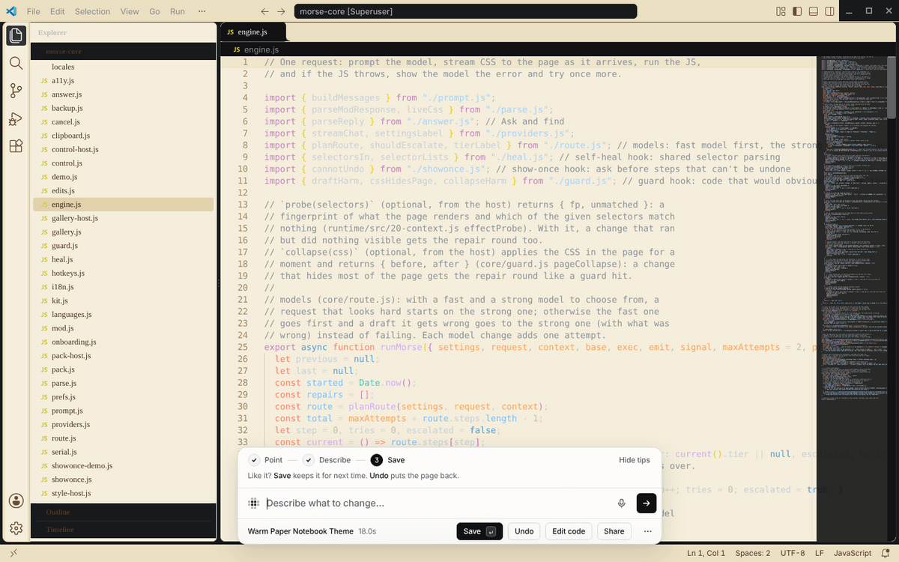 Visual Studio Code as a paper notebook | 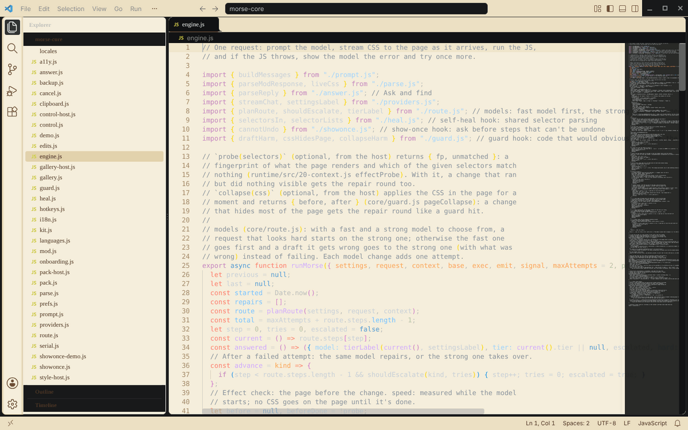 Visual Studio Code opened again: the change is back |
| 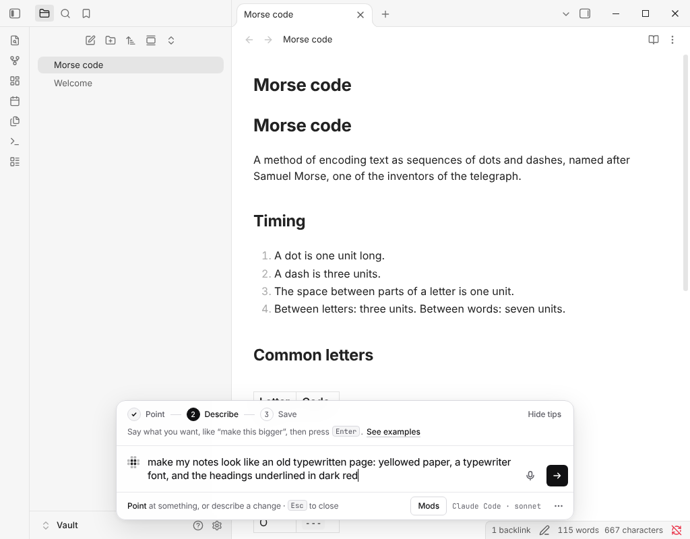 Obsidian: the request in the bar | 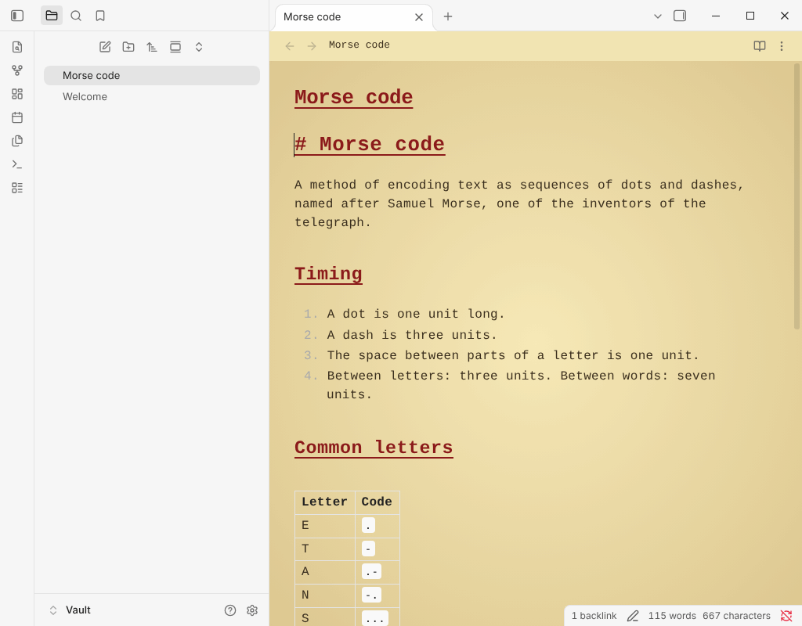 Obsidian opened again: the typewritten page is back |
| 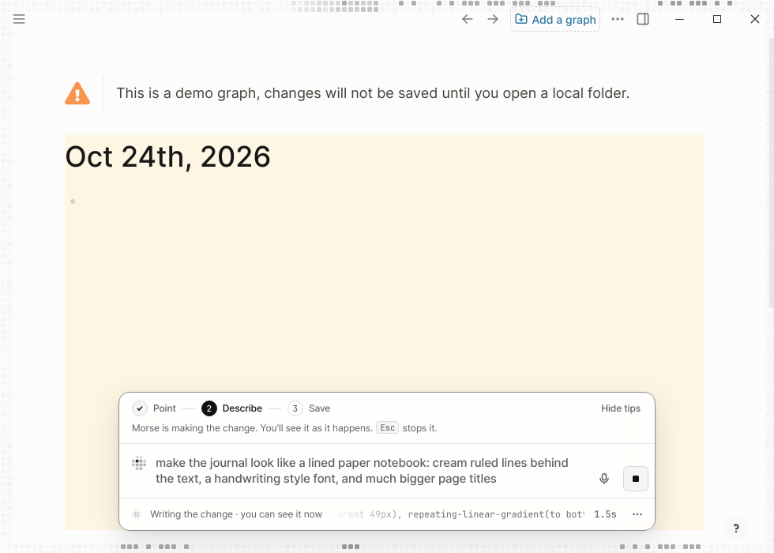 Logseq while the model writes the change | 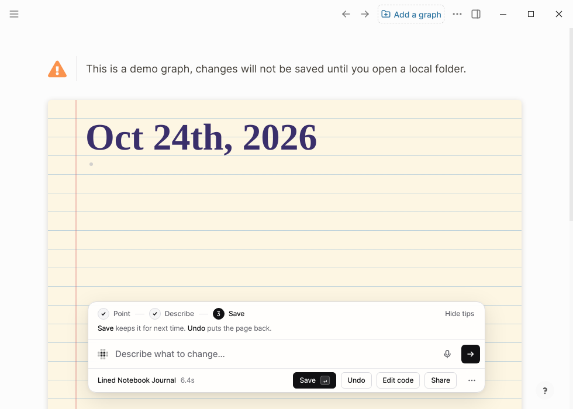 Logseq as a lined notebook |

What these apps turned up, now fixed:

- **VS Code's window refused Morse's bar.** VS Code only lets its own code put
  HTML into its window ("Trusted Types"), and that rule reached Morse too, so
  the bar never appeared. Morse now builds its bar piece by piece there. The
  rule still protects VS Code's own code.
- **`morse apps` didn't find VSCodium or the AppImages.** It now reads the app
  menu and looks for AppImages, and VSCodium is in its list of known apps.
- **Obsidian's AppImage quit at once**, because the computer had no FUSE.
  Morse now has it unpack first.
- **Joplin quit with "Unknown flag"**, because Morse passed a second switch it
  didn't need. Morse now passes only the debugging port.
- **A saved change in an AppImage app wouldn't have come back**: an AppImage
  runs from a new folder each time, and Morse matched changes by the whole
  folder path. It now matches by the page inside the app.
- **The Mods panel said "Stops every mod on this site"** in an app. It now
  says "in this app".
- **Morse Desktop showed a letter for every app.** It now shows the app's own
  icon: from the icon theme, the app's folder, or inside the AppImage, read
  without running it. Logseq's AppImage carries Electron's default icon as
  its main picture; Morse uses Logseq's own icon from inside the app instead.
- **A busy app's slow debugging port read as a slow model.** When Joplin
  didn't answer in time, `morse launch` said "The model took too long to
  answer" before any model was asked. It now says the app didn't answer in
  time.
- **A request with "everywhere" in it became [Your style](your-style.md)**,
  for every site and app, even when it named the app or a part of it ("make VS
  Code look like Windows 95… black text everywhere so the file list stays
  readable" did). Now "everywhere" alone means every site and app only when
  the request names no app and no part of one ("the editor", "the file
  list"). "On every site" and "in all apps" still always do.
- **Morse stopped Visual Studio Code's own code while it started up.**
  Once a mod's code had run, Morse treated a page that didn't answer for 6
  seconds as frozen by that mod, and stopped whatever was running. VS Code
  starting on a busy machine keeps its page busy that long by itself (up to
  8 seconds at a time, measured), so its startup was cut off: the file list
  without names, no syntax colors, a blank window. Now, with no mod code
  being run, Morse waits 20 seconds before stepping in.

Not tested: Spotify, Slack, Discord and Signal. Spotify's downloads
(repository.spotify.com, download.spotify.com, Snapcraft and Flathub) aren't
reachable from the test machine, and Spotify shows nothing but a sign-in
screen without an account; Slack, Discord and Signal need an account too. Also
not tested: Flatpak and Snap installs, macOS, Windows and Wayland. Signing in
to anything wasn't tested. For macOS and Windows, see what's ready and how to
check it in [macOS](#macos) and [Windows](#windows).

### Websites

The same check on public websites, with the built Chrome extension in
Chromium 153 on Linux, paired with `morse serve` and Claude Code (haiku). Each
change was saved, then the page was reloaded.

| Site | What was asked | Result | Time | Back after a reload |
|---|---|---|---|---|
| pypi.org (strict rules for scripts) | "add a back to top button in the bottom right corner" | A round ↑ button. With “Allow User Scripts” off, the site blocked Morse's code and the model's second try was an arrow that only looks like a button (32 s) | 12.6 s | Yes |
| gitlab.com (strict rules, but code is allowed) | the same | The button works, with “Allow User Scripts” on or off | 12.3 s | Yes |
| gitlab.com | "hide this project information box" | Partly: it hid the description in the box, not the whole box | 7.8 s | Yes |
| pkg.go.dev | "make the code examples bigger" (pointing at one) | Bigger code text | 7.6 s | Yes |
| rubygems.org | "make the download numbers much bigger" (pointing at them) | The first try changed nothing. The second made the total downloads big | 8.3 s | Yes |
| hub.docker.com | "make these code blocks bigger with a dark background" | Bigger text on dark blocks | 11.6 s | Yes |
| nodejs.org (the docs) | "hide the left sidebar so the docs use the full width" | Failed, three times: the whole page went blank. The model hid a style the sidebar and the docs share. Undo puts the page back | 10 to 26 s | (blank) |

Wikipedia, Hacker News, MDN, YouTube, the BBC and GitHub's pages couldn't be
tried: the test machine's network doesn't reach them.

Again on October 24, with Claude Code (sonnet) and the pictures in these docs
([`demo/shoot-real.js`](../demo/shoot-real.js),
`npm run store:screenshots`): nodejs.org as a printed book (13.4 s, and a
follow-up, 9.8 s), copy buttons on pypi.org's code examples (12.7 s), and on
hub.docker.com an answer about a tab (5.3 s), where to find the image's
versions (7.1 s) and Explain this page (6.4 s). Page tools' Dark mode and
Higher contrast were paused on pkg.go.dev, "because it was slowing this page
down": a guard that may be too strict on a busy machine. Both worked on
hub.docker.com.

| | |
|---|---|
|  GitLab: the back to top button (bottom right) |  PyPI after a reload: the button is still there |
|  Docker Hub: bigger code on dark blocks |  PyPI with “Allow User Scripts” off: only an arrow, which doesn't scroll |

The same flow can be run on any installed app with
[`demo/try-real-app.js`](../demo/try-real-app.js), and on websites with
[`demo/try-real-sites.js`](../demo/try-real-sites.js) and
[`demo/real-sites.json`](../demo/real-sites.json).

## How this was tested

On a real Electron 45 on Linux, with a small music app built for it,
[`demo/electron-app`](../demo/electron-app) ("Tunes"). It has what real apps
have: a native menu bar, a preload script with context isolation and the
renderer sandbox on, its UI on a custom `app://` address, a `<webview>` side
panel served from a random local port, a second window from a `file://` page,
and a single-instance lock. It is packaged the way apps ship: Electron
renamed to `tunes`, with the app next to it, unpacked or as
`app.asar`.

- [`demo/shoot-electron.js`](../demo/shoot-electron.js) drives the whole flow
  with real keyboard and mouse input from the X server (xdotool) and takes the
  screenshots above: `morse launch`, the shortcut, pointing, a change, Save,
  quitting with the app's own Ctrl+Q, `morse launch` again (the change is
  back), the Mods panel, the second window, `morse status`, `morse stop` and
  `morse fuses`.
- It ran with the test model, and once with **real Claude Code (haiku)**,
  which built a working "Sleep: off / 15 / 30 / 60 min" picker in about 10
  seconds. That run found a real problem: haiku's first try asked for the
  minutes with `prompt()`, which Electron doesn't support. Morse now tells the
  model not to use it. Run again for the pictures below (October 24), haiku
  built a sleep timer picker under the player in about 4 seconds.
- The same app was run as a normal user with Chromium's sandbox fully on and
  connected with `morse attach --port`.
- [`tests/electron.test.js`](../tests/electron.test.js) runs the flow on every
  `npm test` when Electron and a display are there, and skips with
  a message otherwise. To set it up:

  ```bash
  npm install --prefix ~/.cache/morse/electron electron
  node ~/.cache/morse/electron/node_modules/electron/install.js   # only if dist/ is missing
  DISPLAY=:99 node --test tests/electron.test.js
  ```

Real installed apps (Visual Studio Code, VSCodium, Obsidian, Logseq, Joplin)
are under [Tested on](#tested-on). Not tested: Slack, Discord or Spotify, macOS and Windows, and Wayland. The macOS and Windows parts (reading
`.app` bundles, Squirrel installs and Start menu shortcuts, quitting with
AppleScript or taskkill, starting apps, the fuses in a Mac app) are checked
on Linux against copies of real app folders and real file formats
([`tests/platforms.test.js`](../tests/platforms.test.js)), not on the real
systems.
