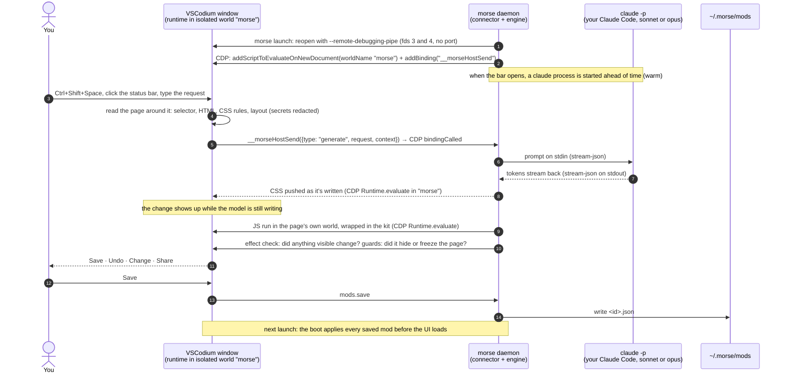

# How a change really happens

A real, unedited recording of everything on this page: [`docs/launch/how-it-works.mp4`](../launch/how-it-works.mp4)
(VSCodium on the left, the live trace on the right; made by
[`demo/record-how-it-works.sh`](../../demo/record-how-it-works.sh)). Its trace:
[`docs/launch/how-it-works-trace.log`](../launch/how-it-works-trace.log). Run any
desktop session with `MORSE_TRACE=1` (or a file path) to see the same lines.
The lines hold your requests, what you pointed at and the model's results, never
keys, tokens or settings. A file path is appended to as given (like a shell
redirect, so a symlink is followed). A file it creates is readable only by you.
`0`, `false`, `off` and `no` turn it off.

## The pieces

| Piece | What it is | Where |
|---|---|---|
| **`morse` (daemon)** | A Node.js process on your computer. The CLI today; Morse Desktop runs the same code. | `daemon/` |
| **The connector** | Opens the app with `--remote-debugging-pipe`, a private channel over the app's file descriptors 3 and 4 that only Morse holds (a `--remote-debugging-port` on 127.0.0.1 where that can't be used), and talks to each window over the Chrome DevTools Protocol (CDP). | `daemon/connector.js`, `daemon/cdp.js` |
| **The runtime** | Morse's own code inside the app's page: the bar, pointing, reading the page, applying CSS. It runs in an **isolated world** named `morse`, so the page's scripts can't see or call it. A 50 KB boot loads on every page. The full UI loads the first time you open the bar. | `runtime/boot.js`, `runtime/src/` |
| **The engine** | Turns a request into a change: builds the prompt, streams the answer, applies CSS as it arrives, runs the JS, checks it did something, one repair round. | `core/engine.js`, `core/prompt.js`, `core/parse.js` |
| **The harness** | Runs the model you already have: your Claude Code (`claude -p … --model sonnet`, or `opus` for new features and restyles) or Codex CLI, or the Anthropic / OpenAI API with your key. | `daemon/harness.js`, `core/providers.js` |
| **The kit** | Helpers the model's code uses (`morse.watch`, `morse.el`, `morse.css`…), with guards that pause a mod that slows or freezes the page. | `core/kit.js`, `core/guard.js` |
| **Mods** | A saved change: a small JSON file with the request, CSS and JS. | `~/.morse/mods/<id>.json` |

## One change, step by step (desktop app)



From the real run in the recording (`MORSE_TRACE`, made when the first model was still haiku; today it starts on sonnet, and a request like this one, a new clock, on opus):

```
16:00:04.431  bar      "add a big live clock to the status bar" · pointed at #workbench.parts.statusbar …
16:00:04.431  model    claude-code · haiku
16:00:04.434  harness  using a Claude Code process started when the bar opened: claude -p --output-format stream-json
                       --input-format stream-json --verbose --include-partial-messages --tools "" --strict-mcp-config
                       --disable-slash-commands --no-session-persistence --system-prompt-file <morse instructions> --model haiku
16:00:06.156  page     CSS reaches the page while the model is still writing (1725ms), pushed over CDP to Morse's world
16:00:09.706  page     JS (388 chars) run in the app's own page world via CDP Runtime.evaluate
16:00:11.132  done     ✓ "Live clock in status bar" in 6701ms · 43 chunks streamed · css 202 chars · js 388 chars · 1 attempt
16:00:14.155  save     Saved "Live clock in status bar" to ~/.morse/mods/ · it runs again every time this app opens
```

Claude Code runs with no tools (`--tools ""`), no MCP servers, no slash commands and no saved
session, in an empty folder: it can only write text back. Morse applies that text itself.

## Websites

A website works the same way: the Morse app opens Chrome, Edge, Brave, Arc
or Vivaldi with a Morse profile of its own (since Chrome 136, a browser takes
no remote control of its everyday profile), connects over CDP like any app,
and injects the same runtime into each page.

## Where to look next

- [Architecture](architecture.md): every module, the mod format, security.
- [Testing](testing.md): what was verified for real and how.
