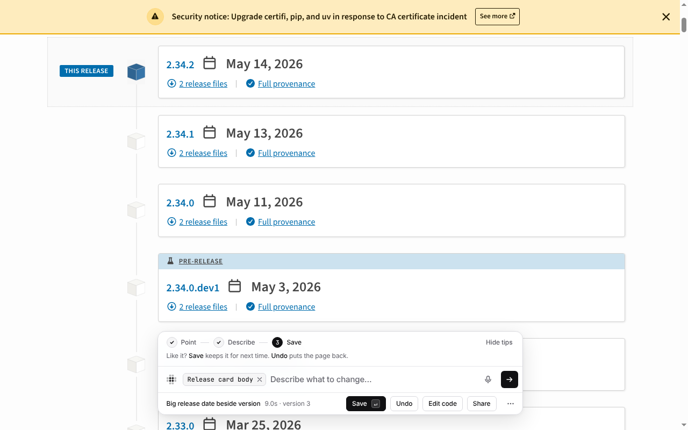
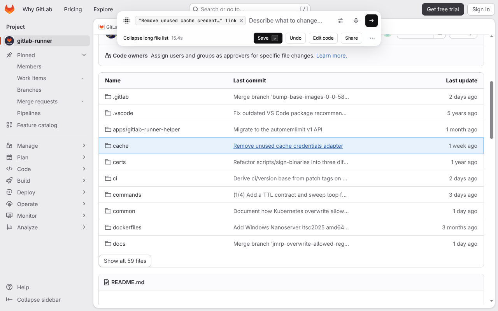
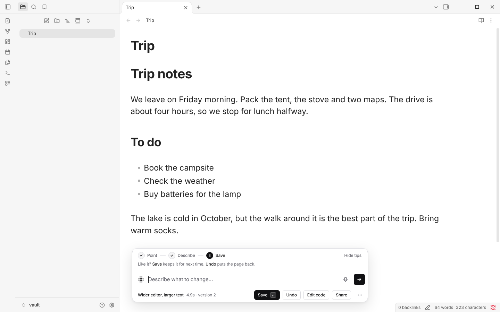
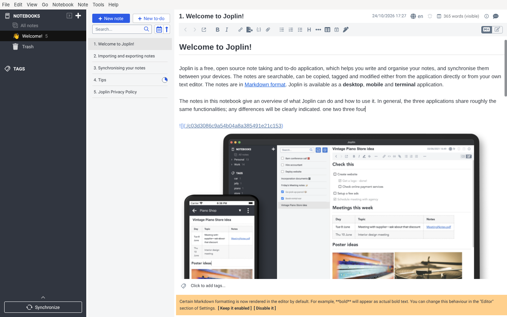
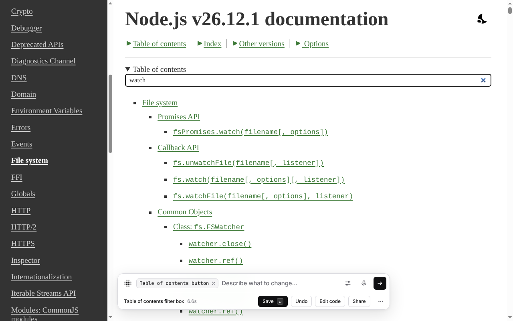
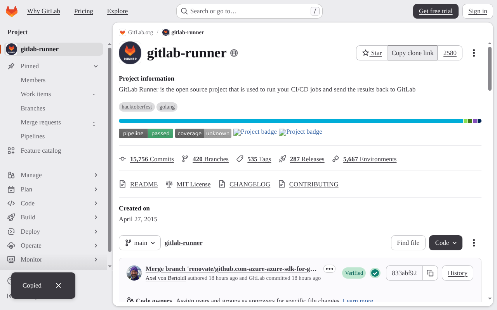
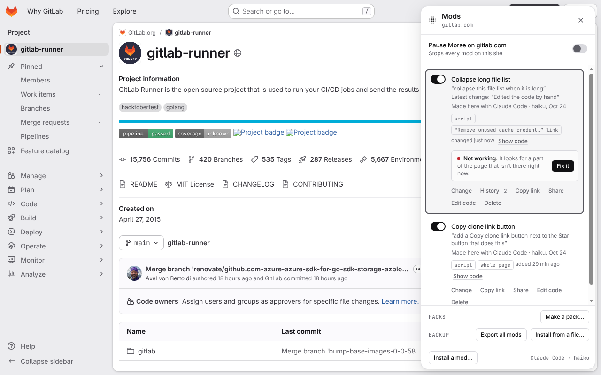
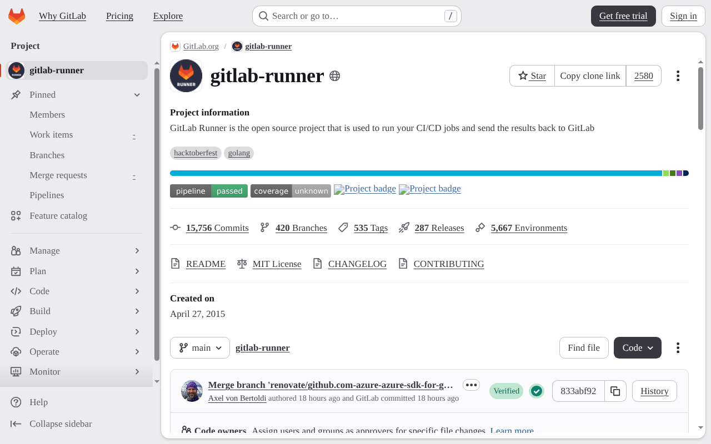
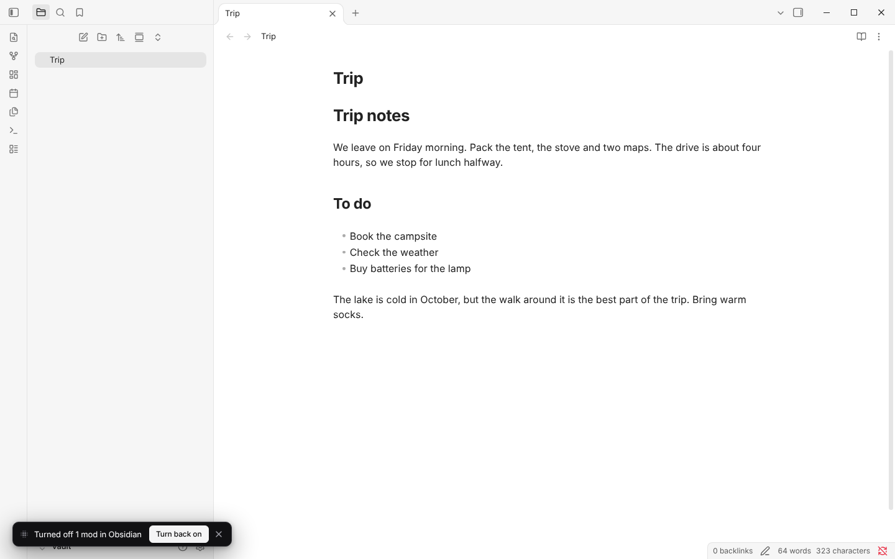

# Dogfood: 12 real tasks, October 24

Morse used the way a person would, on real apps and real websites, with
**Claude Code (haiku)**, then fixed what got in the way. Every task used the
real shortcut, mouse and keyboard: `xdotool` on the desktop apps, the built
Chrome extension in Chromium for the websites, paired with `morse setup --pair`
from the welcome page. Each task was watched closely on its own screen, with
`MORSE_TRACE` on.

- **Apps:** VSCodium 1.140, Obsidian 1.14.5 and Joplin 3.7 (AppImages), each
  opened with `morse launch` and its own fresh profile.
- **Websites:** pypi.org, gitlab.com and nodejs.org. A second, fresh browser
  profile with no model connected installed a mod from a share link.
- Times are from pressing Enter to the result, as the bar shows them.

## The tasks

| # | Task | Before the fixes | After |
|---|---|---|---|
| 1 | PyPI: “show the release date next to every version, big” (pointing at one release), then “don't repeat the small date underneath”, then “a bit smaller, and put a calendar icon before it” | Worked the first time (10.3 s), two follow-ups (7.8 s, 10.6 s), still there after a reload. **Ctrl+Z** stepped back to version 2, and then nothing brought version 3 back: it was gone, even from History | **Ctrl+Shift+Z** (or Ctrl+Y) goes forward again |
| 2 | Share that mod by link and install it in a fresh browser profile, where “Allow User Scripts” is off | The share page and the review were clear. Then PyPI lost **every** release date: the mod's look (hide the small date) ran, its code (add the big date) waited. The notice said “The new look already shows” | A mod whose code waits shows nothing until it can run whole. The notice says so, and its title has its own line |
| 3 | GitLab: “collapse this file list when it is long” | Worked the first time (16.8 s): a “Show all 59 files” button that turns into “Collapse list”. Back after a reload. But pointing chose one link in one row: nothing let you choose the whole list | **Alt+↑** (⌥↑) chooses the bigger part around what you pointed at, and the bar says so |
| 4 | Obsidian: “make the editor wider and the font bigger”, then “a little smaller” | Worked the first time (7.2 s) and the follow-up (4.9 s). Back after quitting with Ctrl+Q and `morse launch` again | Same |
| 5 | The off switch, Alt+Shift+0, in Obsidian | Worked both ways, but said “Turned off 1 mod **on this page**” in a desktop app | “Turned off 1 mod in Obsidian”, and the Mods panel says “Mods are turned off in Obsidian” |
| 6 | Show me once on GitLab: open **Code**, click the copy button next to the HTTPS address, then “add a Copy clone link button next to the Star button that does this” | The button appeared (9.4 s), but clicking it only opened the menu: the copy button has no words, only the name “Copy URL”, and Morse's helper looked for the words. It also used GitLab's numbered menu id (`dropdown-toggle-btn-45`), which can change | The same saved mod now copies the address (no new model call). Show me once skips numbered ids |
| 7 | Joplin: “add a word count to the editor” | Worked the first time (12.8 s; the model thought for 10 s first). The count goes up as you type. It says “361 words (visible)”, an odd word | Same (faster model start, see below) |
| 8 | VSCodium: “hide the sidebar until I hover over the left edge” | 19.5 s (17 s of it thinking). The sidebar's contents went, its empty space stayed, and hovering did nothing. The follow-up took **86.7 s** (83.6 s thinking) and only half worked. Undo put everything back | 6.4 s. Still not right: haiku doesn't understand VS Code's layout. Two of its tries hid every part of the window: one is now caught and tried again, the other was a different wrong part. **Not solved** |
| 9 | Break a mod and let self-heal fix it: GitLab's file list mod, edited by hand to look for something that isn't there | The Mods panel said “Not working. It looks for a part of the page that isn't there right now” with **Fix it**. The fix worked the first time (10.9 s) and held after a reload | Same |
| 10 | Your style: “Georgia font, bigger text and underline links everywhere” | Instant, no model. On GitLab and the Node.js docs right away. The toast says it “follows you to every site and app”, but a style made in Chrome doesn't reach desktop apps (they keep their own) | Paired with the Morse helper, Chrome and the apps share one style. Not paired, the toast says where it goes: “every site in Chrome” |
| 11 | Node.js docs: “add a filter box at the top of this table of contents that filters the entries as I type” | — (done after the speed fix) | Worked the first time (8.2 s). Typing “watch” leaves the matching entries and their headings. Back after a reload |
| 12 | Open VSCodium with `morse launch codium -- --no-sandbox --user-data-dir=<a long folder>` | It quit at once (its folder path was too long for its own socket). Morse said **“Morse couldn't reach the model”** the first time, and the second time told a root user to add `--no-sandbox`, which was already there | It says the app closed right after it started and to open it once on its own to see why |

## What was fixed

**Things that made a task fail**

- **Half a mod.** With “Allow User Scripts” off, a mod's code waits, and its
  look used to show alone. For many mods the look only makes sense with the
  code: here it hid PyPI's dates and the code that adds the big ones never ran.
  Now the look waits with the code. Mods that only change how things look run
  as before. `runtime/boot.js`, the words in the notice, the toolbar popup and
  [Troubleshooting](troubleshooting.md).
- **Buttons with no words.** Show me once names an icon button by its name
  (“Copy URL”), and the model looks for those words. Morse's helper for that
  now matches a button's name as well as its words (`morse.waitFor`,
  `morse.byText` in `core/kit.js`), and Show me once no longer records ids
  that end in a counter (`core/showonce.js`).
- **Hiding the whole window.** Morse already caught a change whose look hid
  most of the page (the Node.js docs). In VSCodium the full-window background
  was still there, so it looked fine to Morse. It now counts only spots that
  show words, a picture, a field or a button, or a smaller box
  (`core/guard.js`), and checks again after a change's code has run
  (`core/engine.js`). The model also gets a note when the page's panes are
  placed by the app's own code, and how not to match every pane around one
  (`runtime/src/20-context.js`).

**Things that confused**

- **Going forward again** after Ctrl+Z (`runtime/src/60-generate.js`,
  [Changing things](changing-things.md#keep-improving-it)).
- **Choosing a bigger part** with Alt+↑ after pointing
  (`runtime/src/41-keypick.js`, [Changing things](changing-things.md#point)).
- **The off switch** names the app on the desktop (`runtime/src/63-control.js`).
- **An app that quits on start** is no longer reported as a model problem, and
  root isn't blamed when `--no-sandbox` is already there
  (`daemon/apps.js`, `daemon/desktop.js`).
- `MORSE_TRACE` shows where mods are really saved (`MORSE_HOME`), and says when
  the wait is the model thinking.

**Fixed later, from the first list of what wasn't**

- **Your style in Chrome and the apps** (task 10). When Chrome is paired with
  the Morse helper, they share one style: Chrome syncs its copy with
  `~/.morse/style.json` through the helper (`core/style-sync.js`,
  `/v1/style` in `daemon/bridge.js`), and whichever side changed since they
  last agreed wins. Not paired, the toast and the review say exactly where it
  goes: “every site in Chrome” or “every app you open with Morse”
  ([Your style](your-style.md)).
- **Esc on a result** still keeps it, but now says so: “Kept … Closing the bar
  keeps a change.”, with Undo right there (`runtime/src/60-generate.js`).
- **A stale extension after a rebuild.** A build from `npm run build` puts an
  id in the extension and in `build-id.txt`. When they differ, the bar
  says “Morse was rebuilt. Reload it in chrome://extensions, then reload this
  page.” Never in a store build (`extension/dev-host.js`).
- **Disk.** `demo/perf.js` and `tests/perf.test.js` remove the
  `/tmp/morse-perf-*` folders they make, and the packaged Tunes copies in
  `~/.cache/morse/tunes` (up to 224 MB each; the folder had reached 4.6 GB)
  are shared by every checkout and only the 3 most recently used of each
  kind are kept (`demo/electron-app/build.mjs`).

**Slowness**

Claude Code now runs at low effort unless you choose another
(`daemon/harness.js`), like the Anthropic key already did. Measured with the
same request and Morse's instructions, five runs each with haiku: the first
words came after **14.2 s** (11.2 to 21.3 s) at Claude Code's own effort and
**2.7 s** (1.7 to 11.9 s) at low. On the real apps, VSCodium went from 19.5 s
to 6.4 s for the same request. The strong model of Automatic routing (sonnet,
for hard requests and second tries) keeps Claude Code's own effort. A Claude
Code too old to know `--effort` is asked again without it.

## Not fixed yet

- **VS Code's sidebar on hover** (task 8). The model hides the wrong part or
  leaves a gap. VS Code's own setting for this, or its Ctrl+B, works better.
- Joplin's word count said “(visible)”: the model's own wording.
- **Your style without pairing.** Chrome and the desktop apps share Your
  style only through the Morse helper. A Chrome that uses an Anthropic key
  and isn't paired keeps its own (and says so).
- PyPI sometimes shows a “Client Challenge” page to the test machine, so the
  fix for task 2 was checked on PyPI's challenge page (the new notice) and by
  `tests/round7.test.js`, not on the release history again.

## Tests

Each fix has a test that failed before it:
`tests/providers.test.js` (low effort, the strong tier, old Claude Code),
`tests/round7.test.js` (the look waits with the code),
`tests/show-once.test.js` (a button by its name, numbered ids),
`tests/round5.test.js` (a full-window app hidden, by its look or by its code),
`tests/context-privacy.test.js` (the note about panes),
`tests/iterate.test.js` (forward again, Alt+↑),
`tests/control-ui.test.js` (the off switch in an app),
`tests/electron.test.js` (an app that quits on start, the Tunes cache),
`tests/style.test.js`, `tests/bridge.test.js` and `tests/style-share.test.js`
(Your style shared through the helper, and the words when it isn't),
`tests/iterate.test.js` (Esc says it kept the change, with Undo),
`tests/dev-build.test.js` and `tests/store.test.js` (the rebuilt note, never
in a store build) and `tests/perf.test.js` (its temp folders).

## Pictures

| | |
|---|---|
|  PyPI: release dates beside every version, after two follow-ups |  GitLab: a long file list, collapsed |
|  Obsidian: a wider editor and bigger text |  Joplin: a word count (top right) that follows your typing |
|  Node.js docs: the table of contents, filtered by “watch” |  Show me once on GitLab: **Copy clone link** next to Star, and GitLab's own “Copied” |
|  A broken mod: “Not working” and **Fix it** |  Your style on GitLab: Georgia, bigger text, underlined links |
|  The off switch in Obsidian names the app | |
