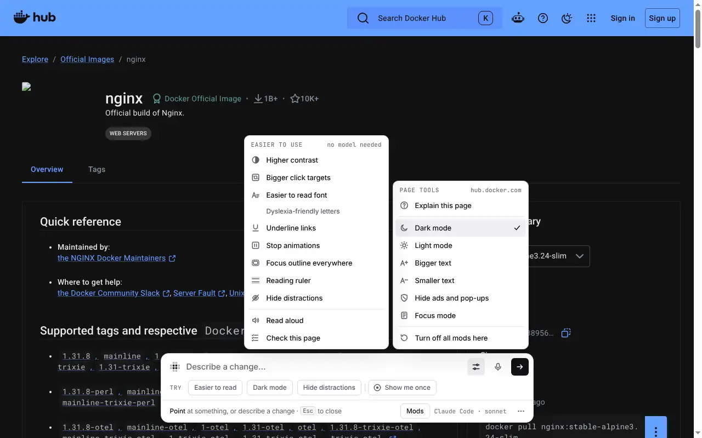
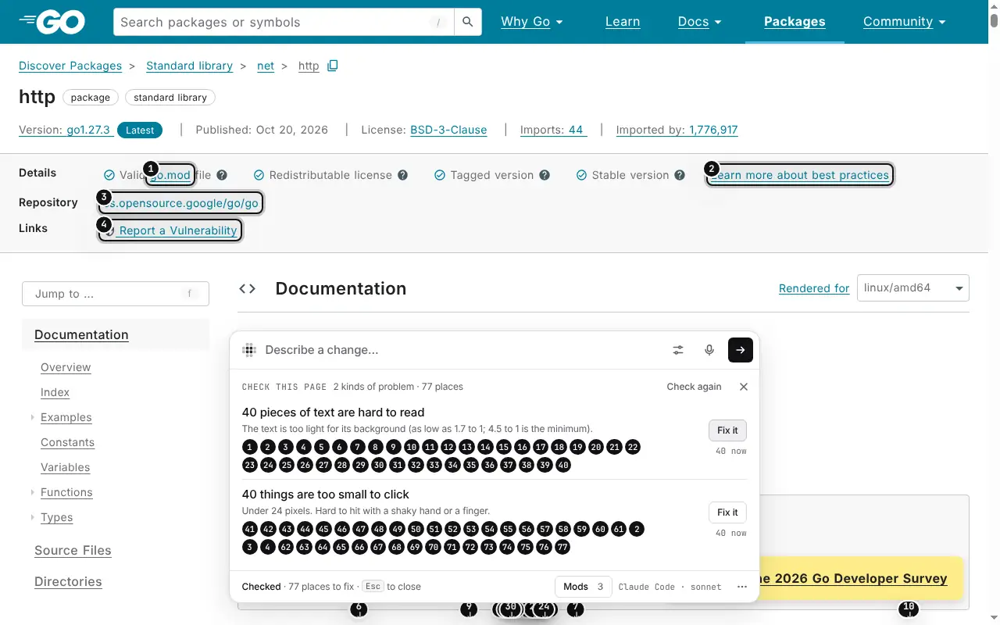

# Easier to use

Some apps are hard to read, hard to click, or never stop moving. **Easier to
use** in Page tools fixes that for the site or app you're on: click it, or
press →, and its tools open beside the menu. They work at once, with no
model.

Each tool is a small mod that Morse makes itself. It stays on for that site.
Click it again to turn it off. The page goes back to exactly how it was.

## The tools

- **Higher contrast**: makes text darker, to at least 7 to 1 against its
  background. Faint borders get stronger. Faded text goes back to full
  strength.
- **Bigger click targets**: makes buttons, links and fields at least 44 by 44
  pixels. Links inside sentences stay as they are.
- **Easier to read font**: a plain font with a little more space between
  letters, words and lines. Lines stop at about 70 characters, and text is
  never stretched to fill a line.
- **Dyslexia-friendly letters**: uses OpenDyslexic, Atkinson Hyperlegible or
  Lexend if one is on your computer. If not, it uses Verdana. Nothing is
  downloaded.
- **Underline links**
- **Stop animations**: animations jump to their end. Video and sound that
  start by themselves pause. Moving pictures show their first frame.
- **Focus outline everywhere**: a ring you can see on any background when you
  use the keyboard.
- **Reading ruler**: a band that follows the pointer and dims the rest.
- **Hide distractions**: cookie bars, chat bubbles and sticky announcements.
  Never the site's header or menus.

## Read aloud

**Read aloud** reads one sentence at a time and marks the sentence it's
reading. It reads what you selected, what you pointed at, or the main text of
the page. You can play, pause, go to the previous or next sentence, and
choose from five speeds. **Esc** stops it.

It uses your computer's own voices, so it works offline. (In Chrome, if your
computer has no voice installed, Chrome may use an online one.)

## Check this page

**Check this page** looks for common problems:

- pictures with no description
- buttons and links with no name
- form fields with no label
- text too light to read (measured, not guessed)
- things too small to click
- video or sound that plays by itself

Each problem gets a numbered marker. Each kind of problem gets a **Fix it**
button. Morse fixes some problems itself, at once: it names a button from its
tooltip, icon or link, makes a color darker or a size bigger. These fixes are
saved in one mod called “Accessibility fixes”. For the rest, Morse sends one
exact request to the model. You save or undo the result like any change.

## Describe this picture

Point at a picture and press the picture button in the Edit tools. The model
says in a sentence or two what it shows. Click **Save as alt text** to keep
that description for screen readers. It's saved in the “Accessibility fixes”
mod.

This needs a model that can look at pictures: Claude Code, or an Anthropic
or OpenAI API key. Codex can't, and Morse tells you so.

Tested once with real Claude Code (haiku) on a chart on a demo library site:
“A bar chart titled “Visitors by month” for Riverside Library from January to
June shows visitor counts rising each month: 1,200 in January, … 3,400 in
June”, in about 6 seconds.

For developers: the tools are made by [`core/a11y.js`](../core/a11y.js), and
the screenshots come from [`demo/shoot-a11y.js`](../demo/shoot-a11y.js) on a
[demo library site](../demo/sites/a11y/index.html) with problems planted on
purpose.
