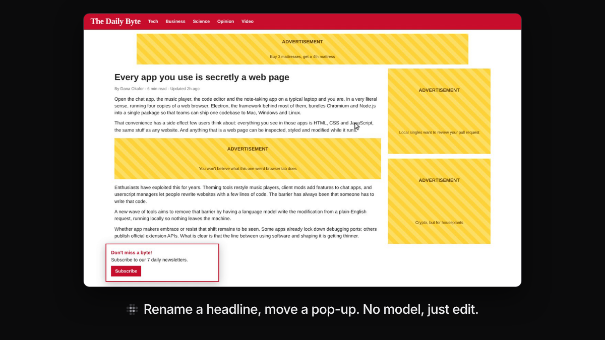
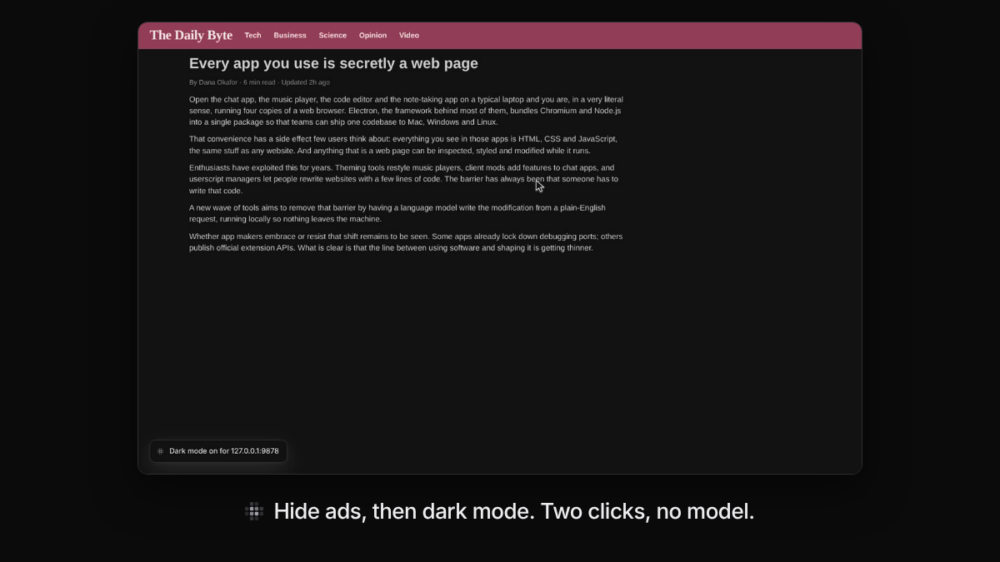

# Edit tools and Page tools

Some changes don't need a model. The Edit tools change one thing you point
at. Page tools change the whole page in one click. Both work at once, with no
waiting, and save like any other change.

*[Watch the clip](launch/clip-direct-edit.mp4): rename a headline and move a
pop-up out of the way, with no model.*

## Edit tools

Point at something and the Edit tools appear next to it. Click a tool, or
press **⌘E** (Ctrl+E) to use them from the keyboard. Each tool has its own
key, shown in its tooltip:

| Key | Tool | What it does |
|---|---|---|
| **H** | Hide | Hides it |
| **M** | Move | Drag it, or use the arrow keys. Shift keeps it straight, or moves 10 pixels at a time |
| **R** | Resize | Drag the corners or sides |
| **T** | Edit text | Change the words in place |
| **C** | Color | Text, fill and border color |
| **F** | Text size | Text size and weight |
| **D** | Duplicate | Makes a copy next to it |
| **⇧C** | Capture | Saves how it looks, to rebuild it in another app (see below) |
| **A** | Describe | Describe a change for the model instead |

Or just start typing to describe a change.

No mouse? Press **⌥↓** (Alt+↓) in the bar to choose a part of the page with
the arrow keys, then **⌘E** (Ctrl+E). **Tab** moves between the tools (and
**←** **→** once you're on one); **Enter** uses one. See
[Using Morse with the keyboard](getting-started.md#using-morse-with-the-keyboard-or-a-screen-reader).

Your edits on a site are saved together as one mod called “Direct edits”,
with undo and redo (**⌘Z** and **⇧⌘Z**). It saves, shares and exports like any
other mod. **⌥⇧G** (Alt+Shift+G) shows the Edit tools from anywhere.

| | |
|---|---|
|  The Edit tools, with the key in every tooltip |  **T**: rename the headline in place |
|  **M**: move a pop-up out of the way |  **C**: recolor the masthead |

## Capture

Like how something looks in one app? Point at it and press **⇧C**. Morse
saves it under **Captured** in the bar. Open Morse in another app, pick it
from the bar, and describe where you want it: the model rebuilds that look
there.

| | |
|---|---|
|  **⇧C**: capture the masthead |  In another app, pick it from the bar and the model rebuilds it |

## Page tools

Click the Page tools button in the bar for one-click changes to the whole
page:

- **Dark mode** and **Light mode**. Dark mode leaves photos, videos and parts
  that are already dark as they are.
- **Bigger text** and **Smaller text**
- **Hide ads and pop-ups**
- **Focus mode**
- **Turn off all mods here**
- **Explain this page**: the model sums up in a few lines what the screen is
  for. See [Ask and find](ask-and-find.md#explain-this-page).

Each one stays on for that site, like a mod. Click it again to turn it off.

Page tools also have the **Easier to use** group: higher contrast, bigger
click targets, easier fonts, Read aloud and more. It has its own page:
[Easier to use](easier-to-use.md).

| | |
|---|---|
|  Hide ads, then dark mode |  Page tools, with Easier to use beside them |
