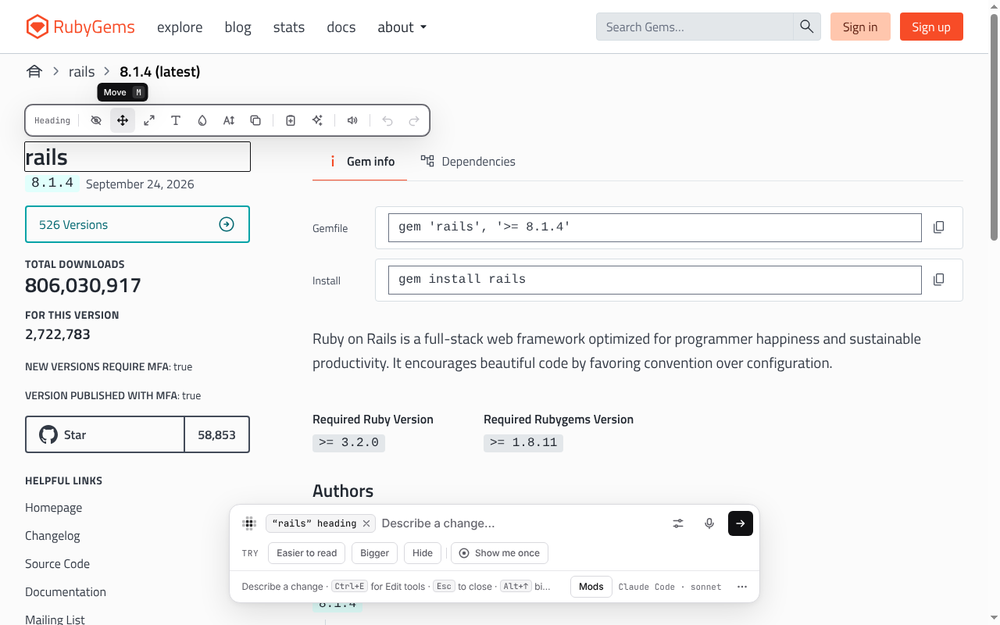
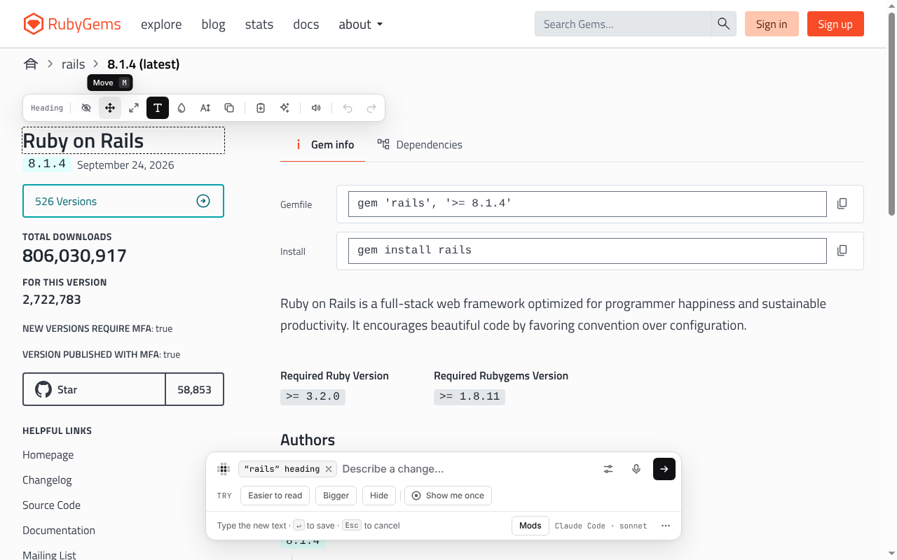
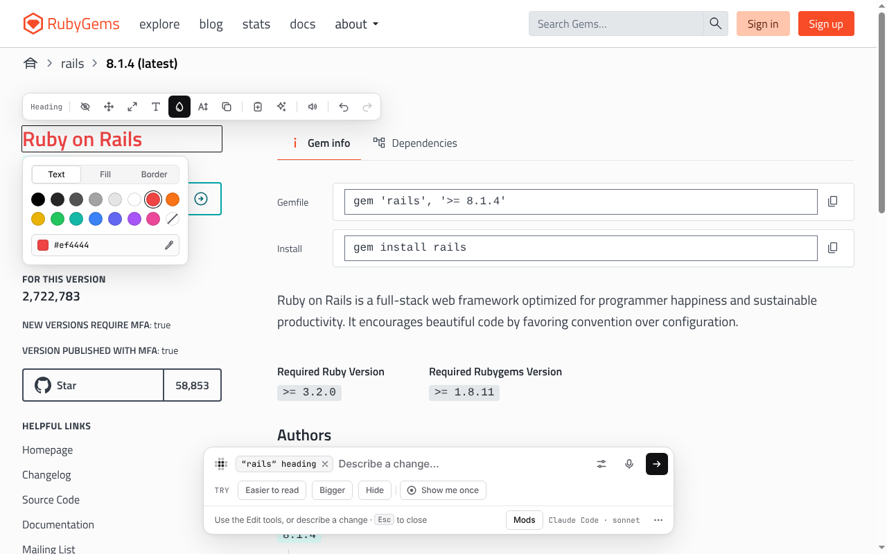
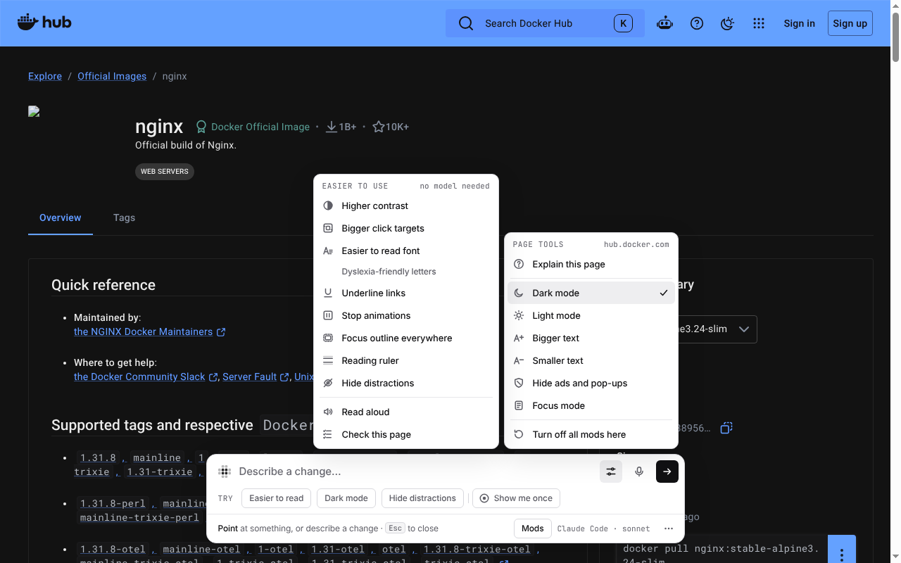
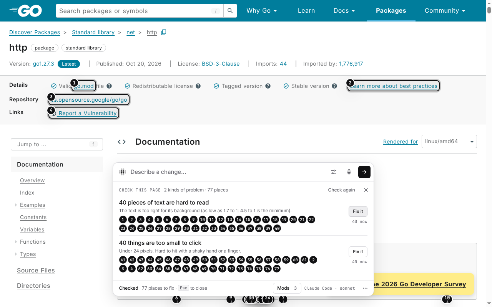

# Edit tools and Page tools

Some changes don't need a model. The Edit tools change one thing you point
at. Page tools change the whole page in one click. Both work at once, and you
save them like any other change.

## Edit tools

Point at something, and the Edit tools appear next to it. Click a tool, or
press **⌘E** (Ctrl+E) to use them from the keyboard. Each tool has its own
key. Its tooltip shows the key.

| Key | Tool | What it does |
|---|---|---|
| **H** | Hide | Hides it |
| **M** | Move | Drag it, or use the arrow keys. Shift keeps it straight, or moves 10 pixels at a time |
| **R** | Resize | Drag the corners or sides |
| **T** | Edit text | Change the words in place |
| **C** | Color | Text, fill and border color |
| **F** | Text size | Text size and weight |
| **D** | Duplicate | Makes a copy next to it |
| **⇧C** | Capture | Saves how it looks, to rebuild it in another app (see below) |
| **A** | Describe | Describe a change for the model instead |

Or start typing to describe a change.

With the keyboard, press **⌥↓** (Alt+↓) in the bar and choose a part of the
page with the arrow keys. Then press **⌘E** (Ctrl+E). **Tab** moves between
the tools. Once you're on one, **←** and **→** move too. **Enter** uses a
tool. See
[Using Morse with the keyboard](getting-started.md#using-morse-with-the-keyboard-or-a-screen-reader).

Your edits on a site are saved together as one mod called “Direct edits”.
**⌘Z** undoes an edit and **⇧⌘Z** redoes it. You can save and share it like
any other mod. **⌥⇧G** (Alt+Shift+G) shows the Edit tools from anywhere.

| | |
|---|---|
|  The Edit tools on rubygems.org, with the key in every tooltip |  **T**: rename the heading in place |
|  **C**: recolor the heading from the palette | |

## Capture

To reuse how something looks in another app, point at it and press **⇧C**.
Morse saves it under **Captured** in the bar. Open Morse in the other app,
pick it from the bar, and say where you want it. The model rebuilds that
look there.

## Page tools

Click the Page tools button in the bar. Each tool changes the whole page in
one click:

- **Dark mode** and **Light mode**. Dark mode leaves photos, videos and parts
  that are already dark as they are.
- **Bigger text** and **Smaller text**
- **Hide ads and pop-ups**
- **Focus mode**
- **Turn off all mods here**
- **Explain this page**: the model says in a few lines what the screen is
  for. See [Ask and find](ask-and-find.md#explain-this-page).

Each one stays on for that site, like a mod. Click it again to turn it off.

Page tools also have the **Easier to use** group: higher contrast, bigger
click targets, easier fonts, Read aloud and more. See
[Easier to use](easier-to-use.md).

| | |
|---|---|
|  Dark mode on Docker Hub, with Easier to use beside Page tools |  Check this page on pkg.go.dev |
