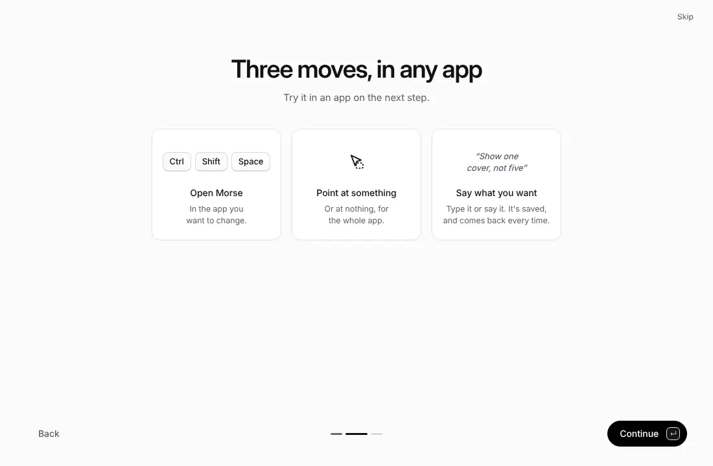
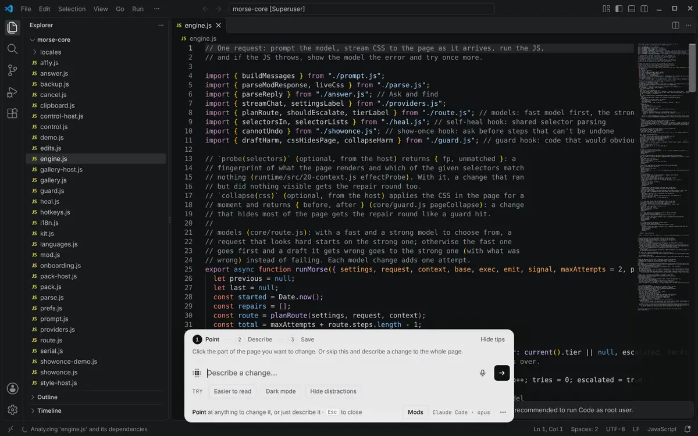

# Getting started

The company shipped its version. Build yours. Open an app with Morse, say
what to rip out or build in, and watch the change. Save it as a mod to keep
your version the next time you open the app.

Morse is one app. You don't need a terminal, Node or anything else.

## 1. Get Morse

Download Morse for your computer:
[Mac (Apple silicon)](https://github.com/sam-siavoshian/RRAA/releases/download/preview/Morse-mac-arm64.dmg) ·
[Mac (Intel)](https://github.com/sam-siavoshian/RRAA/releases/download/preview/Morse-mac-x64.dmg) ·
[Windows](https://github.com/sam-siavoshian/RRAA/releases/download/preview/Morse-Setup.exe) ·
[Linux](https://github.com/sam-siavoshian/RRAA/releases/download/preview/Morse-linux-x86_64.AppImage).
Downloaded in a browser, your computer may warn you once, because Morse isn't
signed yet. [The Morse app](desktop-app.md#get-it) says what to click.

## 2. The first run

Morse's name forms out of dots, then **Begin**. Three short steps follow:
the AI Morse found by itself (Claude Code or Codex, checked that it answers;
paste an API key if it found neither), how it works, and an app to try.
[Models and setup](models.md) explains each AI.

## 3. Open an app or a browser with Morse

Click **Open with Morse** next to an app. Then, in that app, press
**Ctrl+Shift+Space** (**⌥Space** on a Mac). Point at something and say what
to change. Click **Save** to keep it.

If the app is already open, Morse asks to restart it: Morse can only connect
when the app starts. Which apps work, and which can't: [Desktop apps](desktop.md).

**Websites:** open Chrome, Edge, Brave, Arc or Vivaldi the same way, with
**Open with Morse**. You stay signed in to everything: browsers don't let any
program control your everyday profile, so Morse opens the browser on a copy of
it with all your sign-ins, tabs and extensions, and brings in new sign-ins
each time. Your everyday profile is only read, never changed.

**Always open with Morse** is on unless you turn it off: an app with mods
that you open from the Dock, Finder or the Start menu opens again with Morse
a moment later, so your mods are always there.

## Using the bar

- **⌥⇧M** (Alt+Shift+M) opens the Mods panel. Turn mods on and off, share,
  change or delete them there.
- Small changes don't need the model. Point at something and use the Edit
  tools next to it. Or open Page tools in the bar for dark mode, bigger text
  and more. See [Edit tools and Page tools](edit-and-page-tools.md).
- The first time, a short guide in the bar shows you each step.

## Shortcuts

These are the defaults. Change any of them in Settings, in the bar.

| What | macOS | Windows and Linux |
|---|---|---|
| Open Morse (tap), talk (hold) | ⌥Space | Ctrl+Shift+Space |
| Mods panel | ⌥⇧M | Alt+Shift+M |
| Show the Edit tools | ⌥⇧G | Alt+Shift+G |
| Turn every mod on this page off, and back on | ⌥⇧0 | Alt+Shift+0 |

In the bar, press **F1** to see example sentences, and **?** to see all your
shortcuts.

## Using Morse with the keyboard or a screen reader

Everything in Morse works without a mouse.

- **Choose a part of the page with keys.** Open Morse, then press
  **⌥↓** (macOS) or **Alt+↓** (Windows and Linux). **↑** and **↓** move
  through the page's sections, headings, links, buttons, fields and
  pictures. The same frame shows as with the mouse. **←** picks the bigger
  part around it and **→** goes back. **Enter** chooses it. **Esc** stops.
- **Tab** moves through the bar, the Edit tools and anything open in it. In
  menus, **↑** and **↓** move, **Home** and **End** jump to the ends, and
  typing the first letters of an item goes to it.
- **Esc** always closes the top thing first: a menu, a sheet, a window, then
  the bar. Focus goes back to where you were.
- In the **Mods panel**, **↑** and **↓** move between mods, **Space** turns
  one on or off, **Enter** changes it, and **Tab** reaches its buttons and
  **Install a mod…**.
- **Show me** (after you ask where something is): **⌥↓** or **Alt+↓** moves
  to the part of the page for that step. Then you use it yourself.
- With **Show me once**, do the task with the keyboard as usual. Press the
  Open Morse shortcut when you're done.

Screen readers hear a few short messages: when Morse starts working, when
the first change shows, when it's done (or what went wrong), and each
message that pops up at the bottom of the page. The code Morse writes is
never read out. Morse also works with Windows High Contrast, with zoom up to
200%, and on narrow windows.

## Where Morse can't run

- Safari and Firefox: they give Morse no way in. Use Chrome, Edge, Brave, Arc
  or Vivaldi for websites.
- A browser's own pages (new tab, settings) and PDFs in its PDF viewer.
- Desktop apps that aren't built from web pages, like Finder or System
  Settings. See [Desktop apps](desktop.md#which-apps-cant-work-and-why).

When something doesn't work, see [Troubleshooting](troubleshooting.md). It
lists the messages Morse shows and what to do about each one.

## For developers

The `morse` command does what the app does, from a terminal:
`morse launch obsidian`, `morse launch chrome`. The
[developer guide](dev/README.md#set-up-a-checkout) sets it up.
