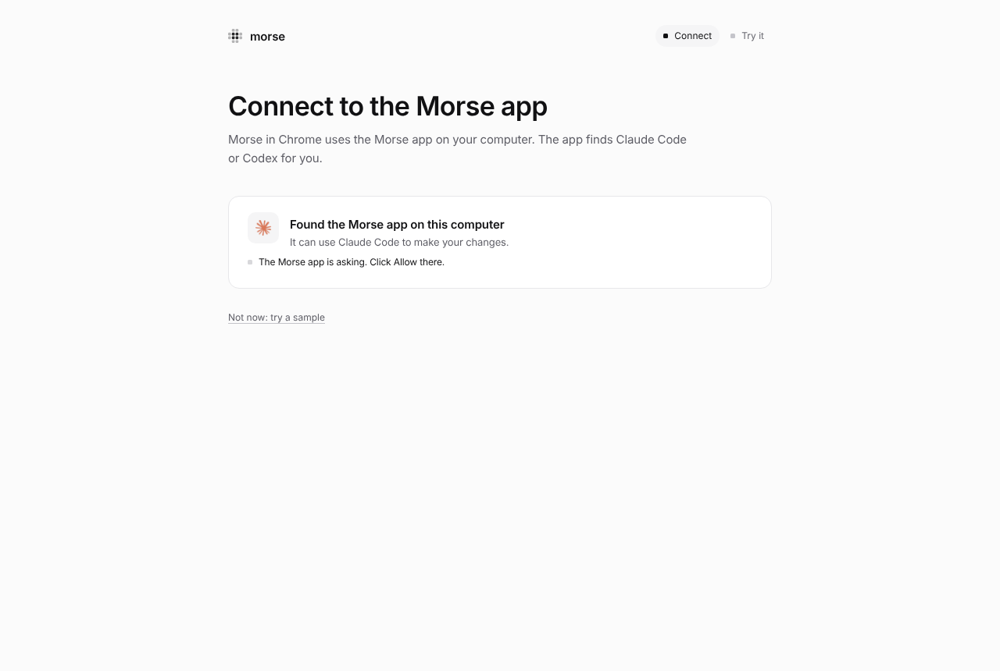
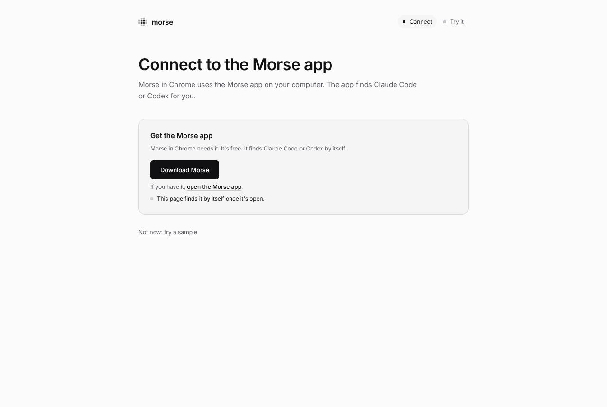

# Getting started

Morse changes websites and desktop apps in your own words. Point at
something, say what you want, and watch it change. A mod is a change you
saved. Morse brings it back every time you open that site or app.

Morse is one app. You don't need a terminal, Node or anything else.

## 1. Download Morse and open it

Download the Morse app for your computer:
[Mac (Apple silicon)](https://github.com/sam-siavoshian/RRAA/releases/download/preview/Morse-mac-arm64.dmg) ·
[Mac (Intel)](https://github.com/sam-siavoshian/RRAA/releases/download/preview/Morse-mac-x64.dmg) ·
[Windows](https://github.com/sam-siavoshian/RRAA/releases/download/preview/Morse-Setup.exe) ·
[Linux](https://github.com/sam-siavoshian/RRAA/releases/download/preview/Morse-linux-x86_64.AppImage).
The first time you open it, your computer may warn you, because Morse isn't
signed yet. [The Morse app](desktop-app.md#get-it) says what to click.

Morse opens on one screen. It finds Claude Code or Codex on this computer by
itself and checks that it answers. If it finds neither, paste an API key
there instead. [Models and setup](models.md) explains each one.

## 2. Open an app with Morse

Click **Open with Morse** next to an app. Then, in that app, press
**Ctrl+Shift+Space** (**⌥Space** on a Mac). Point at something and say what
to change. Click **Save** to keep it.

If the app is already open, Morse asks to restart it: Morse can only connect
when the app starts. Which apps work, and which can't: [Desktop apps](desktop.md).

## 3. Websites too: Use Morse in Chrome

In the Morse app, click **Use Morse in Chrome too**. Morse isn't in the
Chrome Web Store yet, so it adds Morse to Chrome from a folder:

1. Chrome opens on its extensions page. Turn on **Developer mode**, at the
   top right.
2. Click **Load unpacked**, at the top left, and choose the folder Morse
   showed you, **Morse for Chrome** in your home folder. (Or drag that
   folder onto the page.)
3. Morse's welcome page opens in Chrome and the Morse app asks **“Allow
   Chrome to use your Claude Code?”**. Click **Allow**. That's all.

Then make your first change on the practice page. Three steps light up as
you go: open Morse (**⌥Space** on a Mac, **Ctrl+Shift+Space** on Windows
and Linux), point at the article and type <q>make this easier to read</q>,
then **Save**. After that, the page suggests a few sites to try.

If Chrome opened Morse's welcome page before you had the Morse app, it shows
one button, **Download Morse**. Get the app, open it, and the page connects
by itself. **Not now: try a sample** lets you try the practice page first.

Reload any tab that was open before you added Morse. Chrome only adds Morse
to pages that load after you install it.

## “Allow User Scripts”, only when a change needs it

Changes to how a site looks always work. A change that adds a button or a
feature needs one switch in Chrome: **“Allow User Scripts”**. Morse asks for
it only then. Until the switch is on, the whole change waits, so a page is
never left half changed. The bar says which change is waiting. Click **Open
Morse's details** to open the switch, with a small window that shows where
it is. Turn it on. Morse closes both and takes you back to your tab, and the
change runs.

## Using the bar

- **⌥⇧M** (Alt+Shift+M) opens the Mods panel. Turn mods on and off, share,
  change or delete them there.
- Small changes don't need the model. Point at something and use the Edit
  tools next to it. Or open Page tools in the bar for dark mode, bigger text
  and more. See [Edit tools and Page tools](edit-and-page-tools.md).
- The first time, a short guide in the bar shows you each step.

## Shortcuts

These are the defaults. Change any of them in Settings, in the bar.

| What | macOS | Windows and Linux |
|---|---|---|
| Open Morse (tap), talk (hold) | ⌥Space | Ctrl+Shift+Space |
| Mods panel | ⌥⇧M | Alt+Shift+M |
| Show the Edit tools | ⌥⇧G | Alt+Shift+G |
| Turn every mod on this page off, and back on | ⌥⇧0 | Alt+Shift+0 |
| Morse's toolbar button in Chrome | ⌘⇧Y | Ctrl+Shift+Y |

In the bar, press **F1** to see example sentences, and **?** to see all your
shortcuts.

## Using Morse with the keyboard or a screen reader

Everything in Morse works without a mouse.

- **Choose a part of the page with keys.** Open Morse, then press
  **⌥↓** (macOS) or **Alt+↓** (Windows and Linux). **↑** and **↓** move
  through the page's sections, headings, links, buttons, fields and
  pictures. The same frame shows as with the mouse. **←** picks the bigger
  part around it and **→** goes back. **Enter** chooses it. **Esc** stops.
- **Tab** moves through the bar, the Edit tools and anything open in it. In
  menus, **↑** and **↓** move, **Home** and **End** jump to the ends, and
  typing the first letters of an item goes to it.
- **Esc** always closes the top thing first: a menu, a sheet, a window, then
  the bar. Focus goes back to where you were.
- In the **Mods panel**, **↑** and **↓** move between mods, **Space** turns
  one on or off, **Enter** changes it, and **Tab** reaches its buttons and
  **Install a mod…**.
- **Show me** (after you ask where something is): **⌥↓** or **Alt+↓** moves
  to the part of the page for that step. Then you use it yourself.
- With **Show me once**, do the task with the keyboard as usual. Press the
  Open Morse shortcut when you're done.

Screen readers hear a few short messages: when Morse starts working, when
the first change shows, when it's done (or what went wrong), and each
message that pops up at the bottom of the page. The code Morse writes is
never read out. Morse also works with Windows High Contrast, with zoom up to
200%, and on narrow windows.

## Where Morse can't run

- Chrome's own pages (new tab, settings), other extensions' pages and the
  Chrome Web Store. Chrome doesn't let extensions change them.
- PDFs in Chrome's PDF viewer.
- Files on your computer, until you turn on “Allow access to file URLs” in
  Morse's details in `chrome://extensions`.
- Desktop apps that aren't built from web pages, like Finder or System
  Settings. See [Desktop apps](desktop.md#which-apps-cant-work-and-why).

When something doesn't work, see [Troubleshooting](troubleshooting.md). It
lists the messages Morse shows and what to do about each one.

## For developers

The `morse` command does what the app does, from a terminal. The
[developer guide](dev/README.md#set-up-a-checkout) sets it up. In Chrome,
the welcome page with `?dev` added to its address
(`chrome-extension://<id>/welcome.html?dev`) has the developer ways to
connect: an Anthropic API key kept in the browser, or
`morse setup --pair <code>`. The popup has the same under **Developer**.
