# Getting started

Morse changes websites and desktop apps in your own words. Point at
something, say what you want, and watch it change. A mod is a change you
saved. Morse brings it back every time you open that site or app.

Setup takes about a minute. You answer one question, click once to connect,
and make your first change on a practice page.

## 1. Add Morse to Chrome

Morse isn't in the Chrome Web Store yet, so you add it from its folder:

1. Open `chrome://extensions` and turn on **Developer mode**.
2. Click **Load unpacked** and choose the Morse extension folder. To find
   it, click **Add to Chrome** in Morse Desktop, or run
   `morse extension` in a terminal.

Morse's welcome page opens by itself.

## 2. Answer one question

The welcome page asks what you want to change: websites, desktop apps, or
both. That's the only choice you make before your first change.

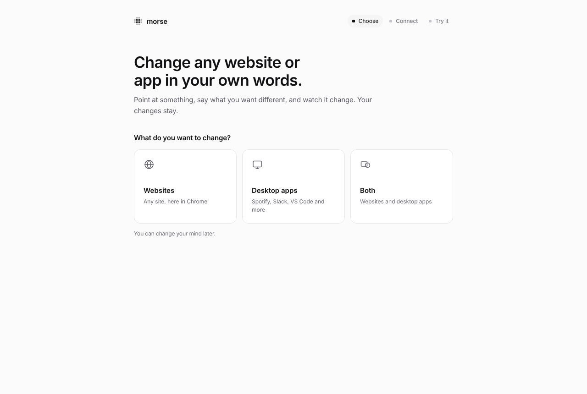

## 3. Connect a model

Morse has no model of its own. It uses one you already have: Claude Code,
Codex or an Anthropic API key.

**With Morse Desktop** (the easiest way). When Morse Desktop is open, the
welcome page finds it and shows one button, like **Use Claude Code**. Click
it. Morse Desktop asks **“Allow Chrome to use your Claude Code?”** Click
**Allow**. There is no code to type and nothing else to install.

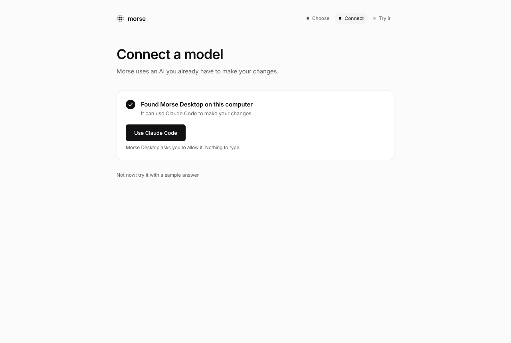

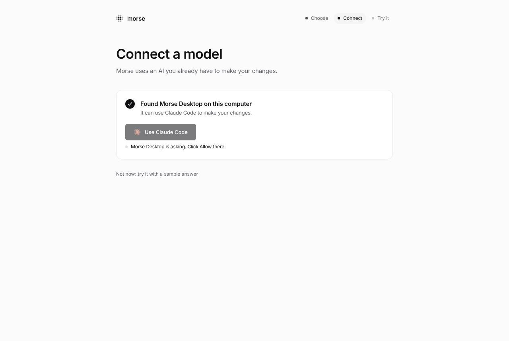

**Without Morse Desktop**, the page offers two choices. **Get Morse Desktop**
(it also opens desktop apps with Morse), or paste an **Anthropic API key**
and press Enter. The key stays in this browser.

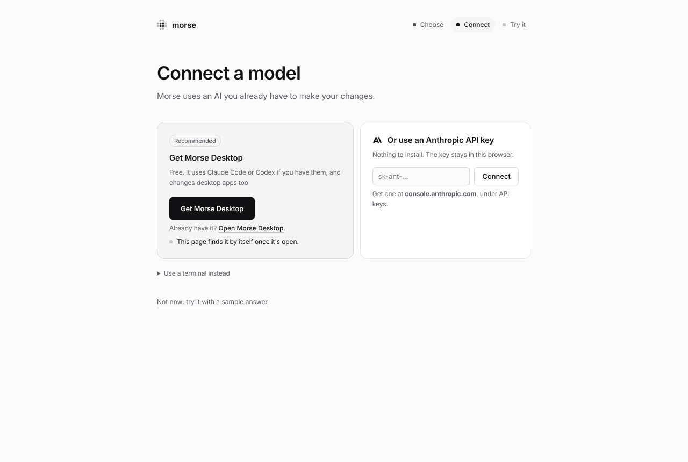

If you use a terminal, click **Use a terminal instead**. It shows one
command, `morse setup --pair <code>`. Run it and the page connects.
[Models and setup](models.md) explains every choice.

## 4. Make your first change

The welcome page has a practice page for you to change. Three steps light up
as you go:

1. **Open Morse.** Press **⌥Space** on a Mac, **Ctrl+Shift+Space** on
   Windows and Linux, or click the link in the first step.
2. **Point and describe.** Click the article, type <q>make this easier to
   read</q> and press Enter.
3. **Save it.** Click **Save** to keep it, or **Undo** to take it off.

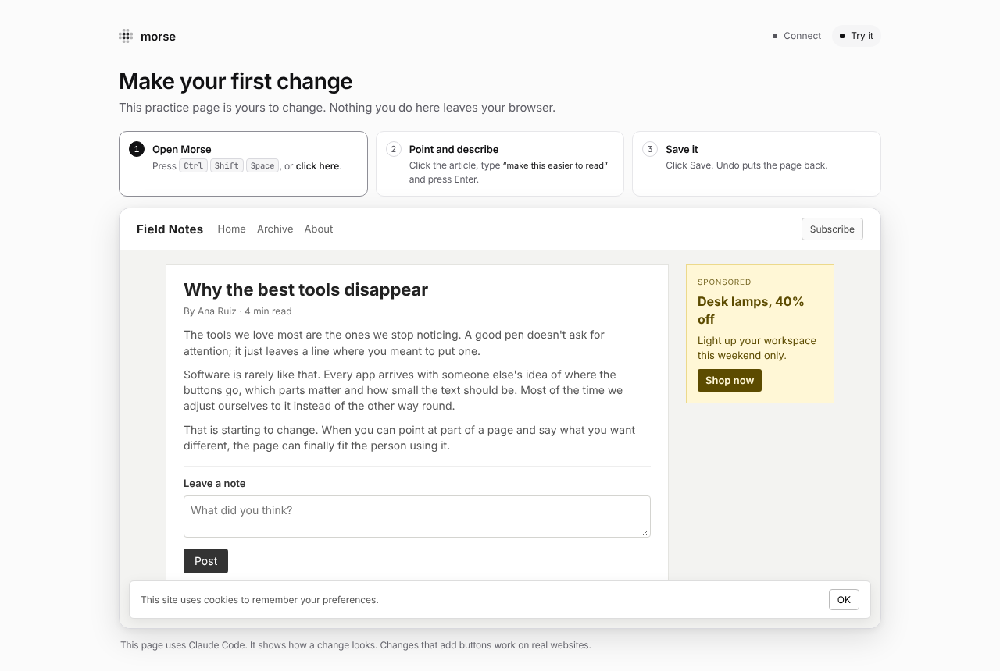

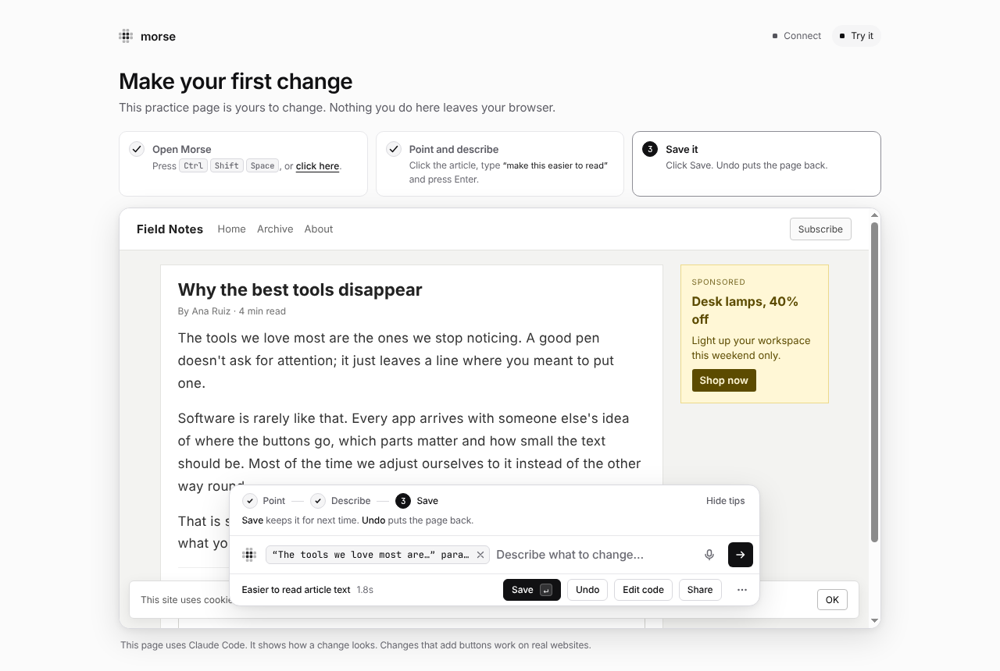

To try it before you connect a model, click **Not now: try it with a sample
answer**. You make the same change with an answer Morse already has.

## 5. Then a site you use

After you save your first mod, the welcome page suggests a few sites. Click
one. It opens with Morse ready and the words typed in. Press Enter. Or type
any address. If you chose desktop apps, the page says how to open one with
Morse Desktop.

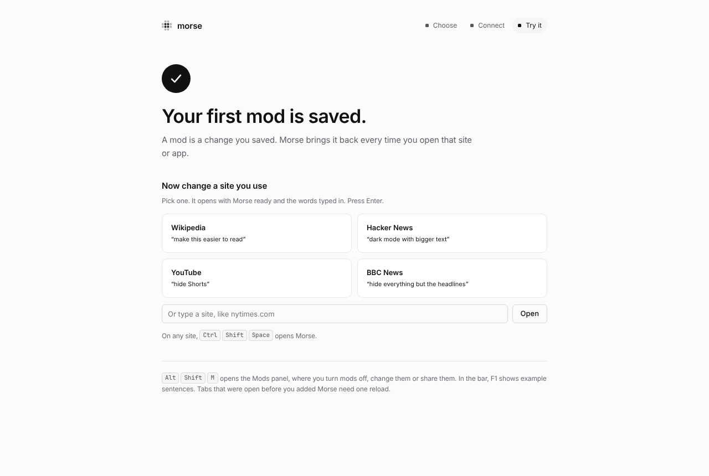

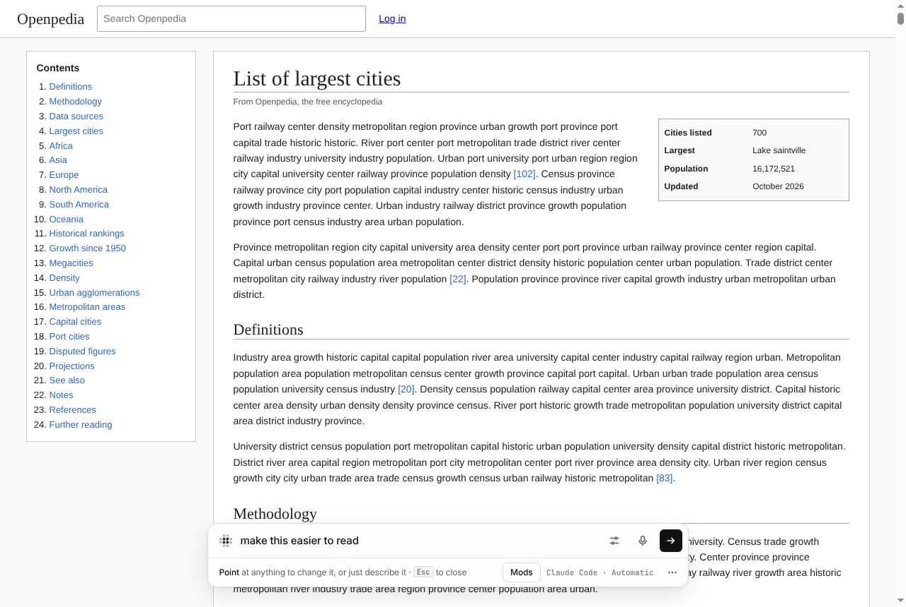

Reload any tab that was open before you added Morse. Chrome only adds Morse
to pages that load after you install it.

On a phone-sized window, the steps stack in one column:

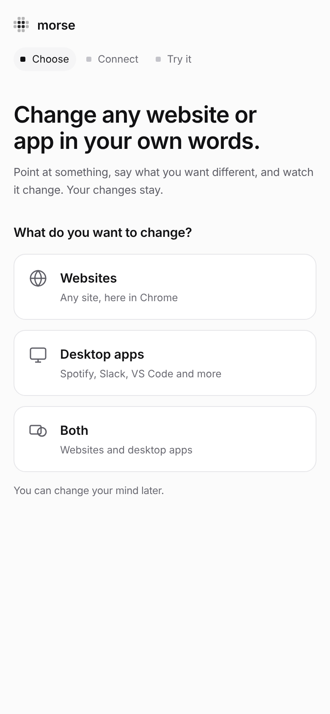

## Desktop apps

In Morse Desktop, click **Open with Morse** next to an app. Then press
**Ctrl+Shift+Space** in the app (**⌥Space** on a Mac). Point at something
and say what to change. If the app is already open, Morse asks to restart
it. Morse can only connect when the app starts.

In a terminal, `morse launch obsidian` does the same. For the details, and
for apps that can't work, see [Desktop apps](desktop.md).

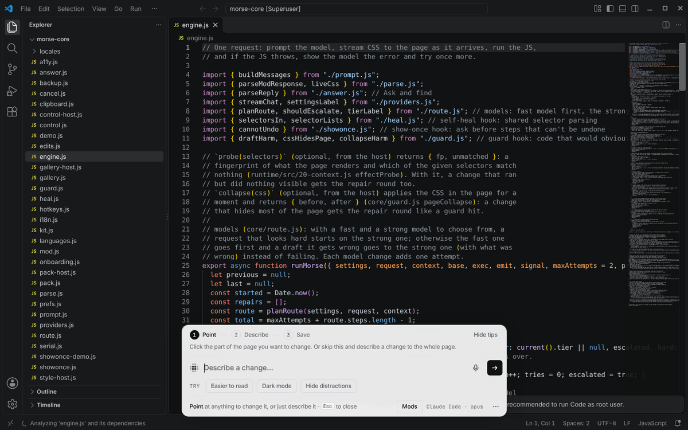

## “Allow User Scripts”, only when a change needs it

Changes to how a site looks always work. A change that adds a button or a
feature needs one switch in Chrome: **“Allow User Scripts”**. Morse asks for
it only then. Until the switch is on, the whole change waits, so a page is
never left half changed. The bar says which change is waiting. Click **Open
Morse's details** to open the switch, with a small window that shows where
it is. Turn it on. Morse closes both and takes you back to your tab, and the
change runs.

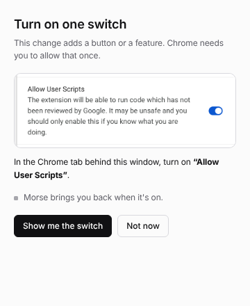

## Using the bar

- **⌥⇧M** (Alt+Shift+M) opens the Mods panel. Turn mods on and off, share,
  change or delete them there.
- Small changes don't need the model. Point at something and use the Edit
  tools next to it. Or open Page tools in the bar for dark mode, bigger text
  and more. See [Edit tools and Page tools](edit-and-page-tools.md).
- The first time, a short guide in the bar shows you each step.

## Shortcuts

These are the defaults. Change any of them in Settings, in the bar.

| What | macOS | Windows and Linux |
|---|---|---|
| Open Morse (tap), talk (hold) | ⌥Space | Ctrl+Shift+Space |
| Mods panel | ⌥⇧M | Alt+Shift+M |
| Show the Edit tools | ⌥⇧G | Alt+Shift+G |
| Turn every mod on this page off, and back on | ⌥⇧0 | Alt+Shift+0 |
| Morse's toolbar button in Chrome | ⌘⇧Y | Ctrl+Shift+Y |

In the bar, press **F1** to see example sentences, and **?** to see all your
shortcuts.

## Using Morse with the keyboard or a screen reader

Everything in Morse works without a mouse.

- **Choose a part of the page with keys.** Open Morse, then press
  **⌥↓** (macOS) or **Alt+↓** (Windows and Linux). Or pick **Choose with
  keys** in the **⋯** menu. **↑** and **↓** move through the page's
  sections, headings, links, buttons, fields and pictures. The same frame
  shows as with the mouse. **←** picks the bigger part around it and **→**
  goes back. **Enter** chooses it. **Esc** stops.
- **Tab** moves through the bar, the Edit tools and anything open in it. In
  menus, **↑** and **↓** move, **Home** and **End** jump to the ends, and
  typing the first letters of an item goes to it.
- **Esc** always closes the top thing first: a menu, a sheet, a window, then
  the bar. Focus goes back to where you were.
- In the **Mods panel**, **↑** and **↓** move between mods, **Space** turns
  one on or off, **Enter** changes it, and **Tab** reaches its buttons and
  **Install a mod…**.
- **Show me** (after you ask where something is): **⌥↓** or **Alt+↓** moves
  to the part of the page for that step. Then you use it yourself.
- With **Show me once**, do the task with the keyboard as usual. Press the
  Open Morse shortcut when you're done.

Screen readers hear a few short messages: when Morse starts working, when
the first change shows, when it's done (or what went wrong), and each
message that pops up at the bottom of the page. The code Morse writes is
never read out. Morse also works with Windows High Contrast, with zoom up to
200%, and on narrow windows.

## Where Morse can't run

- Chrome's own pages (new tab, settings), other extensions' pages and the
  Chrome Web Store. Chrome doesn't let extensions change them.
- PDFs in Chrome's PDF viewer.
- Files on your computer, until you turn on “Allow access to file URLs” in
  Morse's details in `chrome://extensions`.
- Desktop apps that aren't built from web pages, like Finder or System
  Settings. See [Desktop apps](desktop.md#which-apps-cant-work-and-why).

When something doesn't work, see [Troubleshooting](troubleshooting.md). It
lists the messages Morse shows and what to do about each one.

