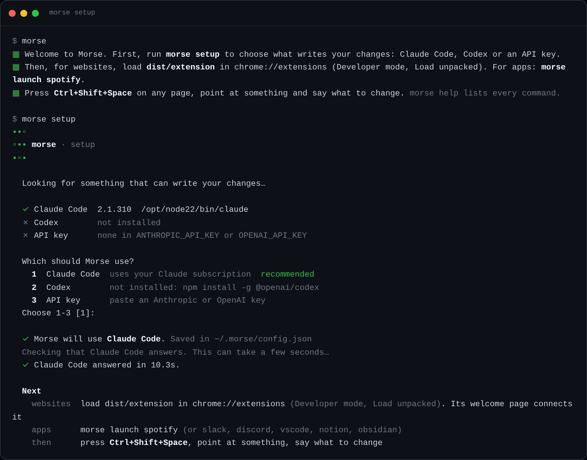
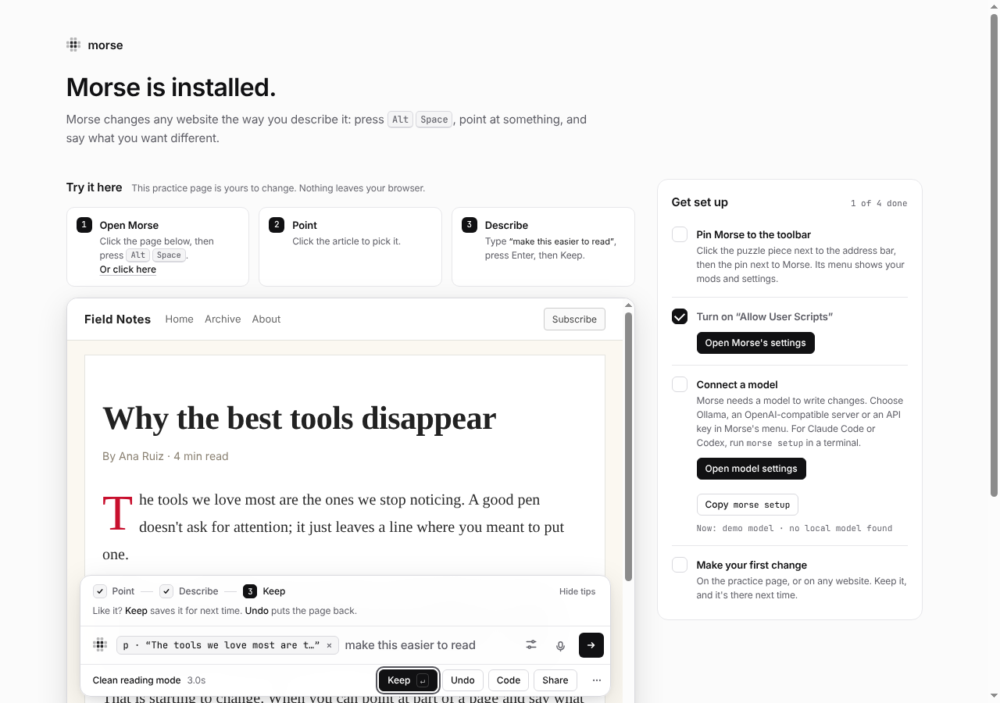
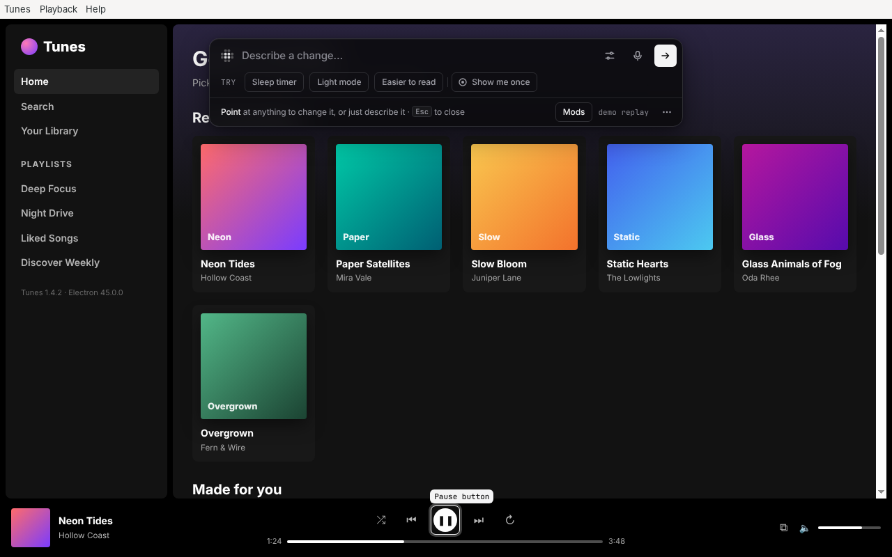
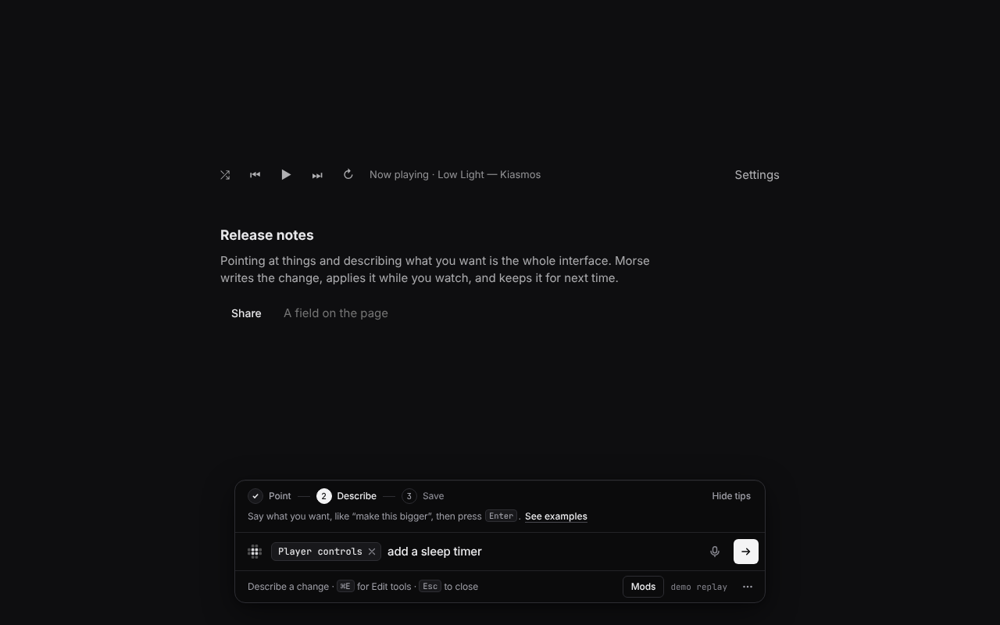
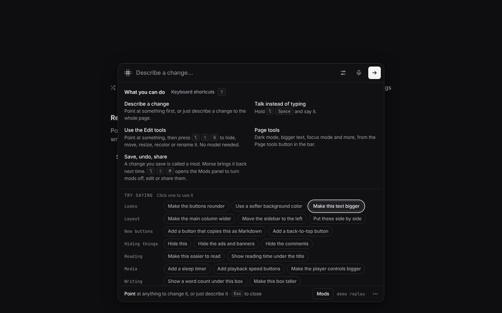
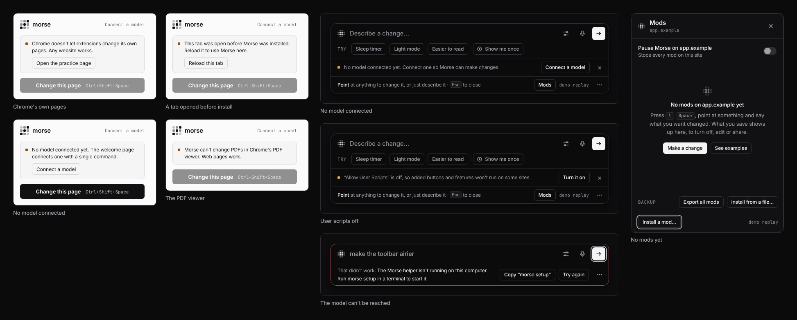

# Getting started

Morse works in two places: websites, through a Chrome extension, and desktop
apps built from web pages (Spotify, Slack, Discord, VS Code and others).
Both use the same model and the same mods.


## 1. Get Morse

You need [Node](https://nodejs.org) 22 or newer. To record clips of your
changes, you also need `ffmpeg`.

```bash
npm install -g morse-cli   # adds the morse command
morse setup                # choose Claude Code, Codex or an API key
morse doctor               # checks that the model answers
```

Until the first npm release, install from GitHub instead:
`npm install -g github:sam-siavoshian/RRAA`. To try it without installing,
`npx morse-cli setup` works too. `morse help` lists every command, and
`morse --version` shows the version.

Working on Morse itself? Set up a clone with the
[developer guide](dev/README.md#set-up-a-checkout).

`morse setup` looks for Claude Code, Codex and an API key on this computer,
recommends the first one it finds, and saves your choice. More about each:
[Models and setup](models.md).



## 2. Websites: add Morse to Chrome

1. Open `chrome://extensions` and turn on **Developer mode**.
2. Click **Load unpacked** and choose the folder that `morse extension`
   prints (`dist/extension` in a clone).
3. Open Morse's details and turn on **“Allow User Scripts”**. Mods that only
   change how a site looks work without it. Mods that add buttons or
   features need it; until it is on, Morse shows their new look and tells
   you which ones are waiting.
4. The welcome page opens. Its practice page has sample answers, so you can
   try a change right away, before connecting anything.
5. Connect a model. The welcome page shows one command,
   `morse setup --pair <code>`. Paste it in a terminal: it finds Claude Code
   or Codex, checks that it answers, starts the Morse helper, and the page
   connects by itself. You can also run `morse serve` and type its code into
   the Morse popup, or paste an Anthropic API key in the popup.
   [Models and setup](models.md#in-chrome) explains all three.
6. Open any website and press **⌥Space** (Ctrl+Shift+Space on Windows and
   Linux).




Tabs that were already open need one reload: Chrome only adds Morse to pages
loaded after it was installed.

## 3. Desktop apps: open an app with Morse

```bash
morse apps                 # what Morse found, and whether it can connect
morse launch spotify       # opens Spotify with Morse connected
```

Keep the terminal open while you use the app. Then press **Ctrl+Shift+Space**
in the app (**⌥Space** on a Mac). If the app is already open, Morse asks
whether to quit it and open it again, because it can only connect when the
app starts. The whole story, and which apps can't work:
[Desktop apps](desktop.md).



## 4. Make your first change

1. Press **⌥Space** (Ctrl+Shift+Space on Windows and Linux). The Morse bar
   opens.
2. Point at the thing you want to change and click it. To change the whole
   page, skip this step.
3. Describe what you want, like “add a sleep timer” or “make this easier to
   read”, and press Enter. Or hold the shortcut and say it.
4. Watch the change happen. Click **Save** to keep it, or **Undo** to take it
   away.
5. Press **⌥⇧M** (Alt+Shift+M) to open the Mods panel. There you turn mods on
   and off, share them, change them or delete them.

Small changes don't need the model. Point at something and use the Edit tools
that appear next to it, or open Page tools in the bar for dark mode, bigger
text and more. See [Edit tools and Page tools](edit-and-page-tools.md).

The first time, a short guide in the bar shows you each step.



## Shortcuts

These are the defaults. Change any of them in Settings, in the bar.

| What | macOS | Windows and Linux |
|---|---|---|
| Open Morse (tap), talk (hold) | ⌥Space | Ctrl+Shift+Space |
| Mods panel | ⌥⇧M | Alt+Shift+M |
| Show the Edit tools | ⌥⇧G | Alt+Shift+G |
| Turn every mod on this page off, and back on | ⌥⇧0 | Alt+Shift+0 |
| Morse's toolbar button in Chrome | ⌘⇧Y | Ctrl+Shift+Y |

In the bar, **F1** shows example sentences and **?** shows every shortcut
you have.



## Where Morse can't run

- Chrome's own pages (new tab, settings), other extensions' pages and the
  Chrome Web Store. Chrome doesn't let extensions change them.
- PDFs in Chrome's PDF viewer.
- Files on your computer, until you turn on “Allow access to file URLs” in
  Morse's details in `chrome://extensions`.
- Desktop apps that aren't built from web pages, like Finder or System
  Settings. See [Desktop apps](desktop.md#which-apps-cant-work-and-why).

When something doesn't work, [Troubleshooting](troubleshooting.md) lists the
messages Morse shows and what to do about each.


