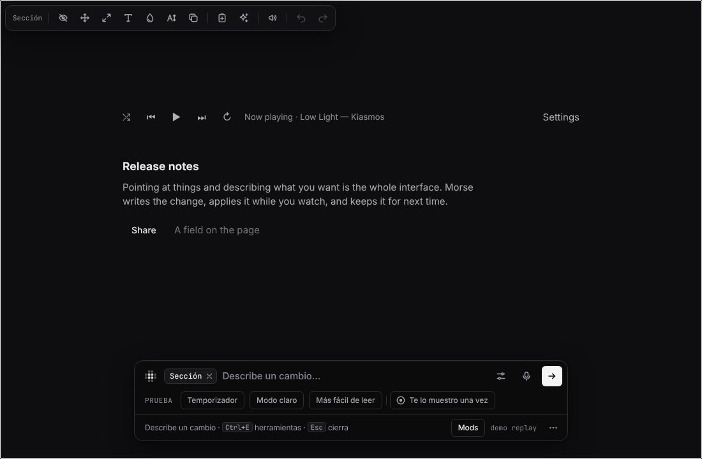
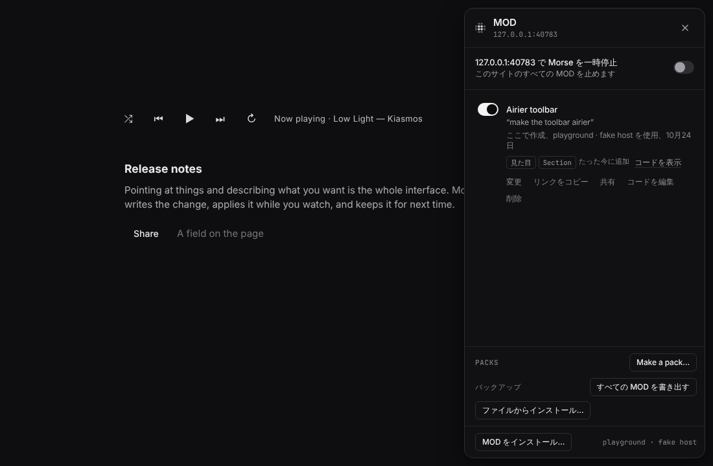
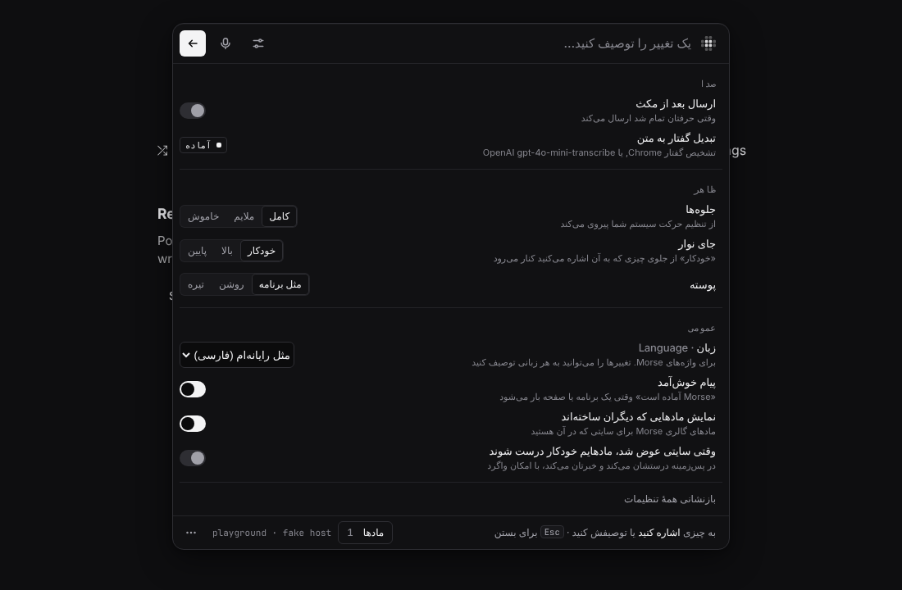

# Morse in your language

Morse speaks English, Spanish, German, French, Brazilian Portuguese,
Simplified Chinese, Japanese, Persian and Arabic. Persian and Arabic lay the
bar, the Mods panel and Settings out right to left.

Morse uses your computer's language unless you pick another. In Chrome and
in desktop apps, that's the browser's language. In the terminal, it's
`LANG` / `LC_ALL`. To pick one yourself, open **Settings → Language**. "Same
as my computer" is the first choice.

You can describe changes in any language. When you ask a question (Ask,
Explain this page), the answer comes in Morse's language.





## What stays in English

- **Product and key names.** Morse, Claude Code, Codex, Chrome, Tampermonkey,
  and keys like Esc, Enter, Ctrl and F1.
- **Chrome's own labels**, in quotes: “Allow User Scripts”, “Allow access to
  file URLs”, “Load unpacked”. Chrome shows them in English in every
  language, so the instructions match what you see.
- **The practice page's sample requests.** The welcome page's practice area
  has answers ready for <q>make this easier to read</q>. It only knows the
  English words, so they stay English.
- **Your style's words.** Morse reads “bigger text and softer colors
  everywhere” by itself, without a model. It only knows the English words.
  The bar says so in each language.
- **Answers to yes-or-no questions in the terminal.** `[y/N]` takes `y` or
  `yes` in every language.
- **Commands and their options.** You type `morse pack install`, `--yes`
  and `--model-mode auto|fast|best` as they are. `morse help` and
  `morse setup --help` explain them in your language.
- **Words for developers.** `morse doctor` and `morse model` output, and
  what Morse tells the model.

## Help make it better

The translations were written with care, but no native speaker has checked
them yet. If something reads oddly, or a word isn't what people say, fix it.
A fix is a small change to one file.

1. Open `core/locales/<language>.js`, for example `core/locales/de.js`.
   English, the source of every message, is `core/locales/en.js`.
2. Find the message by its English words in `en.js`, then the same id in
   your language's file, like `"bar.placeholder"`.
3. Change the words. Keep everything in `{braces}` exactly as it is: Morse
   puts a name or a number there. Keep any `<b>`, `<kbd>`, `<i>` or `<code>`
   around the same words.
4. Run `node --test tests/i18n.test.js`. It checks that every message is
   there, that the `{braces}` and markup match English, and that product and
   key names are kept.
5. Open a pull request. Say which language and what you changed.

The tone is the same in every language: short sentences, everyday words, no
jargon, calm. [How Morse talks](WRITING.md) has the rules. They apply to
translations too. Each file says at its top how it speaks to people (tú, du,
vous, você, です・ます, شما).

### Plurals

A message that counts something has one form per plural category of the
language:

```js
"ctl.offN": { one: "Turned off {n} mod on this page", other: "Turned off {n} mods on this page" },
```

Chinese and Japanese only need `other`. Arabic can use `zero`, `one`, `two`,
`few`, `many` and `other`. Any it leaves out falls back to `other`. The
categories are the ones `Intl.PluralRules` uses for the language.

### Native-speaker review

A language is done only after someone who speaks it every day reads it in
place: the bar, a result, the Mods panel, Settings, the first-run tips, the
toolbar popup and the welcome page. They look for:

- words people use for buttons and menus in that language
- the same word for the same thing everywhere (one word for "mod", one for
  "change")
- text that is cut off or wraps badly (German and French run long)
- for Persian and Arabic, anything that points or lines up the wrong way

`node demo/shoot-i18n.js <language>:<number>` takes those screenshots for
any language. For example: `SHOTS=/tmp/de node demo/shoot-i18n.js de:0`.

| Language | Messages | Reviewed by a native speaker |
| --- | --- | --- |
| Spanish (es) | all | not yet |
| German (de) | all | not yet |
| French (fr) | all | not yet |
| Portuguese, Brazil (pt-BR) | all | not yet |
| Chinese, simplified (zh-CN) | all | not yet |
| Japanese (ja) | all | not yet |
| Persian (fa) | all | not yet |
| Arabic (ar) | all | not yet |

## Adding a language

1. Copy `core/locales/en.js` to `core/locales/<code>.js` (a BCP 47 code like
   `it` or `zh-TW`) and translate it.
2. In `core/i18n.js`, add it to `LANGUAGES` with its name in its own
   language. Add it to `ENGLISH_NAMES` too, and to `PREF_LANGUAGES` in
   `core/prefs.js`. If it is written right to left, add its code to
   `RTL_LANGS`. It loads only when someone picks it, so there is nothing to
   import.
3. Run `node --test tests/i18n.test.js tests/words.test.js`.

A message you haven't translated yet shows in English, so a language can
start small. If a message should stay English on purpose, list it in
`ENGLISH_ON_PURPOSE` in `tests/i18n.test.js` with the reason.

For how it works inside, see [Languages in the code](dev/i18n.md).
