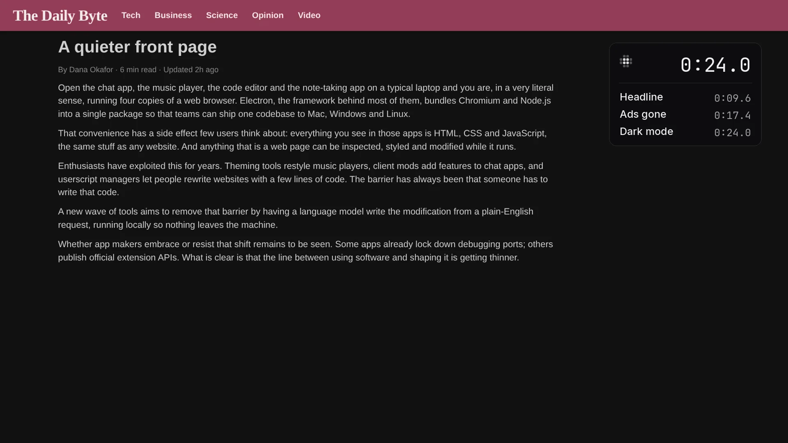

# Morse launch kit

**Change any website or desktop app in your own words.**

[](morse-opus-open-16x9.mp4)

[Watch the launch video](morse-opus-open-16x9.mp4) (33 seconds) · [The previous cut](morse-v4-16x9.mp4) (50 seconds) · [The longer demo](morse-demo-v2.mp4) (92 seconds, on this repo's demo apps) · [Website](https://sam-siavoshian.github.io/RRAA/site/) · [Source](https://github.com/sam-siavoshian/RRAA)

## The launch video

33 seconds, 1920×1080. It opens on The Daily Byte already changed: the headline “A quieter front page”, the ads and the popup gone, and dark mode. Then those edits, Obsidian in light mode, the Mods list, the shortcut and the update window, then the install command. No model was called. The update percent is the window playing, not a download. [`morse-opus-open-web.mp4`](morse-opus-open-web.mp4) and [`morse-opus-open-web.webm`](morse-opus-open-web.webm) are the site's muted loop. [`morse-opus-open-poster.webp`](morse-opus-open-poster.webp) is the poster. The shot list is [`opus-open-CUT.md`](opus-open-CUT.md).

## The launch video (v4)

50 seconds, 1920×1080, with an original drum bed (no third-party music). It opens on The Daily Byte after three saved edits: the headline “A quieter front page”, the ads and the popup gone, and dark mode. Then those edits sped up, then the same page opened again with the mods still on, then the install command. No model was connected. [`morse-v4-web.mp4`](morse-v4-web.mp4) and [`morse-v4-web.webm`](morse-v4-web.webm) are the site's muted loop. [`morse-v4-poster.webp`](morse-v4-poster.webp) is the poster. [`morse-v4-tweet.txt`](morse-v4-tweet.txt) is the post.

The Windows 95 relaunch the storyboard describes was not in the footage, so it is not in this cut. The edge case on screen is the page opened again: Edit text, Hide ads and pop-ups, and Dark mode are still on.

## The launch video (v3), for X

34 seconds, only real apps and real websites: Microsoft's VS Code, Obsidian, Logseq, nodejs.org and Docker Hub. Claude Code with Opus wrote every change that needed a model, live; Your style needs none. It opens on the change itself, cuts on the beat of a human-made track, and has big captions burned in for people who watch with the sound off.

| File | What it is | Size |
|---|---|---|
| [`morse-v3-16x9.mp4`](morse-v3-16x9.mp4) | 1920×1080, 33.9 s, with music | 4.8 MB |
| [`morse-v3-4x5.mp4`](morse-v3-4x5.mp4) | 1080×1350, for the X and Instagram feed, with music | 4.0 MB |
| [`morse-v3-9x16.mp4`](morse-v3-9x16.mp4) | 1080×1920, for Reels, Shorts and TikTok, with music | 4.1 MB |
| [`morse-v3-16x9-nomusic.mp4`](morse-v3-16x9-nomusic.mp4), [`-4x5-nomusic`](morse-v3-4x5-nomusic.mp4), [`-9x16-nomusic`](morse-v3-9x16-nomusic.mp4) | The same cuts with no sound, to add a trending sound inside X, TikTok or Instagram | 4.1, 3.2 and 3.4 MB |
| [`poster-v3.png`](poster-v3.png) | Poster: VS Code, the moment it turned Synthwave ’84 | 311 KB |
| [`morse-v3-web.webm`](morse-v3-web.webm), [`morse-v3-web.mp4`](morse-v3-web.mp4) | The website's muted loop: 1280×720, no sound, small for page speed (the play button on the site plays the full 16:9 file with music) | 1.4 and 0.9 MB |
| [`morse-v3-hook.gif`](morse-v3-hook.gif) | The first 6.6 seconds as a GIF, 720 px wide | 1.5 MB |
| [`MUSIC.md`](MUSIC.md) | The track, its license and the credit to paste | |

In order:

1. **VS Code, rethemed** (0 to 5 s). “make VS Code look like Synthwave '84: bright violet editor, side bar, tabs, title bar and status bar with a neon pink glow line under the tabs, hot pink keywords, cyan strings, yellow functions”, typed into the Morse bar in Microsoft's VS Code 1.143 (from Microsoft's `.deb`). Claude Code (Opus) wrote it in 23 seconds; the new look streams in while it writes, and lands on the music's drop.
2. **A dark reading mode for nodejs.org** (5 to 9 s). “turn this into a calm dark reading mode: hide both sidebars and the light gradient, one centered column, serif text”, on the real Node.js “Introduction to Node.js” page, in Chromium with the Morse extension. 30 seconds.
3. **A feature Obsidian doesn't have** (9 to 18 s). “add a focus panel on the right with this note's reading time and a 25 minute pomodoro timer”, in Obsidian 1.14.5 (its AppImage). 17 seconds. Then Start, and it counts down (25:00, 24:59).
4. **Show me once on Docker Hub** (18 to 26 s). On nginx's Tags page: Show me once, type “alpine” in the filter by hand, Stop, then “add a button next to the filter that does these steps”. Claude Code (Opus) made a “Show Alpine” button in 10 seconds. Saved, then on redis's Tags page the same button fills in the filter there.
5. **Your style, in two apps** (26 to 31 s). “Caladea font, bigger text and dark pages everywhere”, said once in Obsidian. Your style needs no model: Morse makes those changes itself. Logseq 0.10.9 (its AppImage, from Logseq's GitHub releases), opened after, already has it.
6. **End card**: “Morse: change any app in your own words”, “Open source”, github.com/sam-siavoshian/RRAA.

What's real, and what the edit changed:

- **Real apps and sites only.** VS Code is Microsoft's own build, not VSCodium. Obsidian and Logseq are their official AppImages. nodejs.org and hub.docker.com are the live sites, as they were on 24 October 2026. No demo apps, mockups or drawings. Each app ran as a normal user (so no “[Superuser]” in the title bar), started with a debugging port, and Morse connected with a real `morse attach`.
- **Every change is a first answer from the model, with no edits.** VS Code, nodejs.org, Obsidian and Docker Hub: Claude Code with Opus. A take whose change failed, didn't show, or looked cheap was thrown away and recorded again with a better request: an earlier, subtler Synthwave take, a reading mode that left a gray gradient box over the article, a Docker take where a click landed on the wrong thing, and a style take in VS Code, which Your style doesn't restyle (its own font settings win), were all dropped.
- **Sped up, and labelled.** Waiting for the model is folded to under 1.3 seconds and the picture says so (“Waiting for the model, sped up 34×”). In the style scene, the recording machine painted the new look 3.5 seconds after Morse applied it; that wait is labelled too (“Applying the style, sped up 5×”).
- **Shortened without a label.** Pauses where the person did nothing are cut to 0.3 s (never within 0.6 s of a click or key, or 1.8 s of a change landing). The recording machine was heavily loaded, so a few mouse moves took seconds to deliver; they play at a normal hand's speed. Each request is shown already typed (typing was slow on that machine). Each scene starts with the request in the bar, so you can read it.
- **The cursor is drawn in afterwards** from the logged moves (screen recordings don't include it): eased, slightly curved paths with a small overshoot, a soft ripple on each click. The camera's zooms are the edit's.
- **Music**: “Voxel Revolution” by Kevin MacLeod (incompetech.com), CC BY 4.0. Human-made, not AI. See [MUSIC.md](MUSIC.md).

Made by `demo/record-social.js` (recording) with [`demo/social-edit.js`](../../demo/social-edit.js) (the cut: beats, camera, captions, music) and [`demo/compose-social.py`](../../demo/compose-social.py) (draws each frame). `REUSE=<work dir> MUSIC=<track>` cuts it again from the saved recordings.

Tried and not used: Spotify, Signal, Discord and Slack couldn’t be downloaded on the recording machine (its network blocks their download hosts, the Snap Store and Flathub), and Spotify, Discord and Slack open on a sign-in screen anyway; with an account, Spotify (a web app inside, like Spicetify uses) is worth a try. Joplin’s AppImage started but never drew its window there.

### Posts

Three single posts, with the 4:5 video. Add the music credit from [MUSIC.md](MUSIC.md) as a reply or at the end.

> I typed one sentence into VS Code and it became Synthwave ’84. Then I gave Obsidian a focus timer it doesn't have. Morse changes any app in your own words. Open source.

> Do a chore once on Docker Hub, and Morse turns it into a button. It works on the next image too. Your own model writes it while you watch.

> VS Code, Obsidian, Logseq, nodejs.org, Docker Hub. Real apps, one sentence each. Morse is free and open source: github.com/sam-siavoshian/RRAA

A short thread:

> 1/ I changed five real apps and sites with one sentence each. This is Morse, an open-source tool that changes any website or desktop app in your own words. [16:9 video]
>
> 2/ Press a shortcut, say what you want. Your own model writes the change (in the video: Claude Code with Opus) and you see it before you save it. Desktop apps built on web pages, like VS Code and Obsidian, work too.
>
> 3/ Show me once: do a chore by hand one time, and Morse turns it into a button. Your style: say “bigger text and dark pages everywhere” once, and the next app you open has it, no model needed.
>
> 4/ Every change in the video is a real run in a real app. The waits for the model are sped up, and the video says so. github.com/sam-siavoshian/RRAA
>
> Music: "Voxel Revolution" by Kevin MacLeod (incompetech.com), CC BY 4.0, http://creativecommons.org/licenses/by/4.0/

## The 36-second cut (v2)

[`morse-social-16x9.mp4`](morse-social-16x9.mp4), [`-4x5`](morse-social-4x5.mp4), [`-9x16`](morse-social-9x16.mp4) and [`poster-social.png`](poster-social.png) are the earlier cut: VSCodium (VS Code without Microsoft's branding) as a green terminal and with a focus timer, by Claude Code (haiku), then Show me once and Fix it on this repo's demo apps (Postbox and Tunes), not real ones. Made by `CUT=x` in `demo/record-launch.js`. The title bar says “[Superuser]” because that machine ran apps as root.

## Who it's for

People who use the same apps every day and wish one thing worked a little differently: a button that's missing, a chore they do ten times a day, text that's too small. You don't need to know how to code. If you do, you can read and edit every line Morse writes.

## What it does

1. **Adds what an app is missing.** Point at a music player and say “add a sleep timer”. Your model writes the change, and Morse adds it to the running app.
2. **Turns a chore into a button.** With **Show me once**, you do a task by hand one time, like archiving an email. Then say what Morse should do with the steps: “add a button”, “do this when I press Ctrl+Shift+A”, or “do this to every unread email”.
3. **Fixes mods when a site changes.** Sites change, and a mod can stop working. Morse notices. **Fix it** asks the model for a version that fits the new page. You see it before you save it.
4. **Works in desktop apps too.** `morse launch` opens an Electron app again with Morse connected. Tested on VSCodium, Obsidian and Joplin.
5. **Lets you try mods other people made.** The Mods panel lists mods from the gallery for the site you're on. **Try it** runs one without saving it. Then **Save** or **Undo**.

A mod is a change you saved. Morse brings it back every time you open that site or app. You can also change things by hand with the Edit tools. Page tools change the whole page (dark mode, hide ads, focus mode). Easier to use makes an app easier to read and use (bigger text, higher contrast, Read aloud, Check this page).

## How it works

1. **Press Ctrl+Shift+Space** (⌥Space on a Mac) in a website or a connected desktop app, and point at the part you want to change.
2. **Say or type what you want.** Morse sends what you pointed at and what you said to your model: Claude Code, Codex, or an API key you already have.
3. **Watch it change.** You see the change while the model writes it. Then choose Save, Undo, Edit code or Share.

## What's real today, and what isn't yet

Works today:

- **Websites**, through a Chrome extension you load yourself (it isn't in the Chrome Web Store). Mods work on sites with strict security settings too.
- **Desktop apps built on Electron**, with `morse launch <app>`. It opens the app again with Morse connected. The app's files never change.
- **Claude Code** as the model, tested for real, including everything in these videos.
- **Show me once, Fix it, and mods from the gallery**, as shown in the new video.
- **Share links, mod files and Tampermonkey scripts**, tested by installing a shared mod in a second browser.

Not yet, or not verified:

- **Apps that aren't built from web pages** (Finder, most macOS and Windows system apps) don't work.
- **Desktop apps were tested on Linux only.** That means VSCodium, Obsidian and Joplin as downloaded from their own releases, and a sample Electron app made for testing (Tunes, in [`demo/electron-app`](../../demo/electron-app)). Not yet tested: real Spotify, Slack or Discord, and real macOS or Windows. Some apps don't let Morse connect. `morse fuses <app>` tells you before you try. See [docs/desktop.md](../desktop.md).
- **Codex** is only tested with a stand-in `codex` command. **The Anthropic and OpenAI APIs** are only tested with stand-in servers, not the real ones.
- **Mods can do anything the page can.** The model is told not to send data anywhere, but nothing stops it yet. Read what a shared mod does before you install it. The install page tells you, with all of its code below.
- **The gallery is small**: a few example mods, most of them for the demo apps in this repo.
- **Morse was tested on Linux only.** Its tray menu, and the macOS and Windows builds, weren't tried yet.

## About the recordings

This section is about the 92-second demo, the first demo and their clips (the launch video above has its own notes). They were recorded from real runs, by `demo/record-launch.js`. Here is what's real and what was changed in the edit.

**The apps.** Tunes (a music app), Postbox (an email app) and The Daily Byte (a news site) are the demo apps in this repo ([`demo/sites/`](../../demo/sites/)). They stand in for real apps so the recording can be made again. In the browser they get made-up addresses (tunes.example, postbox.example, byte.example) instead of this computer's address and a port number. The desktop app is Tunes packed as a real Electron app ([`demo/electron-app`](../../demo/electron-app)), opened with a real `morse launch` typed into a terminal.

**The model.** Every change in the new video was written by **Claude Code with the `haiku` model**, with no edits: the sleep timer, the button from Show me once, the fixed covers mod, and the round covers in the desktop app. The bar shows the real time each one took: 24.7 s for the sleep timer, 18.2 s for the button, 13.1 s for the fix, 14.6 s for the round covers. The script throws away a run that fails or adds nothing visible and records it again. In the takes used here, each change was the model's first answer. (While the edit was being worked out, one earlier Show me once take was thrown away: the model's button didn't say “archive”, so the script couldn't find it. One desktop take was recorded again because the app didn't start.)

**What is sped up.** Each sped-up part says so on screen:

- “Waiting for the model, sped up N×” while the model writes.
- “Morse checks the page, sped up N×”: after a site changes, Morse waits for the page to settle and checks twice, a few seconds apart, before it says a mod stopped working.
- “Opening the app, sped up N×” while the desktop app starts.

**What is shortened without a label.** The recording machine was very busy, so each step of the script (finding the next button, reading the page) sometimes took a second or two while the person on screen stood still. Those pauses, where the person did nothing, are cut short. The 0.6 seconds after every click, key press or page load are always kept, so how fast the app reacts is shown as it was.

**What isn't from the model.** “Bigger rounded covers” and “Reading mode” are example mods from the gallery ([`site/mods/`](../../site/mods/)), made by hand. The covers mod is installed before the scene starts. Then the scene switches the site to its redesign (`?v2`), which renames the album grid, the way real sites change. Fixing it is the model's work.

**The cursor** is drawn in afterwards, because screen recordings don't include the real one. Its moves, clicks and the typing are paced like a person, with small random delays, and drawn at 30 frames a second from a log of what the script did. The bar is set to stay at the top of the page (a setting), so the cursor can reach its buttons.

**The desktop app.** The terminal and the app starting are the screen itself. Once the app is open, the picture is the app's own page, under the app's real menu bar as it was on screen. The app was started with `--no-sandbox` (needed when running as root) and `--enable-automation` (so the script can read Morse's state). Clicks and keys in the app come from the script, the same way as in the browser.

To record everything again after a UI change (needs Xvfb, xterm, xdotool, ffmpeg, Playwright, the Electron runtime, and Claude Code signed in):

```bash
npm run build
DISPLAY=:99 node demo/record-launch.js            # the new video and clips
CUT=v1 DISPLAY=:99 node demo/record-launch.js     # the first video and its clips
```

`REUSE=<work dir>` rebuilds the videos from saved frames without recording. `ONLY=heal,desktop` records only those scenes. The script's header lists the rest.

## Files

The new video and its clips:

| File | What it is | Size |
|---|---|---|
| [`morse-demo-v2.mp4`](morse-demo-v2.mp4) | The demo: sleep timer, Show me once, a mod fixed after a site update, a desktop app, the gallery. 1280×800, 30 fps, H.264, 92 s | 4.6 MB |
| [`poster-demo-v2.png`](poster-demo-v2.png) | Poster frame for the demo, 1200×675 | 159 KB |
| [`clip-show-once.mp4`](clip-show-once.mp4) | Clip: archive one email by hand, get a button for all of them, 15 s | 0.6 MB |
| [`clip-show-once.gif`](clip-show-once.gif) | The same clip as a GIF, 720 px wide | 1.5 MB |
| [`poster-show-once.png`](poster-show-once.png) | Poster frame, 1200×675 | 214 KB |
| [`clip-self-heal.mp4`](clip-self-heal.mp4) | Clip: a site update breaks a mod, Fix it, 13 s | 1.0 MB |
| [`poster-self-heal.png`](poster-self-heal.png) | Poster frame, 1200×675 | 215 KB |
| [`clip-desktop-app.mp4`](clip-desktop-app.mp4) | Clip: `morse launch`, then “make the covers round” in the desktop app, 15 s | 0.8 MB |
| [`poster-desktop-app.png`](poster-desktop-app.png) | Poster frame, 1200×675 | 202 KB |

The first video and its clips (sleep timer, word count, Edit tools, Page tools, share):

| File | What it is | Size |
|---|---|---|
| [`morse-demo.mp4`](morse-demo.mp4) | The first demo. 1280×800, 30 fps, H.264, 85 s | 4.3 MB |
| [`poster-demo.png`](poster-demo.png) | Poster frame for it, 1200×675 | 77 KB |
| [`clip-sleep-timer.mp4`](clip-sleep-timer.mp4) | Clip: “add a sleep timer”, 10 s | 0.3 MB |
| [`clip-sleep-timer.gif`](clip-sleep-timer.gif) | The same clip as a GIF, 720 px wide | 0.7 MB |
| [`poster-sleep-timer.png`](poster-sleep-timer.png) | Poster frame, 1200×675 | 73 KB |
| [`clip-page-tools.mp4`](clip-page-tools.mp4) | Clip: hide ads, then dark mode, 10 s | 0.3 MB |
| [`poster-page-tools.png`](poster-page-tools.png) | Poster frame, 1200×675 | 141 KB |
| [`clip-direct-edit.mp4`](clip-direct-edit.mp4) | Clip: rename a headline, move a pop-up, 14 s | 1.3 MB |
| [`poster-direct-edit.png`](poster-direct-edit.png) | Poster frame, 1200×675 | 437 KB |

The first video was made with an earlier version of Morse: its bar says “Keep” and “Refine…” where Morse now says “Save” and “Describe what to change…”.

The clips are 1280×864: the picture, with a one-line caption under it.

## Suggested posts

**Demo video**
> Morse lets you change any website or desktop app in your own words. Add a missing button, turn a chore into one click, and fix your changes when a site updates. It uses your own model: Claude Code, Codex or an API key. It's open source.

**clip-show-once**
> I archived one email by hand and told Morse “do these steps to every unread email”. It added a button that archives all of them.

**clip-self-heal**
> A site changed and one of my mods stopped working. Morse noticed, and Fix it made a new version for the new page. I saw it before I saved it.

**clip-desktop-app**
> Morse works in desktop apps too. `morse launch` opens the app with Morse connected. “make the covers round” works the same as on a website.

**clip-sleep-timer**
> I pointed at a music player and typed “add a sleep timer”. Claude Code wrote it and Morse added it to the running app.

**clip-page-tools**
> I hid the ads, then turned on dark mode. That took two clicks in Morse, with no model.

**clip-direct-edit**
> Not every change needs a model. In Morse, you can point at a headline and type new words, or drag a pop-up out of the way. It stays that way next time.
