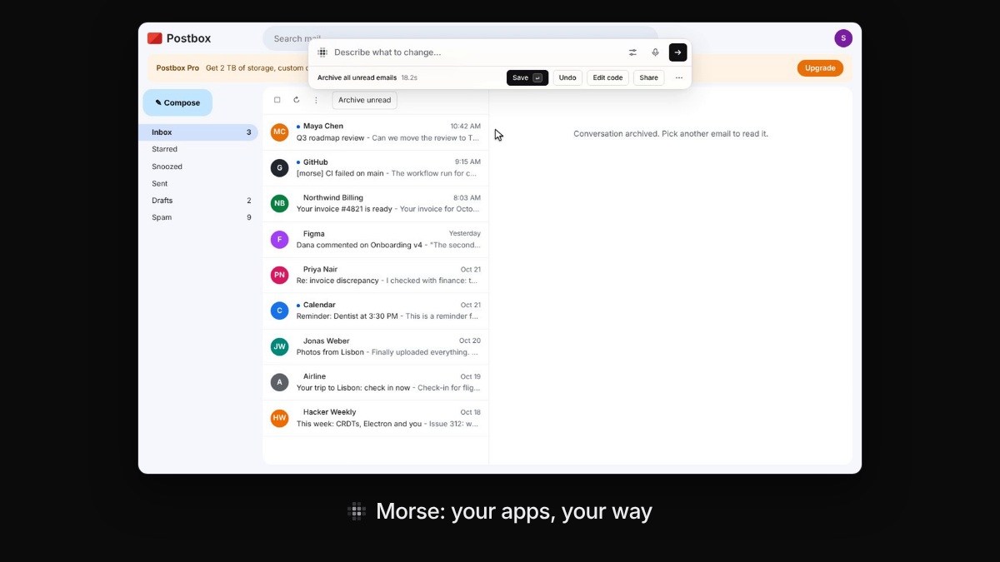
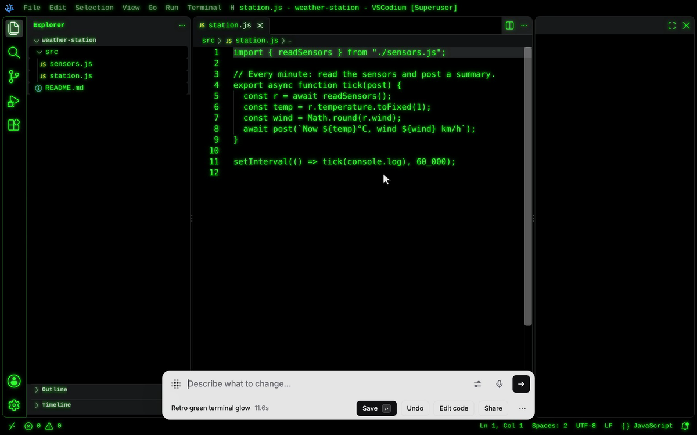

# Morse launch kit

**Change any website or desktop app in your own words.**

[](morse-demo-v2.mp4)

[Watch the demo](morse-demo-v2.mp4) (92 seconds, no sound) · [Website](https://sam-siavoshian.github.io/RRAA/site/) · [Source](https://github.com/sam-siavoshian/RRAA)

## The 36-second cut, for X

[](morse-social-16x9.mp4)

A short video for social media. It opens with Morse changing a real app, VSCodium. Then it adds a new feature, then shows three quick cuts. Captions are part of the picture, because most people watch with the sound off.

| File | What it is | Size |
|---|---|---|
| [`morse-social-16x9.mp4`](morse-social-16x9.mp4) | 1920×1080, 36 s | 3.7 MB |
| [`morse-social-4x5.mp4`](morse-social-4x5.mp4) | 1080×1350, for the timeline, 36 s | 2.6 MB |
| [`morse-social-9x16.mp4`](morse-social-9x16.mp4) | 1080×1920, 36 s | 2.7 MB |
| [`poster-social.png`](poster-social.png) | Poster frame: VSCodium as a green terminal | 272 KB |

In order:

1. **VSCodium as a retro terminal.** “make it look like a retro green terminal: green glowing text on black”, typed into the Morse bar in VSCodium. VSCodium is VS Code without Microsoft's name and logo, installed from its own `.deb` and opened with `morse launch codium`. Claude Code (haiku) wrote the change in 11.6 seconds.
2. **A feature it doesn't have.** “add a floating 25 minute focus timer with a start button in the top right corner”. It took 13.0 seconds. Then Save, then Start, and it counts down.
3. **Show me once**, from the demo above: archive one email by hand, then “Do these steps to every unread email”.
4. **Fix it**, from the demo above: a site update broke a mod, and the model fixed it.
5. **The off switch** in VSCodium: ⌥⇧0 (Alt+Shift+0) turns off both changes at once. Pressing it again brings them back.

What's real and what's sped up:

- Both VSCodium changes are Claude Code (haiku) answers with no edits, in a real VSCodium window. The bar shows the real time each took. Each wait is sped up in the video, and the video says so (“Waiting for the model, sped up N×”).
- Show me once and Fix it run on the demo apps in this repo (Postbox and Tunes), not on a real mail or music app. Their changes are also by Claude Code (haiku).
- Pauses where the person on screen did nothing are cut short, as in the demo above. In VSCodium, typing was slow on the recording machine, so the video starts each request already typed.
- The cursor is drawn in afterwards. The title bar says “[Superuser]” because the recording machine runs as root.

Made by `CUT=x` in [`demo/record-launch.js`](../../demo/record-launch.js). It records the VSCodium scene (`ONLY=codium`) and reuses the Show me once and Fix it recordings of the demo above. Then it lays out each format with its captions.

### Posts

Three single posts, with the 4:5 video:

> I typed “make it look like a retro green terminal” into VSCodium (VS Code without Microsoft's name and logo). It took about 12 seconds. Morse lets you change websites and desktop apps in your own words. It's open source.

> VSCodium doesn't have a focus timer. I asked for one, and Morse added it to the running app. There was no extension to install. Morse works on websites too.

> Point at something in an app and say what you want changed. Your own model (Claude Code, Codex or an API key) writes the change while you watch. Open source: github.com/sam-siavoshian/RRAA

A short thread:

> 1/ I changed VSCodium (VS Code without Microsoft's name and logo) by typing one sentence. This is Morse. It's open source, and it lets you change any website or desktop app in your own words. [16:9 video]
>
> 2/ It works on websites, and in desktop apps built from web pages, like VSCodium and Obsidian. Press a shortcut, point at something and say what you want. Your own model writes the change: Claude Code, Codex or an API key.
>
> 3/ Do a chore once, and Morse turns it into a button. When a site update breaks one of your changes, Fix it writes a new version. One key turns every change off.
>
> 4/ Everything in the video is a real run. The waits are sped up, and the video says so. It's free and open source: github.com/sam-siavoshian/RRAA

## Who it's for

People who use the same apps every day and wish one thing worked a little differently: a button that's missing, a chore they do ten times a day, text that's too small. You don't need to know how to code. If you do, you can read and edit every line Morse writes.

## What it does

1. **Adds what an app is missing.** Point at a music player and say “add a sleep timer”. Your model writes the change, and Morse adds it to the running app.
2. **Turns a chore into a button.** With **Show me once**, you do a task by hand one time, like archiving an email. Then say what Morse should do with the steps: “add a button”, “do this when I press Ctrl+Shift+A”, or “do this to every unread email”.
3. **Fixes mods when a site changes.** Sites change, and a mod can stop working. Morse notices. **Fix it** asks the model for a version that fits the new page. You see it before you save it.
4. **Works in desktop apps too.** `morse launch` opens an Electron app again with Morse connected. Tested on VSCodium, Obsidian and Joplin.
5. **Lets you try mods other people made.** The Mods panel lists mods from the gallery for the site you're on. **Try it** runs one without saving it. Then **Save** or **Undo**.

A mod is a change you saved. Morse brings it back every time you open that site or app. You can also change things by hand with the Edit tools. Page tools change the whole page (dark mode, hide ads, focus mode). Easier to use makes an app easier to read and use (bigger text, higher contrast, Read aloud, Check this page).

## How it works

1. **Press Ctrl+Shift+Space** (⌥Space on a Mac) in a website or a connected desktop app, and point at the part you want to change.
2. **Say or type what you want.** Morse sends what you pointed at and what you said to your model: Claude Code, Codex, or an API key you already have.
3. **Watch it change.** You see the change while the model writes it. Then choose Save, Undo, Edit code or Share.

## What's real today, and what isn't yet

Works today:

- **Websites**, through a Chrome extension you load yourself (it isn't in the Chrome Web Store). Mods work on sites with strict security settings too.
- **Desktop apps built on Electron**, with `morse launch <app>`. It opens the app again with Morse connected. The app's files never change.
- **Claude Code** as the model, tested for real, including everything in these videos.
- **Show me once, Fix it, and mods from the gallery**, as shown in the new video.
- **Share links, mod files and Tampermonkey scripts**, tested by installing a shared mod in a second browser.

Not yet, or not verified:

- **Apps that aren't built from web pages** (Finder, most macOS and Windows system apps) don't work.
- **Desktop apps were tested on Linux only.** That means VSCodium, Obsidian and Joplin as downloaded from their own releases, and a sample Electron app made for testing (Tunes, in [`demo/electron-app`](../../demo/electron-app)). Not yet tested: real Spotify, Slack or Discord, and real macOS or Windows. Some apps don't let Morse connect. `morse fuses <app>` tells you before you try. See [docs/desktop.md](../desktop.md).
- **Codex** is only tested with a stand-in `codex` command. **The Anthropic and OpenAI APIs** are only tested with stand-in servers, not the real ones.
- **Mods can do anything the page can.** The model is told not to send data anywhere, but nothing stops it yet. Read what a shared mod does before you install it. The install page tells you, with all of its code below.
- **The gallery is small**: a few example mods, most of them for the demo apps in this repo.
- **Morse Desktop was tested on Linux only.** Its tray menu, and the macOS and Windows builds, weren't tried yet.

## About the recordings

Everything here was recorded from real runs, by [`demo/record-launch.js`](../../demo/record-launch.js). Here is what's real and what was changed in the edit.

**The apps.** Tunes (a music app), Postbox (an email app) and The Daily Byte (a news site) are the demo apps in this repo ([`demo/sites/`](../../demo/sites/)). They stand in for real apps so the recording can be made again. In the browser they get made-up addresses (tunes.example, postbox.example, byte.example) instead of this computer's address and a port number. The desktop app is Tunes packed as a real Electron app ([`demo/electron-app`](../../demo/electron-app)), opened with a real `morse launch` typed into a terminal.

**The model.** Every change in the new video was written by **Claude Code with the `haiku` model**, with no edits: the sleep timer, the button from Show me once, the fixed covers mod, and the round covers in the desktop app. The bar shows the real time each one took: 24.7 s for the sleep timer, 18.2 s for the button, 13.1 s for the fix, 14.6 s for the round covers. The script throws away a run that fails or adds nothing visible and records it again. In the takes used here, each change was the model's first answer. (While the edit was being worked out, one earlier Show me once take was thrown away: the model's button didn't say “archive”, so the script couldn't find it. One desktop take was recorded again because the app didn't start.)

**What is sped up.** Each sped-up part says so on screen:

- “Waiting for the model, sped up N×” while the model writes.
- “Morse checks the page, sped up N×”: after a site changes, Morse waits for the page to settle and checks twice, a few seconds apart, before it says a mod stopped working.
- “Opening the app, sped up N×” while the desktop app starts.

**What is shortened without a label.** The recording machine was very busy, so each step of the script (finding the next button, reading the page) sometimes took a second or two while the person on screen stood still. Those pauses, where the person did nothing, are cut short. The 0.6 seconds after every click, key press or page load are always kept, so how fast the app reacts is shown as it was.

**What isn't from the model.** “Bigger rounded covers” and “Reading mode” are example mods from the gallery ([`site/mods/`](../../site/mods/)), made by hand. The covers mod is installed before the scene starts. Then the scene switches the site to its redesign (`?v2`), which renames the album grid, the way real sites change. Fixing it is the model's work.

**The cursor** is drawn in afterwards, because screen recordings don't include the real one. Its moves, clicks and the typing are paced like a person, with small random delays, and drawn at 30 frames a second from a log of what the script did. The bar is set to stay at the top of the page (a setting), so the cursor can reach its buttons.

**The desktop app.** The terminal and the app starting are the screen itself. Once the app is open, the picture is the app's own page, under the app's real menu bar as it was on screen. The app was started with `--no-sandbox` (needed when running as root) and `--enable-automation` (so the script can read Morse's state). Clicks and keys in the app come from the script, the same way as in the browser.

To record everything again after a UI change (needs Xvfb, xterm, xdotool, ffmpeg, Playwright, the Electron runtime, and Claude Code signed in):

```bash
npm run build
DISPLAY=:99 node demo/record-launch.js            # the new video and clips
CUT=v1 DISPLAY=:99 node demo/record-launch.js     # the first video and its clips
```

`REUSE=<work dir>` rebuilds the videos from saved frames without recording. `ONLY=heal,desktop` records only those scenes. The script's header lists the rest.

## Files

The new video and its clips:

| File | What it is | Size |
|---|---|---|
| [`morse-demo-v2.mp4`](morse-demo-v2.mp4) | The demo: sleep timer, Show me once, a mod fixed after a site update, a desktop app, the gallery. 1280×800, 30 fps, H.264, 92 s | 4.6 MB |
| [`poster-demo-v2.png`](poster-demo-v2.png) | Poster frame for the demo, 1200×675 | 159 KB |
| [`clip-show-once.mp4`](clip-show-once.mp4) | Clip: archive one email by hand, get a button for all of them, 15 s | 0.6 MB |
| [`clip-show-once.gif`](clip-show-once.gif) | The same clip as a GIF, 720 px wide | 1.5 MB |
| [`poster-show-once.png`](poster-show-once.png) | Poster frame, 1200×675 | 214 KB |
| [`clip-self-heal.mp4`](clip-self-heal.mp4) | Clip: a site update breaks a mod, Fix it, 13 s | 1.0 MB |
| [`poster-self-heal.png`](poster-self-heal.png) | Poster frame, 1200×675 | 215 KB |
| [`clip-desktop-app.mp4`](clip-desktop-app.mp4) | Clip: `morse launch`, then “make the covers round” in the desktop app, 15 s | 0.8 MB |
| [`poster-desktop-app.png`](poster-desktop-app.png) | Poster frame, 1200×675 | 202 KB |

The first video and its clips (sleep timer, word count, Edit tools, Page tools, share):

| File | What it is | Size |
|---|---|---|
| [`morse-demo.mp4`](morse-demo.mp4) | The first demo. 1280×800, 30 fps, H.264, 85 s | 4.3 MB |
| [`poster-demo.png`](poster-demo.png) | Poster frame for it, 1200×675 | 77 KB |
| [`clip-sleep-timer.mp4`](clip-sleep-timer.mp4) | Clip: “add a sleep timer”, 10 s | 0.3 MB |
| [`clip-sleep-timer.gif`](clip-sleep-timer.gif) | The same clip as a GIF, 720 px wide | 0.7 MB |
| [`poster-sleep-timer.png`](poster-sleep-timer.png) | Poster frame, 1200×675 | 73 KB |
| [`clip-page-tools.mp4`](clip-page-tools.mp4) | Clip: hide ads, then dark mode, 10 s | 0.3 MB |
| [`poster-page-tools.png`](poster-page-tools.png) | Poster frame, 1200×675 | 141 KB |
| [`clip-direct-edit.mp4`](clip-direct-edit.mp4) | Clip: rename a headline, move a pop-up, 14 s | 1.3 MB |
| [`poster-direct-edit.png`](poster-direct-edit.png) | Poster frame, 1200×675 | 437 KB |

The first video was made with an earlier version of Morse: its bar says “Keep” and “Refine…” where Morse now says “Save” and “Describe what to change…”.

The clips are 1280×864: the picture, with a one-line caption under it.

## Suggested posts

**Demo video**
> Morse lets you change any website or desktop app in your own words. Add a missing button, turn a chore into one click, and fix your changes when a site updates. It uses your own model: Claude Code, Codex or an API key. It's open source.

**clip-show-once**
> I archived one email by hand and told Morse “do these steps to every unread email”. It added a button that archives all of them.

**clip-self-heal**
> A site changed and one of my mods stopped working. Morse noticed, and Fix it made a new version for the new page. I saw it before I saved it.

**clip-desktop-app**
> Morse works in desktop apps too. `morse launch` opens the app with Morse connected. “make the covers round” works the same as on a website.

**clip-sleep-timer**
> I pointed at a music player and typed “add a sleep timer”. Claude Code wrote it and Morse added it to the running app.

**clip-page-tools**
> I hid the ads, then turned on dark mode. That took two clicks in Morse, with no model.

**clip-direct-edit**
> Not every change needs a model. In Morse, you can point at a headline and type new words, or drag a pop-up out of the way. It stays that way next time.
