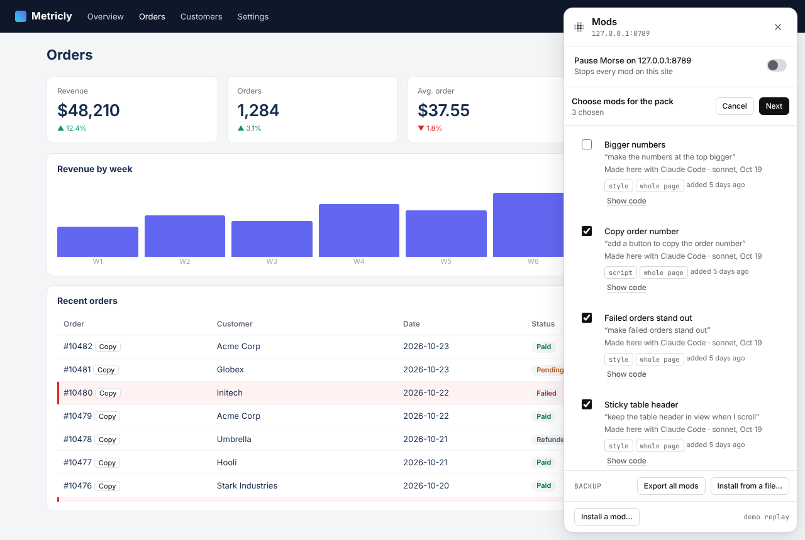
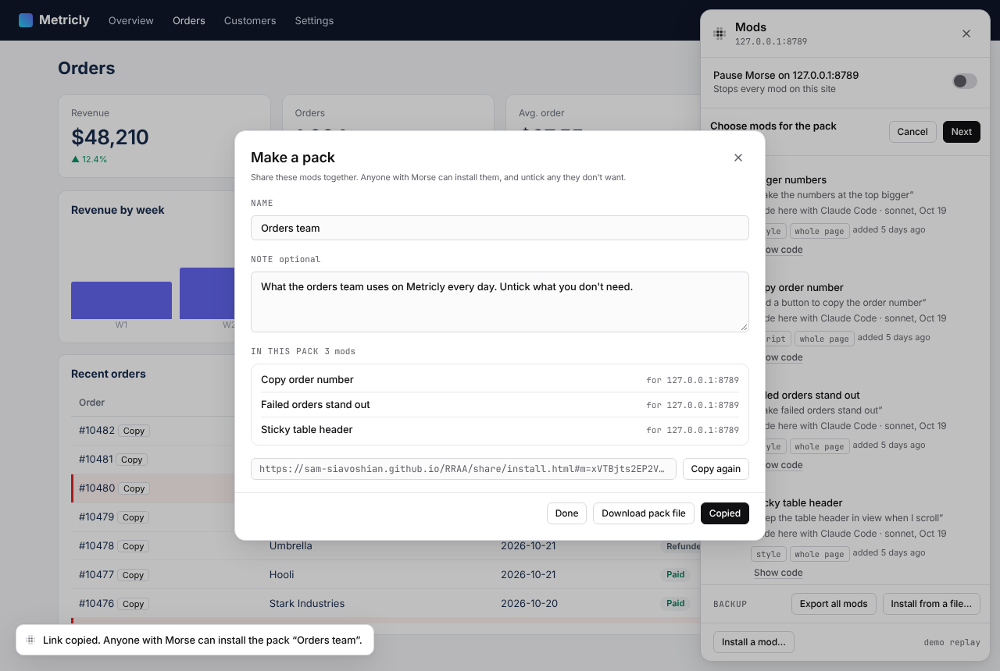
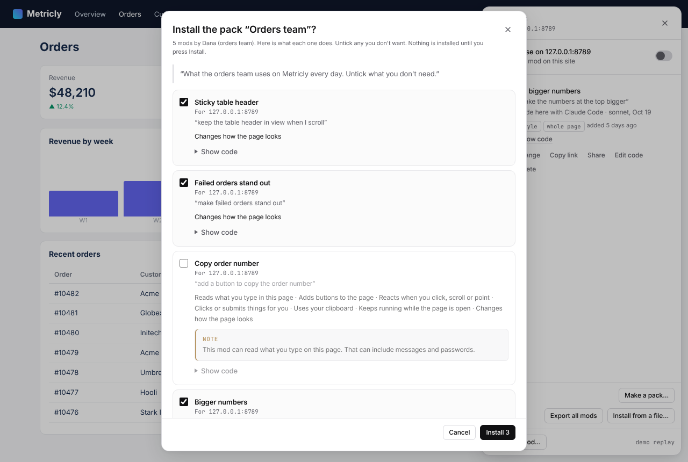
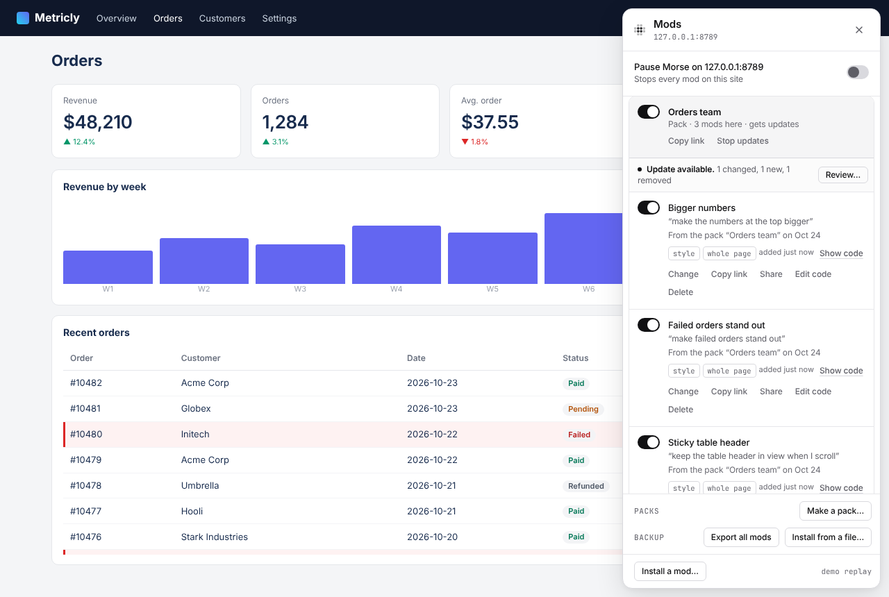
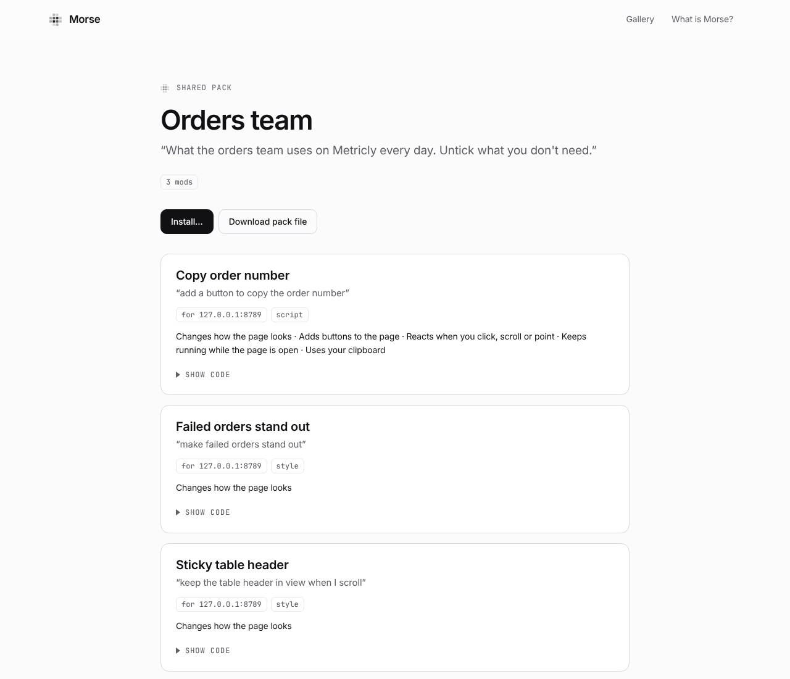
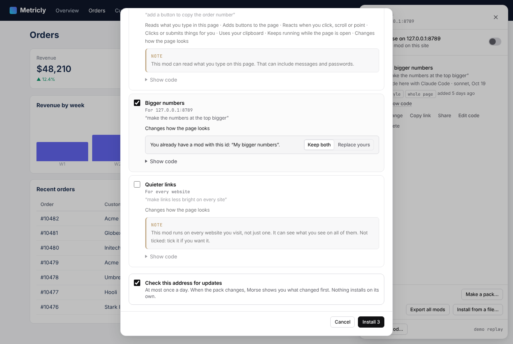
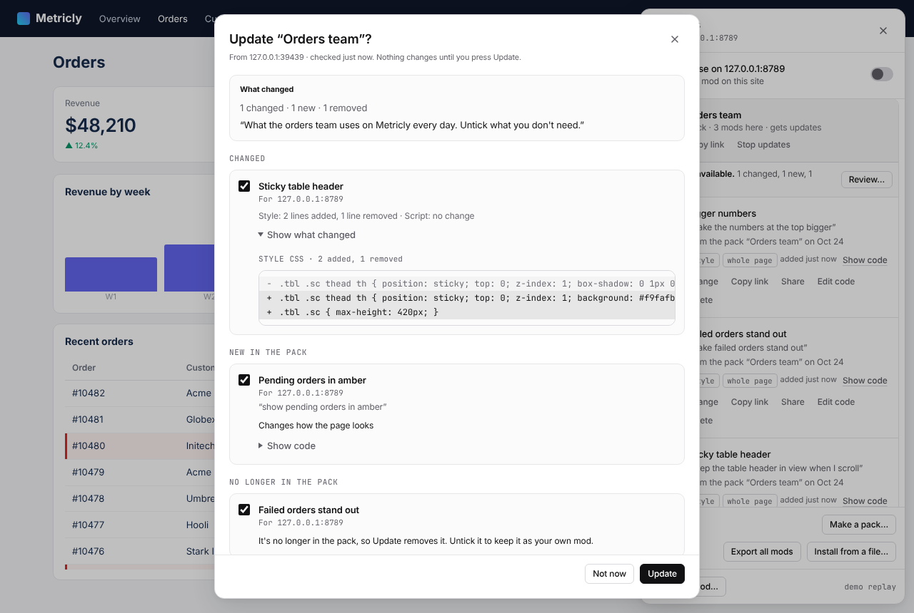

# Mod packs: several mods, shared together

A pack is a few mods with a name and a note, shared and installed together. It is for a team that wants the same changes to the tools it uses every day, or for anyone who made a set of mods that go together. A mod is a change you saved. Morse brings it back every time you open that site or app.

A pack travels the same ways a mod does: as a share link, as a file, or from an address your team keeps it at. Whoever installs it sees every mod in it first, and chooses which ones they want.

| | |
|---|---|
|  **Make a pack…**: tick the mods to put in it |  **Name and note**, then Copy link or Download pack file |
|  **Installing**: every mod, what it does and where. Untick what you don't want |  **The Mods panel**: the pack's mods under its name, with one switch |

## Make a pack

1. Open the Mods panel and press **Make a pack…** (under Packs, near the bottom).
2. Tick the mods you want in it, then press **Next**.
3. Give the pack a name, and a note if you like: what the mods are for, and who they're for.
4. Press **Copy link** to share it as a link, or **Download pack file** to share it as a file.

A pack carries each mod as it is now. Nothing about your computer goes in it: not whether a mod is on or off, not its History, and not where you got it from. A pack holds up to 50 mods. A pack that is too big for a link is shared as a file instead.

The Mods panel shows the mods for the site you're on. To put mods for several sites or apps in one pack, use the `morse` command (below).

## Install a pack

Open the link, or in the Mods panel press **Install a mod…** and paste the link, the text of a pack file, or the address of a pack. **Install from a file…** takes a pack file too.



Morse shows one review for the whole pack. For each mod:

- what it does, in plain words, worked out from its code
- where it runs, and **not this page** when it's for another site
- **Show code**, to read it
- a note when it can send what's on the page to another website, read what you type, or put together its own code while it runs
- a note when it runs on every website (or on every site ending in .com, and so on). These start unticked: tick them if you want them.

Untick any mod you don't want. Nothing is installed until you press **Install**.

If you already have a mod with the same id as one in the pack, Morse never replaces yours without asking. It shows **Keep both** (the default: the pack's copy is installed next to yours) and **Replace yours**. Installing the same pack again updates the mods you got from it, and your copies stay in History.

Each mod you install remembers the pack it came from. The Mods panel says “From the pack …” under it.

## In the Mods panel

A pack's mods are listed together under the pack's name.

- **The switch next to the pack's name** turns the whole pack on or off, on every site it runs on. Each mod still has its own switch.
- **Copy link** shares the whole pack again, with all its mods.
- **The off switch** (⌥⇧0, Alt+Shift+0) and **pausing Morse** work on pack mods like on any other mod. See [Your controls](your-controls.md).

## Packs that stay up to date

A team can keep its pack as a file in its own repository, and everyone gets the changes. To get updates, install the pack from its address (for a file on GitHub, the address of the raw file) and tick **Check this address for updates** at the end of the review. It is never ticked for you.



- Morse checks the address at most once a day, when you open the Mods panel. It asks the server whether the file changed since last time, reads at most 2 MB, and if the address can't be reached it keeps the copy it has and tries again later.
- When the pack changed, the pack shows **Update available** in the Mods panel. **Review…** shows what changed: mods that changed (with the lines that changed, and a note if one would now run on more sites), new mods, and mods that are no longer in the pack. Mods you left out before stay unticked.
- Nothing installs on its own. Untick anything you don't want, then press **Update**. Your old versions stay in History. A mod that left the pack is removed, unless you untick it: then it stays as your own mod.
- **Stop updates** in the Mods panel stops checking. The pack's mods stay installed.

Updates only come from an https:// address. (While you make a pack, an address on your own computer works too.)



## From the command line

```bash
morse pack make a1b2c3 d4e5f6 --name "Orders team" --note "What we use on Metricly"
morse pack install orders-team.morse-pack.json
morse pack install https://raw.githubusercontent.com/acme/tools/main/orders-team.morse-pack.json --subscribe
morse pack list
morse pack unsubscribe orders-team
```

`morse mods` lists your mods and their ids. `morse pack make` saves the pack file and prints a share link. `morse pack install` takes a file, a share link or an address, says what each mod does, and asks before it installs anything (`--yes` to skip the question). If one of your mods has the same id, it asks whether to replace it; with `--yes` it keeps both, and `--replace` replaces yours. `--subscribe` checks the address for updates. `morse pack list` shows your packs and when each was last checked.

## Safety

A pack is read as if it came from a stranger:

- a pack file or link over 2 MB, or with more than 50 mods, is refused
- a mod that is broken, or has the same id as another mod in the pack, is left out, and the review says so
- names and notes are shown as plain text, never as part of the page
- History, on or off, and where a mod came from never come in with a pack
- a mod can't arrive as part of Your style
- what you install is exactly what the review showed: if the pack changes while you look at it, Morse asks you to open it again

Tested by [`tests/pack.test.js`](../tests/pack.test.js) (the format, hostile packs, updates), [`tests/pack-ui.test.js`](../tests/pack-ui.test.js) (make, share, install with unticked mods, the grouped panel, an update from an address, in real Chromium) and [`tests/pack-cli.test.js`](../tests/pack-cli.test.js). Screenshots by [`demo/shoot-packs.js`](../demo/shoot-packs.js).
