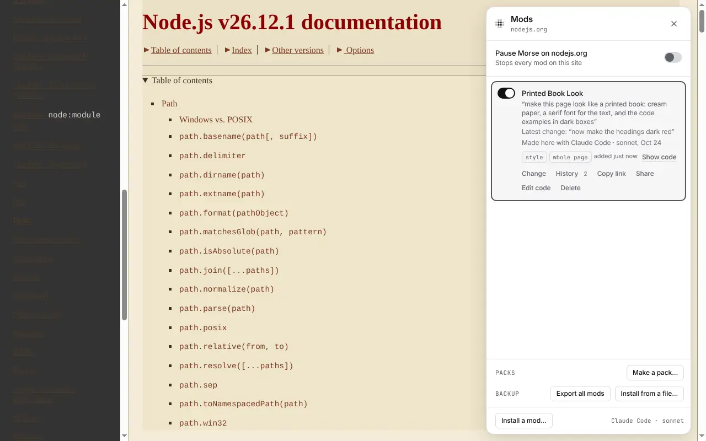
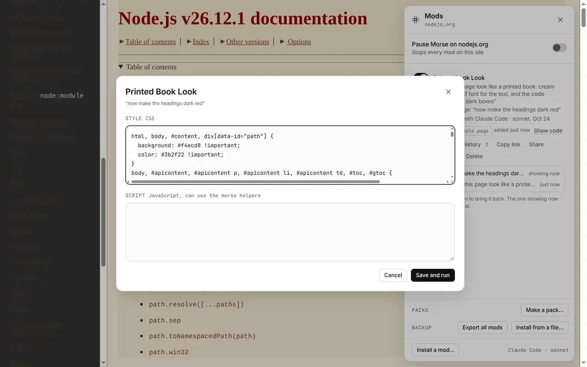
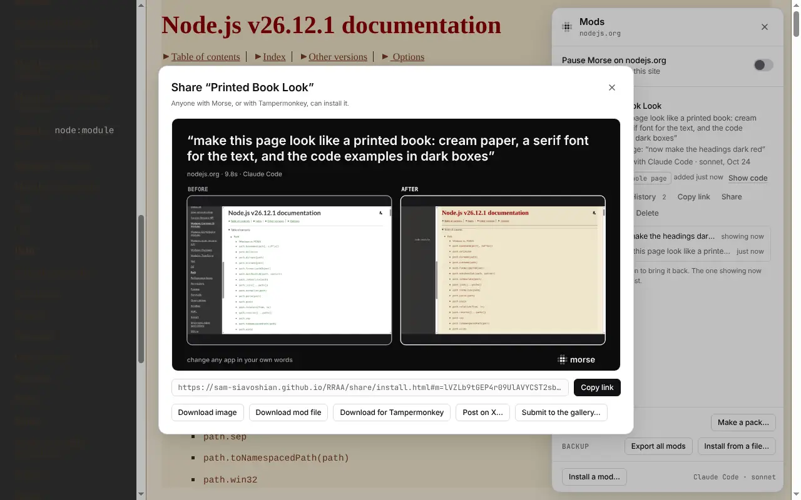
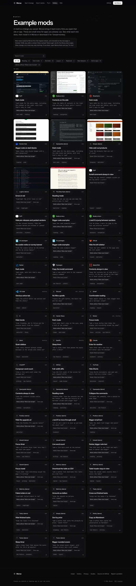

# Mods

A mod is a change you saved. Morse brings it back every time you open that
site or app, even after a restart. This page covers the Mods panel, sharing,
mods other people made, and what to do when a site changes.

## The Mods panel

Press **⌥⇧M** (Alt+Shift+M), or click **Mods** in the bar. The panel lists
the mods for the site or app you're on. For each one you can:

- turn it on or off with its switch
- **Change** it: the bar opens on it, and you describe what to change
- bring back an older version from **History** (the last 20 are kept)
- **Share** it
- under **More**: **Copy link**, **Show code** (with **Edit code** inside it), or **Delete**

Delete and bringing back a version both show **Undo** in Morse's message at
the bottom of the page. The Morse app's **Mods** list has every mod for every
app and site, each with its switch and **Delete** (with **Undo**), and one
switch that turns them all off.

Each mod also says where it came from. It was made here (and with which
model), made with your own edits, installed from a share link (and from
whom), or restored from a backup.

With more than six mods, a search box appears. With the keyboard, **↑** and
**↓** move, **Space** turns a mod on or off, and **Enter** changes it.

In a terminal, `morse mods` lists your mods. `morse code <id>` says what one
does and shows its code. `morse rm <id>` deletes one.

| | |
|---|---|
|  The Mods panel on nodejs.org: where each mod came from, with **Show code** |  **Edit code** |

## Share a mod

To share several mods together, make a [mod pack](mod-packs.md).

**Share** on a result or in the Mods panel gives you:

- **Copy link**: a share link that carries the whole mod. Anyone with Morse
  can install it.
- **Download image**: the same spot before and after, with the change
  outlined.
- **Download clip**: a short video of the change. For desktop apps. Needs
  `ffmpeg`.
- **Download mod file**: the mod as a `.morse.json` file.
- **Download for Tampermonkey**: a version that runs without Morse, in
  Tampermonkey or any userscript extension.
- **Post on X…**: opens X with your request and the link filled in. Nothing
  is posted until you post it.
- **Submit to the gallery…**: opens GitHub with the mod and a short form
  filled in. Nothing is sent until you submit it.

In a terminal, `morse export <id>` makes the mod file, the Tampermonkey file
and the share link.

| | |
|---|---|
|  **Share**: the share image (before and after), the link and the downloads | |

## Install a shared mod

Open a share link. The page says what the mod does, with its code folded
below. Click **Install**, and Morse shows the same summary again. Only a
click there installs it. A web page can't install anything by itself.

You can also install from the Mods panel with **Install a mod…** (a link or a
file). Or run `morse install <link or file>` in a terminal.

### What a mod does, before you install it

Morse reads the mod's code and lists what it changes and what it can do:

- *Changes how the page looks*
- *Adds buttons to the page*
- *Reads what you type in this page*
- *Sends data to another website*
- *Remembers settings on this site*

and so on. If a mod sends data elsewhere or reads what you type, Morse warns
you clearly. Things a mod adds itself, like a sleep timer's own label, don't
count as changing the page. When unsure, Morse lists a thing rather than
leaving it out. This is a careful reading of the code, not a promise. When
it matters, read the code too.

## Mods other people made

The Mods panel in Morse offers shared mods for sites like PyPI, GitLab and the Node.js docs. You can read their code before installing them.

When the site you're on has mods in the gallery, the empty bar says so (“2
mods for pypi.org”). The Mods panel lists them under **For this site**, with
the title, the request, what it does and who made it.

- **Try it** runs the mod on the page without saving it. Then **Save** keeps
  it and **Undo** takes it off, the same as any change.
- **Install…** shows the same review as a share link.
- **Update available**: when the gallery has a newer version of a mod you
  installed, click **Update…**. It shows what changed, in words and line by
  line, before anything is replaced. Your old version stays in History.

Morse checks the gallery list at most once a day. To stop that, turn off
**Show mods others made** in Settings.

| | |
|---|---|
|  The gallery on the website | |

## When a site changes

Sites change their pages, and a mod can stop working when they do. Morse
notices.

- If a saved mod's code fails, or the part it looks for isn't there after 5
  seconds, its row in the Mods panel says so.
- If a site was redesigned and nothing the mod changed is on the page any
  more, Morse puts a small dot on the Morse mark (in the bar, the Mods panel
  and Chrome's toolbar). The mod's row says *Stopped working after this site
  changed*. Nothing pops up over the page.

Click **Fix it**. Morse sends the model what went wrong, what the mod used to
change and the page as it is now. You see the fixed version. **Save** it or
**Undo** it. The old version stays in History.

To fix mods without asking, turn on **Fix my mods automatically when a site
changes** in Settings. It is off until you turn it on. Morse then fixes mods
in the background and tells you, with Undo.

If the mod came from the gallery, Morse offers **Share the fix…**. Then other
people who use it get the fix too.

## Back up your mods

See [Your controls](your-controls.md#backups).
