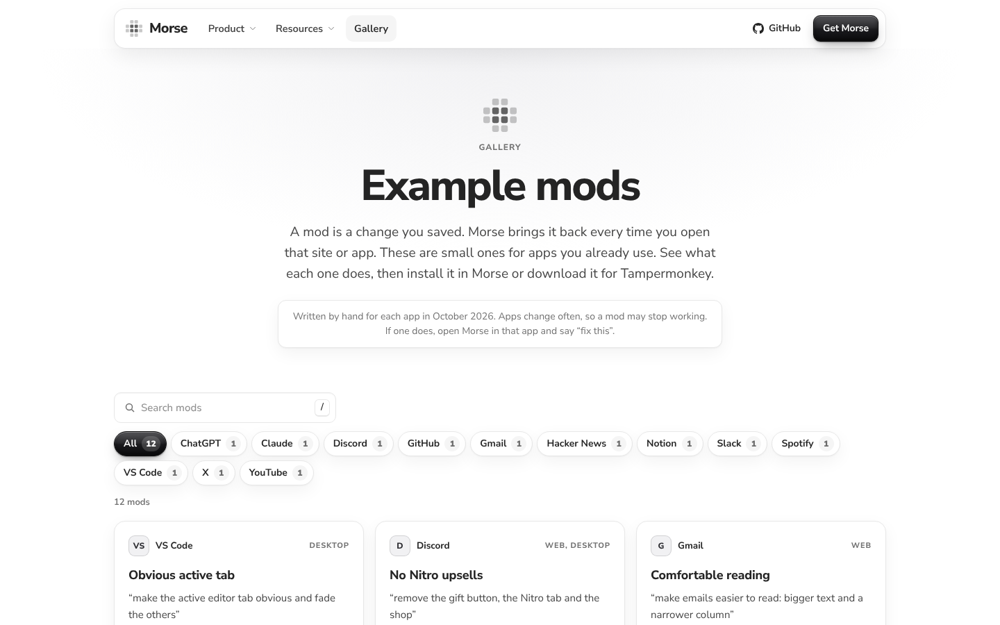
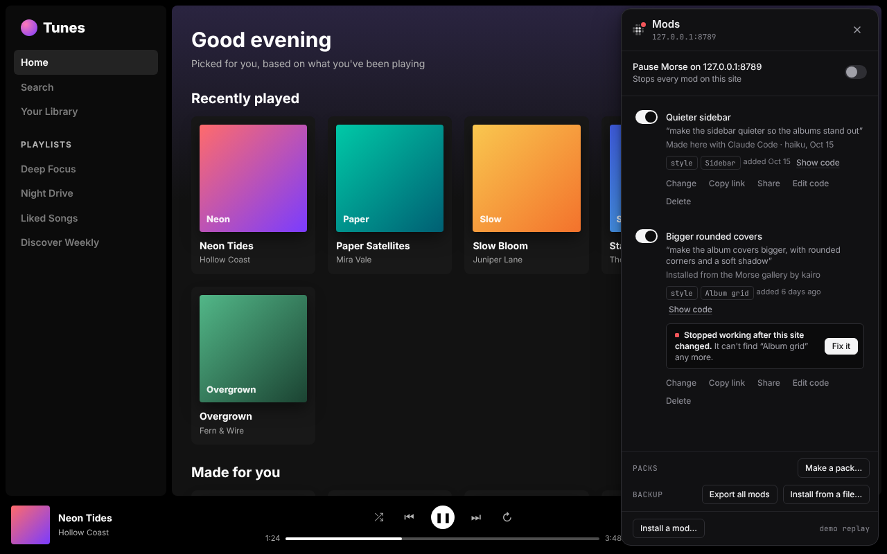
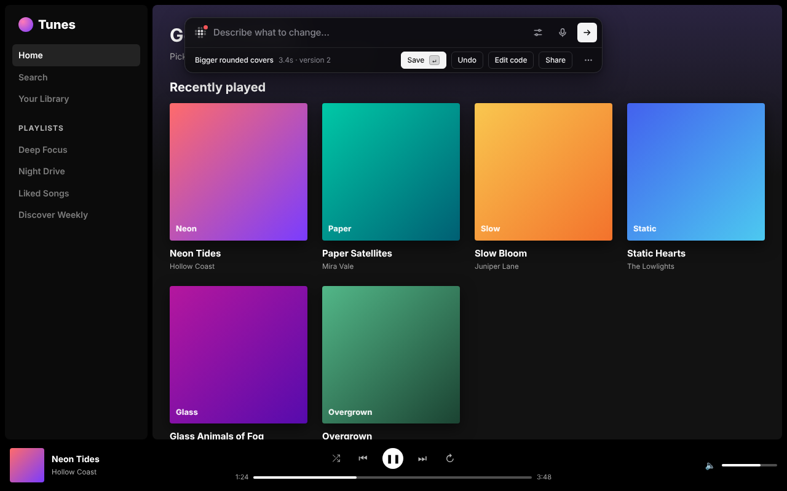
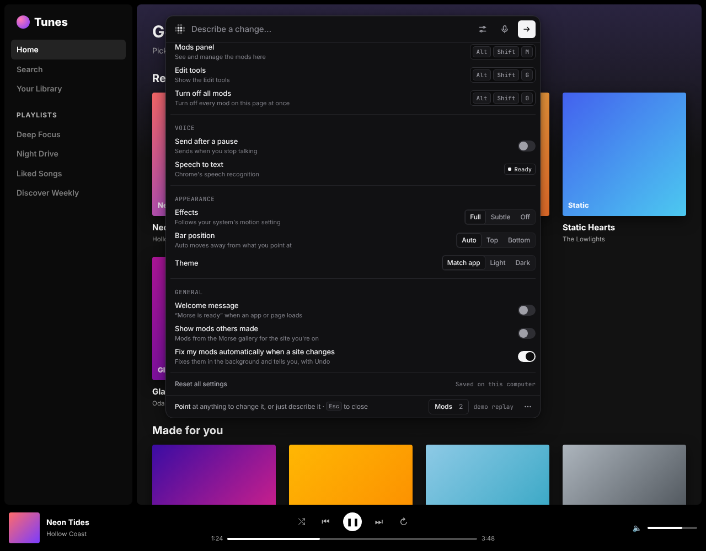
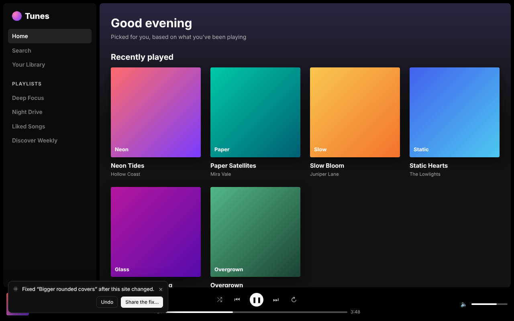
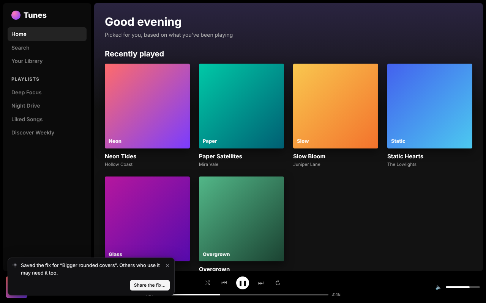

# Mods

A mod is a change you saved. Morse brings it back every time you open that
site or app, even after a restart. This page covers the Mods panel, sharing,
mods other people made, and what happens when a site changes under a mod.

## The Mods panel

Press **⌥⇧M** (Alt+Shift+M), or click **Mods** in the bar. The panel lists
the mods for the site or app you're on. For each one you can:

- turn it on or off with its switch
- **Change** it: the bar opens on it, so you can describe what to change
- bring back an older version from **History** (the last 20 are kept)
- **Share** it, **Copy link**, **Edit code**, or delete it

Each mod also says where it came from: made here (and with which model), your
own edits, installed from a shared link (and from whom), or restored from a
backup. **Show code** next to it shows its code.

With more than six mods, a search box appears. From the keyboard: **↑** and
**↓** move, **Space** turns a mod on or off, **Enter** changes it.

In a terminal, `morse mods` lists your mods, `morse code <id>` says what one
does and shows its code, and `morse rm <id>` deletes one.

| | |
|---|---|
|  The Mods panel in a desktop app |  Every row says where the mod came from, with **Show code** |
|  Turn mods on and off, share, edit, delete |  **Edit code** |

## Share a mod

To share several mods together, make a [mod pack](mod-packs.md).

**Share** on a result or in the Mods panel gives you:

- **Copy link**: a share link that carries the whole mod. Anyone with Morse
  can install it.
- **Download image**: the same spot before and after, with the change
  outlined.
- **Download clip**: a short video of the change (desktop apps, needs
  `ffmpeg`).
- **Download mod file**: the mod as a `.morse.json` file.
- **Download for Tampermonkey**: a version that runs without Morse, in
  Tampermonkey or any userscript extension.
- **Post on X…**: opens X with your request and the link filled in. Nothing
  is posted until you post it.
- **Submit to the gallery…**: opens GitHub with the mod and a short form
  filled in. Nothing is sent until you submit it.

In a terminal, `morse export <id>` writes the mod file, the Tampermonkey
file and the share link.

| | |
|---|---|
|  Share |  The share image: before and after, with the change outlined |
|  The Tampermonkey version, running **without Morse** |  Share, in a desktop app |

## Install a shared mod

Open a share link and the page shows what the mod does, in plain words, with
its code folded below. **Install** hands it to Morse, which shows the same
summary again. Only a click there installs it. A web page can't install
anything by itself.

You can also install from the Mods panel with **Install a mod…** (a link or a
file), or in a terminal with `morse install <link or file>`.

| | |
|---|---|
|  A friend opens the share link |  …installs it, and gets the mod |

### What a mod does, before you install it

Morse reads the mod's code and lists what it changes and what it can do:

- *Changes how the page looks*
- *Adds buttons to the page*
- *Reads what you type in this page*
- *Sends data to another website*
- *Remembers settings on this site*

and so on. Sending data elsewhere and reading what you type get a clear note.
Things a mod adds itself, like a sleep timer's own label, don't count as
changing the page. When in doubt, Morse mentions something rather than
leaving it out. This is a careful reading of the code, not a guarantee, so
read the code too when it matters.

## Mods other people made

The [gallery](../site/gallery.html) has mods other people made, for sites
like YouTube, GitHub and Slack. On the website you can search them, read
their code, and install them, download them for Tampermonkey or copy their
link.

Inside Morse, when the site you're on has mods in the gallery, the empty bar
says so (“2 mods for youtube.com”), and the Mods panel lists them under
**For this site**: the title, the request, what it does in a few words, and
who made it.

- **Try it** runs the mod on the page without saving anything. Then **Save**
  keeps it and **Undo** takes it all away, the same as any change.
- **Install…** goes through the same review as a share link.
- **Update available**: when the gallery has a newer version of a mod you
  installed from it, **Update…** shows what changed, in words and line by
  line, before anything is replaced. Your old version stays in History.

Morse reads the gallery list at most once a day. Turn it off with **Show mods
others made** in Settings.

| | |
|---|---|
|  **For this site** in the Mods panel |  **Try it**: on the page, nothing saved yet |
|  **Update…**: what changed in the newer version |  The gallery on the website |

## When a site changes

Sites change their pages, and a mod can stop working when they do. Morse
notices.

- When a saved mod's code fails, or what it looks for hasn't shown up after 5
  seconds, its row in the Mods panel says so in plain words.
- When a site was redesigned and nothing the mod used to change is on the
  page any more, Morse puts a small dot on the Morse mark (in the bar, the
  Mods panel and Chrome's toolbar) and the mod's row says *Stopped working
  after this site changed*. Nothing pops up over the page.

**Fix it** sends the model what went wrong, what the mod used to change and
the page as it is now. The fixed version is shown for you to **Save** or
**Undo**, and the old one stays in History.

To have this happen by itself, turn on **Fix my mods automatically when a
site changes** in Settings (it is off unless you turn it on). Morse then
fixes mods in the background and tells you, with Undo.

If the mod came from the gallery, Morse offers **Share the fix…**, so other
people who use it get the fix too.

| | |
|---|---|
|  *Stopped working after this site changed*, with **Fix it** |  The fixed version, shown with Save and Undo |
|  The setting to fix mods automatically |  Fixed in the background, with Undo |
|  Share the fix with the gallery |  A mod that stopped working, with **Fix it** |

## Back up your mods

See [Your controls](your-controls.md#backups).
