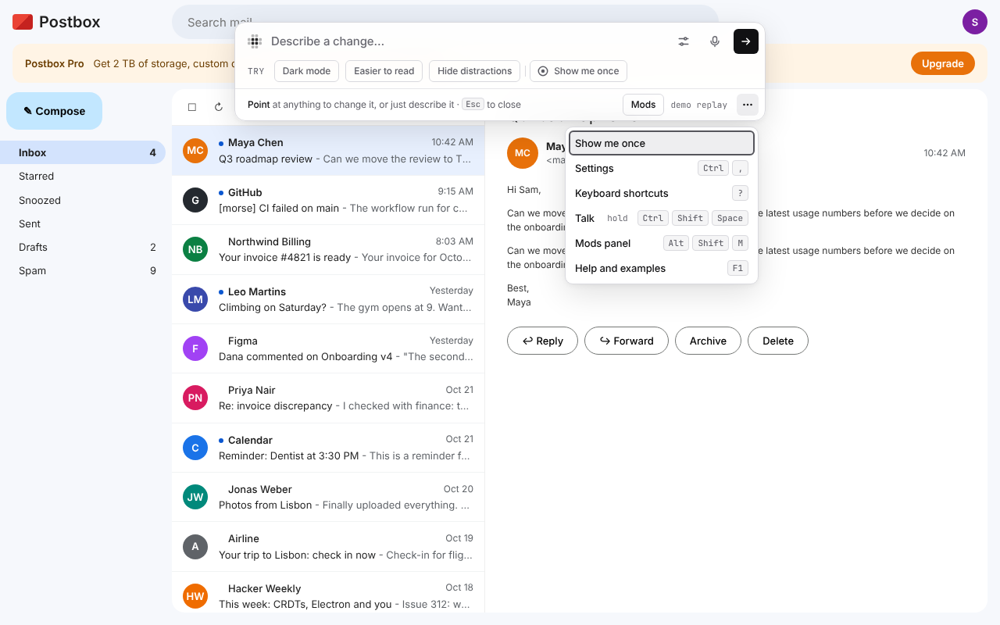
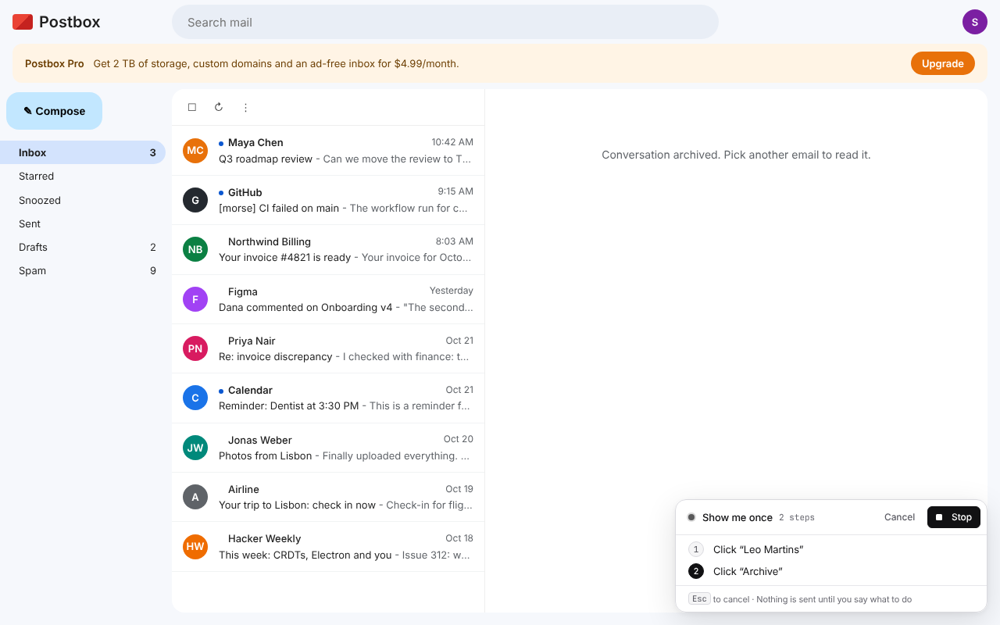
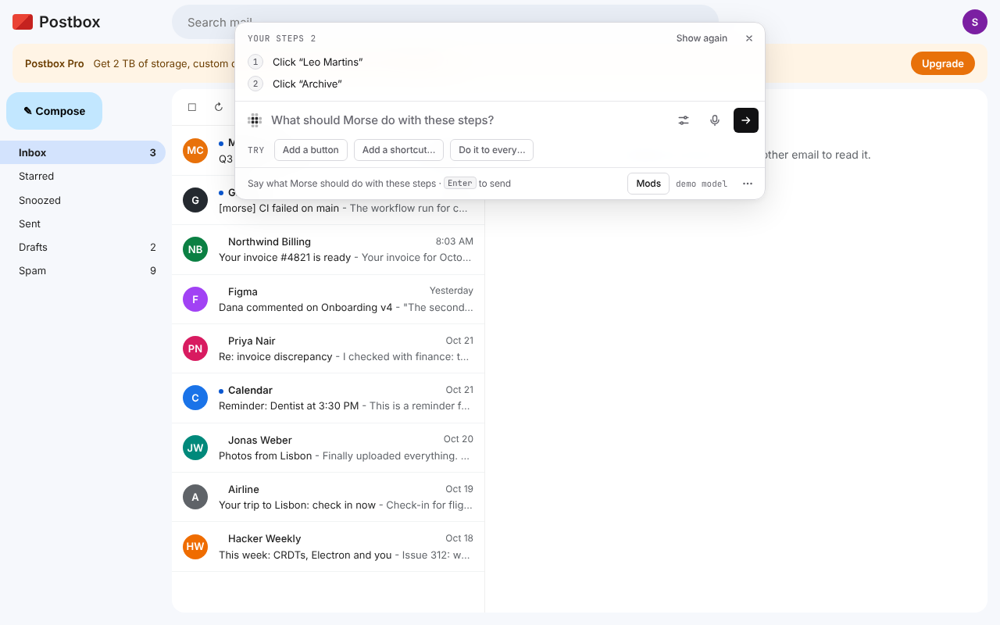
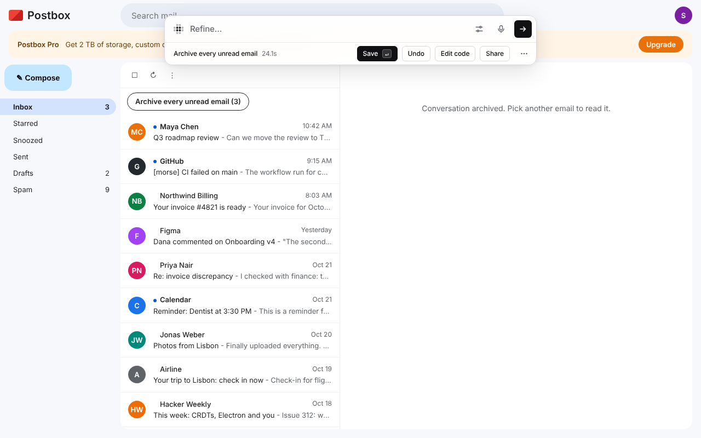
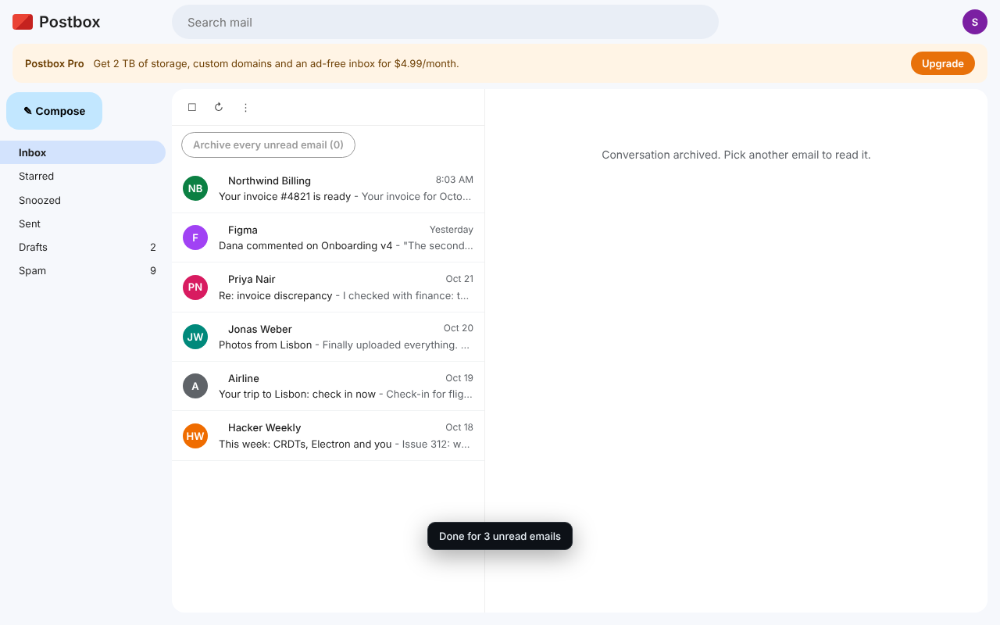
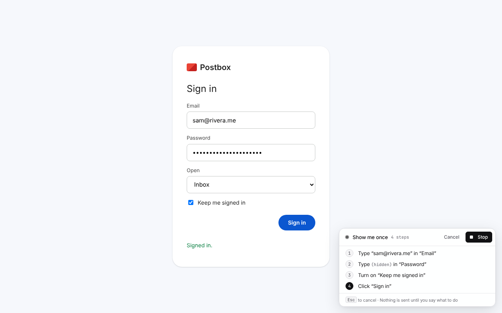

# Show me once

Clicking the same things over and over? Do the task by hand once, and Morse
writes it down. Then say what you want done with it:

- “add a button that does this”
- “do this when I press Ctrl+Shift+A”
- “do this to every unread email”

The model writes a mod that does the steps for you. Save it, change it or undo
it like any change.

## How to use it

1. Open Morse and choose **Show me once**. It is under the box in the empty
   bar, and in the **⋯** menu.
2. Do the task by hand: click, type, choose, press keys. A small strip lists
   each step in plain words as you go: *Click “Archive”*, *Type “invoice” in
   “Search mail”*.
3. Click **Stop**. The bar opens with your steps.
4. Say what you want done with them, and press **Enter**.

Morse sends the steps to the model in order, with what each thing is called
and how to find it again. The mod it writes waits for each thing to appear
before it does the next step.

| | |
|---|---|
|  **Show me once**, in the bar and the ⋯ menu |  **Recording**: each step as you do it |
|  **Stop**: say what to do with the steps |  **The result**, live: a button for every unread email |
|  **Done** for 3 unread emails |  A sign-in: the password is “(hidden)” |

## What Morse writes down

- **Passwords and card numbers stay yours.** In a password field, or a field
  marked for card details, the step says “(hidden)” and what you typed is
  never kept. The mod stops at that field and asks you to type it.
- **Only what you do, only here.** Morse writes down your own clicks and keys
  on this page while the strip shows. Not what the page does by itself, not
  other frames on the page, and not Morse itself.
- **Esc** cancels. Nothing is sent until you say what to do and press
  **Enter**.

## How well it works

Checked with real Claude Code (haiku) on a demo mail app. “Do this to every
unread email” gave an **Archive unread** button that archived all 4 unread
emails and kept the 6 read ones in 10 of 12 runs. The other 2 forgot to put
the button on the page. Each took about 10 to 25 seconds. “Do this when I
press Ctrl+Shift+A” worked every time.

For developers: the steps come from
[`core/showonce.js`](../core/showonce.js) and
[`runtime/src/64-show-once.js`](../runtime/src/64-show-once.js), the check is
[`evals/show-once.js`](../evals/show-once.js), and the screenshots come from
[`demo/shoot-show-once.js`](../demo/shoot-show-once.js).
