# Showcase: big changes to real apps

Eighteen changes you can see at a glance, made by asking in plain words. All on
real software: Microsoft's own Visual Studio Code, Obsidian, and live websites.
No demo apps, no mockups. Every change was written by Claude Code (Opus, or
Sonnet for two of them; never Haiku) while we watched, then saved. Then the app
was quit and opened again (or the page reloaded) to check the change came back.

Each picture is three files: `<name>-before.jpg`, `<name>-after.jpg` (same size,
same framing) and `<name>.jpg`, the two side by side under the words asked, the
app, the model and the time. [`showcase.json`](showcase.json) lists them all
with those details. To redraw the side-by-side pictures:
`python3 -I demo/showcase-pictures.py docs/showcase/showcase.json`.

## How they were made

- **Visual Studio Code 1.143.1**, Microsoft's build, from its `.deb` in
  packages.microsoft.com (the site's own download link isn't reachable from the
  test machine). **Obsidian 1.14.5**, its AppImage. Both on Linux in a
  container, as root, so each was started with `-- --no-sandbox`.
- Opened with `morse launch code` and `morse launch obsidian`. Then, with real
  keyboard and mouse input ([`demo/try-real-app.js`](../../demo/try-real-app.js)):
  Ctrl+Shift+Space, the words typed into the bar, Enter, Save. The app was
  quit, opened again with `morse launch`, and the "after" picture was taken
  there.
- Websites: Chromium with the Morse extension and “Allow User Scripts” on,
  paired with `morse serve` (`demo/try-real-sites.js`).
  The "after" picture is after Save and a reload.
- New buttons and keys were used for real before the "after" picture: a click
  on Start, Focus, Hide distractions or New daily note, a press of
  Ctrl+Alt+P, or typing.
- **Time** is from pressing Enter to seeing the change. The test machine was
  shared with other work and often very busy, so times are slower than usual.
- **The words** are exactly what was typed. Where the first result looked
  cheap or broken, the words were changed and asked again, and the table says
  so. Only the kept result is shown.

## The changes

| | What was asked | App | Model | Time | Back after reopening | Needs “Allow User Scripts” |
|---|---|---|---|---|---|---|
| [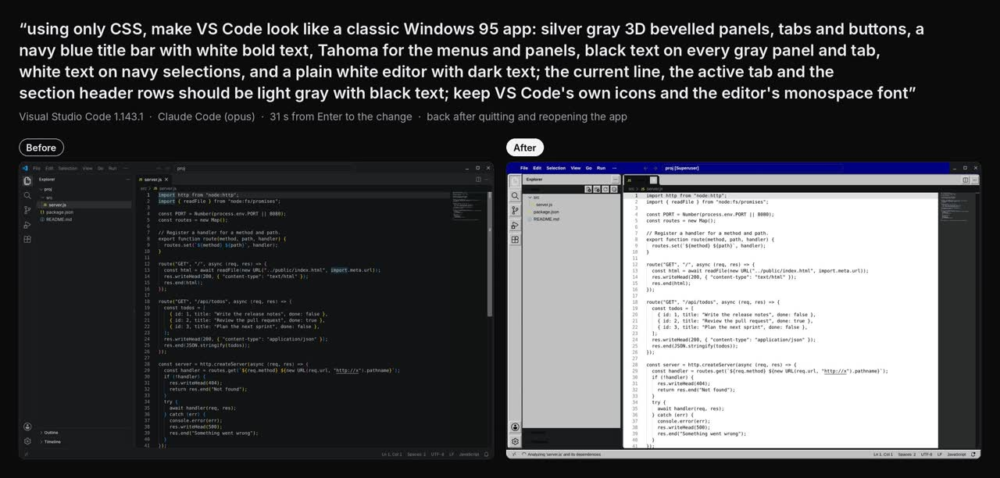](vscode-windows-95.jpg) | “using only CSS, make VS Code look like a classic Windows 95 app: silver gray 3D bevelled panels, tabs and buttons, a navy blue title bar with white bold text, Tahoma for the menus and panels, black text on every gray panel and tab, white text on navy selections, and a plain white editor with dark text; the current line, the active tab and the section header rows should be light gray with black text; keep VS Code's own icons and the editor's monospace font” | VS Code | Opus | 31 s | Yes | (desktop app) |
| [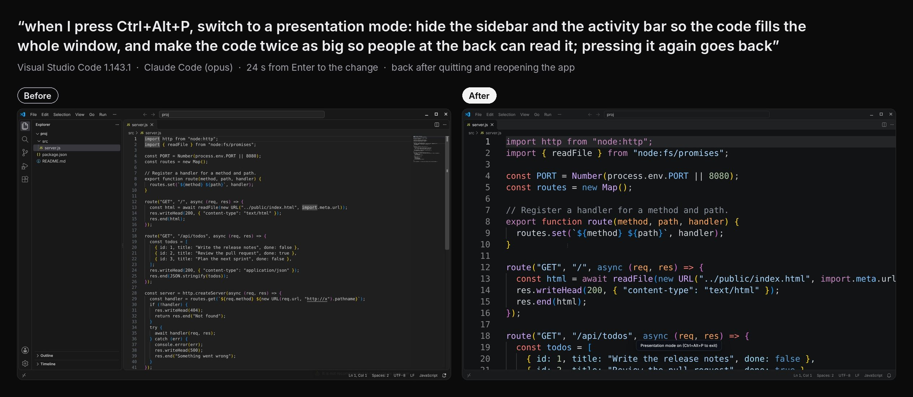](vscode-presentation-shortcut.jpg) | “when I press Ctrl+Alt+P, switch to a presentation mode: hide the sidebar and the activity bar so the code fills the whole window, and make the code twice as big so people at the back can read it; pressing it again goes back” | VS Code | Opus | 24 s | Yes | (desktop app) |
| [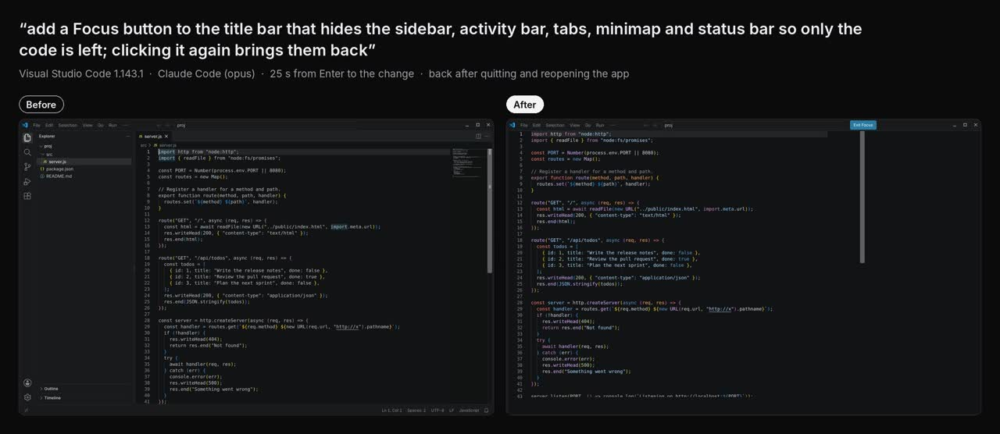](vscode-focus-button.jpg) | “add a Focus button to the title bar that hides the sidebar, activity bar, tabs, minimap and status bar so only the code is left; clicking it again brings them back” | VS Code | Opus | 25 s | Yes | (desktop app) |
| [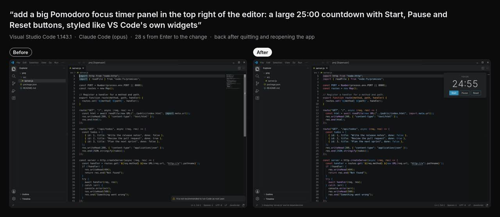](vscode-focus-timer.jpg) | “add a big Pomodoro focus timer panel in the top right of the editor: a large 25:00 countdown with Start, Pause and Reset buttons, styled like VS Code's own widgets” | VS Code | Opus | 28 s | Yes | (desktop app) |
| [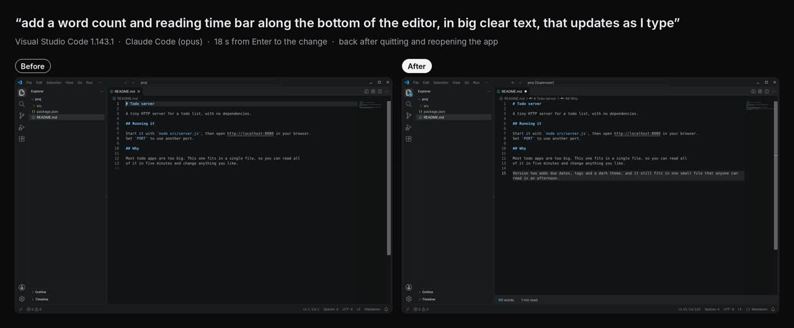](vscode-word-count.jpg) | “add a word count and reading time bar along the bottom of the editor, in big clear text, that updates as I type” | VS Code | Opus | 18 s | Yes | (desktop app) |
| [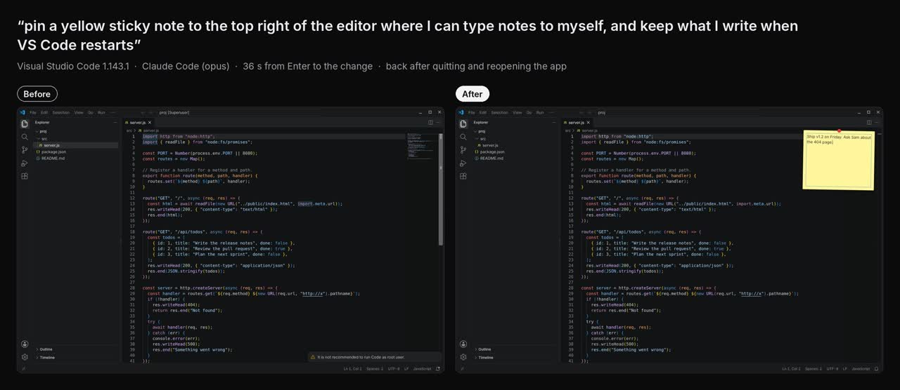](vscode-sticky-note.jpg) | “pin a yellow sticky note to the top right of the editor where I can type notes to myself, and keep what I write when VS Code restarts” | VS Code | Opus | 36 s | Yes | (desktop app) |
| [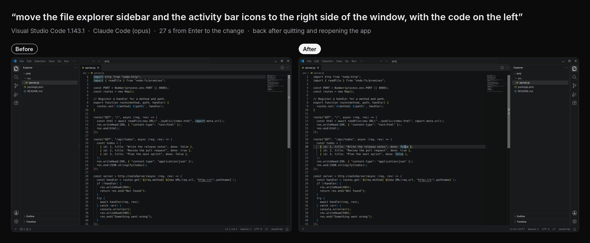](vscode-sidebar-right.jpg) | “move the file explorer sidebar and the activity bar icons to the right side of the window, with the code on the left” | VS Code | Opus | 27 s | Yes | (desktop app) |
| [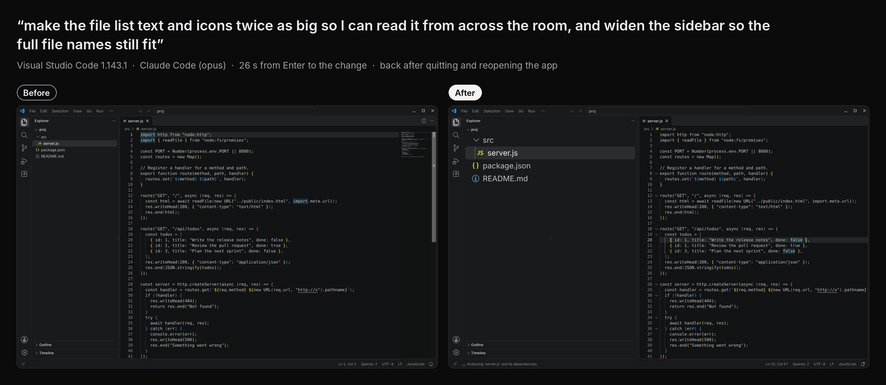](vscode-big-file-list.jpg) | “make the file list text and icons twice as big so I can read it from across the room, and widen the sidebar so the full file names still fit” | VS Code | Opus | 26 s | Yes | (desktop app) |
| [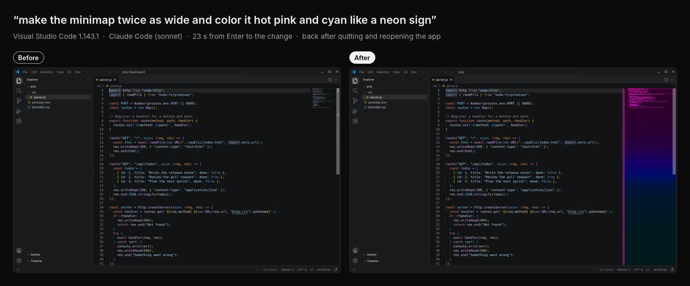](vscode-neon-minimap.jpg) | “make the minimap twice as wide and color it hot pink and cyan like a neon sign” (pointing at the minimap) | VS Code | Sonnet | 23 s | Yes | (desktop app) |
| [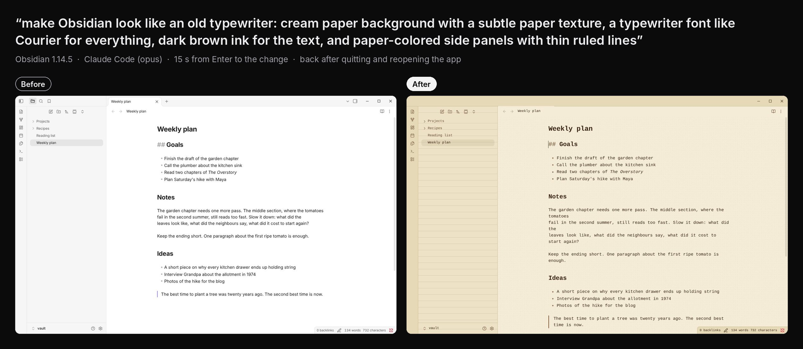](obsidian-typewriter.jpg) | “make Obsidian look like an old typewriter: cream paper background with a subtle paper texture, a typewriter font like Courier for everything, dark brown ink for the text, and paper-colored side panels with thin ruled lines” | Obsidian | Opus | 15 s | Yes | (desktop app) |
| [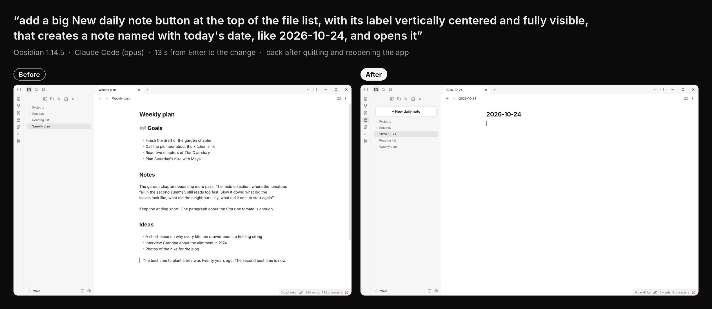](obsidian-daily-note-button.jpg) | “add a big New daily note button at the top of the file list, with its label vertically centered and fully visible, that creates a note named with today's date, like 2026-10-24, and opens it” | Obsidian | Opus | 13 s | Yes | (desktop app) |
| [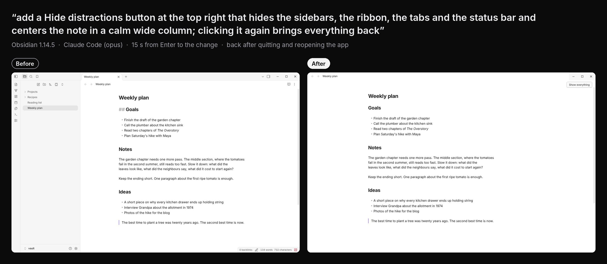](obsidian-hide-distractions.jpg) | “add a Hide distractions button at the top right that hides the sidebars, the ribbon, the tabs and the status bar and centers the note in a calm wide column; clicking it again brings everything back” | Obsidian | Opus | 15 s | Yes | (desktop app) |
| [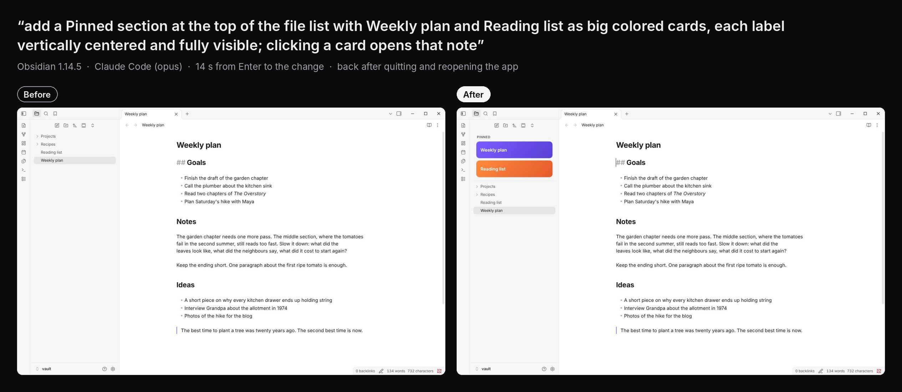](obsidian-pinned-notes.jpg) | “add a Pinned section at the top of the file list with Weekly plan and Reading list as big colored cards, each label vertically centered and fully visible; clicking a card opens that note” | Obsidian | Opus | 14 s | Yes | (desktop app) |
| [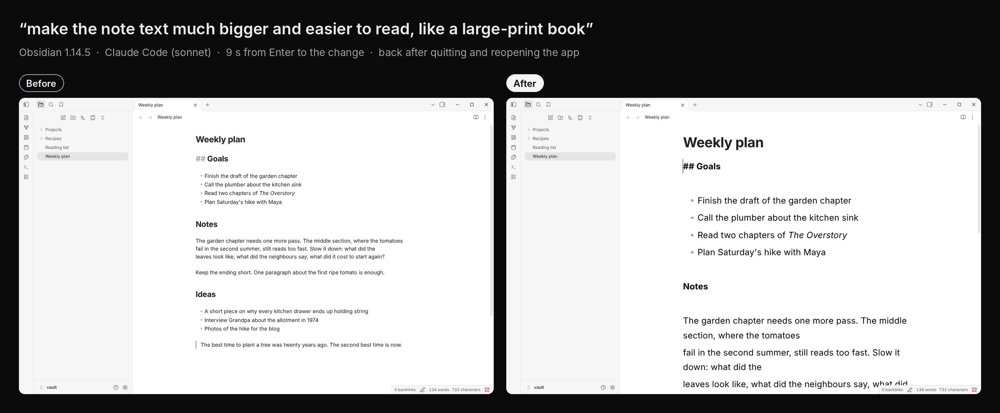](obsidian-large-print.jpg) | “make the note text much bigger and easier to read, like a large-print book” (pointing at the note) | Obsidian | Sonnet | 9 s | Yes | (desktop app) |
| [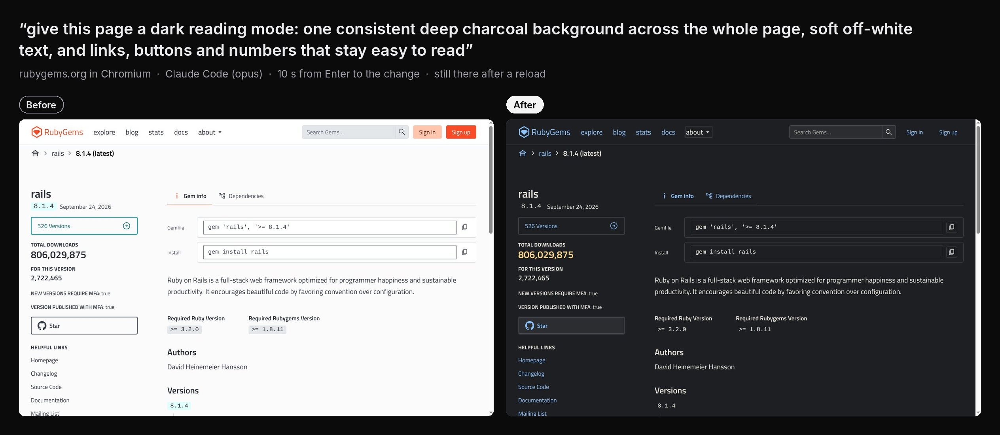](web-rubygems-dark-mode.jpg) | “give this page a dark reading mode: one consistent deep charcoal background across the whole page, soft off-white text, and links, buttons and numbers that stay easy to read” | rubygems.org | Opus | 10 s | Yes, after a reload | No: a new look only |
| [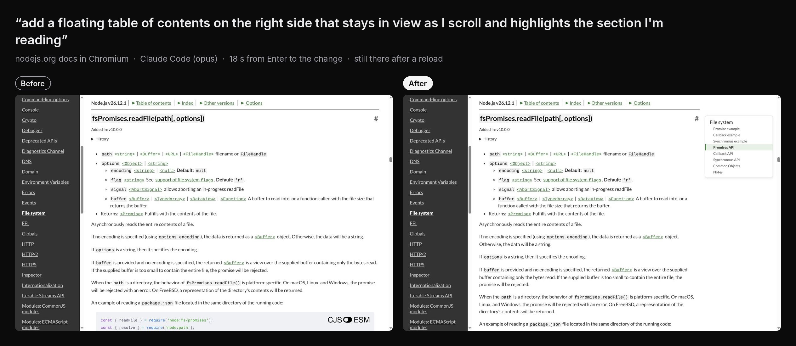](web-nodejs-floating-toc.jpg) | “add a floating table of contents on the right side that stays in view as I scroll and highlights the section I'm reading” | nodejs.org docs | Opus | 18 s | Yes, after a reload | Yes: it follows your scrolling |
| [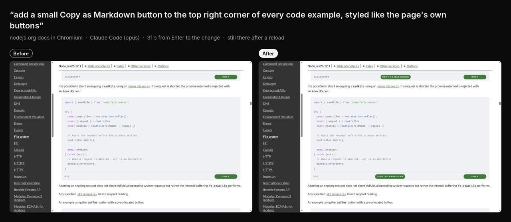](web-nodejs-copy-as-markdown.jpg) | “add a small Copy as Markdown button to the top right corner of every code example, styled like the page's own buttons” | nodejs.org docs | Opus | 31 s | Yes, after a reload | Yes: new buttons |
| [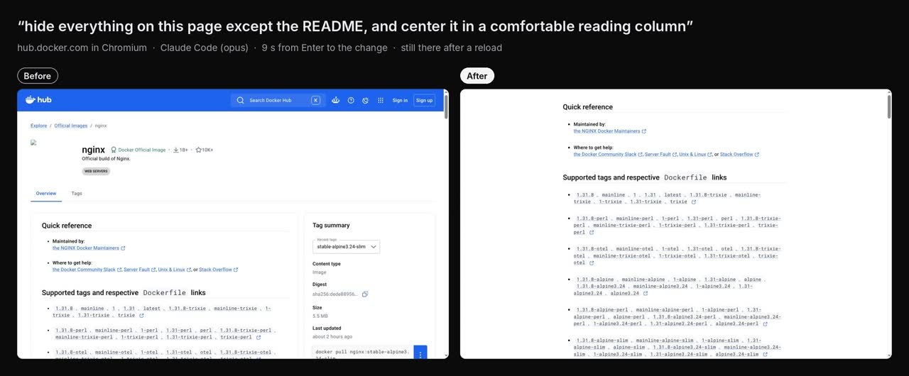](web-dockerhub-readme-only.jpg) | “hide everything on this page except the README, and center it in a comfortable reading column” | hub.docker.com | Opus | 9 s | Yes, after a reload | Partly: the look works without it; a small part of it is code |

All eighteen are real runs on real software. None is a demo.

## What the pictures don't show

- **Asked again with other words** (the first result looked cheap or
  broken): the Windows 95 look (several times: earlier tries hid the file
  names, turned every icon into a box, or froze VS Code with code that recolored
  the syntax; "using only CSS" and "keep VS Code's own icons" fixed those), presentation mode (the first left
  an empty column where the sidebar was), the big file list (the first cut the
  names to "se…"), the New daily note button and the pinned cards (the first
  cut off the bottom of their labels), and the rubygems dark mode (the first
  had a darker stripe down the page).
- **Still not perfect:** in the Windows 95 look, the folder row, the active tab
  label and the section headers are dark text on a dark bar. In large print,
  the "Goals" heading came out about as big as the text under it. In Hide
  distractions, the note sits left of center.
- **The sticky note's text** was typed after VS Code was opened again, to show
  it works. That it keeps the text across a restart wasn't pictured.
- **The rubygems star count** didn't load on that reload. The change doesn't
  hide it.
- **Copy as Markdown** worked on two runs and failed on two later ones with
  “The change didn't run on this page”: the code reached Chrome, but no result
  came back. The pictures are from a run that worked.
- **VS Code's own warning** (“It is not recommended to run Code as root user”)
  was closed before the "after" picture, as you would. It shows because the
  test machine runs everything as root.

## What this turned up

- **Morse was stopping VS Code's own code** while VS Code started up, which
  left it half drawn: no file names, no syntax colors, sometimes a blank
  window. Morse took a page that didn't answer for 6 seconds, after a mod's
  code had run, as frozen by that mod. VS Code starting on a busy machine is
  that slow by itself (measured: up to 8 seconds at a time). Now, with no mod
  code being run, Morse waits 20 seconds. Fixed in `daemon/guard.js`, with a
  test in `tests/guard-ui.test.js`.
- **The word "everywhere" turned a request into Your style.** “…black text
  everywhere so the file list stays readable” was taken as a style for every
  site and app, not a change to VS Code. Now a bare "everywhere" counts only
  when the request names no app and no part of one. Fixed in `core/style.js`,
  with tests in `tests/style.test.js`.
- **Spotify couldn't be tried.** Its download servers aren't reachable from
  the test machine, and it needs an account.

## Run it yourself

```bash
# a VS Code change, pictures in /tmp/shots
MORSE_PROVIDER=claude-code MORSE_MODEL=opus node demo/try-real-app.js \
  --app code --window 'workbench\.html' \
  --ask 'add a Focus button to the title bar that hides the sidebar, activity bar, tabs, minimap and status bar so only the code is left; clicking it again brings them back' \
  --then-prekeys Escape --then-click 'text=/^focus$/i' \
  --shots /tmp/shots --name vscode-focus -- --no-sandbox --user-data-dir=/tmp/code-profile /path/to/project

# a website change (see demo/real-sites.json for the format)
node scripts/build.js
SHOTS=/tmp/shots MORSE_PROVIDER=claude-code MORSE_MODEL=opus node demo/try-real-sites.js sites.json
```
