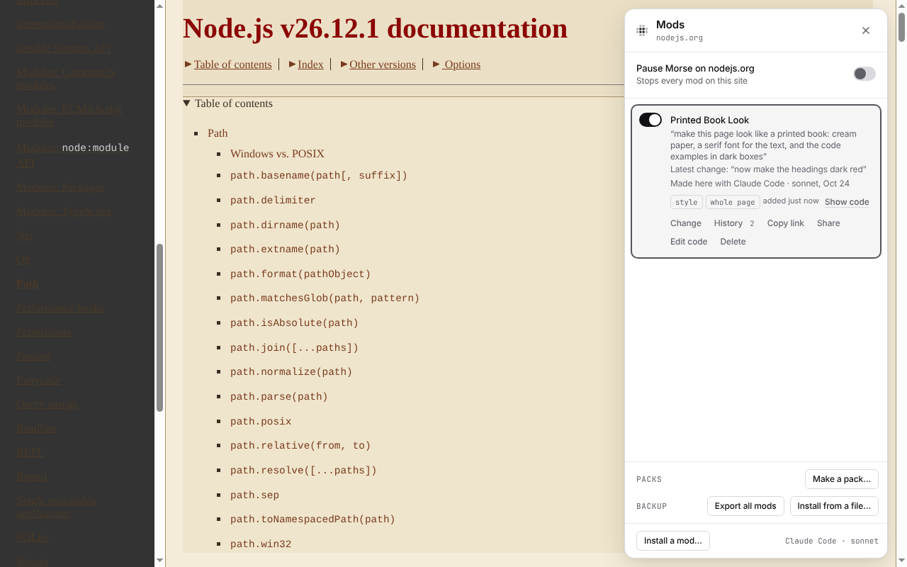

# Your controls

Mods run inside apps you're signed into, so you decide what runs and when.
Nothing on this page deletes a mod.

## The off switch

Press **⌥⇧0** (Alt+Shift+0) to take every mod off the page at once. They stay
off in that tab, even after a reload. Press it again, or click **Turn back
on**, to bring them back. You can change the key in Settings, under
Shortcuts.

**Turn off all mods here** in Page tools does the same from the bar.

## Pause Morse

- **On one site**: click “Pause Morse on pypi.org” in the Mods panel, or in
  the Morse popup (Chrome's toolbar button).
- **Everywhere**: click “Pause everywhere” in the popup. The toolbar button
  then says *off*.
- **In a terminal**: `morse pause` stops every mod everywhere.
  `morse pause pypi.org` or `morse pause obsidian` stops them on one site or
  app. `morse resume` starts them again.

Paused mods stay saved. Every open tab and window follows at once.

## Safe start

Sometimes a page closes, crashes or reloads a few seconds after a mod runs.
If that happens three times in a row, Morse holds the mod back next time and
asks: **Keep it off** or **Turn it back on**.

## Mods can't freeze or slow down a page

Morse watches every mod while it runs. It pauses a mod, turns it off and
keeps it off on the next visit when the mod:

- keeps the page busy most of the time
- keeps running again every time the page changes
- adds too much to the page
- would hide everything on the page
- has code that never stops running

Its row in the Mods panel says why: *Paused because it was slowing this page
down*, *Paused because it froze this page*, *Paused because it hid this
page*. **Turn back on** runs it again, with the same limits. **Fix it** tells
the model what went wrong and asks for a version that works. A change you
haven't saved yet is stopped the same way, and the bar says “Try describing
it another way”.

Before anything runs, Morse also blocks code that would clearly break the
page, like hiding the whole page or reloading it when you didn't ask. Then
the model gets one more try.

When a page freezes anyway:

- **In a desktop app**, Morse notices within a few seconds. It stops the
  mod, turns it off and reloads the page.
- **In Chrome**, Morse never starts a saved mod with a loop that can't end.
  If a mod hasn't finished 4 seconds after it starts, Morse turns it off, so
  the next visit is clean. If a page freezes later, Chrome's own *Page
  unresponsive* message lets you close it. Safe start then holds the mod back
  next time.

## Before you install

A mod someone shared with you never installs by itself. Morse first tells
you what it does and shows its code. It warns you clearly if the mod sends
data to another website or reads what you type. See
[Mods](mods.md#install-a-shared-mod).

## Backups

At the bottom of the Mods panel:

- **Export all mods** saves every mod to one file.
- **Install from a file…** brings them back, on this computer or another one.

In a terminal, run `morse export --all` to save, and add `--out <file>` to
choose where. Run `morse install <backup file>` to bring them back.

## Where mods live

- In Chrome, in the Morse extension's own storage.
- For desktop apps, in `~/.morse/mods`, in a folder for each app. A mod made
  in Obsidian only ever runs in Obsidian.

To see what leaves your computer, and what a mod can do, read
[Privacy and safety](privacy-and-safety.md).
