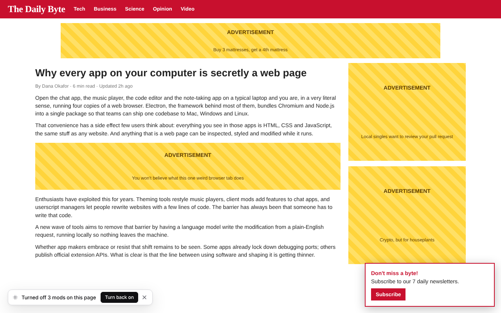
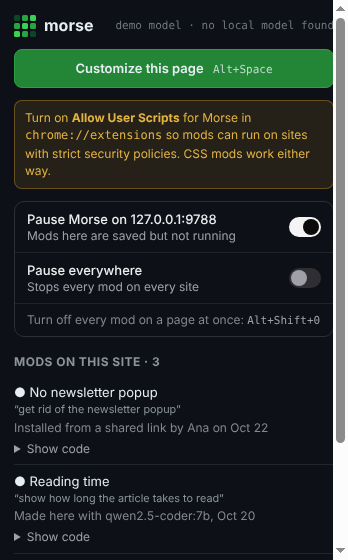
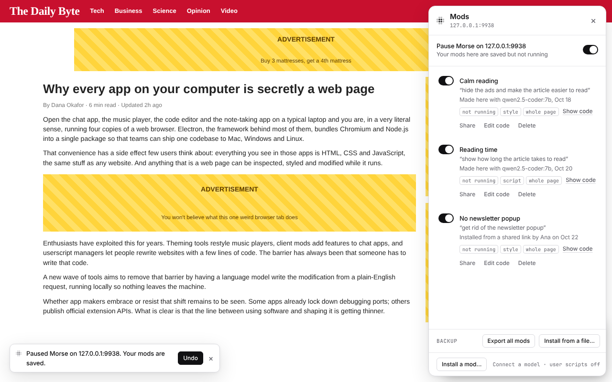

# Your controls

Mods run inside apps you're signed into, so you decide what runs and when.
None of these delete anything.

| | |
|---|---|
|  **⌥⇧0** turns every mod on the page off at once; the message turns them back on |  Pause from Chrome's toolbar button, on one site or everywhere |

## The off switch

Press **⌥⇧0** (Alt+Shift+0) to take every mod off the page at once. They stay
off in that tab, even when you reload, until you press it again or click
**Turn back on**. Change the key in Settings, under Shortcuts.

**Turn off all mods here** in Page tools does the same from the bar.

## Pause Morse

- **On one site**: “Pause Morse on youtube.com” in the Mods panel or in the
  Morse popup (Chrome's toolbar button).
- **Everywhere**: “Pause everywhere” in the popup. The toolbar button then
  says *off*.
- **In a terminal**: `morse pause` stops every mod everywhere,
  `morse pause youtube.com` or `morse pause slack` stops them on one site or
  app, and `morse resume` starts them again.

Paused mods stay saved. Every open tab and window follows at once.

## Safe start

If a page closes, crashes or reloads within seconds after a mod ran, three
times in a row, Morse holds that mod back the next time and asks: **Keep it
off** or **Turn it back on**.

## Mods can't freeze or slow down a page

Morse watches every mod while it runs. A mod is paused, turned off and kept
off on the next visit, when it:

- keeps the page busy most of the time
- keeps running again every time the page changes
- adds too much to the page
- would hide everything on the page
- has code that never stops running

Its row in the Mods panel says why, in plain words: *Paused because it was
slowing this page down*, *Paused because it froze this page*, *Paused because
it hid this page*. **Turn back on** runs it again (under the same limits), and
**Fix it** asks the model for a version that doesn't, telling it what went
wrong. A change you haven't saved yet is stopped the same way, and the bar
says “Try describing it another way”.

Before anything runs, Morse also refuses code that would obviously break the
page, like hiding the whole page or reloading it when you didn't ask, and
gives the model one more try.

When a page freezes anyway:

- **In a desktop app**, Morse notices within a few seconds, stops the mod,
  turns it off and reloads the page.
- **In Chrome**, a saved mod with a loop that has no way out is never started, and a
  mod that hasn't finished within 4 seconds of starting is turned off so the
  next visit is clean. If a page freezes later, Chrome's own *Page
  unresponsive* message lets you close it, and Safe start holds the mod back
  next time.

## Before you install

A mod someone shared with you never installs by itself. Morse first says in
plain words what it does, with a clear note when it sends data to another
website or reads what you type, and shows its code. See
[Mods](mods.md#install-a-shared-mod).

## Backups

At the bottom of the Mods panel:

- **Export all mods** saves every mod to one file.
- **Install from a file…** brings them back, on this computer or another one.

In a terminal: `morse export --all` (add `--out <file>` to choose where) and
`morse install <backup file>`.

## Where mods live

- In Chrome, in the Morse extension's own storage.
- For desktop apps, in `~/.morse/mods`, filed under each app. A mod made in
  Slack is only ever loaded in Slack.

To see what leaves your computer, and what a mod can do, read
[Privacy and safety](privacy-and-safety.md).
