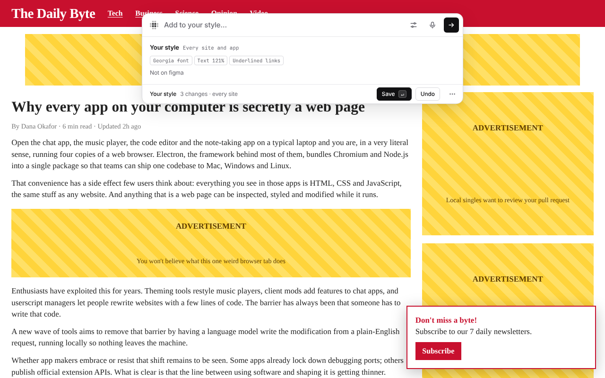
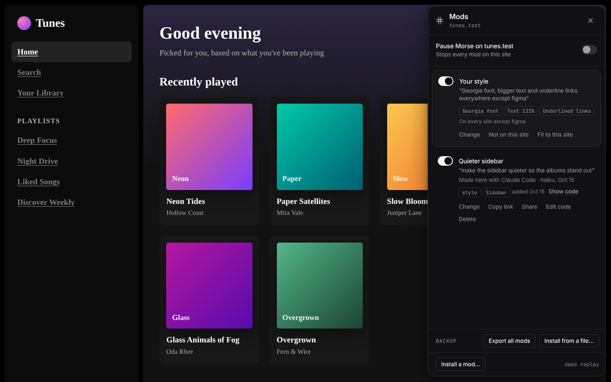
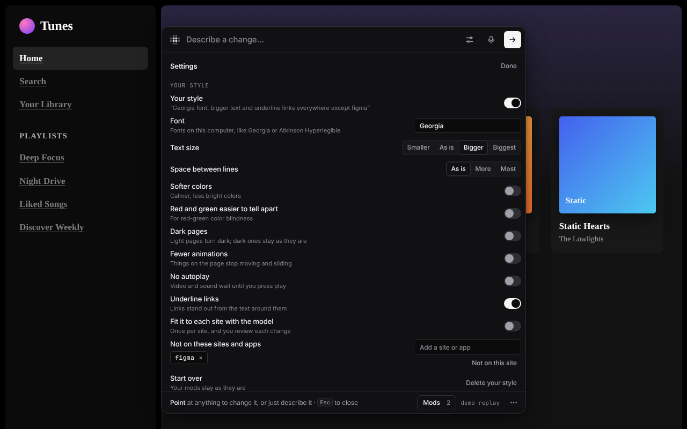
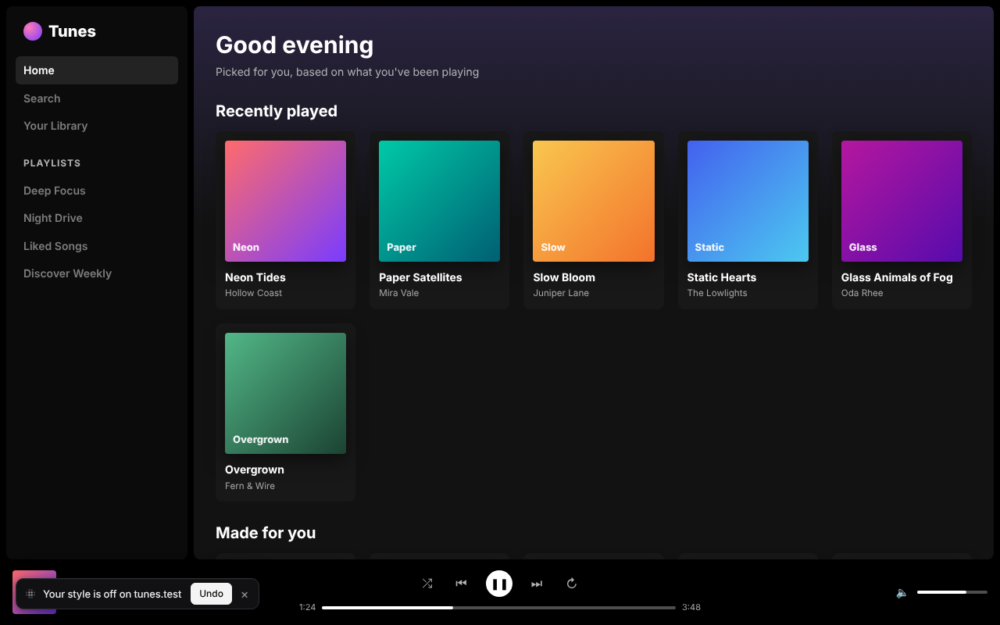
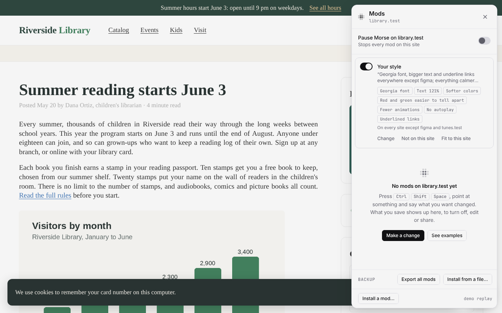
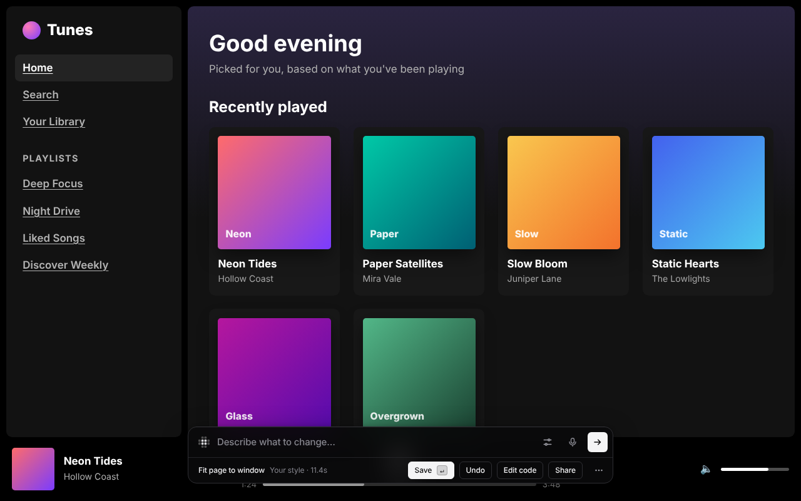

# Your style

Your style is one look for every site and app. Say it once, and end with
“everywhere” or “on every site”. For example: *Georgia font, bigger text and
underline links everywhere except Figma*.

Morse shows it right away on the page you're on, with Save and Undo. After
you save it, every site and app you open has it from the start. Say more
later, and Morse adds it to your style. You can also set each part under
**Your style** in Settings.

- **No model for the basics.** Morse makes these itself: a font, text size,
  space between lines, softer colors, red and green that are easier to tell
  apart, dark pages, fewer animations, no autoplay and underlined links. They
  are the same as in Easier to use and Page tools. They add almost no time
  when a page loads. Only no autoplay and dark pages add a little code.
- **Leave a site out.** Say “not on this site” in the bar, or click **Not on
  this site** in the Mods panel. You can also keep a list in Settings.
  “except Figma” in your words leaves out figma.com and the Figma app.
- **One style in Chrome and your apps.** When Chrome is paired with the Morse
  helper (Morse Desktop or `morse serve`), they share your style. Set it in
  Chrome and your desktop apps get it too, and the other way round. If both
  changed, the newer one wins. When Chrome isn't paired, Chrome and your apps
  each keep their own style. Morse tells you which one you saved to (“every
  site in Chrome”, or “every app you open with Morse”).
- **You stay in charge.** Your style sits at the top of the Mods panel with
  its own switch. The off switch and pausing Morse turn it off, like any mod.
  Morse never marks it as broken.
- **Fit to each site.** This is off until you turn it on. A style for every
  site can break the layout of one. Turn on **Fit it to each site with the
  model**. Then, the first time you open a site, the model sees your style
  and what it broke there. Its fix shows in the bar, and you Save or Undo it
  like any change. This happens once per site.

## How it was tested

Real Claude Code (haiku) ran [`demo/style-fit-real.js`](../demo/style-fit-real.js).
On the Tunes demo, bigger text pushed the player bar below the window. The
fit took one try (11 to 18 seconds) and brought the bar back. On the next
visit it was still there, with no model call. The pictures come from
[`demo/shoot-style.js`](../demo/shoot-style.js), on three demo sites. Tests:
[`tests/style.test.js`](../tests/style.test.js),
[`tests/style-ui.test.js`](../tests/style-ui.test.js) and, for Chrome and the
apps sharing one style, [`tests/style-share.test.js`](../tests/style-share.test.js).
The code is in [`core/style.js`](../core/style.js),
[`core/style-host.js`](../core/style-host.js) and
[`core/style-sync.js`](../core/style-sync.js).

| | |
|---|---|
|  **“…everywhere”**, shown at once with Save and Undo |  **The Mods panel**: Your style at the top |
|  **Settings**: each part, and the sites it skips |  **Not on this site**, with Undo |
|  **Calmer** on the library: the video waits, the ticker stops |  **Fit to this site** by Claude Code (haiku): the player bar is back |
