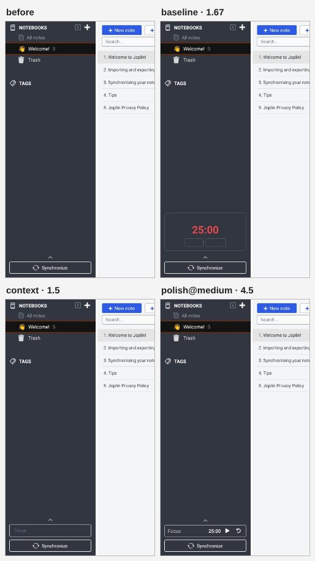
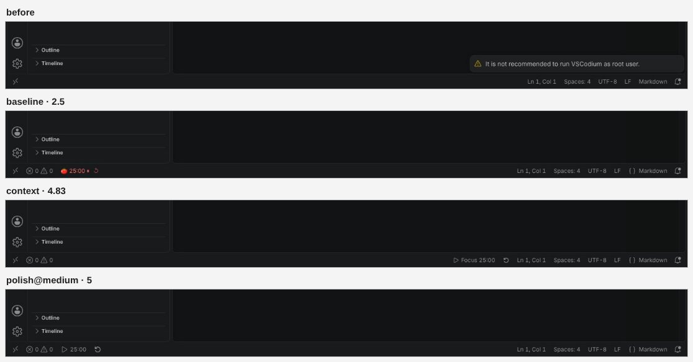
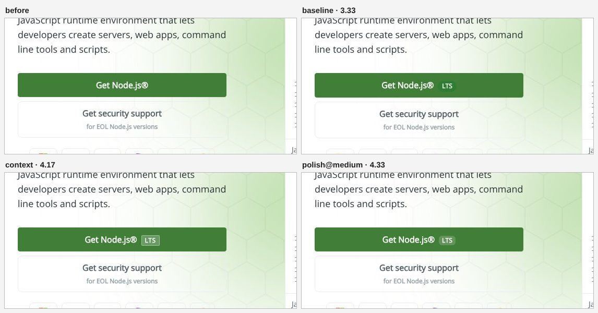
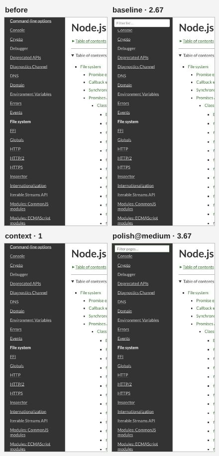
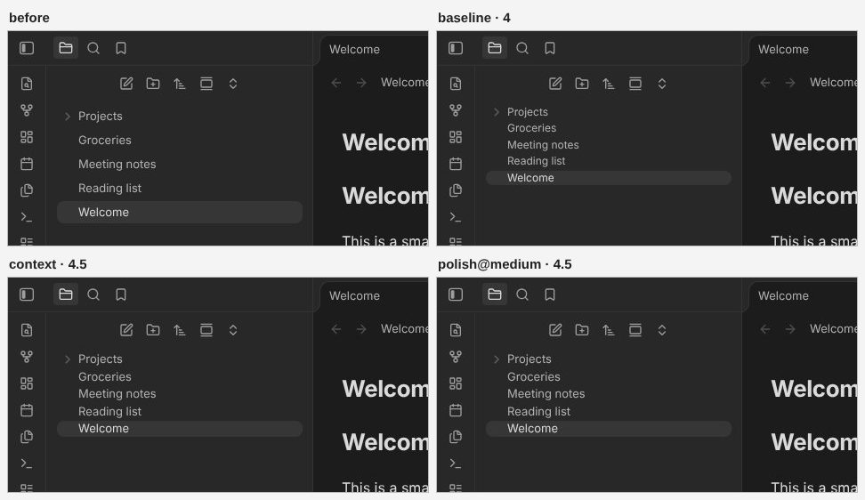
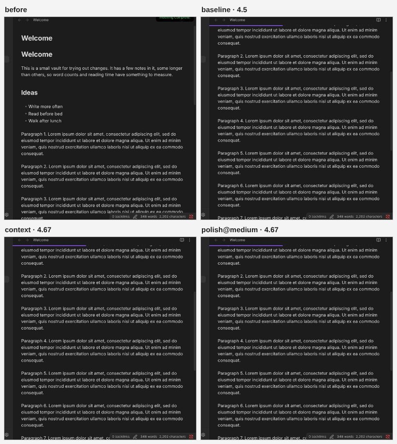
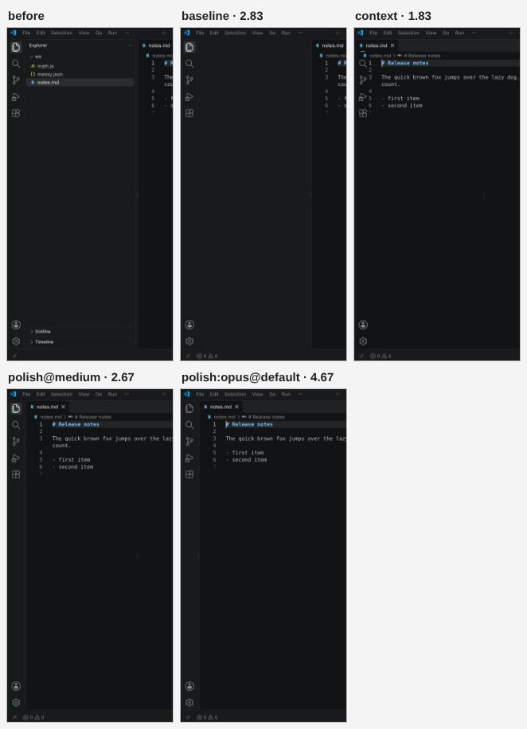

# Design fit eval

Does a new feature or a restyle look like it shipped with the app it was added to, and does it work? The main evals ([`../README.md`](../README.md)) check that a change works on demo apps. This one checks how it looks, on real apps: VSCodium, Microsoft VS Code, Obsidian and Joplin, started fresh for every run, and real sites (nodejs.org), recorded once and replayed so every version sees the same page.

```bash
node evals/design/run.js --baseline <checkout of the code before>        # 23 cases, three arms, Opus judge
node evals/design/run.js --only vsc-pomodoro --arms context,polish --judge none
node evals/design/run.js --arms polish@low,polish@medium --judge none   # an effort per arm ("default": the CLI's own)
node evals/design/run.js --only code-hover-sidebar --arms polish:opus@default
node evals/design/run.js --judge-only a.json,b.json --rename polish=polish@default   # judge saved runs together
node evals/design/compare.js results/<file>.json jop-pomodoro --arms baseline,context,polish@medium   # pictures for this page
```

Needs `claude` signed in, Playwright, an X display (`DISPLAY`, default `:99`), `/usr/share/codium`, `/usr/share/code`, and the Obsidian and Joplin AppImages (`~/Applications/Obsidian-*.AppImage`, `~/.joplin/Joplin.AppImage`; unpacked once into `--cache`). Pictures go to `--cache/runs/<time>/`, results to [`results/`](results/).

## The arms

| Arm | What it is |
|---|---|
| **baseline** | The code before this work (commit 61afab7): its context builder, prompt, engine and kit |
| **context** | This branch without the polish round: the design context ([`runtime/src/20-context.js`](../../runtime/src/20-context.js) `designOf`, marked `// design`) and the prompt's Design rules ([`core/prompt.js`](../../core/prompt.js)) |
| **polish** | This branch with **Polish changes** on ([`core/polish.js`](../../core/polish.js)): after a change that adds or restyles something, the model sees a picture of it in the app and fixes it once if needed |

`@low`, `@medium`, `@default` set Claude Code's `--effort` (`default`: no flag); `:opus` another model. Every arm here is Claude Code `sonnet` unless named.

## How a case runs

1. Start the app with a fresh profile and `--remote-debugging-port` (VS Code builds: the Electron binary itself with a short profile path, because VS Code puts a socket there and the CLI wrapper exits; Obsidian: a vault of five notes; Joplin: a copy of a profile made on first start), connect with Playwright over CDP, close the notifications. Sites: Chromium at 1280×800, replaying a HAR recorded on the first run.
2. Read the context with the arm's own `20-context.js`, in an isolated world of its own, as the runtime does (VS Code refuses HTML strings in the page's world; the runtime's Trusted Types shim runs in Morse's world).
3. Run the arm's `runMorse` like the hosts: CSS in a style tag, JS through the helper kit in the page's world, the effect probe, and for **polish** the picture: the changed area (`shotArea`: what was pointed at plus what the mod made, with some of the app around it), as a JPEG clip.
4. Take pictures of the whole window before and after. Then switch the app to its other theme where the eval can (VS Code: `workbench.colorTheme` in settings.json, which it applies live; Obsidian: `theme-dark`/`theme-light` on the body; nodejs.org: its `data-theme` / `dark-mode` switch; Joplin: not switched) and take one more. A case with `scroll` (a progress bar) is pictured half way down.
5. Run the case's functional check ([`cases.json`](cases.json), with `T` from [`../page-helpers.js`](../page-helpers.js) and `D` from [`checks.js`](checks.js)): a timer that counts once clicked, a count within range, rows smaller with no gaps or overlaps, the clipboard, a note that survives the mod starting again (`morse.store`), a filter that filters.
6. When all arms are done, the judge scores the case: one call per case, all versions together.

## The judge

Opus through `claude -p` (its own effort), with the pictures cropped to one area for all versions (the union of what each version changed), in this order: before; then for each version, after and after in the other theme. The versions are shuffled per case (the same order every time) under neutral letters, and each version's CSS and JS go along. The prompt ([`judge.js`](judge.js)):

> You are a senior product designer reviewing changes made to a real app by a tool that edits apps with CSS and JavaScript. For one request, you see the app before the change and after each version of the change (labeled with letters, in no particular order), and the code of each version.
>
> Score each version from 1 to 5 on each item, judging only what you can see and what the code implies:
> - native: Native look: colors and theme variables. Uses the app's own palette (its CSS variables or exact colors), not foreign colors.
> - typography: Typography match: font family, size, weight and line height match the app's own text of the same role.
> - spacing: Spacing and alignment: padding, height, gaps and alignment match the neighbors; sits on the app's grid; nothing cramped or floating.
> - theme: Dark/light correctness: readable and consistent in the current theme, and (where shown, or as the code suggests) it follows the other theme too: no hard-coded colors that break it.
> - polish: Polish: looks finished and deliberate: hover/focus states, icons from the app's icon set (not emoji unless the app uses emoji), sensible empty states and labels.
> - bugs: No visual bugs: nothing overlapping, clipped, misaligned, broken or covering the app's content; the rest of the app is not disturbed. 5 means none at all.
>
> Scale: 5 = indistinguishable from something the app's own designers shipped; 4 = native with a small slip; 3 = acceptable but visibly added on; 2 = clearly foreign or sloppy; 1 = broken, or no visible change at all.
> A version that made no visible change gets 1 on every item. Be strict and consistent across versions: compare them with each other and with the app itself. Ignore whether the feature works when clicked (that is tested separately); judge how it looks and fits.
>
> Reply with only JSON, no prose before or after: `{"A": {"native": n, "typography": n, "spacing": n, "theme": n, "polish": n, "bugs": n, "note": "<one short sentence>"}, "B": {...}, ...}`

The polish round's own question to the model ([`core/polish.js`](../../core/polish.js) `POLISH_ASK`), sent with the picture after the request, the page and the model's draft:

> This picture shows your change applied in the app, with what is around it. Does it look like it shipped with the app: its colors and variables, fonts and sizes, spacing and alignment, icons, light/dark mode? Is anything broken (overlapping, clipped or misaligned, unreadable, out of place)?
> If it looks native and nothing is broken, reply with only: OK
> Otherwise list each concrete problem on its own FIX: line, then reply with the complete new version (all of its CSS and JS) in the same format. Fix how it looks; keep what it does.

## Cases

23 requests: VSCodium 5 (a pomodoro timer and a word count in the status bar, a copy-the-file button in the editor toolbar, a more compact explorer, a notes box that keeps what you write), VS Code 4 (a clock, a button that hides and shows the sidebar, smaller tabs, and "hide the sidebar until I hover the left edge", which dogfooding found broken), Obsidian 5 (a pomodoro timer, reading time, a compact file list, a random-note button in the ribbon, a reading progress bar), Joplin 4 (a word count, a pomodoro timer above Synchronize, a compact note list, a copy-title button), nodejs.org 5 (a progress bar, back to top, a filter box for the docs' sidebar, an LTS badge, a row of quick links).

## Results

Claude Code `sonnet`, one run per case and arm, all arms judged together by Opus ([`results/2026-10-24T21-45-41-judged-all.json`](results/2026-10-24T21-45-41-judged-all.json)). Scores are the mean over cases, 1 to 5; **works** is the functional check.

| Arm | Works | Native | Typography | Spacing | Dark/light | Polish | No bugs | **Mean** | Time, median / p90 | Polish rounds (fixed), median time |
|---|---|---|---|---|---|---|---|---|---|---|
| baseline | 20/23 | 3.52 | 4.00 | 3.74 | 3.96 | 3.17 | 4.04 | **3.74** | 9.7 s / 16.4 s | - |
| context (design context + rules) | 21/23 | 4.22 | 4.26 | 3.78 | 4.30 | 3.57 | 4.00 | **4.02** | 11.2 s / 15.7 s | - |
| polish, Claude Code's own effort | 20/23 | 4.52 | 4.48 | 4.17 | 4.43 | 4.00 | 4.30 | **4.32** | 17.8 s / 34.5 s | 22 (4), 7.3 s |
| polish, `--effort low` | 20/23 | 4.35 | 4.48 | 3.96 | 4.43 | 3.70 | 4.22 | **4.19** | 14.4 s / 17.4 s | 21 (1), 4.9 s |
| **polish, `--effort medium`** | **23/23** | 4.48 | 4.52 | 4.26 | 4.48 | 4.17 | 4.43 | **4.39** | 16.1 s / 27.2 s | 22 (3), 5.7 s |
| opus, own effort, polish (the hover case only) | 0/1 | 5 | 5 | 5 | 5 | 4 | 4 | **4.67** | 35.7 s | 1 (0), 7.9 s |

What this says:
- **The design context and rules** raised the native-look score the most (3.52 → 4.22) and dark/light (3.96 → 4.30): the drafts use the app's variables, classes and icons (VS Code's `statusbar-item` and codicons, Obsidian's `--status-bar-text-color` and lucide icons, Joplin's `--joplin-*` and Font Awesome) instead of tomato emoji and fixed reds.
- **The polish round** lifted every item again (4.02 → 4.32 to 4.39), most of all polish and spacing. It answered OK on most cases and fixed 1 to 4 per arm; where it fixed, the jumps are large (Joplin's pomodoro timer 1.5 → 3.8 to 4.5, invisible dark-on-dark text; the docs' filter box 1 → 3.8; Joplin's copy-title icon). Part of the difference between arms that both said OK on a case is a different draft, not the round: one run per case, so read differences under about 0.2 as noise.
- **Effort, for Sonnet (the fast tier)**: medium scored highest and was the only arm where every feature worked; low was the fastest but lost on both (4.19, 20/23: a copy button that copied only the first line, tabs whose labels were cut off, the sidebar button; and Joplin's timer drawn dark on the dark sidebar until the polish round caught it). Medium was also faster than Claude Code's own effort. **Medium is now the default** for Claude Code (`daemon/harness.js` `effortOf`); the strong tier keeps the CLI's own effort.
- **Time**: the polish round takes 5 to 7 s at the median (the picture itself 0.3 to 0.5 s), on the changes that add or restyle something; hiding things and small tweaks skip it. The machine was heavily loaded (load 30 to 45), so absolute times are high; the arms ran interleaved.
- **"Hide the sidebar until I hover the left edge" (VS Code)** stays hard. Every Sonnet version broke the layout somewhere: the baseline left a blank gap where the sidebar was, the context arm slid the editor under the activity bar; the polish round saw the overlap and named it ("the editor was stretched to the window's left edge and sits under the activity bar"), and at medium effort the result works but still scores 2.67. Opus made the cleanest one (4.67), but it doesn't hide the sidebar again when the mouse leaves.

Failures (functional): VS Code's sidebar button (4 of 5 arms: clicking the title bar's own toggle from a script didn't toggle it here); the hover sidebar (polish at the CLI's own effort, and Opus: it doesn't hide again); smaller tabs with clipped labels (2 arms); Obsidian's random note (baseline: no button); the docs' filter box (context: no field in the sidebar); the copy button (baseline: faked Ctrl+A/Ctrl+C key presses, which the prompt now warns about; low: copied only the first line).

### Before and after

The same part of the app before the change and after each arm (judge's mean in the label).

Joplin, "add a pomodoro timer at the bottom of the sidebar, above Synchronize": the baseline's foreign card with a red timer and empty buttons, the context arm's dark-on-dark box, the polished row with Font Awesome icons.


VSCodium, "add a pomodoro timer to the status bar": a tomato emoji in red and a unicode reset glyph (baseline), then status bar items with codicons and the theme's colors.


nodejs.org, "add a small badge next to the Get Node.js button that says it's the LTS version".


nodejs.org docs, "add a box at the top of this list that filters it as I type": no field in the sidebar from the context arm; polished, it sits in the sidebar with its padding.


Obsidian, "make the file list more compact" and "add a reading progress bar at the top of the note".



VS Code, "hide the sidebar until I hover the left edge": a blank gap (baseline), the editor under the activity bar (context), and the Sonnet and Opus versions with polish.


## The main evals

The existing evals on a subset of 44 cases (features, layout, looks, dark mode, and the hashed-class, shadow DOM, re-rendering and virtualized-list apps), Sonnet at low effort, 2 at a time:

| | Passed | Total time, median / p90 | Prompt, median |
|---|---|---|---|
| Before (61afab7) | 43/44 (r-confirm) | 3.7 s / 6.7 s | 6,958 chars |
| This branch, Polish changes on | **44/44** | 9.5 s / 19.1 s | 8,824 chars |

The polish round ran on 17 of the 44 (16 OK, 1 fixed), 5.3 s at the median (p90 13.7 s). The rest of the time difference is the machine: this branch's run overlapped the design eval (load 40 to 45; starting `claude` took 1.8 s at the median against 0.3 s), so the times aren't comparable beyond the polish round itself. The design context adds about 1,900 characters to the prompt and 20 to 300 ms to reading the page (VS Code, with 3,300 variables and 12,000 CSS rules, is the slow end).
